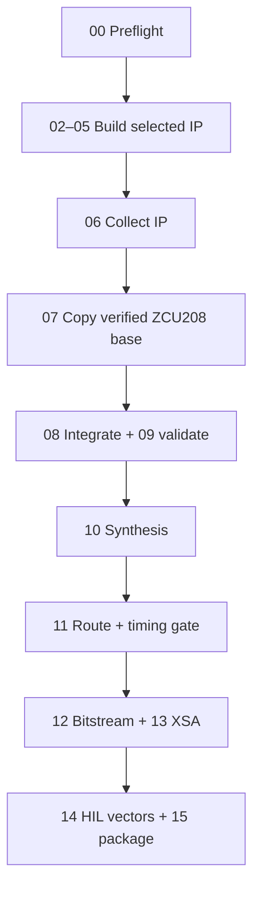

# Restartable build stages



`make` defaults to `make help`. Every numbered target owns one result stamp in
`build/.stamps` and one complete console log in `build/logs`. A stamp is written
only after the command exits successfully. The individual targets deliberately
do not depend on all earlier targets: running `make step10_synth` runs synthesis
only and reports a clear error if its project prerequisite is absent.

Cleaning steps 08–13 preserves the copied Vivado project and removes only that
stage's checkpoint/reports/output. The integration Tcl replaces its generated
`/doa_v7` hierarchy on rerun. Only cleaning step07 deliberately removes the
isolated project copy.

## Command patterns

| Need | Command |
|---|---|
| Show stages | `make help` or `make list` |
| Inspect checkpoints | `make status` |
| Run one stage | `make step03_hls_spectrum` |
| Preview without writes | `make -n step03_hls_spectrum` |
| Force rerun | `make rebuild STEP=step03_hls_spectrum` |
| Remove one stage product | `make clean-stage STEP=step03_hls_spectrum` |
| Resume the production sequence | `make pipeline` |
| Remove generated build products | `make clean-build` |

## Stage reference

### `step00_preflight`

Checks `make`, Git, Python 3, Vitis HLS, Vivado, MATLAB, the XCZU48DR part
and pinned ZCU208 board part, base-project path, and selected channelizer.
The Vivado/Vitis version lock is hard: `EXPECTED_VIVADO_VERSION` defaults to
**2023.2** in `config.mk`, both tools must match it, and the stage finishes
by running `common/vivado/00_check_ip_catalog.tcl`, which proves every AMD
catalog VLNV in `config/ip_versions.tcl` against the installed Vivado and
writes `build/output/ip_catalog_lock.txt` (`SKIP_IP_CATALOG_CHECK=1` is for
tool-presence smoke tests only).

### `step01_fetch_references`

Fetches only the selected set from `config/upstream_repositories.tsv`. Every
ref there is a **pinned full commit SHA** (branch names float and would
invalidate the VLNV audit). Clones are resumable, retries are bounded, and
each checked-out commit is printed. The production base is fetched with
`FETCH_SET=RFSoC-MTS`; see `V03_MTS_BASE_2023P2.md`.

```bash
make step01_fetch_references FETCH_SET=native
make rebuild STEP=step01_fetch_references FETCH_SET=opfb
make step01_fetch_references FETCH_SET=RFSoC-MTS
```

### `step02_hls_covariance`

Runs the exact-match C test, HLS synthesis, and IP Catalog export for the V7
covariance core. The result is `build/ip_repo/doa_covariance_4ch_v4`.

### `step03_hls_spectrum`

Builds the updated AXI512-to-AXI256 four-lane power statistic. Its test verifies
every lane and `TLAST`.

### `step04_hls_candidate`

Builds the free-running four-lane frame peak/average detector. It emits one
candidate record per `TLAST`-delimited spectrum frame and exposes a Q8.8
peak-to-average threshold. Full CFAR/persistence remains a later detector gate.

### `step04_hls_beam`

Builds an optional four-lane complex-weight diagnostic. This block is not in
the DOA estimator and may be omitted from a resource-constrained deployment
after integration Tcl is adjusted.

### `step05_hls_repack`

Builds the stage-V05 RFDC gearbox (`V05_RFDC_REPACK4_SPEC.md`): pairs the
eight 128-bit RFDC I/Q streams into four 256-bit SSR-8 complex streams at
250 MHz. The C test is bit-exact over beats × channels × lanes; csynth uses
`WIDEBAND_CLOCK_PERIOD_NS` (4.0 ns), not the low-rate DOA clock.

### `step05_channelizer`

Select exactly one implementation:

| Flow | Selection | Use |
|---|---|---|
| MATLAB HDL Coder | `CHANNELIZER_FLOW=matlab_hdl` | Default R2024a fixed-point vector harness |
| Model Composer/System Generator | `CHANNELIZER_FLOW=model_composer MODEL_COMPOSER_MODEL=...` | Existing tested model with IP Catalog token |
| MazinLab OPFB | `CHANNELIZER_FLOW=opfb` | Plan-B only: fetches the pinned set once and builds/imports exactly the ten MazinLab IP definitions used by RFSoC_OPFB `bd/opfb_streaming.tcl` (see `ip/upstream_opfb/README.md`); DOA rate/interface adaptation is still stage V06 |
| External IP | `CHANNELIZER_FLOW=external EXTERNAL_CHANNELIZER_IP=...` | Previously packaged compatible channelizer |

**Stage V06 status:** Transposed Gates 0T/1T/2T/3T have passed;
Gate 3 froze natural bin order, alignment and numerical scaling/phase
against `dsp.Channelizer`. `config.mk` now selects transposed as the
Plan-A core/default. Gate 2T measured 35,902 LUTs and 176 RAMB36 per
channel; the crude MTS + 4× screen is 43.7056% LUTs and 69.8611% BRAM
Tiles. This is not integrated placement/routing, hold, congestion or
power proof. The generated top is still a raw vector/data-valid core,
not the frozen AXI4-Stream wrapper, so MATLAB packaging remains guarded
and `step08` is not a valid next step. Also, the earlier `step06` PASS
in debug snapshots came from the OPFB build; it does not prove MATLAB
IP collection. See `V06_CHANNELIZER_FEASIBILITY.md` for Gate-3 results
and the remaining wrapper contract.

### `step06_collect_ip`

Validates every required `component.xml` and writes `ip_manifest.tsv`. It does
not silently accept an incomplete export.

**Current MATLAB-HDL selection:** the user has switched the build flow to
`CHANNELIZER_FLOW=matlab_hdl`. Gate-3 feasibility passes; an isolated AXI4-
Stream wrapper candidate is being screened by `make debug-channelizer-gate
GATE=gate4-axis-wrapper`. Gate 4 is OOC synthesis only and does not authorize
packaging or `step08`; the wrapper's stall/TLAST behavior and package path
still require validation. Do not treat prior `step06` PASS logs as MATLAB
collection evidence; those were generated under the earlier OPFB flow. The
OPFB collection command remains available only for explicit Plan-B evaluation.

### `step07_vivado_project`

Opens `BASE_XPR`, verifies the part and board part, creates an isolated copy
under `build/vivado`, and appends the common IP repository. The source base
project is not modified. For the locked base (`BASE_KIND=mts`, default),
`BASE_XPR`/`BASE_BD` default to the stage-V03 output
(`build/mts_base_src_2023p2/boards/ZCU208/build_mts/mts/mts.xpr`, BD `mts`);
if that file does not exist yet, run stage V03 first — see
`V03_MTS_BASE_2023P2.md` (fetch `RFSoC-MTS`, run
`scripts/prepare_mts_2023p2_patch.sh`, then build the unmodified MTS project).

### `step08_vivado_integrate`

Creates the `doa_v7` hierarchy and invokes the only base-specific file,
`config/zcu208_bd_map.tcl`. The default `mapped` mode fails until actual RFDC,
clock/reset, AXI control, DMA/FIFO, and detector connections are named.

### `step09_vivado_validate`

Runs `validate_bd_design`, writes an IP-status report, exports the integrated BD
Tcl, and captures critical warnings/errors. This is the fastest stage for
debugging interface widths and missing clocks.

### `step10_synth`

Regenerates BD output products, resets only `synth_1`, runs synthesis, and
writes post-synthesis utilization and timing reports.

### `step11_impl`

Resets only `impl_1`, runs through route, writes route/utilization/timing
reports, and fails the stage if the worst setup slack is negative.

### `step12_bitstream` and `step13_export_xsa`

These consume the routed design. They do not rerun HLS, MATLAB, synthesis, or
route. Outputs are written under `build/output`.

### `step14_hil_vectors`

Uses the V7 MATLAB model to generate AXI512 stimulus, calibration registers,
and the exact 16-word covariance result. Set `V7_MATLAB_ROOT` to the latest V7
directory.

### `step15_package`

Archives output products, reports, manifests, logs, and HIL vectors and writes
a SHA-256 checksum. It does not hide missing earlier artifacts.

## Failure recovery examples

If spectrum HLS fails, edit only `ip/custom/spectrum_power4`, then run:

```bash
make rebuild STEP=step03_hls_spectrum
```

If block-design validation fails, edit only `config/zcu208_bd_map.tcl`, then:

```bash
make rebuild STEP=step08_vivado_integrate
make rebuild STEP=step09_vivado_validate
```

If timing fails, inspect `build/output/post_route_timing.rpt`, modify the PL
architecture or constraints, and rerun `step10_synth` only when RTL changed;
otherwise rerun `step11_impl`.
