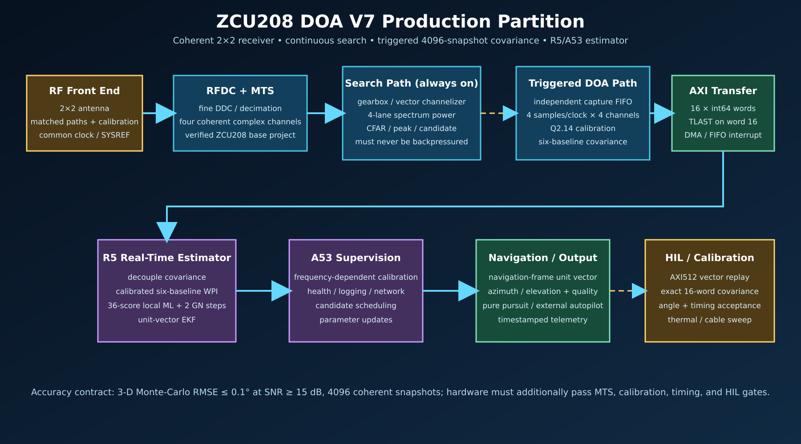

# ZCU208 DOA V7 FPGA Build Kit



This is the corrected ZCU208 implementation draft for the V7 2×2 DOA
simulation. It is a restartable build system and a hardware/software partition,
not a claim that a bitstream was generated in this environment.

The critical design decisions are:

- use a verified **ZCU208** RFDC/clock/MTS base project; never port a different
  RFSoC board by changing only `PART`;
- keep search and triggered covariance on independent streams so a completed
  covariance frame cannot stop continuous detection;
- process four complex samples per clock on all custom PL blocks;
- compute calibrated four-channel/six-baseline covariance in PL;
- initially run V7 WPI, bounded local ML/Gauss–Newton, and the unit-vector EKF
  on the R5, with the A53 supervising calibration, logging, and networking;
- require C simulation, BD validation, timing closure, exact covariance HIL,
  and angle acceptance as separate gates.

## Start here

```bash
make help
make status
# Vivado/Vitis are locked to 2023.2 (V00): every IP VLNV lives in
# config/ip_versions.tcl and step00 proves it against your installed catalog.
make step00_preflight \
  BASE_XPR=/absolute/path/verified_zcu208_base.xpr
```

Vivado-first flow: the production base is the pinned Xilinx RFSoC-MTS
ZCU208 design. See [V03_MTS_BASE_2023P2.md](V03_MTS_BASE_2023P2.md) for how
that 2022.1.2 base is brought under the 2023.2 lock before step07, and
[V00_V01_V02_CHANGES.md](V00_V01_V02_CHANGES.md) for the version-pinning
changes (branch `vivado-2023.2-v00-v01`).

Run or debug any stage directly:

```bash
make step02_hls_covariance
make step10_synth
make rebuild STEP=step10_synth
make clean-stage STEP=step10_synth
make -n step10_synth
```

The production integration stage intentionally stops until
[`config/zcu208_bd_map.tcl`](config/zcu208_bd_map.tcl) is mapped to the actual
RFDC base-design pin names. For a structural-only BD check, use
`INTEGRATION_MODE=external_ports`; that result is not deployable.

## Documentation

- [Implementation and algorithm guide](ZCU208_IMPLEMENTATION_GUIDE.md)
- [Every build stage and recovery command](BUILD_STAGES.md)
- [File-by-file and code walkthrough](FILE_AND_CODE_GUIDE.md)
- [Primary-source research and adoption decisions](RESEARCH_REFERENCES.md)
- [First-draft audit and direct comparison](AUDIT_AND_COMPARISON.md)
- [What was and was not validated here](VALIDATION_REPORT.md)
- [Original draft source matrix](SOURCE_MATRIX.md)

## Accuracy statement

V7 demonstrated a 3-D Monte-Carlo RMSE below 0.1° in its stated simulated
acceptance domain (SNR ≥ 15 dB, 4096 coherent snapshots, calibrated 2×2 array).
That is a simulation contract, not a guaranteed field result. A real ZCU208
build must also prove converter coherence, MTS repeatability, channel/cable and
mounting calibration, quantized parity, timing closure, and HIL/anechoic tests.
