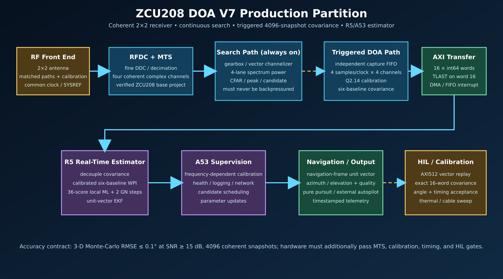
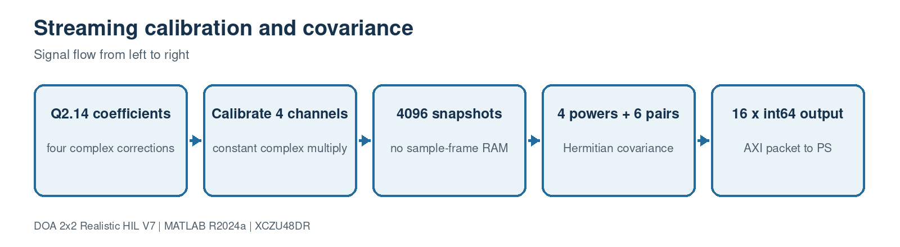
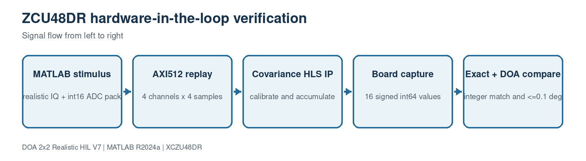

# ZCU208 DOA V7 implementation guide



## Clickable block index

1. [RF front end and array](#1-rf-front-end-and-array)
2. [RFDC, clocking, and MTS](#2-rfdc-clocking-and-mts)
3. [AXI stream contract](#3-axi-stream-contract)
4. [Channelizer](#4-channelizer)
5. [Spectrum power](#5-spectrum-power)
6. [Candidate peak/noise gate](#6-candidate-peaknoise-gate)
7. [Triggered capture](#7-triggered-capture)
8. [Calibrated covariance](#8-calibrated-covariance)
9. [Weighted phase seed](#9-weighted-phase-seed)
10. [Local ML and Gauss–Newton](#10-local-ml-and-gaussnewton)
11. [Unit-vector EKF](#11-unit-vector-ekf)
12. [Beam diagnostic](#12-beam-diagnostic)
13. [HIL and acceptance](#13-hil-and-acceptance)
14. [ZCU208 fit and remaining proof](#14-zcu208-fit-and-remaining-proof)

## 1. RF front end and array

The planar 2×2 array has four coherent receiver channels. V7 places the array
in its body-frame Y–Z plane and assumes the source is in the forward +X
hemisphere. A planar array therefore cannot distinguish the forward source from
its rear mirror without that constraint or another non-coplanar sensor.

At 4 GHz, wavelength is approximately 74.95 mm. Keeping the largest phase-LS
baseline at or below λ/2 avoids a wrapped phase over the admitted field of view.
The RF implementation also needs:

- one frequency reference and deterministic SYSREF distribution;
- stable relative cable/group delay and gain;
- identical DDC/NCO updates across channels;
- calibration versus RF frequency and temperature;
- rigid measurement of antenna coordinates and receiver-to-body rotation.

Example: a residual inter-channel phase error of 1° is already 1/360 of a
cycle. On a λ/2 baseline that phase alone corresponds to roughly 0.32° near
broadside, so the 0.1° objective requires substantially better residual phase
calibration or the averaging benefit of all six baselines.

## 2. RFDC, clocking, and MTS

The build kit does not create a guessed RFDC configuration. `BASE_XPR` must be
a base design already proven on ZCU208 with its CLK104 programming, converter
sample rates, DDC/decimation, fabric widths, MTS calls, and repeated-reset
alignment test.

`common/vivado/07_create_project_from_base.tcl` performs these operations in
source order:

| Code statement | Function |
|---|---|
| `require_env BASE_XPR` | Refuses an unnamed or accidental base project. |
| `file normalize` / `file exists` | Resolves an exact source before any write. |
| `open_project $base` | Opens the verified project read/write inside Vivado. |
| compare `PART` | Rejects non-XCZU48DR designs. |
| `save_project_as -force` | Copies it to `build/vivado`; the source is preserved. |
| set `ip_repo_paths` | Adds only this build's packaged IP repository. |
| `update_ip_catalog` / `save_project` | Resolves IP and persists the isolated copy. |

MTS is a runtime acceptance item as well as a Vivado setting. The board program
must record tile latency/offsets and repeat initialization enough times to prove
that relative sample alignment is deterministic.

## 3. AXI stream contract

All custom sample-domain cores use the same 512-bit beat:

```text
word index = lane*4 + channel
bits 32*index + 15 : 32*index      signed int16 real
bits 32*index + 31 : 32*index +16 signed int16 imaginary
lane = 0..3, channel = 0..3
```

Thus one beat is four time/frequency samples for every antenna. At 128 MHz it
carries 512 MS/s per channel. The RFDC DDC/decimation and any gearbox must be
selected so its real sample rate exactly equals this contract; no stage may
drop samples merely to match a convenient simulation rate.

`TLAST` means different things by stream:

| Stream | `TLAST` meaning |
|---|---|
| Search/channelizer | end of one spectrum frame |
| DOA capture | last beat of a 4096-sample coherent capture |
| Covariance output | word 16 of 16 |
| Candidate output | the single record for one spectrum frame |

## 4. Channelizer

Choose one route; never instantiate all three:

- `matlab_hdl`: `dsphdl.Channelizer` wrapped by a fixed-point four-element
  vector harness and generated with HDL Coder;
- `model_composer`: an already simulated System Generator/Model Composer model
  configured for IP Catalog export;
- `opfb`: the high-throughput MazinLab architecture rebuilt and adapted to the
  exact ZCU208 stream and tool release;
- `external`: an independently packaged, compatible IP.

The included MATLAB HDL route is a generation harness, not evidence of final
throughput. Its generated HDL must pass channel mapping, spectral response,
resource, and timing tests. For 30 MHz signals, choose a bin width and overlap
that avoid splitting candidate energy in a way the detector does not model.

## 5. Spectrum power

Source: `ip/custom/spectrum_power4/src/spectrum_power4.cpp`.

For lane \(l\), the block calculates

\[
P_l=\sum_{c=0}^{3}(I_{l,c}^2+Q_{l,c}^2).
\]

The source-order walkthrough is:

| Source code | Meaning |
|---|---|
| `#include "spectrum_power4.hpp"` | Imports exact AXI512/AXI256 packet types. |
| function parameters | One input stream and one output stream; no memory bus. |
| `axis register_mode=both` | Registers both sides of each AXI interface. |
| `ap_ctrl_none` | Makes the IP free-running. |
| `PIPELINE II=1` | Requests one beat every clock. |
| `input=s_axis.read()` | Accepts exactly one 512-bit beat. |
| `output.data=0` | Prevents unused/reserved bits from containing old state. |
| `lane_loop` + `UNROLL` | Builds four parallel lane datapaths. |
| `channel_loop` + `UNROLL` | Builds four parallel magnitude-square paths per lane. |
| `word=lane*4+channel` | Applies the shared packing contract. |
| signed casts | Preserve negative ADC I/Q values. |
| 33-bit channel power | Prevents signed-16 square/add overflow. |
| 64-bit lane accumulator | Leaves large headroom for interface reuse. |
| copy `keep`, `strb`, `last` | Emits a legal full-width packet and preserves frame end. |

Example: if one lane has samples `(100+j0)` on every channel, its result is
`4*100^2 = 40000`.

## 6. Candidate peak/noise gate

Source: `ip/custom/candidate_peak4/src/candidate_peak4.cpp`.

This block receives four power bins per clock and stores four state values:
frame sum, current peak, peak bin, and next bin index. On `TLAST` it calculates
the frame average and asserts `valid` when

\[
P_{peak} > P_{average}\frac{T_{Q8.8}}{256}.
\]

With `thresholdQ8_8=512`, the peak must exceed twice the frame average.

The output AXI192 record is:

| Bits | Field |
|---|---|
| 15:0 | peak bin |
| 16 | valid |
| 95:32 | peak power |
| 159:96 | average power |
| other | zero/reserved |

Its source-order behavior is:

| Source code | Meaning |
|---|---|
| four `static` variables | Retain frame state while the free-running function processes beats. |
| local `next*` copies | Include all four lanes before committing state. |
| unrolled lane loop | Adds/compares four bins in one clock iteration. |
| `if (power>nextPeak)` | First strict maximum wins; ties preserve the lower bin. |
| `if (input.last)` | Closes the frame only on the explicit AXI boundary. |
| average and Q8.8 comparison | Produces a scale-independent first candidate gate. |
| pack result and `m_axis.write` | Emits one record, not a full spectrum. |
| reset state | Starts the next spectrum frame cleanly. |

This is not full CA-CFAR. Production software or later PL must add persistence,
guard/training-cell logic, exclusion masks, cluster merging, and false-alarm
control. It is a realistic bandwidth-reduction gate, not the final detector.

## 7. Triggered capture

The candidate decision triggers an independent FIFO/capture path that records
4096 coherent four-channel samples. The search path must continue even while
the covariance IP emits its 16-word result. This is why the generated
`doa_v7` hierarchy has separate `S_AXIS_SEARCH` and `S_AXIS_DOA_CAPTURE`
interfaces instead of an AXI broadcaster.

Recommended implementation:

1. channelizer/candidate asserts an interrupt with bin/frequency metadata;
2. a programmable mixer selects that signal or the wideband stream is captured;
3. an AXI Data FIFO absorbs transaction/output gaps;
4. exactly 1024 AXI512 beats are presented to the covariance core;
5. DMA/FIFO transfers 16 signed int64 values to tightly coupled R5 memory;
6. metadata and covariance share one sequence number and timestamp.

The base-specific connections belong in `config/zcu208_bd_map.tcl`.

## 8. Calibrated covariance



Source: `ip/custom/doa_covariance_4ch_v4/src/doa_covariance_4ch_v4.cpp`.

Each channel first receives complex Q2.14 correction
\(y_c=x_c g_c\). Then the core accumulates four powers and all six unique
cross-products over 4096 samples.

The source-order walkthrough is:

| Source code | Meaning |
|---|---|
| `low16` / `high16` | Reinterprets packed real and imaginary halves as signed values. |
| `calibrate` | Performs one complex multiply and shifts by 14 fractional bits. |
| AXI pragmas | Declares AXI512 input, AXI64 output, and AXI-Lite control registers. |
| coefficient array + partition | Makes all four channel coefficients available in parallel. |
| pair tables | Fixes output order to 01, 02, 03, 12, 13, 23. |
| 64-bit accumulators | Avoids overflow for 4096 calibrated int16-derived samples. |
| beat loop, II=1 | Reads 1024 beats for a normal 4096-sample frame. |
| lane/channel unroll | Calibrates 16 complex values per clock. |
| power update | Accumulates \(|y_c|^2\). |
| pair update | Accumulates \(y_j y_i^*\), with explicit real/imaginary formulas. |
| output loop | Emits powers, six real cross terms, then six imaginary terms. |
| `last=(index==15)` | Marks the exact 16-word result boundary. |

The output ordering is:

```text
0..3   R00 R11 R22 R33
4..9   Re(R10) Re(R20) Re(R30) Re(R21) Re(R31) Re(R32)
10..15 Im(R10) Im(R20) Im(R30) Im(R21) Im(R31) Im(R32)
```

The HLS testbench creates deterministic data, independently computes all 16
results with ordinary integer arithmetic, and requires an exact word and
`TLAST` match before synthesis.

## 9. Weighted phase seed

Reference: `matlab_v7/estimate_doa_from_covariance_v7.m` and
`matlab_v7/DOAEstimator4Ch.m`.

For each of six baselines the processor obtains cross phase
\(\phi_{ji}=\arg(R_{ji})\) and coherence

\[
\gamma^2_{ji}=\frac{|R_{ji}|^2}{R_{ii}R_{jj}}.
\]

It clips coherence away from 0 and 1 and uses
\(w=\gamma^2/(1-\gamma^2)\). With the 6×2 Y–Z baseline matrix \(B\),
the seed is the small weighted least-squares solve

\[
[u_y,u_z]^T=-\frac{1}{k}(B^TWB+\epsilon I)^{-1}B^TW\phi.
\]

Then \(u_x=\sqrt{1-u_y^2-u_z^2}\) enforces the known forward hemisphere,
azimuth is `atan2(uy,ux)`, and elevation is `asin(uz)`.

All six baselines improve noise averaging and expose inconsistent channels.
The solve is only 2×2, which is efficient on an R5.

## 10. Local ML and Gauss–Newton

The V7 local ML schedule is `[0.5, 0.1, 0.02, 0.005]` degrees. At each scale it
scores the 3×3 neighborhood around the current point, totaling 36 steering
scores. The score is \(a^H R a\). This is off-grid refinement without a large
global 2-D MUSIC scan.

Four power iterations estimate the dominant signal vector. Two bounded
Gauss–Newton steps then use analytical azimuth/elevation steering derivatives.
The bound prevents one poor covariance frame from making a large jump.

For the first board implementation, keep these steps in R5 floating point or
carefully profiled fixed point. Only migrate them to PL after cycle profiling
shows a real latency bottleneck; their low update rate usually makes that
unnecessary.

## 11. Unit-vector EKF

The measurement is converted from body-frame angles to a three-component unit
vector, rotated into the navigation frame using full yaw/pitch/roll, and tracked
with state `[unit_vector; angular_rate_vector]`. After prediction and update,
V7 normalizes position and projects rate onto the tangent plane. This avoids
angle wrap and elevation singularities.

The estimate is rotated back to the body frame only for output/control. The
earlier Simulink circling bug came from mixing frames/wrapped azimuth; this
navigation-frame state prevents platform rotation from appearing as source
motion.

## 12. Beam diagnostic

`beam_weight_4ch` applies four complex Q1.15 weights to each of four lanes. It
is a commissioning monitor: point it using the DOA estimate and verify coherent
gain. It does not replace covariance or improve the estimator by itself.

Its nested loops are completely unrolled, four lane results are packed as
signed 32-bit real/imaginary pairs in AXI256, and the testbench uses exact 0.5
weights so expected integer output is unambiguous.

## 13. HIL and acceptance



`step14_hil_vectors` calls the embedded V7 project and produces:

- AXI512 hexadecimal replay beats;
- raw int16 I/Q CSV;
- four packed Q2.14 calibration registers;
- the exact 16 signed-int64 covariance result;
- truth azimuth/elevation and format metadata.

Acceptance should be layered:

1. HLS C simulation exact integer match;
2. RTL co-simulation exact integer match;
3. Vivado BD validation with no unresolved clock/interface error;
4. post-route WNS ≥ 0 and pulse-width/clock-interaction checks clean;
5. AXI replay on ZCU208 exactly matches all 16 covariance words;
6. PS estimate from captured covariance matches the V7 reference;
7. repeated RF loopback proves MTS and channel stability;
8. calibrated chamber/field campaign measures 3-D RMSE and P95.

## 14. ZCU208 fit and remaining proof

The three arithmetic HLS cores are structurally small compared with an XCZU48DR;
the channelizer, RFDC interface width, FIFOs, and DMA dominate PL cost. It is
plausible that the partition fits, but fit is not proven until the selected
channelizer and actual base project produce `post_route_utilization.rpt` and
meet timing.

Before calling the design production-ready, complete these board-specific items:

- fill `config/zcu208_bd_map.tcl` for the chosen base project;
- add/verify capture FIFO, DMA, interrupt, and AXI address map;
- port/profile the V7 covariance-to-angle estimator on R5 and retain the MATLAB
  cross-check;
- implement full CFAR/persistence/cluster policy if the simple peak gate is
  insufficient;
- write the ZCU208 runtime clock/MTS/calibration service;
- run synthesis, implementation, bitstream, XSA, HIL, RF loopback, thermal, and
  chamber tests.

