# Block guide — every step, every block, every figure

This is the long-form guide. It answers, for each piece of the design: **what is it, where
is the source, which IDE project holds it, how do I open that project, what does its test
bench prove, and how do I run the test bench.**

Five system figures and twenty-three block figures go with it, all regenerated by `make diagram`:

| figure | what it shows | section |
|---|---|---|
| 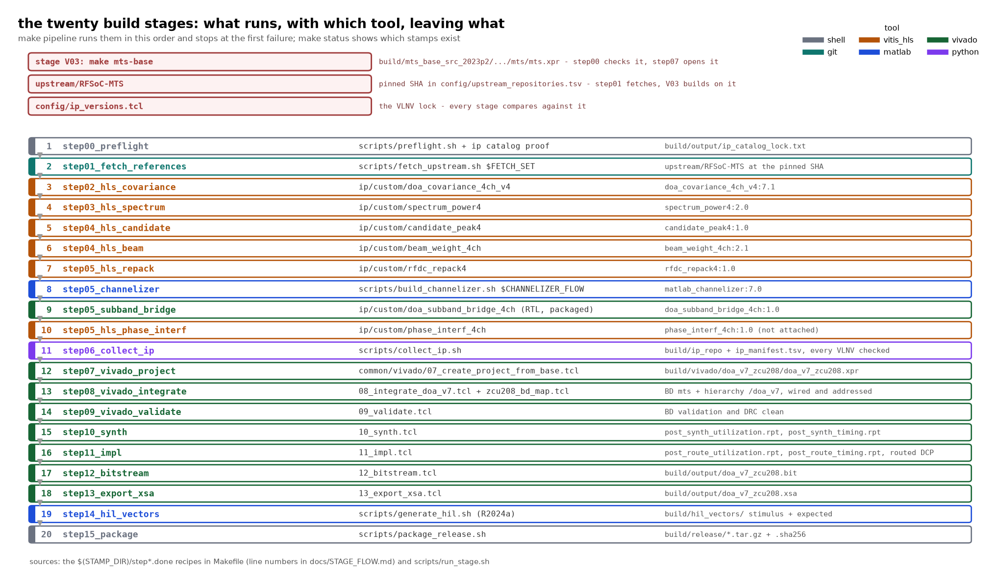 | the twenty build stages, with the three inputs no stage produces | [Part 1](#part-1--the-build) |
| 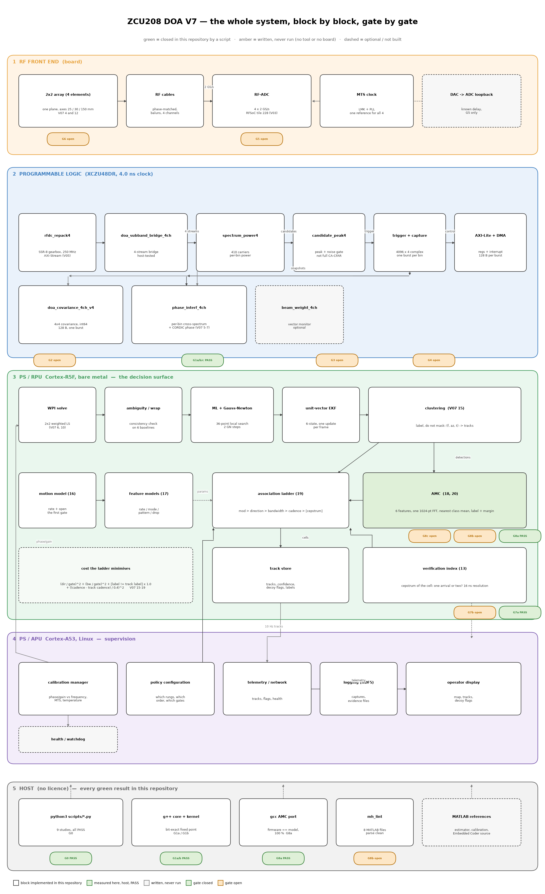 | the whole system: RF front end, PL, R5, A53, host, with every gate marked | [Part 1.4](#14-the-system-around-the-pl) |
| 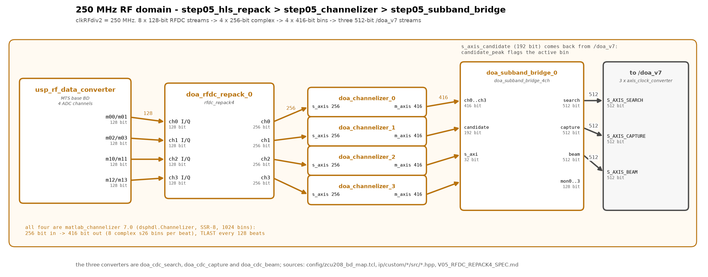 | the 250 MHz data path at port level, TDATA widths on every wire | [Part 2.1](#21-the-250-mhz-chain) |
| 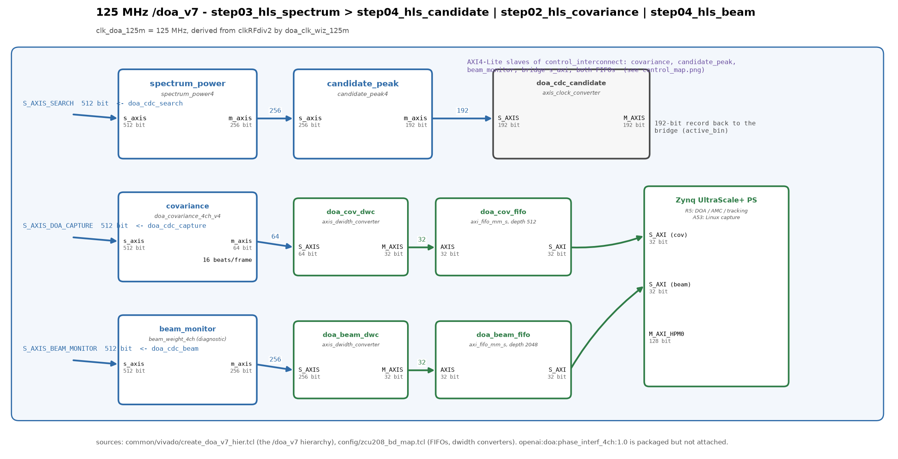 | the 125 MHz `/doa_v7` data path, and the FIFOs the PS reads | [Part 2.2](#22-the-125-mhz-doa_v7-hierarchy) |
| 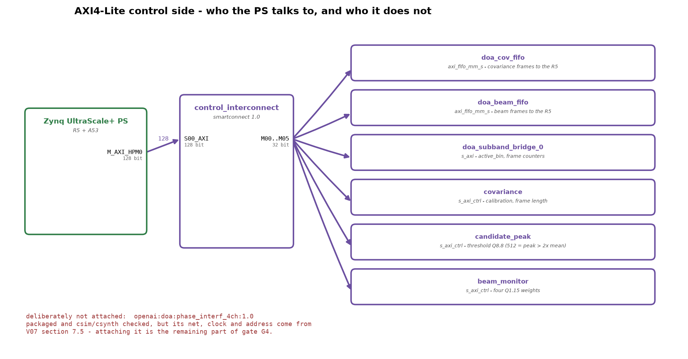 | the AXI4-Lite side, and what is deliberately not attached | [Part 2.3](#23-the-control-side) |
| 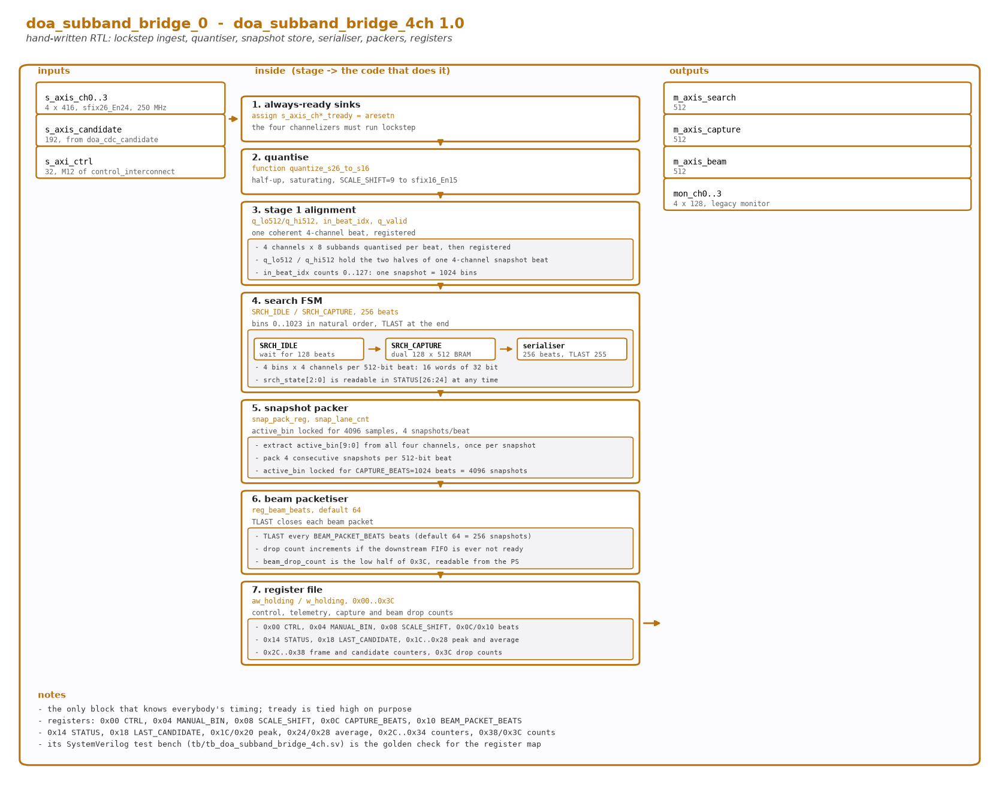 | **one internal picture per block**: ports, stages, notes — twenty-three of them | [Part 5](#part-5--one-picture-per-block) |
| 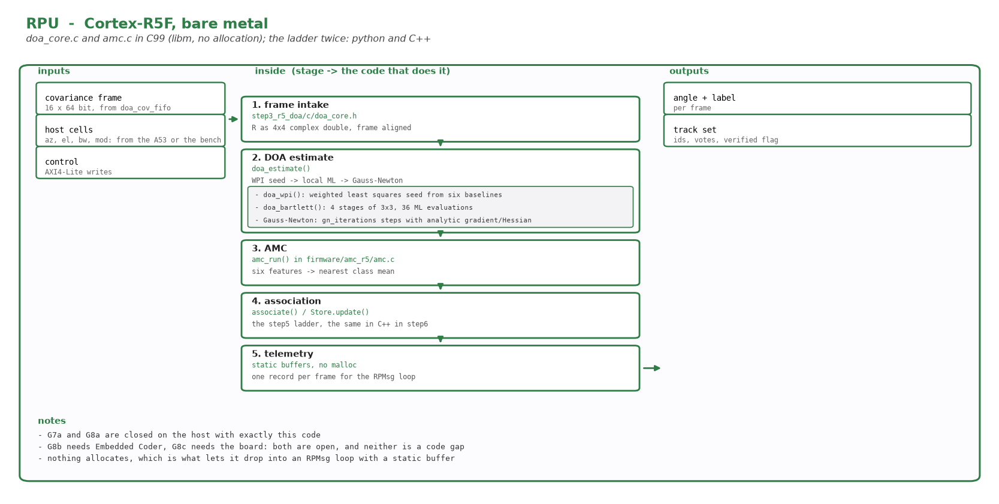 | the RPU: the ladder, AMC and tracking as separate pictures | [Part 5.4](#54-the-rpu--four-pictures) |
| 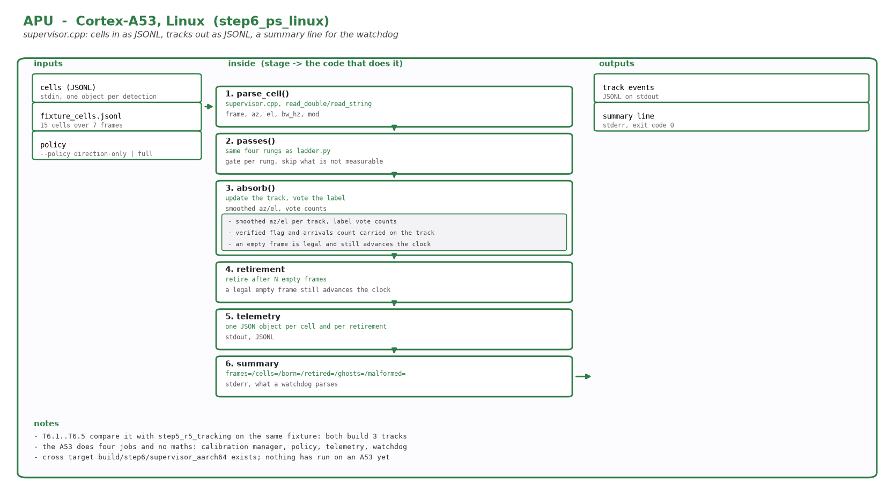 | the APU/Linux supervisor, and the host benches behind every gate | [Part 5.5](#55-the-apu--linux-side-step6_ps_linux) |

Measured on the ZCU208 host, 2026-11-08/09: **20/20 stages PASS**, CLB LUTs 48.48 %,
Block RAM 71.62 % (tightest resource), DSPs 36.12 %, post-route **WNS +0.164 ns**.

---

# Part 1 — the build

## 1.1 The stage flow


Three inputs are **not produced by any stage**, drawn at the top of that figure:

| input | produced by | needed from |
|---|---|---|
| `build/mts_base_src_2023p2/.../mts/mts.xpr` | `make mts-base` (stage V03) | `step00` checks it, `step07` opens it |
| `upstream/RFSoC-MTS` at the pinned SHA | `make rebuild STEP=step01_fetch_references FETCH_SET=RFSoC-MTS` | V03 builds on it |
| `config/ip_versions.tcl` | hand-pinned | every stage compares against it |

## 1.2 Every stage, in order

| # | stage | tool | command it runs | it leaves |
|---|---|---|---|---|
| 1 | `step00_preflight` | shell + Vivado | `scripts/preflight.sh`, then `common/vivado/00_check_ip_catalog.tcl` | `build/output/ip_catalog_lock.txt` — all 35 pinned IPs proved present |
| 2 | `step01_fetch_references` | git | `scripts/fetch_upstream.sh $FETCH_SET` | `upstream/<repo>` at the SHA in `config/upstream_repositories.tsv` |
| 3 | `step02_hls_covariance` | Vitis HLS | `make -C ip/custom/doa_covariance_4ch_v4 all` | `doa_covariance_4ch_v4:7.1` |
| 4 | `step03_hls_spectrum` | Vitis HLS | `make -C ip/custom/spectrum_power4 all` | `spectrum_power4:2.0` |
| 5 | `step04_hls_candidate` | Vitis HLS | `make -C ip/custom/candidate_peak4 all` | `candidate_peak4:1.0` |
| 6 | `step04_hls_beam` | Vitis HLS | `make -C ip/custom/beam_weight_4ch all` | `beam_weight_4ch:2.1` |
| 7 | `step05_hls_repack` | Vitis HLS | `make -C ip/custom/rfdc_repack4 all` | `rfdc_repack4:1.0` |
| 8 | `step05_channelizer` | MATLAB R2024a | `scripts/build_channelizer.sh $CHANNELIZER_FLOW` | `matlab_channelizer:7.0` |
| 9 | `step05_subband_bridge` | Vivado packaging | `make -C ip/custom/doa_subband_bridge_4ch all` | `doa_subband_bridge_4ch:1.0` |
| 10 | `step05_hls_phase_interf` | Vitis HLS | `make -C ip/custom/phase_interf_4ch all` | `phase_interf_4ch:1.0` (packaged, **not attached**) |
| 11 | `step06_collect_ip` | python | `scripts/collect_ip.sh` | one IP repo + `ip_manifest.tsv`, every VLNV re-checked |
| 12 | `step07_vivado_project` | Vivado | `07_create_project_from_base.tcl` | `build/vivado/doa_v7_zcu208/doa_v7_zcu208.xpr` |
| 13 | `step08_vivado_integrate` | Vivado | `08_integrate_doa_v7.tcl` + `create_doa_v7_hier.tcl` + `config/zcu208_bd_map.tcl` | BD `mts` with hierarchy `/doa_v7`, wired and addressed |
| 14 | `step09_vivado_validate` | Vivado | `09_validate.tcl` | BD validation and DRC clean |
| 15 | `step10_synth` | Vivado | `10_synth.tcl` | `post_synth_utilization.rpt`, `post_synth_timing.rpt` |
| 16 | `step11_impl` | Vivado | `11_impl.tcl` | `post_route_utilization.rpt` (+ hierarchical), `post_route_timing.rpt`, routed DCP |
| 17 | `step12_bitstream` | Vivado | `12_bitstream.tcl` | `build/output/doa_v7_zcu208.bit` |
| 18 | `step13_export_xsa` | Vivado | `13_export_xsa.tcl` | `build/output/doa_v7_zcu208.xsa` |
| 19 | `step14_hil_vectors` | MATLAB R2024a | `scripts/generate_hil.sh` | `build/hil_vectors/` — stimulus + expected results |
| 20 | `step15_package` | shell | `scripts/package_release.sh` | `build/release/doa_v7_zcu208_artifacts.tar.gz` + `.sha256` |

Details per stage that matter when something breaks:

- **`step00`** fails fast on a missing tool, a wrong part, a version mismatch, or a missing
  MTS base. `PREFLIGHT_ALLOW_MISSING_BASE=1` downgrades only the last one to a warning, so
  the IP stages (3–11) can run before the base exists.
- **`step01`** with `FETCH_SET=native` fetches RFSoC-MTS, RFSoC-PYNQ and rfsoc_sam;
  `FETCH_SET=RFSoC-MTS` fetches only what the base needs.
- **`step06`** checks VLNV, not file presence: a stale `component.xml` fails here, with the
  directory and the expected value named.
- **`step08`** is where the block design is edited; every IP is created through
  `doa_create_pinned_ip`, so nothing can be pulled in at the wrong version.
- **`step12`/`step13`** write files; `make fit` then reads the reports from `step10`/`step11`.

## 1.3 Opening the hardware design (stages 12–18)

```bash
vivado build/vivado/doa_v7_zcu208/doa_v7_zcu208.xpr &
```

| where | what you see |
|---|---|
| Sources → Block Designs → **`mts`** | the base MTS design; double-click to open |
| inside it, **`/doa_v7`** | `covariance`, `spectrum_power`, `candidate_peak`, `beam_monitor`, `covariance_fifo`, `candidate_fifo` |
| top level | `doa_rfdc_repack_0`, `doa_channelizer_0…3`, `doa_subband_bridge_0`, `doa_clk_wiz_125m`, `doa_rst_125m`, `doa_cdc_search/_capture/_beam`, `doa_cdc_candidate`, `doa_cov_dwc`, `doa_beam_dwc`, `doa_cov_fifo`, `doa_beam_fifo` |
| **F6** or `validate_bd_design` | the same check `step09` passed |
| Address Editor | six AXI4-Lite slaves under `/control_interconnect` (see `control_map.png`) |
| Design Runs → `impl_1` → **Open Implemented Design** | placement, routing, the routed DCP |
| Reports → Report IP Status | should report nothing to upgrade: the lock is 2023.2 everywhere |

## 1.4 The system around the PL


The five bands are the five places code runs: the RF front end on the board, the
programmable logic, the R5 (bare metal: DOA, AMC, tracking), the A53 (Linux: capture and
logging) and the host (every measurement in this repository that does not need a board).
Gates are marked on the figure; their state is Part 4.

---

# Part 2 — the blocks

## 2.1 The 250 MHz chain


### `doa_rfdc_repack_0` — `openai:doa:rfdc_repack4:1.0`

- **duty:** turns the eight AXI4-Stream outputs of the RF Data Converter into four complex
  streams, one per antenna. The RFDC emits I and Q as separate streams per channel
  (`m00/m01`, `m02/m03`, `m10/m11`, `m12/m13`); this block interleaves them into the
  project-wide `{Q[31:16], I[15:0]}` packing, four samples per beat.
- **interface:** 8 inputs × 128 bit → 4 outputs × 256 bit, 250 MHz, no control port.
- **why it exists:** AMD's `axis_combiner` concatenates whole beats rather than
  interleaving samples, which pushes an un-interleave into every consumer
  (`V05_RFDC_REPACK4_SPEC.md` §2).
- **source:** `ip/custom/rfdc_repack4/src/rfdc_repack4.cpp`, interface in `…hpp`.
- **build:** `make step05_hls_repack` → csim → csynth at 4.0 ns → IP Catalog export.
- **IDE:** `vitis_hls -p ip/custom/rfdc_repack4/rfdc_repack4_hls` → `solution1` → C SIMULATION.
- **test bench:** `ip/custom/rfdc_repack4/tb/rfdc_repack4_tb.cpp` — bit-exact packing, I/Q
  pairing and sample order; synthesis only runs if the csim match is exact.

### `doa_channelizer_0…3` — `openai:doa:matlab_channelizer:7.0`

- **duty:** one 1024-bin channelizer per antenna. Each beat in carries 8 complex samples;
  each beat out carries 8 complex bins as `sfix26_En24` I and Q (52 bits → 416 bits per
  beat). `TLAST` marks the end of one snapshot, 128 beats apart.
- **interface:** 256 bit in → 416 bit out, 250 MHz.
- **built from:** `dsphdl.Channelizer` through HDL Coder — `ip/matlab/channelizer_hdl/`
  holds the wrapper that adds AXI4-Stream and the `TLAST` cadence
  (`channelizer_axis_wrapper.sv`). Inside it: `g_pack_lanes` (lane unpack), the
  `Channelizer_DUT` subsystem (`Channelizer_DUT.v`, 228 generated files), the
  `ChannelizerCore` `dsphdl.Channelizer` object (1024 bands, 12 taps/band, 12 288
  coefficients), the clock-enable handshake (`core_clk_enable = m_axis_tready`), the
  `LAST_BEAT_IN_SNAPSHOT` framing and the 52-bit lane packing. Part 5.1 draws exactly this.
  The Model Composer route to the same function is `ip/model_composer/channelizer/` and is
  documented, not used.
- **build:** `make step05_channelizer` (`CHANNELIZER_FLOW=matlab_hdl`).
- **IDE:** MATLAB R2024a for the model and the HDL Coder run; the resulting IP opens in
  Vivado like any other component.
- **test bench:** `make ip-equivalence` compares what the model describes against the
  Verilog twin `channelizer_dut.v` — `bit-exact: 16384 samples, 4 channels, depth 4: MATCH`,
  gateway error 6.103e-05 = 1.000 LSB. In hardware the four channels are checked by the
  bridge's frame counters and by `beam_monitor`.
- **cost:** the transposed form was chosen over the systolic one because four systolic
  channelizers reached 93.2 % of the CLB LUTs (`V06_CHANNELIZER_FEASIBILITY.md` §4).

### `doa_subband_bridge_0` — `openai:doa:doa_subband_bridge_4ch:1.0`

- **duty:** the one block that knows the timing of everything else. It ingests the four
  channel streams in lockstep, keeps them in lockstep (its `tready` is continuously
  asserted, so the channelizers can never stall), and produces the three streams `/doa_v7`
  consumes:

  | output | width | what it carries |
  |---|---|---|
  | `m_axis_search` | 512 | one snapshot serialised in natural bin order: 256 beats, 4 bins × 4 channels per beat, `TLAST` on beat 255 |
  | `m_axis_capture` | 512 | the selected bin across four consecutive snapshots, `word = snapshot_lane*4 + channel` |
  | `m_axis_beam` | 512 | the same for the diagnostic beam monitor, 64 beats per packet by default |
  | `m_axis_mon_ch0…3` | 4 × 128 | legacy MTS monitor path, tie-off |

- **quantisation:** stage-1 converts `sfix26_En24 → sfix16_En15` with half-up rounding and
  symmetric saturation, `SCALE_SHIFT = 9` for unity gain.
- **control (`s_axi_ctrl`, 32 bit):** `0x00 CTRL` (`auto_bin_en`, `capture_en`, `search_en`,
  `beam_en`, `mon_en`), `0x04 MANUAL_BIN`, `0x08 SCALE_SHIFT`, `0x0C CAPTURE_BEATS`
  (1024 = 4096 snapshots), `0x10 BEAM_PACKET_BEATS`, `0x14 STATUS` (`active_bin`,
  `last_cand_valid`, `srch_state`), `0x18 LAST_CANDIDATE`, `0x1C…0x28` candidate peak and
  average (64 bit each, split lo/hi), `0x2C SNAPSHOT_COUNT`, `0x30 SEARCH_FRAME_COUNT`,
  `0x34 CAPTURE_FRAME_COUNT`, `0x38 CANDIDATE_COUNT`, `0x3C DROP_COUNTS`.
- **input from the DOA side:** `s_axis_candidate` (192 bit) — the candidate record, clocked
  back into the 250 MHz domain by `doa_cdc_candidate`; the bridge latches the bin into
  `active_bin`.
- **source:** `ip/custom/doa_subband_bridge_4ch/rtl/doa_subband_bridge_4ch.v` — hand-written
  RTL, packaged by `package_ip.tcl`.
- **build:** `make step05_subband_bridge`.
- **IDE:** there is no HLS project; the RTL is packaged and then opened in Vivado as an IP.
- **test bench:** `ip/custom/doa_subband_bridge_4ch/tb/tb_doa_subband_bridge_4ch.sv`
  (SystemVerilog, drives the four 416-bit inputs and checks the three outputs) plus
  `verify_golden_model.py`, which checks the packer against a Python golden model.

### The three forward clock crossings

`doa_cdc_search`, `doa_cdc_capture`, `doa_cdc_beam` — `axis_clock_converter:1.1`, 512 bit,
250 → 125 MHz. They exist because `/doa_v7` runs at half the RF clock.

## 2.2 The 125 MHz `/doa_v7` hierarchy


Everything below runs at 125 MHz, on `clk_doa_125m` from `doa_clk_wiz_125m`, reset by
`doa_rst_125m`. The 125 MHz domain exists so the DOA logic has two clock cycles for every
RF beat.

### `spectrum_power` — `openai:doa:spectrum_power4:2.0`

- **duty:** the detector statistic. From one 512-bit beat (4 lanes × 4 channels of complex
  `sfix16`) it produces four unsigned 64-bit incoherent powers, 256 bits per beat,
  sustaining one beat per clock and copying `TLAST`.
- **interface:** 512 → 256 bit, no control port.
- **source / build / IDE:** `ip/custom/spectrum_power4` · `make step03_hls_spectrum` ·
  `vitis_hls -p ip/custom/spectrum_power4/spectrum_power4_hls`.
- **test bench:** `tb/spectrum_power4_tb.cpp` — power arithmetic and `TLAST` propagation.

### `candidate_peak` — `openai:doa:candidate_peak4:1.0`

- **duty:** the cheap gate that decides whether a snapshot is worth a full DOA capture.
  Over one `TLAST`-delimited frame it tracks the maximum bin and the global average and,
  at `TLAST`, emits one 192-bit record: bin index, validity, peak power, average power.
- **control:** `thresholdQ8_8` (16 bit), default 512 = peak > 2× average. This is
  deliberately **not** advertised as full CA-CFAR.
- **interface:** 256 → 192 bit.
- **source / build / IDE:** `ip/custom/candidate_peak4` · `make step04_hls_candidate` ·
  `candidate_peak4_hls`.
- **test bench:** `tb/candidate_peak4_tb.cpp` — max/average arithmetic, threshold
  comparison, record layout.

### `covariance` — `openai:doa:doa_covariance_4ch_v4:7.1`

- **duty:** the DOA statistic. Applies four complex Q2.14 calibration coefficients,
  accumulates 4096 samples, and emits 16 signed 64-bit values: 4 powers, 6 cross-product
  real parts, 6 cross-product imaginary parts — the upper triangle of `R = XXᴴ`.
- **interface:** 512 bit in (4 lanes × 4 channels, `word = lane*4 + channel`), 64 bit out
  over 16 beats per frame. It is a frame processor: II=1 during a 1024-beat capture, then a
  short burst of results. It needs a triggered capture in front of it, which is exactly
  what the bridge's `m_axis_capture` provides.
- **control:** `cal0…cal3` (32 bit each, Q2.14 complex), `frameSamples` (16 bit).
- **source / build / IDE:** `ip/custom/doa_covariance_4ch_v4` · `make step02_hls_covariance` ·
  `doa_covariance_4ch_v4_prj`.
- **test bench:** `tb/doa_covariance_4ch_v4_tb.cpp` — requires an exact match on all 16
  words and `TLAST` before synthesis is allowed to run.

### `beam_monitor` — `openai:doa:beam_weight_4ch:2.1`

- **duty:** diagnostic only. Applies four complex Q1.15 weights to four channels for four
  lanes per clock so that a calibration or steering error is visible in hardware. It does
  **not** estimate DOA and nothing downstream depends on it.
- **interface:** 512 → 256 bit; control `w0…w3` (32 bit each).
- **source / build / IDE:** `ip/custom/beam_weight_4ch` · `make step04_hls_beam` ·
  `beam_weight_4ch_hls`.
- **test bench:** `tb/beam_weight_4ch_tb.cpp`.

### `doa_cdc_candidate` — the one backward crossing

192 bit, 125 → 250 MHz: the candidate record travels back so the bridge can select the bin
it names. This is the only signal path that closes a loop across the two clock domains, and
it is the reason `active_bin` in the bridge is a latched value rather than a wire.

### `doa_cov_dwc` / `doa_beam_dwc` and the two FIFOs

`axis_dwidth_converter` (→ 32 bit) followed by `axi_fifo_mm_s` (RX only, depth 512 for
covariance, 2048 for beam). The PS reads them over AXI4-Lite; the FIFOs are the only place
DOA results leave the PL on the data side.

### The published but unattached block

`phase_interf_4ch` (`openai:doa:phase_interf_4ch:1.0`): six complex cross-spectra and six
CORDIC phases per bin, so the PS never runs `atan2` per bin. Interface 512 bit in,
16 × 64 bit out plus a 128-bit `m_phase` (6 × Q3.13 rad, frame tag, phases-valid), control
`cal0…cal3` and `frameSamples`. Source `ip/custom/phase_interf_4ch`, IDE
`vitis_hls -p ip/custom/phase_interf_4ch/phase_interf_4ch_prj`, OOC timing script
`gate3_ooc.tcl` (`make -C ip/custom/phase_interf_4ch gate3-ooc`), test bench
`tb/phase_interf_4ch_tb.cpp`. It is packaged and checked but **not wired into the block
design**: its net, clock and address must come from `V07_PHASE_INTERFEROMETRY.md` §7.5, and
attaching it is the remaining work of gate G4.

## 2.3 The control side


Six AXI4-Lite slaves hang off `/control_interconnect` (`smartconnect:1.0`, master
`M_AXI_HPM0` 128 bit, slaves 32 bit):

| slave | registers that matter |
|---|---|
| `doa_cov_fifo` | RX occupancy and reset for the covariance stream |
| `doa_beam_fifo` | the same for the beam stream |
| `doa_subband_bridge_0` | `active_bin`, frame counters, drop counts, candidate peak/average |
| `covariance` | four Q2.14 calibration words, frame length |
| `candidate_peak` | threshold Q8.8 |
| `beam_monitor` | four Q1.15 weights |

---

# Part 3 — the eight step folders

Each folder holds a `GUIDE.md` (why the step exists, what is measured), the sources and a
`testbench/run_testbench.py`. All eight run on the host, no vendor tools and no board:

```bash
make steps      # 8/8 PASS
make step3      # one of them
```

| folder | source | duty | test bench closes |
|---|---|---|---|
| `step0_antenna` | `py/`, `matlab/`, `py/make_scenes.py` | array geometry, steering vectors, `R = XXᴴ/K`, WPI and GN estimators, the spacing rule | **G0**: 5.996 GHz at 25 mm / 4.997 GHz at 30 mm; σ = 0.302/0.170/0.096/0.030° at 0/5/10/20 dB |
| `step1_rfadc_mts` | `py/`, `matlab/` | the V04 contract: 4 ADC channels at 4.000 GSPS, 512-bit beats, decimation 2 (2.000 GSPS complex), zone-2 R2C DDC, the MTS configuration `step07` opens | G5 simulated, not measured |
| `step2_pl_ip` | `kernels.tsv`, `matlab/`, and everything under `ip/custom/` | the kernels of Part 2 — repack, channelizer, bridge, covariance, spectrum, candidate, beam | **G1a/G1c** |
| `step3_r5_doa` | `c/` (this *is* the R5F code: C99, libm, no allocation), `py/` reference | covariance → angle, ladder rung selection, decoy handling | **G7a** |
| `step4_r5_amc` | `c/`, `matlab/step4_classify_burst.m`, export `firmware/amc_r5/` | features → modulation label, same code the R5 runs | **G8a** (`make amc-port` checks C against the model) |
| `step5_r5_tracking` | `py/` | the ladder, births, retirements, ghost and malformed accounting | G7a on the host; `make step6` (T6.2) requires it to build the same 3 tracks as the A53 supervisor |
| `step6_ps_linux` | `c/supervisor.cpp`, `testbench/fixture_cells.jsonl` | the A53 side: cells → tracks → telemetry, plus the four jobs it keeps (calibration, policy, logging, watchdog) — what makes G5/G6/G7b/G8c measurable | no gate of its own; T6.1–T6.5 compare it with `step5_r5_tracking`, and it prints `frames=7 cells=15 tracks_live=2 born=3 retired=1 ghosts=1 malformed=0` |
| `step7_board_bringup` | `checklist.sh`, `testbench/` | the eleven commands between a bitstream and a measured gate | prints them, `--run N` runs one |

---

# Part 4 — gates, and what is left

| gate | question | state |
|---|---|---|
| G0 | is the physics right, on the host? | **PASS** |
| G1a/G1b/G1c | fixed-point core, kernel testbench, VLNV contract | **PASS** |
| G2 | does Vitis HLS compile, synthesise and export? | **PASS** — stages 3–11, 2026-11-08 |
| G3 | does the packaged IP meet 4.0 ns out of context? | NOT RUN — in context it does |
| G4 | block design + bitstream | **PASS** — stages 12–18, `doa_v7_zcu208.bit` written |
| G5 | on silicon, phase sign and offset | NOT RUN — needs the board |
| G6 | accuracy with a calibrated array | NOT RUN — needs array + source |
| G7a | decoy criteria on host models | **PASS** |
| G7b | repeater rejection on hardware | NOT RUN — needs the board |
| G8a | R5 firmware reproduces the model | **PASS** (host gcc) |
| G8b | Embedded Coder build for the RPU | NOT RUN — needs Embedded Coder |
| G8c | AMC frame deadline on the R5F | NOT RUN — needs the board |

## 4.1 Commands

```bash
make steps                        # the eight host benches
make hls-all                      # every HLS kernel: csim + csynth
make pipeline                     # the twenty build stages
make fit                          # resources and post-route WNS from the reports
make status                       # what passed, what failed, with log paths
make diagram                      # all five figures
make amc-port                     # G8a
bash step7_board_bringup/checklist.sh     # what needs the board, in order
```

## 4.2 Where each tool is used

| tool | what it does here | folders |
|---|---|---|
| Vitis HLS 2023.2 | csim, csynth at 4.000 ns, IP Catalog export | `ip/custom/*` (six kernels) |
| MATLAB R2024a | HDL Coder for the channelizer; HIL vectors | `ip/matlab/channelizer_hdl`, `hil/matlab` |
| MATLAB R2022b via Model Composer | the alternative channelizer route (`CHANNELIZER_FLOW=model_composer`), unfinished | `ip/model_composer/channelizer` |
| Vivado 2023.2 | base project, BD integration, synthesis, implementation, bitstream, XSA | `common/vivado/` |
| Vitis | platform from the XSA, R5 application | `firmware/amc_r5` |
| python3 + numpy | the eight host benches and every gate that does not need a board | `step0…step7`, `scripts/` |

---

# Part 5 — one picture per block

Parts 1–4 describe the design in words and five system-level figures. This part is the
opposite direction: **twenty-three pictures, one per block**, each drawn from that block's
own source and READMEs, each showing *only* that block — its inputs on the left, its internal
stages in the middle in the order a beat passes through them, its outputs on the right, and at
the bottom the notes that would otherwise live in a README nobody opens.

The middle column is deliberately not a block diagram of abstract boxes. Every stage carries
the **function, module, register or tcl line that implements it** — `doa_wpi()` and
`solve2()`, `quantize_s26_to_s16`, `SRCH_IDLE`/`SRCH_CAPTURE`, `CONFIG.NUM_MI = 13`,
`amc_classify()`, `Store.update()` — so a reader can go from a picture to the line of code
without guessing which file holds it.

Where a stage is itself a block — `ChannelizerCore`, `Channelizer_DUT`, the bridge's search
FSM, the covariance accumulator, the CORDIC, `u_FilterBank` — the picture opens it: a shaded
**"what is inside it"** panel inside the stage box lists its sub-blocks, their sizes or
resources, and the internal ordering. Nothing goes one level down and stops at a name.

44 stages carry such a panel. This is the list, generated from the `INSIDE` table in
the script so it cannot drift away from the pictures:

| picture | stage opened | what the panel shows |
|---|---|---|
| `rfdc` | 1. fine mixer R2C | NCO_Freq = -RF_CENTER = -3.000 GHz (PG269 absolute-NCO convention); Nyquist=1 selects zone 2; the 2-4 GHz band lands at baseband; from here on the samples are complex: one I stream and one Q stream |
| `rfdc` | 2. decimate by 2 | decimating filter inside the tile (PG269), CalOpt_Mode=1; 4.000 GSPS real -> 2.000 GSPS complex per channel; Decimation_Mode=2 is set by the DOA map, not by upstream MTS |
| `rfdc` | 3. fabric format | each 128-bit word carries 8 samples of 16 bit; two streams per channel: m00/m01 = I/Q of ADC0, and so on; 8 samples x 250 MHz = 2.000 GSPS: the rate every width assumes |
| `rfdc` | 4. MTS alignment | SYSREF reaches all four tiles from clocktreeMTS; NCO phase and decimator state reset together on every SYSREF; mts_all_true() is asserted post-validate or the map script aborts |
| `rfdc_repack4` | 2. pair I and Q | sample s of the input beat becomes sample s of the output beat; {Q[31:16], I[15:0]} is the project-wide complex packing; 8 samples per 256-bit output beat, order never permuted |
| `matlab_channelizer` | 2. Channelizer_DUT | atomic subsystem: ChannelizerCore is its only MATLAB System block; u_FilterBank + u_FFT are the two generated children; 228 generated files, one per pipeline register group |
| `matlab_channelizer` | 3. ChannelizerCore | chips: u_FilterBank -> u_FFT; FilterBank: 12 288 coefficients (1024 bands x 12 taps), 16 subFilters x 12 DSPs; FFT: 25 102 LUTs, 43 571 FFs, 120 DSPs; 351 cycles end to end; transposed: 10 800 LUTs + 176 RAMB36 (systolic: 63 439 LUTs, 57 670 SRLs) |
| `matlab_channelizer` | 5. snapshot framing | one snapshot = 128 accepted beats = 1024 bins x 8 lanes; TLAST on the beat whose index is 127, then the counter wraps; counters are per channel: four wrappers, four TLASTs, one per antenna |
| `subband_bridge` | 3. stage 1 alignment | 4 channels x 8 subbands quantised per beat, then registered; q_lo512 / q_hi512 hold the two halves of one 4-channel snapshot beat; in_beat_idx counts 0..127: one snapshot = 1024 bins |
| `subband_bridge` | 4. search FSM | chips: SRCH_IDLE -> SRCH_CAPTURE -> serialiser; 4 bins x 4 channels per 512-bit beat: 16 words of 32 bit; srch_state[2:0] is readable in STATUS[26:24] at any time |
| `subband_bridge` | 5. snapshot packer | extract active_bin[9:0] from all four channels, once per snapshot; pack 4 consecutive snapshots per 512-bit beat; active_bin locked for CAPTURE_BEATS=1024 beats = 4096 snapshots |
| `subband_bridge` | 6. beam packetiser | TLAST every BEAM_PACKET_BEATS beats (default 64 = 256 snapshots); drop count increments if the downstream FIFO is ever not ready; beam_drop_count is the low half of 0x3C, readable from the PS |
| `subband_bridge` | 7. register file | 0x00 CTRL, 0x04 MANUAL_BIN, 0x08 SCALE_SHIFT, 0x0C/0x10 beats; 0x14 STATUS, 0x18 LAST_CANDIDATE, 0x1C..0x28 peak and average; 0x2C..0x38 frame and candidate counters, 0x3C drop counts |
| `cdc_forward` | 2. asynchronous FIFO | write pointer in the 250 MHz domain, read pointer in the 125 MHz one; grey-coded pointers, two flip-flops per bit across the boundary; TLAST crosses with TDATA, so a frame cannot be cut in half |
| `cdc_candidate` | 2. asynchronous FIFO | written at 125 MHz, read at 250 MHz: the mirror image; bin[15:0], valid[16], peak[95:32], average[159:96] as one record; the bridge consumes it into pending_auto_bin / has_auto_bin |
| `spectrum_power` | 3. channel_loop | 16 multipliers: 4 lanes x 4 channels, all unrolled; I*I + Q*Q in ap_int<32>, widened to ap_uint<33> per channel; four channels summed into one ap_uint<64> per lane |
| `candidate_peak` | 1. static frame state | frameSum: ap_uint<80>, four 64-bit powers per beat for 1024 beats; framePeak: ap_uint<64>, peakBin: ap_uint<16>, binBase: ap_uint<16>; no BRAM and no ping-pong: the frame is one pass, the record is written at TLAST |
| `candidate_peak` | 3. at TLAST: average | binCount = binBase + 4 after the last beat of the frame; average = nextSum / binCount, integer division; frameSum, framePeak, peakBin, binBase all cleared for the next frame |
| `candidate_peak` | 5. record builder | bin[15:0], valid[16]; peak[95:32] and average[159:96], 64 bit each; keep and strb all ones, TLAST set: one beat per frame |
| `covariance` | 4. accumulate | power[c] += |x_c|^2 for the four channels; crossReal[pair], crossImag[pair] for 01 02 03 12 13 23; ap_int<40> products into ap_int<64> accumulators |
| `covariance` | 5. output_loop | index 0..3 powers, 4..9 cross real, 10..15 cross imaginary; TLAST on index 15: exactly one burst per integration frame |
| `beam_monitor` | 2. lane_loop / channel_loop | 4 lanes x 4 channels unrolled into 16 complex multiplies; real = sum(xr*wr - xi*wi), imag = sum(xr*wi + xi*wr); ap_int<40> accumulator, >>15 after the loop, then saturate |
| `phase_interf` | 3. atan2_q13() | 16 CORDIC iterations, vectoring mode, one instance only; kAtanQ30[32] table, Q2.30 angle accumulated then rounded to Q3.13; six phases time-multiplexed: 1 pair per beat-group, no sixfold area |
| `clocking` | 2. doa_clk_wiz_125m | MMCM: 250 MHz in, 125 MHz out, phase aligned; CLKOUT1 only, integer divide, no fractional setting; doa_clk_wiz_125m is a pinned part of the DOA hierarchy |
| `fifo_cov` | 2. doa_cov_fifo | RX FIFO 512 x 32 bit, no TX interface at all; C_USE_TX_DATA=0, C_USE_TX_CTRL=0, C_USE_RX_DATA=1; S_AXI exposes RRD/RDF, RLR, ISR/IER and the reset |
| `fifo_beam` | 2. doa_beam_fifo | identical IP, only C_RX_FIFO_DEPTH differs: 2048 x 32 bit; RX only, so the diagnostic path can never write back; S_AXI at M11 of control_interconnect |
| `control_ic` | 1. port count | one 128-bit master, thirteen mirrored slaves; M00..M06 belong to the MTS base and are left alone; M07..M12 are the DOA design: three kernels, two FIFOs, the bridge |
| `rpu` | 2. DOA estimate | doa_wpi(): weighted least squares seed from six baselines; doa_bartlett(): 4 stages of 3x3, 36 ML evaluations; Gauss-Newton: gn_iterations steps with analytic gradient/Hessian |
| `rpu_doa` | 2. doa_wpi() | coherence weight c/(1-c) per baseline, clipped to 0.05..100; phase[pair] = atan2(crossImag, crossReal); 2x2 normal equations (B^T W B) over the six baselines |
| `rpu_doa` | 4. doa_bartlett() | chips: stage 1 -> stage 2-3 -> stage 4; 36 evaluations per estimate, each a 4x4 quadratic form; az clamped to +-55 deg, el to +-45 deg after every stage |
| `rpu_doa` | 5. dominant_vector() | v = R v, normalised, four times: 4x4 complex matrix-vector per step; seeded with the steering vector of the Bartlett solution; gives the projector P = I - v v^H the Newton step needs |
| `rpu_doa` | 6. Gauss-Newton | gradient 2*Re(conj(d) . (P a)) for the az and el basis; Hessian 2*Re(conj(d_i) . (P d_j)), 2x2; step solved from the same 2x2 helper, applied, then re-steered |
| `rpu_amc` | 1. amc_features.m | |C40| fourth-order cumulant: the BPSK/QPSK discriminator; C42 = mean|x|^4 / power^2, sigma_ap = amplitude variation; gamma_max and freq_std from fft_complex(), spike for a carrier |
| `rpu_amc` | 4. amc_features() | build_tables() once: twiddles, class scales; fft_complex(): 1024-point, in place, static buffers (16 kB + 4 kB); 1024 atan2 and 4 sqrt per burst, no allocation anywhere |
| `rpu_tracking` | 5. cost() and associate() | passes(): every measurable rung must be inside its gate; cost(): C = sum w_r d_r^2 over the rungs that were measured; greedy: sort by cost, then by how many rungs were measurable |
| `rpu_tracking` | 6. Store.update() | a cell with no track passes the gates creates a new track (birth); absorb() appends the cell, updates az/el and votes for the label; a track with no cell for RETIRE_FRAMES=3 frames is retired, ghosts included |
| `apu` | 3. absorb() | smoothed az/el per track, label vote counts; verified flag and arrivals count carried on the track; an empty frame is legal and still advances the clock |
| `host` | 1. step0 -> G0 | array_model.py: geometry, steering vectors, R = X X^H / K; make_scenes.py: the 0/5/10/20 dB scenarios and the decoy scene; closes G0: 5.996 GHz at 25 mm, 4.997 GHz at 30 mm |
| `host` | 3. step2 -> G1a/G1c | kernels.tsv: one row per kernel, VLNV and rate; tb/*.cpp: the golden vectors every csim replays; closes G1a (fixed point) and G1c (VLNV contract) |
| `host` | 4. step3/4/5 -> G7a/G8a | doa_core.c is the R5F estimator, compiled on the host for G7a; amc.c is the exported classifier, checked by amc_port_check.py for G8a; ladder.py is the association and the decoy check, reused by step6 as the referee |
| `mts_base` | 3. copy | removes the destination, then copies the pinned tree; the two patches are applied in place afterwards; build_mts_base.sh refuses this path unless MTS_BASE_FORCE=1 |
| `mts_base` | 5. patch 2 | the MTS BD ships impl_1 set to a default strategy; the patch pins Performance_ExtraTimingOpt so every run is comparable; any other strategy silently changes the WNS in the final report |
| `ip_flow` | 1. csim | run_csim.tcl per kernel against the vectors in tb/; a failing csim stops the flow before any packaging; the bridge uses its SystemVerilog bench instead of C simulation |
| `ip_flow` | 4. collect_ip.sh | one directory per IP under build/ip_repo, never a merged blob; each VLNV is compared with config/ip_versions.tcl before it is listed; ip_manifest.tsv is what step06 and step07 read |

Three of those panels draw their sub-blocks as **boxes**, because the inside really is a
chain: `ChannelizerCore` = `u_FilterBank` -> `u_FFT`, the bridge's search FSM =
`SRCH_IDLE` -> `SRCH_CAPTURE` -> serialiser, and `doa_bartlett()` = its four grid
stages. The rest are fact lists, because a list is what the source gives.

Every picture has at least one opened stage; the ones with only one are blocks that genuinely
have one block inside them (the FIFOs, the clock wizard, the CORDIC, `phase_interf`'s pair
network).

Every picture is generated, not drawn by hand, so it cannot drift away from the text:

```bash
cd /media/joshua/Linux/Vivado_prj/Doc1/seek/FP/RFSoC_ZCU208_DOA_V7_BuildKit_STEP05_PACKAGE_FIX_V5/RFSoC_ZCU208_DOA_V7_BuildKit
make diagram                                       # the five system figures + all twenty-three below
python3 scripts/draw_block_details.py               # only the twenty-three
python3 scripts/draw_block_details.py --only covariance   # one figure, e.g. after editing a README
```

Read every picture the same way:

| where | what it is |
|---|---|
| left column | each input port, with its data width, clock, or the register source that drives it |
| middle column, numbered | the internal stages, in pipeline order — this is the block's actual structure |
| right column | each output port, with its data width |
| bottom, `notes` | the constraints, the register map, the reason the block exists, and what would break without it |

Nothing in these pictures is inferred from a block name. The ports and widths come from
`ip/custom/*/src/*.hpp` and the RTL ports, the register names from
`ip/custom/doa_subband_bridge_4ch/README.md`, the clocking and the interconnect topology from
`common/vivado/*.tcl` and `config/zcu208_bd_map.tcl`, and the software stages from
`step3_r5_doa`, `step4_r5_amc`, `step5_r5_tracking` and `step6_ps_linux`.

## 5.1 The 250 MHz chain — six pictures

### The RF Data Converter

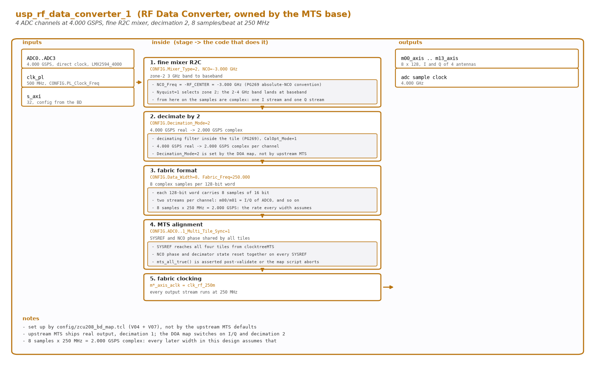

- **In:** four ADC channels at **4.000 GSPS** (direct clocking, `LMX2594_4000`), a 500 MHz PL
  clock (`CONFIG.PL_Clock_Freq`) and the 32-bit `s_axi` config port.
- **Inside, in order:** the fine real-to-complex mixer (`CONFIG.Mixer_Type=2`, NCO
  `-3.000 GHz`, zone 2) → decimation by 2 (`CONFIG.Decimation_Mode=2`, so 4.000 GSPS real
  becomes 2.000 GSPS complex) → fabric format (`CONFIG.Data_Width=8`,
  `Fabric_Freq=250.000`: eight complex samples per 128-bit word) → MTS alignment
  (`CONFIG.ADC0/1_Multi_Tile_Sync=1`, SYSREF and NCO phase shared) → the fabric clocking that
  puts every output stream on `clk_rf_250m`.
- **Out:** eight 128-bit streams `m00_axis … m13_axis` at 250 MHz — even = I, odd = Q of the
  same antenna.
- **Remember:** the RFDC belongs to the MTS base (`/usp_rf_data_converter_1`), but it is
  *reconfigured* here, by `config/zcu208_bd_map.tcl` (`build_rfdc_pair_dict`), which sets I/Q,
  decimation 2 and 8 samples per word. Upstream MTS ships real output and decimation 1. Eight
  samples × 250 MHz = 2.000 GSPS complex, and every width downstream assumes exactly that.

### `doa_rfdc_repack_0` — the gearbox

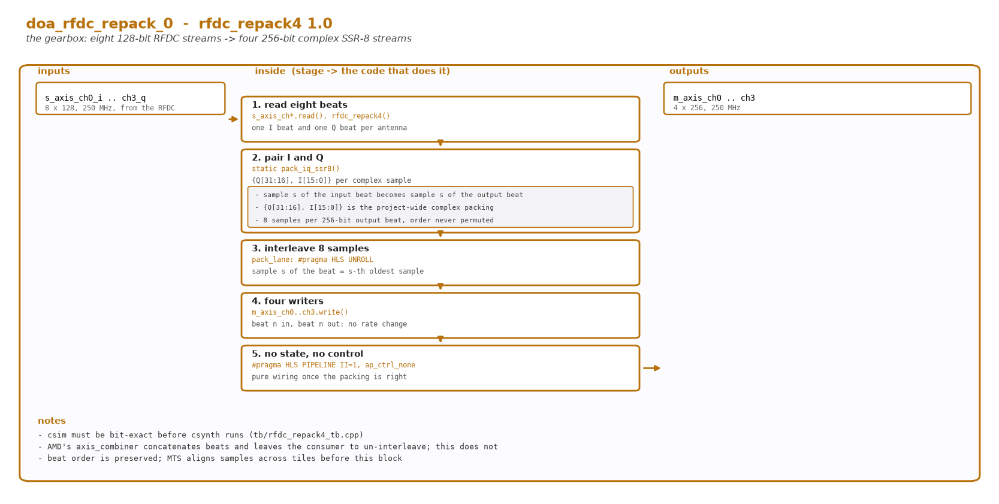

- **In:** the eight 128-bit RFDC streams, `s_axis_ch0_i … s_axis_ch3_q`.
- **Inside, in order:** read one I beat and one Q beat per antenna → `static pack_iq_ssr8()`
  packs `{Q[31:16], I[15:0]}` per sample and interleaves eight samples per beat
  (`pack_lane`, `#pragma HLS UNROLL`) → four `m_axis_ch*.write()`. `#pragma HLS
  PIPELINE II=1` and `ap_ctrl_none`: no state, no control, no rate change.
- **Out:** four 256-bit streams, `m_axis_ch0 … ch3`, 250 MHz.
- **Remember:** this is not `axis_combiner`. AMD's combiner concatenates beats and leaves the
  consumer to un-interleave; here the interleaving exists before the beat does. csim must be
  bit-exact (`tb/rfdc_repack4_tb.cpp`) or synthesis is not allowed.

### `doa_channelizer_0…3` — the channelizer, block by block

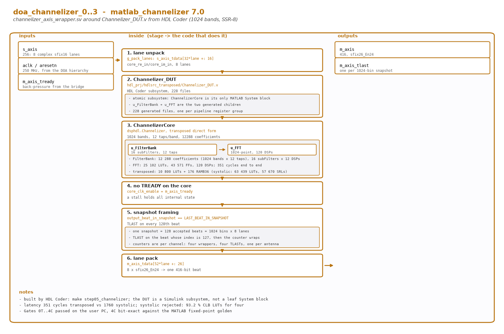

- **In:** a 256-bit stream (8 complex `sfix16` lanes, lane 0 in the LSB), `aclk`/`aresetn` at
  250 MHz, and `m_axis_tready` from the bridge.
- **Inside, in order — these are the actual pieces, not a summary:**
  1. `g_pack_lanes` in `channelizer_axis_wrapper.sv` — `s_axis_tdata[32*lane +: 16]` into
     `core_re_in`/`core_im_in`, eight lanes.
  2. `Channelizer_DUT` — the HDL Coder subsystem (`hdl_prj/hdlsrc_transposed/Channelizer_DUT.v`,
     228 generated files).
  3. `ChannelizerCore` — the `dsphdl.Channelizer` object: **1024 bands, 12 taps per band,
     12 288 prototype coefficients**, transposed direct form, output `sfix26_En24`. Opened
     up its panel shows the two generated children: **`u_FilterBank`** — 16 real/imaginary
     `subFilter` instances, 12 taps each, 10 800 LUTs / 15 055 FFs / **176 RAMB36** /
     192 DSPs in the transposed form (the systolic form put the same delays in 57 670 SRLs
     and cost 63 439 LUTs) — and **`u_FFT`**, the 1024-point transform at 25 102 LUTs,
     43 571 FFs and 120 DSPs.
  4. The clock enable, not TREADY — `core_clk_enable = m_axis_tready`: the generated core has
     no TREADY port, so a stall holds all internal state and back-pressure is propagated as
     `s_axis_tready = m_axis_tready`.
  5. Snapshot framing — `output_beat_in_snapshot == LAST_BEAT_IN_SNAPSHOT` drives `TLAST` on
     every 128th beat, i.e. once per 1024-bin snapshot.
  6. Output packing — `m_axis_tdata[52*lane +: 26]`, eight `sfix26_En24` lanes into one
     416-bit beat.
- **Out:** `m_axis` (416 bit) and `m_axis_tlast` (one per snapshot).
- **Remember:** the 416 is 8 × 52, not a power of two, and that one number sets the width of
  every block that touches the search stream. Latency is 351 cycles transposed against 1760
  systolic; the systolic form was rejected at 93.2 % of the CLB LUTs for four channels. Built
  by `make step05_channelizer`; gates 0T–4C passed on the user PC, 4C bit-exact against the
  MATLAB fixed-point golden.

### `doa_subband_bridge_0` — the bridge


- **In:** four 416-bit channelizer streams, the 192-bit candidate record from
  `doa_cdc_candidate`, and `s_axi_ctrl` (32 bit, M12 of the control interconnect).
- **Inside, in order:** always-ready sinks (`assign s_axis_ch*_tready = aresetn`) → the
  quantiser function `quantize_s26_to_s16` (half-up, symmetric saturation, `SCALE_SHIFT = 9`)
  → stage-1 alignment (`q_lo512`/`q_hi512`, `in_beat_idx`, `q_valid`: one coherent
  four-channel beat) → the search FSM (`SRCH_IDLE`/`SRCH_CAPTURE`, 256 beats, natural bin
  order) → the snapshot packer (`snap_pack_reg`, `snap_lane_cnt`, `active_bin` locked for
  4096 samples) → the beam packetiser (`reg_beam_beats`, 64 by default) → the AXI-Lite
  register file (`aw_holding`/`w_holding`, `0x00 … 0x3C`).
- **Out:** `m_axis_search`, `m_axis_capture`, `m_axis_beam` (512 bit each) and the legacy
  `mon_ch0…3` monitor.
- **Remember:** this is the only block that knows everybody's timing, and its `tready` is
  tied high on purpose — a stalled channelizer would break the lockstep. The full register map
  is in Part 2.1; the picture's notes list all fifteen registers by address, and
  `tb/tb_doa_subband_bridge_4ch.sv` is the golden check for them.

### The three forward clock crossings

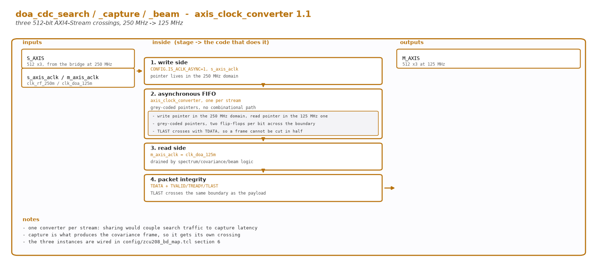

- **In:** three 512-bit streams written at 250 MHz (`s_axis_aclk = clk_rf_250m`).
- **Inside:** `axis_clock_converter` with `CONFIG.IS_ACLK_ASYNC=1` — write pointer in the RF
  domain, grey-coded pointers across, read side on `clk_doa_125m`, with TDATA and
  TVALID/TREADY/TLAST crossing together.
- **Out:** the same three streams, read at 125 MHz.
- **Remember:** one converter per stream. Sharing one would couple search traffic to capture
  latency, and capture is what produces the covariance frame.

### `doa_cdc_candidate` — the one backward crossing

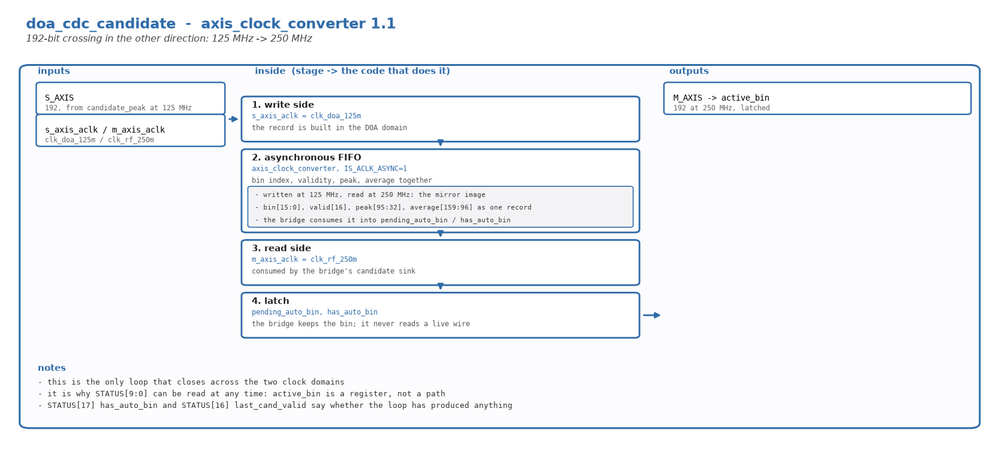

- **In:** the 192-bit candidate record written at 125 MHz.
- **Inside:** the same primitive, reversed — `s_axis_aclk = clk_doa_125m`,
  `m_axis_aclk = clk_rf_250m`; bin index, validity, peak and average cross as one record; the
  bridge then latches it into `pending_auto_bin` / `has_auto_bin`.
- **Out:** the record at 250 MHz, consumed as `active_bin`.
- **Remember:** this is the only loop that closes across the two clock domains, which is why
  the bridge stores the bin instead of reading a live wire, and why `STATUS[17]` tells you
  whether the loop has produced anything at all.

## 5.2 The 125 MHz `/doa_v7` hierarchy — seven pictures

### `spectrum_power` — the detector statistic

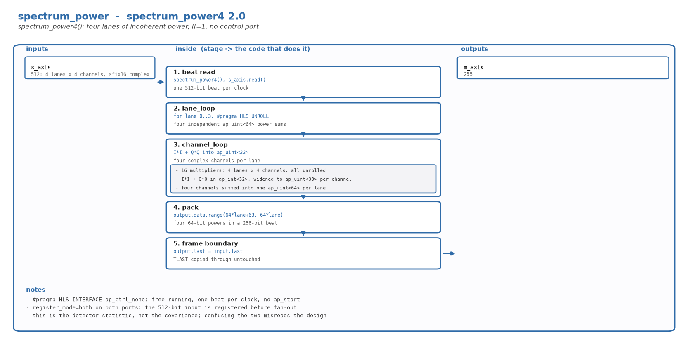

- **In:** the 512-bit search stream: 4 lanes × 4 channels of complex `sfix16`.
- **Inside:** `spectrum_power4()` reads one beat, then `lane_loop` (`#pragma HLS UNROLL`, four
  `ap_uint<64>` sums) and an inner `channel_loop` computing `I*I + Q*Q` into `ap_uint<33>`
  per channel; the four powers are packed with `output.data.range(64*lane+63, 64*lane)` and
  `output.last = input.last`.
- **Out:** a 256-bit beat per clock, `TLAST` copied.
- **Remember:** `#pragma HLS INTERFACE ap_ctrl_none` — free-running, no `ap_start`, one beat
  per clock; `register_mode=both` registers the 512-bit input before its fan-out. This is the
  detector statistic, *not* the covariance.

### `candidate_peak` — the gate

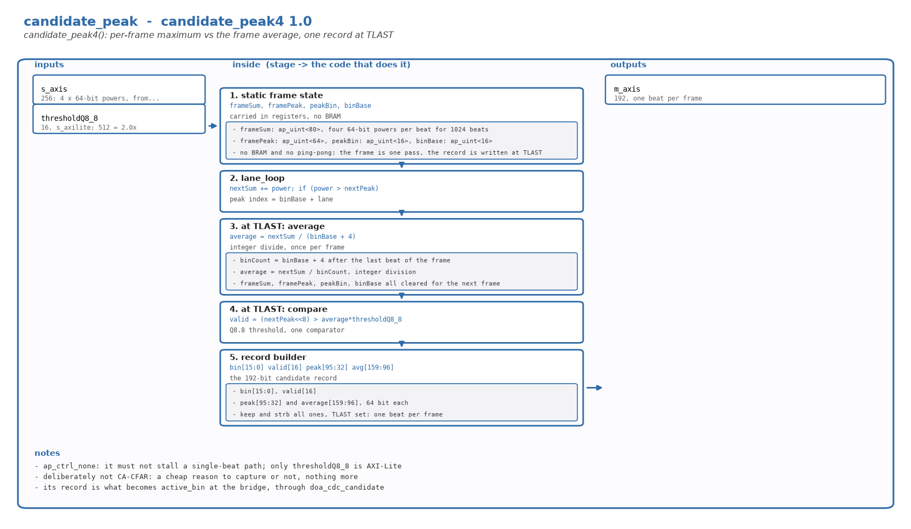

- **In:** the 256-bit power stream and `thresholdQ8_8` (16 bit, AXI-Lite; 512 = 2.0×).
- **Inside:** static frame state in registers (`frameSum`, `framePeak`, `peakBin`, `binBase`;
  no BRAM), `lane_loop` accumulating and tracking the maximum, and at `input.last`:
  `average = nextSum / (binBase + 4)`, `valid = (nextPeak<<8) > average*thresholdQ8_8`,
  then the record builder — `bin[15:0]`, `valid[16]`, `peak[95:32]`, `avg[159:96]`.
- **Out:** one 192-bit record per frame.
- **Remember:** `ap_ctrl_none`, so it can never stall a single-beat path; only the threshold
  is AXI-Lite. Deliberately not CA-CFAR: a cheap reason to capture or not, nothing more.

### `covariance` — the DOA statistic

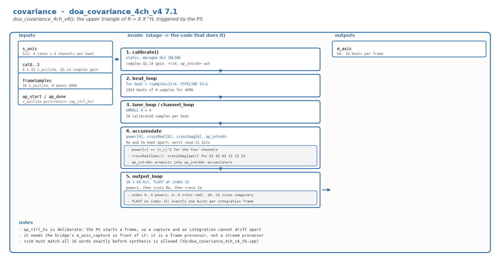

- **In:** the 512-bit capture stream, `cal0…cal3` (Q2.14 complex gain, AXI-Lite),
  `frameSamples` (0 means 4096) and — crucially — `ap_start`/`ap_done` from
  `#pragma HLS INTERFACE s_axilite port=return`, i.e. `ap_ctrl_hs`.
- **Inside:** `static calibrate()` (inline, `>>14`, `ap_int<20>`) → `beat_loop`
  (`(samples+3)/4` beats, `PIPELINE II=1`, trip count 1024) → `lane_loop`/`channel_loop`
  (unrolled 4 × 4) → accumulation into `power[4]`, `crossReal[6]`, `crossImag[6]`
  (`ap_int<64>`; the worst case is 51 bits) → `output_loop` writing 16 × 64-bit words,
  `TLAST` at index 15.
- **Out:** `m_axis`, 16 beats per integration frame: powers first, then cross real, then cross
  imaginary.
- **Remember:** `ap_ctrl_hs` is deliberate — the PS starts a frame, so capture and integration
  cannot drift apart. It is a frame processor: it needs the bridge's `m_axis_capture` in front
  of it, and csim must match all sixteen words before synthesis.

### `beam_monitor` — the diagnostic

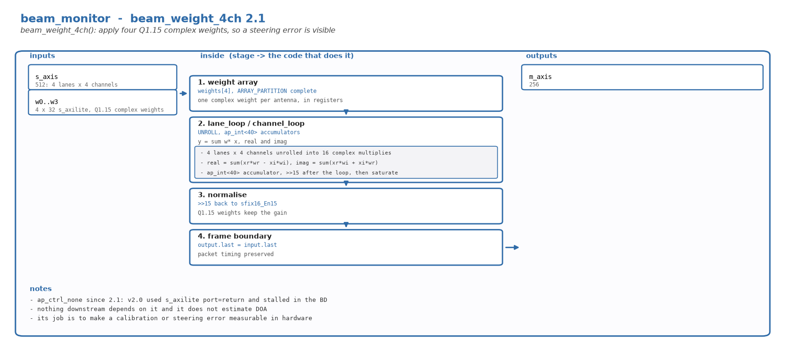

- **In:** the 512-bit beam stream and `w0…w3` (Q1.15 complex weights, AXI-Lite).
- **Inside:** `weights[4]` with `ARRAY_PARTITION complete` → `lane_loop`/`channel_loop`
  computing `real = Σ(xr·wr − xi·wi)` and `imag = Σ(xr·wi + xi·wr)` in `ap_int<40>` → `>>15`
  back to `sfix16_En15` → `output.last = input.last`.
- **Out:** a 256-bit stream.
- **Remember:** v2.0 used `s_axilite port=return` and stalled in the BD; 2.1 moved to
  `ap_ctrl_none`. Nothing downstream depends on it — its job is to make a calibration or
  steering error *visible in hardware*.

### `phase_interf_4ch` — packaged, not attached

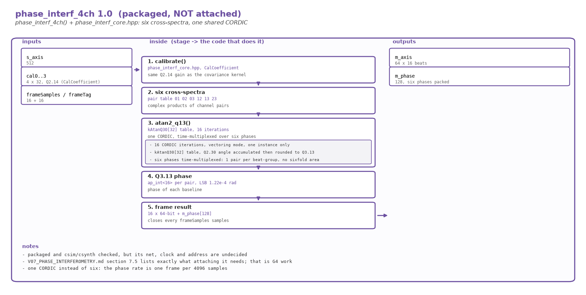

- **In:** the 512-bit stream, `cal0…cal3`, `frameSamples` and `frameTag`.
- **Inside:** `calibrate()` from `phase_interf_core.hpp` (`CalCoefficient`, Q2.14) → six
  cross-spectra over the pair table 01/02/03/12/13/23 → `atan2_q13()` with the 32-entry
  `kAtanQ30` table and 16 iterations — **one** CORDIC, time-multiplexed over the six phases →
  Q3.13 phase per pair (≤ 2 LSB) → the frame result.
- **Out:** `m_axis` (16 × 64-bit) and `m_phase` (128 bit).
- **Remember:** packaged, csim- and csynth-checked, but its net, clock and address are
  undecided; `V07_PHASE_INTERFEROMETRY.md` §7.5 lists what attaching it needs, and that is G4
  work. One CORDIC is enough because the phase rate is one frame per 4096 samples.

### `doa_cov_dwc` + `doa_cov_fifo`

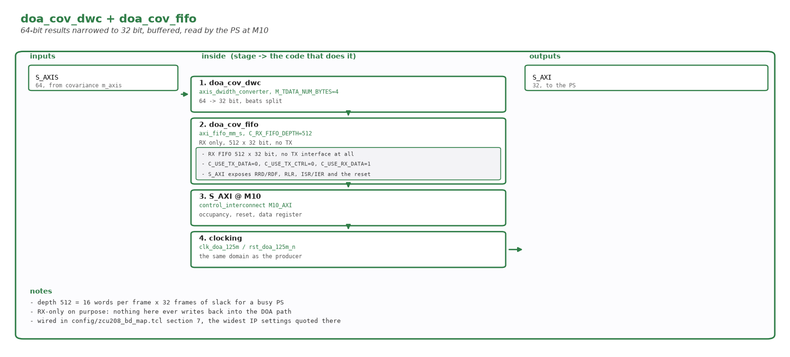

- **In:** the 64-bit covariance burst.
- **Inside:** `doa_cov_dwc` (`axis_dwidth_converter`, `M_TDATA_NUM_BYTES=4` → 32 bit) →
  `doa_cov_fifo` (`axi_fifo_mm_s`, `C_RX_FIFO_DEPTH=512`, RX only, no TX path) → `S_AXI` at
  M10 of the control interconnect.
- **Out:** 32-bit reads the A53 can `mmap`.
- **Remember:** 512 deep = 16 words per frame × 32 frames of slack, and RX-only by
  construction: nothing here can ever write back into the DOA path.

### `doa_beam_dwc` + `doa_beam_fifo`

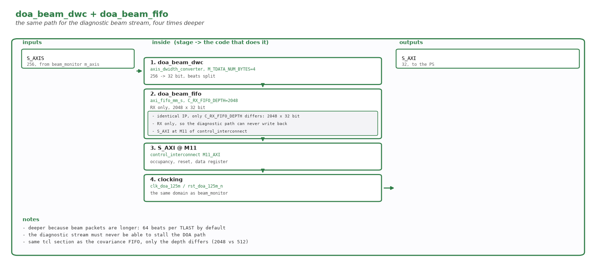

- **In:** the 256-bit beam stream.
- **Inside:** the same two IPs — `doa_beam_dwc` (256 → 32 bit) and `doa_beam_fifo`
  (`C_RX_FIFO_DEPTH=2048`), `S_AXI` at M11.
- **Out:** 32-bit reads for the diagnostic path.
- **Remember:** four times deeper because beam packets are longer (64 beats per `TLAST`), and
  it must never be able to stall the DOA path.

## 5.3 Clocking and the control plane — two pictures

### `clocktreeMTS/clkRFdiv2` → `doa_clk_wiz_125m` + `doa_rst_125m`

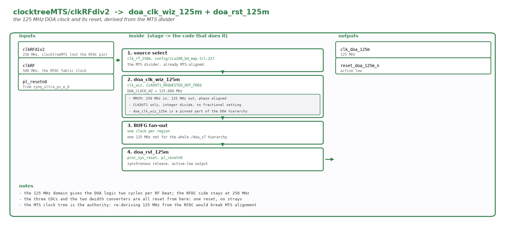

- **In:** `clocktreeMTS/clkRFdiv2` at 250 MHz, `clocktreeMTS/clkRF` at 500 MHz, and
  `zynq_ultra_ps_e_0/pl_resetn0`.
- **Inside:** source select (`clk_rf_250m` from the MTS clock tree, already MTS-aligned) →
  `doa_clk_wiz_125m` (clk_wiz, `CLKOUT1_REQUESTED_OUT_FREQ` = `DOA_CLOCK_HZ` = 125.000) →
  BUFG fan-out → `doa_rst_125m` (`proc_sys_reset` on `pl_resetn0`, synchronous release).
- **Out:** `clk_doa_125m` and `reset_doa_125m_n`.
- **Remember:** the 250 MHz is the MTS divider, not the RFDC's own output pin — re-deriving
  125 MHz from anywhere else would break MTS alignment. The three CDCs and the two dwidth
  converters are all reset from here.

### `control_interconnect`

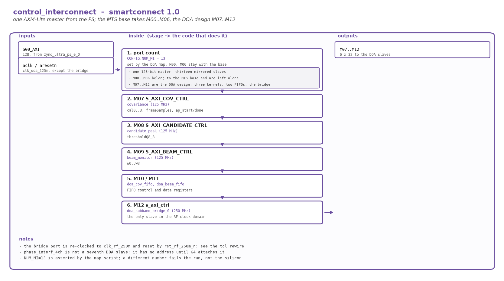

- **In:** `S00_AXI` (128 bit) from `zynq_ultra_ps_e_0`, clocked by `clk_doa_125m` except for
  the one RF-domain slave.
- **Inside:** `CONFIG.NUM_MI = 13` — the MTS base keeps M00…M06, the DOA design uses
  **M07…M12**: M07 `S_AXI_COV_CTRL` (covariance), M08 `S_AXI_CANDIDATE_CTRL`
  (`candidate_peak`), M09 `S_AXI_BEAM_CTRL` (`beam_monitor`), M10/M11 the two FIFOs, and
  M12 `s_axi_ctrl` on the bridge — the only slave re-clocked to `clk_rf_250m` and reset by
  `rst_rf_250m_n`.
- **Out:** six 32-bit slave ports, M07…M12.
- **Remember:** the port count is asserted by the map script, so a wrong topology fails the
  build rather than the board. `phase_interf_4ch` is **not** a seventh DOA slave: it has no
  address until G4 attaches it.

## 5.4 The RPU — four pictures

### The RPU as a whole


- **Software:** `step3_r5_doa/c/doa_core.c` and `firmware/amc_r5/amc.c` are C99 — libm only,
  no allocation, because that is what a bare-metal R5F build tolerates. The ladder exists
  twice: `step5_r5_tracking/py/ladder.py` and `step6_ps_linux/c/supervisor.cpp`.
- **Inside, in order:** frame intake (`doa_core.h`: R as 4×4 complex double, frame-aligned) →
  `doa_estimate()` → `amc_run()` → `associate()` / `Store.update()` → telemetry into static
  buffers.
- **Out:** an angle, a modulation label and a track set per frame.
- **Remember:** G7a and G8a are closed with exactly this code on the host. G8b needs Embedded
  Coder and G8c needs the board; neither is a code gap. Nothing in the path allocates, which
  is what lets it drop into an RPMsg loop with a static buffer.

### The estimator: `doa_core.c`

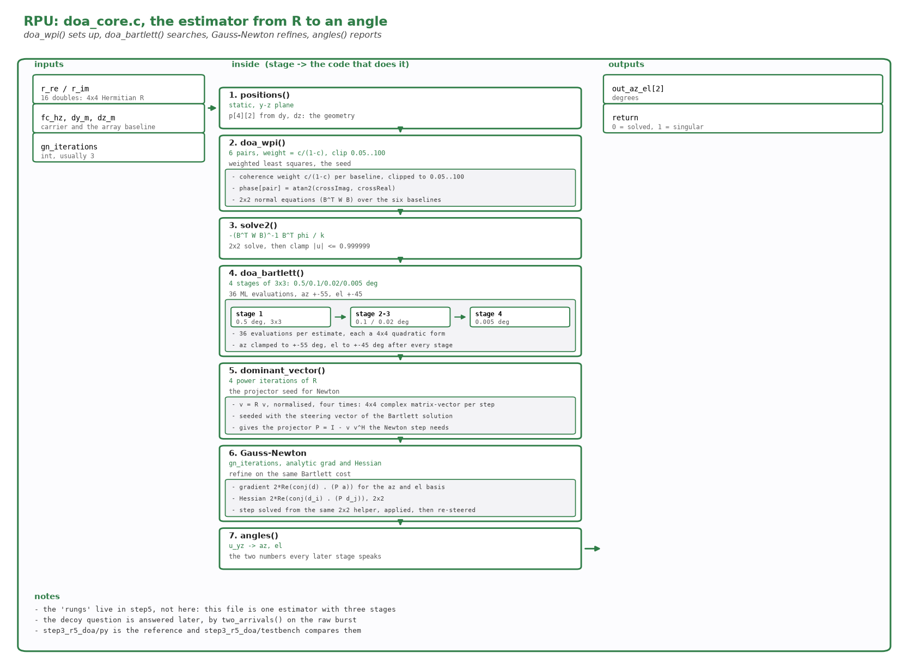

- **In:** `r_re`/`r_im` (16 doubles, the 4×4 Hermitian R), `fc_hz`, `dy_m`, `dz_m`, and
  `gn_iterations`.
- **Inside, in order:** `positions()` (geometry in the y–z plane) → `doa_wpi()` (six pairs,
  coherence weight `c/(1−c)` clipped to 0.05…100) → `solve2()`
  (`−(BᵀWB)⁻¹Bᵀφ/k`, then `|u| ≤ 0.999999`) → `doa_bartlett()` (four stages of 3×3 at
  0.5/0.1/0.02/0.005°, 36 ML evaluations, az clamped to ±55°, el to ±45°) →
  `dominant_vector()` (four power iterations of R) → Gauss-Newton (`gn_iterations`, analytic
  gradient and Hessian with the projector `I − vvᴴ`) → `angles()`.
- **Out:** `out_az_el[2]` in degrees; return 0 for solved, 1 for singular.
- **Remember:** the *rungs* are not here — this file is one estimator with three stages. The
  decoy question is answered later, by `two_arrivals()` on the raw burst.

### AMC: the same classifier in MATLAB and in C

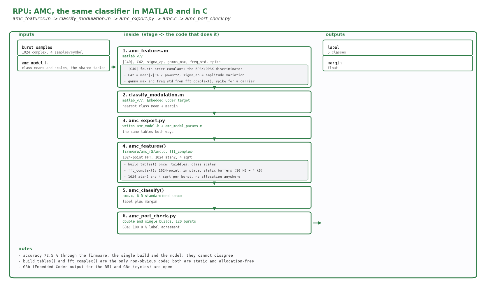

- **In:** a 1024-sample complex burst (4 samples/symbol) and `amc_model.h`.
- **Inside, in order:** `matlab_v7/amc_features.m` (six features: `|C40|`, `C42`,
  `sigma_ap`, `gamma_max`, `freq_std`, `spike`) → `matlab_v7/classify_modulation.m`
  (nearest class mean + margin) → `scripts/amc_export.py` (writes `amc_model.h` and
  `amc_model_params.m` from the same tables) → `amc_features()` and `fft_complex()` in
  `firmware/amc_r5/amc.c` (1024-point FFT, 1024 `atan2`, 4 `sqrt`) → `amc_classify()` →
  `scripts/amc_port_check.py` as the referee.
- **Out:** a label over five classes and a margin. Measured today: **100.0 % label agreement**
  over 120 bursts for the double *and* the single build, every feature within 1e-3, **72.5 %
  accuracy against the true class in firmware, single build and model alike**.
- **Remember:** G8a is exactly this claim, on the host, with `make amc-port`; the report is
  `docs/evidence/2026-11-06-phase-interf/amc_port.txt`. Cycles on the R5F are G8c — not
  measured anywhere in this repository.

### Tracking: the ladder and the store

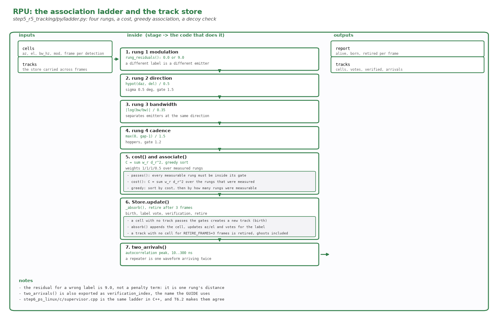

- **In:** cells (`az`, `el`, `bw_hz`, `mod`, `frame`) and the track store.
- **Inside, in order:** rung 1 `rung_residuals()` modulation (0.0 or 9.0) → rung 2 direction
  (`hypot(Δaz, Δel)/0.5`) → rung 3 bandwidth (`|log(bw/bw)|/0.35`) → rung 4 cadence
  (`max(0, gap−1)/1.5`) → `cost()` and `associate()` (`C = Σ w_r d_r²`, weights 1/1/1/0.5,
  greedy sort) → `Store.update()` (`_absorb()`, retire after 3 empty frames) →
  `two_arrivals()` (autocorrelation peak between 10 and 300 ns).
- **Out:** a per-frame report (alive, born, retired) and the tracks with cells, votes,
  `verified` and `arrivals`.
- **Remember:** a wrong modulation label contributes a *distance* of 9.0 on that one rung —
  it is not a separate penalty term. `two_arrivals()` is also exported as
  `verification_index`, the name the rest of the documentation uses.

## 5.5 The APU / Linux side (step6_ps_linux)


- **Platform:** Cortex-A53 running Linux. Built on the host with any g++ (`make -C step6_ps_linux/c`),
  cross-built for the board with the PetaLinux SDK (`make -C step6_ps_linux/c cross` →
  `build/step6/supervisor_aarch64`).
- **In:** cells as JSONL on stdin, `--policy` (`full` or `direction-only`), and the fixture
  `step6_ps_linux/testbench/fixture_cells.jsonl` — 15 cells over 7 frames, holding a QPSK
  mover with a dropped frame, a 16QAM emitter at the *same* direction, and a ghost at 25°
  that disappears.
- **Inside, in order (`supervisor.cpp`):** `parse_cell()` with `read_double()`/`read_string()`
  → `passes()` (the same four rungs as `ladder.py`) → `absorb()` (update the track, vote the
  label) → retirement after N empty frames → telemetry (one JSON object per cell and per
  retirement on stdout) → the summary line on stderr.
- **Out:** JSONL track events, and
  `supervisor: frames=7 cells=15 tracks_live=2 born=3 retired=1 ghosts=1 malformed=0 policy=full`
  — that line is what a watchdog parses on the board.
- **Remember:** the A53 does four jobs and **no maths** — calibration manager, policy,
  telemetry, watchdog. The duplication with `step5_r5_tracking/py` is deliberate: a shared
  library across two cores with different ABIs costs more than 300 lines twice, so it is
  checked instead of removed (T6.1–T6.5, `make step6`). The cross target exists and refuses
  politely without the SDK; nothing has run on an A53 yet.

## 5.6 The host, the base project, and the IP flow — three pictures

### The host

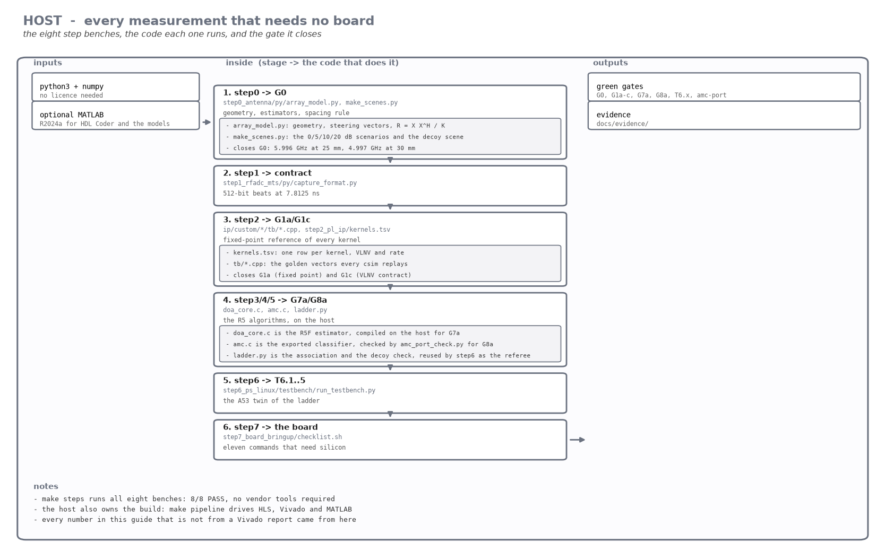

- **In:** python3 + numpy (no licence) and, optionally, MATLAB R2024a.
- **Inside, in order:** step0 (`step0_antenna/py/array_model.py`, `make_scenes.py`) → G0;
  step1 (`step1_rfadc_mts/py/capture_format.py`) → the capture contract; step2
  (`ip/custom/*/tb/*.cpp`, `step2_pl_ip/kernels.tsv`) → G1a/G1c; step3/4/5 (`doa_core.c`,
  `amc.c`, `ladder.py`) → G7a/G8a; step6 (`testbench/run_testbench.py`) → T6.1–T6.5; step7
  (`step7_board_bringup/checklist.sh`) → the eleven commands that need silicon.
- **Out:** the green gates and everything under `docs/evidence/`.
- **Remember:** `make steps` runs all eight benches — 8/8 PASS, no vendor tools. Every number
  in this guide that is not from a Vivado report came from here.

### Stage V03 — the MTS base project

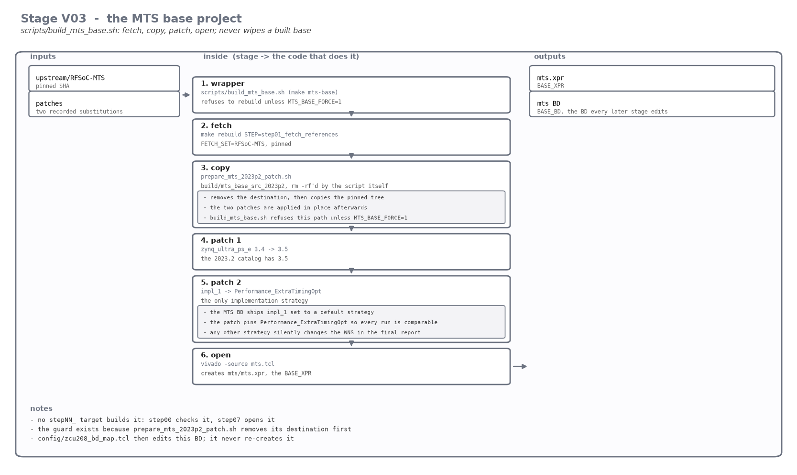

- **In:** `upstream/RFSoC-MTS` at a pinned SHA and two recorded substitutions.
- **Inside, in order:** `scripts/build_mts_base.sh` (target `mts-base`, refuses to rebuild
  unless `MTS_BASE_FORCE=1`) → fetch (`make rebuild STEP=step01_fetch_references
  FETCH_SET=RFSoC-MTS`) → `prepare_mts_2023p2_patch.sh` copies to
  `build/mts_base_src_2023p2` → patch 1 (`zynq_ultra_ps_e` 3.4 → 3.5 for the 2023.2
  catalog) → patch 2 (implementation strategy `Performance_ExtraTimingOpt`) →
  `vivado -source mts.tcl`.
- **Out:** `mts/mts.xpr` (`BASE_XPR`) and its `BASE_BD`.
- **Remember:** no `stepNN_` target builds it — step00 checks it, step07 opens it. The guard
  exists because `prepare_mts_2023p2_patch.sh` `rm -rf`s its own destination.

### IP packaging and collection — steps 02…06

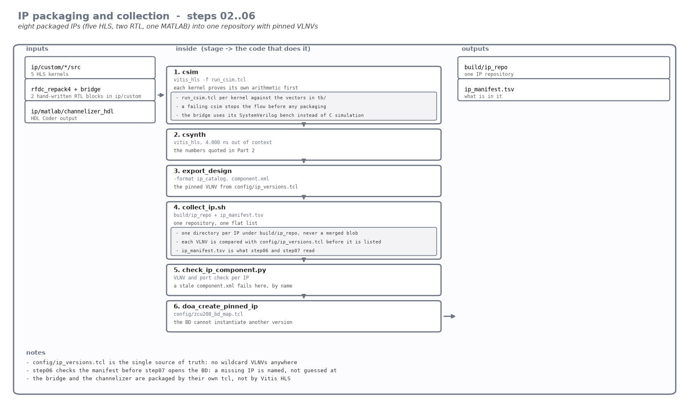

- **In:** `ip/custom/*/src` (five HLS kernels), `ip/custom/rfdc_repack4` and
  `ip/custom/doa_subband_bridge_4ch` (two hand-written RTL blocks), and
  `ip/matlab/channelizer_hdl` (HDL Coder output).
- **Inside, in order:** csim (`vitis_hls -f run_csim.tcl`) → csynth at 4.000 ns out of context
  → `export_design -format ip_catalog` → `collect_ip.sh` (checks every VLNV, writes
  `ip_manifest.tsv` into `build/ip_repo`) → `check_ip_component.py` → `doa_create_pinned_ip`
  in the BD.
- **Out:** one IP repository and the flat manifest.
- **Remember:** `config/ip_versions.tcl` is the single source of truth — no wildcard VLNVs
  anywhere, so the BD cannot instantiate an unpinned version, and a stale `component.xml`
  fails at step06 with the directory and the expected value named.

## 5.7 Adding or changing a picture

The gallery is a table (`BLOCKS`) in `scripts/draw_block_details.py`. One entry is one picture:

```python
("stem", "title", "subtitle", colour,
 [("input port", "width, clock, or where it comes from")],
 [("stage name", "function / module / file", "what it does")],
 [("output port", "width")],
 ["note", "note"]),
```

```bash
cd /media/joshua/Linux/Vivado_prj/Doc1/seek/FP/RFSoC_ZCU208_DOA_V7_BuildKit_STEP05_PACKAGE_FIX_V5/RFSoC_ZCU208_DOA_V7_BuildKit
python3 scripts/draw_block_details.py --only stem     # render one, look at it
python3 scripts/draw_block_details.py                 # render all twenty-three
make lint                                             # shell/Tcl/SV checks (it does not read Python or Markdown)
```

Three rules for anyone editing it, learned the hard way. The middle column is *"stage → the
code that does it"*: a stage without a real function, module, register or tcl line next to it
is a summary, not a diagram — that is why `doa_channelizer_0..3` names `g_pack_lanes`,
`Channelizer_DUT`, `ChannelizerCore`, `core_clk_enable`, `LAST_BEAT_IN_SNAPSHOT` and the
52-bit lane packing instead of saying "the channelizer". If a stage is itself a block, it also
gets an entry in the `INSIDE` table, keyed by block and stage number, and that entry is what
the shaded panel draws; leave it out and the picture stops one level too early. Each line of a
panel is one fact with a number or a name in it — "32-bit" is a fact, "handles data" is not.
And any new fact must come from the block's own source, not from its name: a picture that
guesses is worse than no picture, because it looks authoritative.

```python
# scripts/draw_block_details.py — the second level, keyed by (stem, stage number)
INSIDE = {
    ("matlab_channelizer", 3): [
        "u_FilterBank: 16 real/imag subFilters, 12 taps each = 12 288 coefficients",
        "u_FFT: 1024-point, 25 102 LUTs, 43 571 FFs, 120 DSPs",
        ...
    ],
}
```

---

*Figures: five system-level (`make diagram`, Part 1–2) and twenty-three block-level
(`scripts/draw_block_details.py`, this part). Sources and renders live under
`docs/diagrams/`; nothing in them was produced by a vendor tool in this sandbox.*
