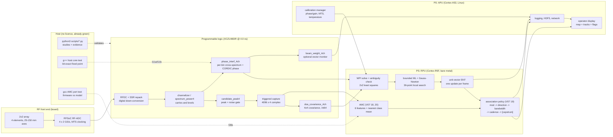
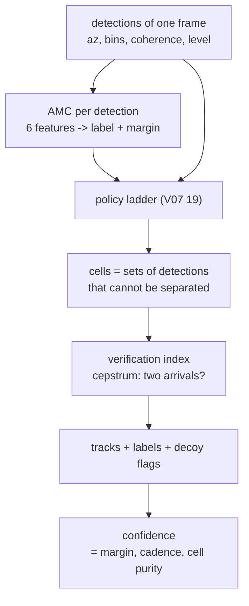

# The whole system on one page, and where every gate sits

This is the map. Every algorithm document in this repository — V07's sections,
`DECOY_DISCRIMINATION.md`, the MATLAB guides — is a zoom into one box on this
page, and every gate in `GATES_RUNBOOK.md` is an arrow that has not been proved
yet.

Two diagrams follow: the machine (where the code runs) and the decision path
(what the numbers mean). Both are Mermaid so they render in the repository view;
an ASCII copy of the first one is below it for terminals and for diffing.

---

## 1. The machine: RF → PL → PS → out



```
 2x2 array      RF-ADC 2 GS/s      PL @ 4.0 ns                        PS
┌─────────┐   ┌──────────────┐   ┌──────────────────────────────┐   ┌─────────────┐
│ 4 el.   │──▶│ RFDC + repack│──▶│ channelizer → candidate gate │──▶│ R5: WPI, ML │
│ 25-150mm│   │ 4 x 2 GS/s   │   │        ↓                     │   │     GN, EKF │
└─────────┘   └──────────────┘   │ triggered capture (4096 x 4) │   │     policy  │
                                 │        ↓            ↓        │   │ A53: calib, │
                                 │ covariance      phase_interf │   │     log, UI │
                                 │ (4x4, int64)    (per-bin)    │──▶│             │
                                 └──────────────────────────────┘   └─────────────┘
```

## 2. The decision path: what each box hands to the next



## 3. Every box: what it does and what proves it

| # | Box | Runs on | What it does | Algorithm document | Gate | Status |
|---|---|---|---|---|---|---|
| 1 | Array + RF front end | board | 4 elements, 2 GS/s each, MTS clocking | V07 §3–4, §12 | G6 | not run |
| 2 | RFDC + SSR repack | PL (hard IP) | 2 GS/s → complex baseband, 4 streams | V04 contract, `ip/custom/rfdc_repack4` | G2 (repack) | IP written, not built |
| 3 | Channelizer / spectrum power | PL (HLS) | carriers + per-bin power, 410 bins | V06 feasibility, `ip/custom/spectrum_power4` | G2 | host test green, HLS not run |
| 4 | Candidate peak / noise gate | PL (HLS) | which bins are candidates | `ip/custom/candidate_peak4` | G2 | host test green, HLS not run |
| 5 | Triggered capture | PL | 4096 snapshots × 4 channels | `ip/custom/doa_covariance_4ch_v4` | G2 | written |
| 6 | Calibrated covariance | PL (HLS) | 4×4 int64 covariance per burst | `ip/custom/doa_covariance_4ch_v4` | G2 | IP written |
| 7 | Phase interferometry | PL (HLS) | per-bin cross-spectrum + CORDIC phase | V07 §5–7, `ip/custom/phase_interf_4ch` | **G1a/b/c green, G2–G3 not run** | core bit-exact on host |
| 8 | WPI solve + ambiguity check | R5 | 2×2 weighted least squares, wrap test | V07 §6, `matlab_v7/PhaseInterferometryEstimator.m` | G4 (integration) | MATLAB reference + host port |
| 9 | ML + Gauss–Newton | R5 | 36-point local search, 2 GN steps | `matlab_v7/estimate_doa_from_covariance_v7.m` | G4 | MATLAB only |
| 10 | Unit-vector EKF | R5 | 6-state filter, one update per frame | `matlab_v7/PlatformDynamics3D.m` | G4 | MATLAB only |
| 11 | **Association policy** | R5 | ladder of indices, cells, tracks | **V07 §15, §16, §17, §18, §19** | — (host) | measured, host |
| 12 | **AMC** | **R5** | 6 features, nearest class mean, voted | **V07 §18, §20** | **G8a green, G8b/c not run** | verified C port |
| 13 | Verification index (cepstrum) | R5 | two-path ripple per cell | V07 §13, §19.1 | G7a green, G7b not run | measured, host |
| 14 | Calibration manager | A53 | phase/gain tables, MTS, temperature | `matlab_v7/estimate_multifrequency_calibration.m` | G5, G6 | MATLAB only |
| 15 | Logging, network, UI | A53 | HDF5, telemetry, the map | `matlab_v7/doa_3d_gui.m` | G4 | MATLAB only |

"Host test green" means the C/C++ core of that block produces bit-identical
output on the host against a golden vector (`make -C ip/custom/<ip> host-check`).
It says nothing about synthesis, timing, or the board.

## 4. Where the seven gates are on this page

The gates are ordered by cost, not by importance: each one is cheaper to fail
than the next. Full detail — criteria, why each is unimplemented, and the exact
commands to close it — is in [`GATES_G1_G7.md`](GATES_G1_G7.md).

| Gate | Sits between | Owner | Status |
|---|---|---|---|
| **G0** | host model of boxes 7–12 | scripts | **PASS** (physics, screens, comparisons) |
| **G1a/b/c** | box 7's C++ core and its packaging | host g++ | **PASS** (bit-exact, contract only) |
| **G2** | box 3–7: C source → packaged IP | Vitis HLS 2023.2 | **NOT RUN** |
| **G3** | box 7: packaged IP → 4.0 ns timing | Vivado 2023.2 | **NOT RUN** |
| **G4** | box 2–7 into the block design, bitstream | Vivado 2023.2 | **NOT RUN** |
| **G5** | box 1–7 on silicon: RF loopback, sign and offset | board | **NOT RUN** |
| **G6** | box 1–7 calibrated: chamber/field accuracy | board + chamber | **NOT RUN** |
| **G7a/G7b** | box 13: decoy model (host) and decoy on hardware | host / board | **G7a PASS, G7b NOT RUN** |
| **G8a/b/c** | box 12: AMC on the R5 | host gcc / MATLAB / board | **G8a PASS, G8b/c NOT RUN** |

## 5. What the picture makes obvious

Three things, and they are the reason this page exists:

1. **Everything measured so far is in the PS or the host.** Boxes 11–13 are where
   all the recent sections live, and they are the only boxes whose behaviour is
   evidenced by this repository. Boxes 3–7 have host tests but no synthesis and
   no timing.
2. **The PL is a pipe, not a decision.** It reduces 2 GS/s to 128 bytes of
   covariance and a per-bin phase vector. Nothing in the PL knows what an emitter
   is. That is deliberate: the decision surface (association, AMC, decoys) is
   where requirements still change, so it lives in software.
3. **The gates are a chain, and only its two ends are green.** The head (host
   physics, fixed-point cores) and tail (host decoy criteria) are proved; the
   whole middle — HLS, timing, block design, silicon — is unwritten. No accuracy
   number in this repository may be quoted as a hardware number until G4–G6
   exist, and no RPU timing number until G8c.
