# Complete V7 file, function and source-code guide

This is the single-document code reference requested for the realistic 2x2 DOA and ZU48DR HIL project. It starts with the overall project diagram, then provides a clickable block/file index. Every distributed implementation source appears once with its purpose, edit guidance, definitions, important-line explanation, and complete source code.

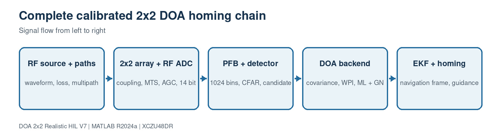

## Document header index

- [How to use this guide](#how-to-use-this-guide)
- [Clickable block and file index](#clickable-block-and-file-index)
- [Block 1: Project entry, configuration and dashboards](#block-1-project-entry-configuration-and-dashboards)
- [Block 2: RF source, waveform and propagation](#block-2-rf-source-waveform-and-propagation)
- [Block 3: Realistic receiver and calibration](#block-3-realistic-receiver-and-calibration)
- [Block 4: PFB search, CFAR and candidate selection](#block-4-pfb-search-cfar-and-candidate-selection)
- [Block 5: DOA seed and off-grid refinement](#block-5-doa-seed-and-off-grid-refinement)
- [Block 6: Tracking, guidance and truth](#block-6-tracking-guidance-and-truth)
- [Block 7: MATLAB verification and accuracy campaigns](#block-7-matlab-verification-and-accuracy-campaigns)
- [Block 8: Separate ZCU48DR HIL flow](#block-8-separate-zcu48dr-hil-flow)
- [Block 9: MATLAB HDL front-end reference](#block-9-matlab-hdl-front-end-reference)
- [Block 10: Four-sample-per-clock production HLS core](#block-10-four-sample-per-clock-production-hls-core)
- [Block 11: Legacy scalar HLS compatibility reference](#block-11-legacy-scalar-hls-compatibility-reference)
- [Block 12: Documentation generators](#block-12-documentation-generators)

## How to use this guide

- Start with `sim3d_params.m`, then follow the blocks in numeric order.
- The definition table identifies every class, MATLAB function/method, C++ function, Tcl procedure or Make target and its source line.
- The important-line table explains the lines that determine interfaces, geometry, covariance sign, bounded loops, verification and hardware synthesis.
- Expand **Complete source code** to inspect or copy the exact distributed file.
- Line numbers refer to this V7 delivery. Regenerate this document after code edits with `python3 docs/generate_complete_file_code_guide.py`.
- Behavioral source, GUI and vehicle dynamics are simulation code. Only explicitly identified HDL/HLS blocks are intended for PL synthesis.

## Clickable block and file index

### Block 1: Project entry, configuration and dashboards

- [`sim3d_params.m`](#file-sim3d-params-m)
- [`START_HERE.m`](#file-start-here-m)
- [`run_3d_doa_sim.m`](#file-run-3d-doa-sim-m)
- [`run_3d_doa_sim_compat.m`](#file-run-3d-doa-sim-compat-m)
- [`run_simulink_homing.m`](#file-run-simulink-homing-m)
- [`build_3d_doa_simulink.m`](#file-build-3d-doa-simulink-m)
- [`plot_simulink_results.m`](#file-plot-simulink-results-m)
- [`plot_homing_results.m`](#file-plot-homing-results-m)
- [`doa_3d_gui.m`](#file-doa-3d-gui-m)
- [`doa_3d_gui_update.m`](#file-doa-3d-gui-update-m)

### Block 2: RF source, waveform and propagation

- [`SourceModel3D.m`](#file-sourcemodel3d-m)
- [`source_modulation_profile.m`](#file-source-modulation-profile-m)
- [`source_modulation_summary.m`](#file-source-modulation-summary-m)

### Block 3: Realistic receiver and calibration

- [`RealisticReceiver4.m`](#file-realisticreceiver4-m)
- [`realism_profile.m`](#file-realism-profile-m)
- [`simulate_realistic_snapshots.m`](#file-simulate-realistic-snapshots-m)
- [`estimate_multifrequency_calibration.m`](#file-estimate-multifrequency-calibration-m)

### Block 4: PFB search, CFAR and candidate selection

- [`PFBFFTChannelizer4.m`](#file-pfbfftchannelizer4-m)
- [`SpectrumEstimator4.m`](#file-spectrumestimator4-m)
- [`NoiseFloorEstimator1D.m`](#file-noisefloorestimator1d-m)
- [`CACFAR1D.m`](#file-cacfar1d-m)
- [`BinClusterEstimator.m`](#file-binclusterestimator-m)
- [`CandidateSelector.m`](#file-candidateselector-m)
- [`SignalMetricsMonitor.m`](#file-signalmetricsmonitor-m)
- [`SnapshotDecimator4.m`](#file-snapshotdecimator4-m)
- [`SyntheticFourChannelSource.m`](#file-syntheticfourchannelsource-m)
- [`doa_search_params.m`](#file-doa-search-params-m)
- [`run_search_chain_matlab.m`](#file-run-search-chain-matlab-m)
- [`build_doa_search_model.m`](#file-build-doa-search-model-m)

### Block 5: DOA seed and off-grid refinement

- [`DOAEstimator4Ch.m`](#file-doaestimator4ch-m)
- [`estimate_doa_from_covariance_v7.m`](#file-estimate-doa-from-covariance-v7-m)
- [`body_to_navigation_dcm.m`](#file-body-to-navigation-dcm-m)

### Block 6: Tracking, guidance and truth

- [`PlatformDynamics3D.m`](#file-platformdynamics3d-m)
- [`TruthErrorMonitor3D.m`](#file-trutherrormonitor3d-m)

### Block 7: MATLAB verification and accuracy campaigns

- [`verify_r2024a_setup.m`](#file-verify-r2024a-setup-m)
- [`verify_doa_direction.m`](#file-verify-doa-direction-m)
- [`verify_hybrid_doa_2x2.m`](#file-verify-hybrid-doa-2x2-m)
- [`verify_rotating_frame_ekf.m`](#file-verify-rotating-frame-ekf-m)
- [`verify_full_attitude_geometry.m`](#file-verify-full-attitude-geometry-m)
- [`verify_simulink_vector_shapes.m`](#file-verify-simulink-vector-shapes-m)
- [`verify_source_waveforms.m`](#file-verify-source-waveforms-m)
- [`verify_multifrequency_calibration.m`](#file-verify-multifrequency-calibration-m)
- [`run_accuracy_campaign.m`](#file-run-accuracy-campaign-m)
- [`run_realistic_accuracy_campaign.m`](#file-run-realistic-accuracy-campaign-m)
- [`run_fixed_point_input_parity.m`](#file-run-fixed-point-input-parity-m)

### Block 8: Separate ZCU48DR HIL flow

- [`generate_zcu48dr_hil_vectors.m`](#file-generate-zcu48dr-hil-vectors-m)
- [`hil_fixed_covariance_reference.m`](#file-hil-fixed-covariance-reference-m)
- [`run_zcu48dr_hil.m`](#file-run-zcu48dr-hil-m)

### Block 9: MATLAB HDL front-end reference

- [`ZU48DRChannelizer4.m`](#file-zu48drchannelizer4-m)
- [`design_pfb_coefficients.m`](#file-design-pfb-coefficients-m)
- [`build_rfsoc_hdl_frontend_model.m`](#file-build-rfsoc-hdl-frontend-model-m)
- [`generate_rfsoc_hdl_frontend.m`](#file-generate-rfsoc-hdl-frontend-m)

### Block 10: Four-sample-per-clock production HLS core

- [`rfsoc_buildkit_overlay/ip/custom/doa_covariance_4ch_v4/src/doa_covariance_4ch_v4.hpp`](#file-rfsoc-buildkit-overlay-ip-custom-doa-covariance-4ch-v4-src-doa-covariance-4ch-v4-hpp)
- [`rfsoc_buildkit_overlay/ip/custom/doa_covariance_4ch_v4/src/doa_covariance_4ch_v4.cpp`](#file-rfsoc-buildkit-overlay-ip-custom-doa-covariance-4ch-v4-src-doa-covariance-4ch-v4-cpp)
- [`rfsoc_buildkit_overlay/ip/custom/doa_covariance_4ch_v4/tb/doa_covariance_4ch_v4_tb.cpp`](#file-rfsoc-buildkit-overlay-ip-custom-doa-covariance-4ch-v4-tb-doa-covariance-4ch-v4-tb-cpp)
- [`rfsoc_buildkit_overlay/ip/custom/doa_covariance_4ch_v4/build_hls.tcl`](#file-rfsoc-buildkit-overlay-ip-custom-doa-covariance-4ch-v4-build-hls-tcl)
- [`rfsoc_buildkit_overlay/ip/custom/doa_covariance_4ch_v4/Makefile`](#file-rfsoc-buildkit-overlay-ip-custom-doa-covariance-4ch-v4-makefile)

### Block 11: Legacy scalar HLS compatibility reference

- [`rfsoc_buildkit_overlay/ip/custom/doa_covariance_4ch/src/doa_covariance_4ch.cpp`](#file-rfsoc-buildkit-overlay-ip-custom-doa-covariance-4ch-src-doa-covariance-4ch-cpp)
- [`rfsoc_buildkit_overlay/ip/custom/doa_covariance_4ch/build_hls.tcl`](#file-rfsoc-buildkit-overlay-ip-custom-doa-covariance-4ch-build-hls-tcl)
- [`rfsoc_buildkit_overlay/ip/custom/doa_covariance_4ch/Makefile`](#file-rfsoc-buildkit-overlay-ip-custom-doa-covariance-4ch-makefile)

### Block 12: Documentation generators

- [`docs/generate_block_diagrams.py`](#file-docs-generate-block-diagrams-py)
- [`docs/generate_block_pages.py`](#file-docs-generate-block-pages-py)
- [`docs/generate_complete_file_code_guide.py`](#file-docs-generate-complete-file-code-guide-py)

<a id="block-1-project-entry-configuration-and-dashboards"></a>

# Block 1: Project entry, configuration and dashboards


This block contains 10 implementation source file(s). Use the file links below to jump directly to the code explanation.

- [`sim3d_params.m`](#file-sim3d-params-m)
- [`START_HERE.m`](#file-start-here-m)
- [`run_3d_doa_sim.m`](#file-run-3d-doa-sim-m)
- [`run_3d_doa_sim_compat.m`](#file-run-3d-doa-sim-compat-m)
- [`run_simulink_homing.m`](#file-run-simulink-homing-m)
- [`build_3d_doa_simulink.m`](#file-build-3d-doa-simulink-m)
- [`plot_simulink_results.m`](#file-plot-simulink-results-m)
- [`plot_homing_results.m`](#file-plot-homing-results-m)
- [`doa_3d_gui.m`](#file-doa-3d-gui-m)
- [`doa_3d_gui_update.m`](#file-doa-3d-gui-update-m)

<a id="file-sim3d-params-m"></a>

## File: `sim3d_params.m`

### Purpose

Creates the authoritative P structure for source, array, receiver, estimator, navigation, accuracy and simulation settings.

### Where it runs

MATLAB R2024a behavioral, processor-reference or verification environment.

### Editing guidance

Edit this file first for mission and receiver settings. Keep the baseline <= lambda/2 assertion valid.

### Size

213 source lines.

### Functions, classes and build targets

| Line | Kind | Definition | What the function/definition does |
| ---: | --- | --- | --- |
| 205 | function/method | `function distances=pdist_local(positions)` | Implements the `pdist_local` helper used by this file; inputs, outputs and operations are visible in the signature and source below. |

### Important code lines explained

| Line | Source statement | Function of the line |
| ---: | --- | --- |
| 3 | `P.c = 299792458;` | Assigns the left-hand variable/property from the expression on the right. |
| 5 | `P.Source.Position = [500 300 200];` | Assigns the left-hand variable/property from the expression on the right. |
| 6 | `P.Source.CenterFreqHz = 4.0e9;` | Assigns the left-hand variable/property from the expression on the right. |
| 7 | `P.Source.ModulationType = 'QAM16';` | Assigns the left-hand variable/property from the expression on the right. |
| 8 | `P.Source.PowerdBm = 40;` | Assigns the left-hand variable/property from the expression on the right. |
| 10 | `P.Platform.Position0 = [0 0 50];` | Assigns the left-hand variable/property from the expression on the right. |
| 11 | `P.Platform.Velocity = 25;` | Assigns the left-hand variable/property from the expression on the right. |
| 12 | `P.Platform.MaxTurnRate = 20;` | Assigns the left-hand variable/property from the expression on the right. |
| 163 | `assert(abs(P.DOA.TrackerDt-P.Sim.Dt)<eps, ...` | Rejects an invalid dimension, type, geometry or configuration before processing. |
| 169 | `assert(mod(P.PFB.FrameLength,P.PFB.DecimationFactor)==0, ...` | Rejects an invalid dimension, type, geometry or configuration before processing. |
| 171 | `assert(P.PFB.DecimationFactor<=P.PFB.NumBands);` | Rejects an invalid dimension, type, geometry or configuration before processing. |
| 172 | `assert(P.Source.BandwidthHz>0 && P.Source.BandwidthHz<P.PFB.Fs, ...` | Rejects an invalid dimension, type, geometry or configuration before processing. |
| 174 | `assert(P.Source.ModulationToneHz>0,'ModulationToneHz must be positive.');` | Rejects an invalid dimension, type, geometry or configuration before processing. |
| 175 | `assert(P.Source.SweepTimeSeconds>0,'SweepTimeSeconds must be positive.');` | Rejects an invalid dimension, type, geometry or configuration before processing. |
| 176 | `assert(P.Source.SweepStopHz>P.Source.SweepStartHz, ...` | Rejects an invalid dimension, type, geometry or configuration before processing. |
| 180 | `assert(max(abs([P.Source.SweepStartHz P.Source.SweepStopHz]))<P.PFB.Fs/2, ...` | Rejects an invalid dimension, type, geometry or configuration before processing. |
| 182 | `assert(P.Source.BandwidthHz>=abs(P.Source.SweepStopHz-P.Source.SweepStartHz), ...` | Rejects an invalid dimension, type, geometry or configuration before processing. |
| 186 | `assert(P.Source.PRFHz>0 && P.Source.PulseWidthSeconds>0, ...` | Rejects an invalid dimension, type, geometry or configuration before processing. |
| 188 | `assert(P.Source.PulseWidthSeconds*P.Source.PRFHz<=1, ...` | Rejects an invalid dimension, type, geometry or configuration before processing. |
| 190 | `assert(mod(P.PFB.FrameLength,P.DOA.NumSnapshots)==0, ...` | Rejects an invalid dimension, type, geometry or configuration before processing. |
| 205 | `function distances=pdist_local(positions)` | Declares a callable function or System object method, including its inputs and outputs. |

### Complete source code

<details>
<summary>Open the complete sim3d_params.m source</summary>

```matlab
%% DOA 3D HOMING SIMULATION - MASTER PARAMETERS
clear P
P.c = 299792458;

P.Source.Position = [500 300 200];
P.Source.CenterFreqHz = 4.0e9;
P.Source.ModulationType = 'QAM16';
P.Source.PowerdBm = 40;

P.Platform.Position0 = [0 0 50];
P.Platform.Velocity = 25;
P.Platform.MaxTurnRate = 20;
P.Platform.MaxClimbRate = 10;
P.Platform.Heading0 = 0;
P.Platform.Pitch0 = 0;
P.Platform.Roll0 = 0;
P.Platform.NavFilterAlpha = 0.3;

% Physical 2x2 square array on the vehicle nose (the Y-Z plane).  The
% boresight is +X.  With d=25 mm at 4 GHz, even the diagonal baseline is
% below lambda/2, so every one of the six pair phases is unambiguous.
P.Antenna.d = 0.025;
P.Antenna.dx = 0;
P.Antenna.dy = P.Antenna.d;
P.Antenna.dz = P.Antenna.d;
P.Antenna.Positions = [ ...
    0 -P.Antenna.d/2 -P.Antenna.d/2; ...
    0  P.Antenna.d/2 -P.Antenna.d/2; ...
    0 -P.Antenna.d/2  P.Antenna.d/2; ...
    0  P.Antenna.d/2  P.Antenna.d/2];

P.Channel.Gain_dB = [0 0.3 -0.2 0.15];
P.Channel.PhaseError_deg = [0 1.0 -0.7 0.5];
P.Channel.NoiseFigure_dB = 3.0;
P.Channel.PathLossExponent = 2.0;

% Select IDEAL, CALIBRATED_LOS, or FIELD_STRESS. The formal 0.1-degree
% acceptance condition applies to CALIBRATED_LOS; FIELD_STRESS is deliberately
% difficult and reports degradation rather than silently forcing a pass.
P.Realism.Profile = 'CALIBRATED_LOS';
R=realism_profile(P.Realism.Profile,P.Antenna.Positions,P.Source.CenterFreqHz);
P.Antenna.ActualPositions=R.Array.ActualPositions;
P.Antenna.CalibratedPositions=R.Array.CalibratedPositions;
P.Multipath=R.Multipath;
P.Receiver=R.Receiver;
P.Receiver.Fs=2.048e9;
P.Receiver.FrameLength=8192;
P.Receiver.CenterFreqHz=P.Source.CenterFreqHz;
P.Receiver.NoiseFigure_dB=P.Channel.NoiseFigure_dB;
P.Receiver.ChannelGain_dB=P.Channel.Gain_dB;
P.Receiver.ChannelPhase_deg=P.Channel.PhaseError_deg;
P.Receiver.CommonPhaseNoiseStep_deg=.002;
P.Receiver.AGCTargetRMS=.25;
P.Receiver.AGCMaximumGain_dB=90;
P.Receiver.ADCBits=14;
P.Receiver.ADCFullScale=1;
P.Receiver.DCOffset=[0 2 -1 1]*2^-16;
P.Receiver.EnableThermalNoise=true;
P.Receiver.EnableAGC=true;
P.Receiver.EnableADCQuantization=true;

% Receiver calibration estimates.  The small residuals below are deliberate:
% they make the acceptance test realistic instead of silently assuming a
% mathematically perfect receiver.  In hardware these values are written by
% the calibration routine after RFDC MTS and cable/antenna calibration.
P.Calibration.ResidualGain_dB = [0 0.005 -0.004 0.006];
P.Calibration.ResidualPhase_deg = [0 0.020 -0.020 0.030];
P.Calibration.EstimatedGain_dB = P.Channel.Gain_dB- ...
    P.Calibration.ResidualGain_dB;
P.Calibration.EstimatedPhase_deg = P.Channel.PhaseError_deg+ ...
    R.Calibration.TimeSkewPhase_deg- ...
    P.Calibration.ResidualPhase_deg;
P.Calibration.DecouplingMatrix=R.Calibration.DecouplingMatrix;
clear R

P.PFB.Fs = 2.048e9;
P.PFB.FrameLength = 8192;
P.PFB.NumBands = 1024;
P.PFB.DecimationFactor = 1024;
P.PFB.TapsPerBand = 12;
P.PFB.StopbandAttenuation_dB = 100;
P.PFB.ChannelSpacingHz = P.PFB.Fs/P.PFB.NumBands;

% Fetch the complete parameter set for the selected modulation. To change an
% LFM, NLFM, PM, or another waveform profile, edit its switch/case in
% source_modulation_profile.m rather than mixing unrelated controls here.
waveform=source_modulation_profile(P.Source.ModulationType);
waveformFields=fieldnames(waveform);
for waveformIndex=1:numel(waveformFields)
    waveformField=waveformFields{waveformIndex};
    P.Source.(waveformField)=waveform.(waveformField);
end
clear waveform waveformFields waveformIndex waveformField

% OPTIONAL EXPERIMENT OVERRIDES (place them here, after profile loading).
% Example for a 130 MHz LFM sweep:
% P.Source.SweepStartHz = -65e6;
% P.Source.SweepStopHz = 65e6;
% P.Source.SweepTimeSeconds = P.PFB.FrameLength/P.PFB.Fs;
% P.Source.BandwidthHz = 130e6;

P.Spectrum.AverageAlpha = 0.25;
P.Spectrum.PowerFloor = 1e-15;
P.Noise.MedianWindowBins = 81;

P.CFAR.TrainCells = 24;
P.CFAR.GuardCells = 4;
P.CFAR.Pfa = 1e-3;

P.Cluster.MaxClusters = 16;
P.Cluster.MergeGapBins = 1;
P.Cluster.MinClusterBins = 1;

P.Candidate.BW_MinHz = 0.5e6;
P.Candidate.BW_MaxHz = max(40e6,1.25*P.Source.BandwidthHz);
P.Candidate.MinSNRdB = 3;

P.DOA.Algorithm = 'HYBRID_CAL_WPI_ML_EKF';
P.DOA.NumSnapshots = 4096;
P.DOA.SnapshotStride = P.PFB.FrameLength/P.DOA.NumSnapshots;
% A planar 2x2 array needs the known forward-hemisphere constraint.  These
% limits describe the qualified precision field of view, not an all-sky claim.
P.DOA.AzScanRange = [-55 55];
P.DOA.ElScanRange = [-45 45];
% The hybrid estimator is off-grid; this 1-degree value controls only the
% lightweight display matrix and the optional legacy MUSIC/MVDR modes.
P.DOA.ScanResolution = 1;
P.DOA.NumSignals = 1;
P.DOA.ForwardBackwardAvg = true;
P.DOA.ArrayPositions = P.Antenna.CalibratedPositions;
P.DOA.CalibrationGain_dB = P.Calibration.EstimatedGain_dB;
P.DOA.CalibrationPhase_deg = P.Calibration.EstimatedPhase_deg;
P.DOA.CalibrationDecouplingMatrix=P.Calibration.DecouplingMatrix;
% Fixed, bounded local search: 4 stages x 9 candidates = 36 ML scores/frame.
P.DOA.MLStepSchedule_deg = [0.5 0.1 0.02 0.005];
P.DOA.EnableGNPolish=true;
P.DOA.GNIterations=2;
P.DOA.GNMaxStep_deg=.05;
P.DOA.EnableTracking = true;
P.DOA.TrackerDt = 0.1;
P.DOA.EKFProcessNoise = 2e-5;
P.DOA.EKFMeasurementNoise = 1.5e-5;

% Definition of the 0.1-degree claim.  It is checked by
% run_accuracy_campaign, not inferred from one homing plot.
P.Accuracy.Required3DRMSE_deg = 0.1;
P.Accuracy.MinimumInputSNR_dB = 15;
P.Accuracy.SnapshotsPerEstimate = P.DOA.NumSnapshots;
P.Accuracy.AzQualified_deg = [-45 45];
P.Accuracy.ElQualified_deg = [-35 35];
P.Accuracy.MonteCarloTrials = 1000;

P.Nav.GuidanceLaw = 'pure_pursuit';
P.Nav.ProNavGain = 3;
P.Nav.ArrivalRadius = 10;
P.Nav.HeadingUpdateRate = 10;
P.Nav.MaxSimTime = 60;

P.Sim.Dt = 0.1;
P.Sim.StopTime = P.Nav.MaxSimTime;
P.Sim.FramePeriod = P.PFB.FrameLength/P.PFB.Fs;
P.Sim.RandomSeed = 8675309;
assert(abs(P.DOA.TrackerDt-P.Sim.Dt)<eps, ...
    'TrackerDt must match the DOA/Simulink frame update interval P.Sim.Dt.');

P.GUI.Enable = true;
P.GUI.UpdateRate = 10;

assert(mod(P.PFB.FrameLength,P.PFB.DecimationFactor)==0, ...
    'FrameLength must be a multiple of DecimationFactor.');
assert(P.PFB.DecimationFactor<=P.PFB.NumBands);
assert(P.Source.BandwidthHz>0 && P.Source.BandwidthHz<P.PFB.Fs, ...
    'Source bandwidth must be positive and below the complex sample rate.');
assert(P.Source.ModulationToneHz>0,'ModulationToneHz must be positive.');
assert(P.Source.SweepTimeSeconds>0,'SweepTimeSeconds must be positive.');
assert(P.Source.SweepStopHz>P.Source.SweepStartHz, ...
    'SweepStopHz must be greater than SweepStartHz.');
selectedModulation=upper(char(P.Source.ModulationType));
if any(strcmp(selectedModulation,{'LFM','CHIRP','NLFM','PULSED_LFM','LFM_PULSE'}))
    assert(max(abs([P.Source.SweepStartHz P.Source.SweepStopHz]))<P.PFB.Fs/2, ...
        'Sweep start/stop must lie inside the complex Nyquist interval.');
    assert(P.Source.BandwidthHz>=abs(P.Source.SweepStopHz-P.Source.SweepStartHz), ...
        'BandwidthHz must contain the complete LFM/NLFM sweep span.');
end
clear selectedModulation
assert(P.Source.PRFHz>0 && P.Source.PulseWidthSeconds>0, ...
    'PulseWidthSeconds and PRFHz must be positive.');
assert(P.Source.PulseWidthSeconds*P.Source.PRFHz<=1, ...
    'PulseWidthSeconds*PRFHz must not exceed one.');
assert(mod(P.PFB.FrameLength,P.DOA.NumSnapshots)==0, ...
    'DOA NumSnapshots must divide FrameLength.');
assert(mod(P.Noise.MedianWindowBins,2)==1,'MedianWindowBins must be odd.');
assert(P.DOA.NumSignals>=1 && P.DOA.NumSignals<4,'NumSignals must be 1, 2, or 3.');
lambda=P.c/P.Source.CenterFreqHz;
baselineDistances=pdist_local(P.Antenna.ActualPositions);
assert(max(baselineDistances)<=lambda/2, ...
    'The largest 2x2 baseline must be <= lambda/2 for unambiguous phase LS.');
fprintf('Params loaded. Source=[%.0f,%.0f,%.0f] Platform=[%.0f,%.0f,%.0f]\n', ...
    P.Source.Position,P.Platform.Position0);
fprintf('Selected source: %s, BW %.1f MHz, %s\n',P.Source.ModulationType, ...
    P.Source.BandwidthHz/1e6,source_modulation_summary(P.Source));
fprintf('Realism profile: %s, %d-bit ADC, calibrated coupling and position manifold.\n', ...
    P.Realism.Profile,P.Receiver.ADCBits);

function distances=pdist_local(positions)
distances=zeros(6,1); pairIndex=0;
for first=1:3
    for second=first+1:4
        pairIndex=pairIndex+1;
        distances(pairIndex)=norm(positions(second,:)-positions(first,:));
    end
end
end
```

</details>

[Back to the document index](#document-header-index)

<a id="file-start-here-m"></a>

## File: `START_HERE.m`

### Purpose

Runs verification, builds the executable Simulink model and launches the closed-loop simulation.

### Where it runs

MATLAB R2024a behavioral, processor-reference or verification environment.

### Editing guidance

Edit only with the interfaces, dimensions and conventions in the surrounding block preserved.

### Size

14 source lines.

### Functions, classes and build targets

This is an execution/configuration script and does not declare a separate function or class.

### Important code lines explained

| Line | Source statement | Function of the line |
| ---: | --- | --- |
| 5 | `fprintf('\nSTEP 1/3: Verifying MATLAB R2024a classes and DOA direction...\n');` | Computes an array direction/steering quantity using the calibrated geometry. |
| 13 | `simulationOutput=sim('DOA_3D_Homing');` | Assigns the left-hand variable/property from the expression on the right. |

### Complete source code

<details>
<summary>Open the complete START_HERE.m source</summary>

```matlab
%% START_HERE - Verify, build, and run the complete Simulink homing model.
close all; clearvars; clc;
rehash path;

fprintf('\nSTEP 1/3: Verifying MATLAB R2024a classes and DOA direction...\n');
verify_r2024a_setup;
clear objects;

fprintf('\nSTEP 2/3: Building DOA_3D_Homing.slx...\n');
build_3d_doa_simulink;

fprintf('\nSTEP 3/3: Running the moving-target homing simulation...\n');
simulationOutput=sim('DOA_3D_Homing');
plot_simulink_results(simulationOutput);
```

</details>

[Back to the document index](#document-header-index)

<a id="file-run-3d-doa-sim-m"></a>

## File: `run_3d_doa_sim.m`

### Purpose

Executes the complete MATLAB-only RF search, DOA, EKF and homing loop.

### Where it runs

MATLAB R2024a behavioral, processor-reference or verification environment.

### Editing guidance

Edit only with the interfaces, dimensions and conventions in the surrounding block preserved.

### Size

215 source lines.

### Functions, classes and build targets

This is an execution/configuration script and does not declare a separate function or class.

### Important code lines explained

| Line | Source statement | Function of the line |
| ---: | --- | --- |
| 4 | `run('sim3d_params.m');` | Loads the single authoritative project parameter structure P. |
| 7 | `source=SourceModel3D( ...` | Assigns the left-hand variable/property from the expression on the right. |
| 35 | `receiver=RealisticReceiver4( ...` | Assigns the left-hand variable/property from the expression on the right. |
| 55 | `channelizer=PFBFFTChannelizer4( ...` | Assigns the left-hand variable/property from the expression on the right. |
| 61 | `spectrumEstimator=SpectrumEstimator4( ...` | Assigns the left-hand variable/property from the expression on the right. |
| 64 | `noiseEstimator=NoiseFloorEstimator1D( ...` | Assigns the left-hand variable/property from the expression on the right. |
| 67 | `cfar=CACFAR1D('NumBins',P.PFB.NumBands, ...` | Assigns the left-hand variable/property from the expression on the right. |
| 69 | `cluster=BinClusterEstimator('NumBins',P.PFB.NumBands, ...` | Assigns the left-hand variable/property from the expression on the right. |
| 72 | `selector=CandidateSelector('MaxClusters',P.Cluster.MaxClusters, ...` | Assigns the left-hand variable/property from the expression on the right. |

### Complete source code

<details>
<summary>Open the complete run_3d_doa_sim.m source</summary>

```matlab
%% RUN_3D_DOA_SIM - MATLAB closed-loop homing simulation
close all; clearvars; clc;
rehash path;
run('sim3d_params.m');
rng(P.Sim.RandomSeed,'twister');

source=SourceModel3D( ...
    'SourcePosition',P.Source.Position, ...
    'CenterFreqHz',P.Source.CenterFreqHz, ...
    'BandwidthHz',P.Source.BandwidthHz, ...
    'ModulationType',P.Source.ModulationType, ...
    'PowerdBm',P.Source.PowerdBm, ...
    'ChipRateHz',P.Source.ChipRateHz, ...
    'SweepStartHz',P.Source.SweepStartHz,'SweepStopHz',P.Source.SweepStopHz, ...
    'SweepTimeSeconds',P.Source.SweepTimeSeconds, ...
    'ModulationToneHz',P.Source.ModulationToneHz, ...
    'PMIndexRad',P.Source.PMIndexRad,'AMDepth',P.Source.AMDepth, ...
    'FMDeviationHz',P.Source.FMDeviationHz, ...
    'FSKDeviationHz',P.Source.FSKDeviationHz, ...
    'NLFMShape',P.Source.NLFMShape, ...
    'PulseWidthSeconds',P.Source.PulseWidthSeconds,'PRFHz',P.Source.PRFHz, ...
    'Fs',P.PFB.Fs, ...
    'FrameLength',P.PFB.FrameLength, ...
    'AntennaPositions',P.Antenna.ActualPositions, ...
    'ChannelGain_dB',P.Channel.Gain_dB, ...
    'ChannelPhaseError_deg',P.Channel.PhaseError_deg, ...
    'NoiseFiguredB',P.Channel.NoiseFigure_dB, ...
    'PathLossExponent',P.Channel.PathLossExponent, ...
    'AddReceiverNoise',false, ...
    'MultipathRelativeGain_dB',P.Multipath.RelativeGain_dB, ...
    'MultipathDelaySamples',P.Multipath.DelaySamples, ...
    'MultipathAzOffset_deg',P.Multipath.AzOffset_deg, ...
    'MultipathElOffset_deg',P.Multipath.ElOffset_deg, ...
    'MultipathPhase_deg',P.Multipath.Phase_deg);
receiver=RealisticReceiver4( ...
    'Fs',P.PFB.Fs,'FrameLength',P.PFB.FrameLength, ...
    'CenterFreqHz',P.Source.CenterFreqHz, ...
    'NoiseFigure_dB',P.Receiver.NoiseFigure_dB, ...
    'ChannelGain_dB',P.Receiver.ChannelGain_dB, ...
    'ChannelPhase_deg',P.Receiver.ChannelPhase_deg, ...
    'RelativeTimeSkew_ps',P.Receiver.RelativeTimeSkew_ps, ...
    'GainDrift_dB',P.Receiver.GainDrift_dB, ...
    'PhaseDrift_deg',P.Receiver.PhaseDrift_deg, ...
    'CouplingMatrix',P.Receiver.CouplingMatrix, ...
    'CommonPhaseNoiseStep_deg',P.Receiver.CommonPhaseNoiseStep_deg, ...
    'DifferentialPhaseNoiseStep_deg',P.Receiver.DifferentialPhaseNoiseStep_deg, ...
    'FramePhaseJitter_deg',P.Receiver.FramePhaseJitter_deg, ...
    'AGCTargetRMS',P.Receiver.AGCTargetRMS, ...
    'AGCMaximumGain_dB',P.Receiver.AGCMaximumGain_dB, ...
    'ADCBits',P.Receiver.ADCBits,'ADCFullScale',P.Receiver.ADCFullScale, ...
    'DCOffset',P.Receiver.DCOffset, ...
    'EnableThermalNoise',P.Receiver.EnableThermalNoise, ...
    'EnableAGC',P.Receiver.EnableAGC, ...
    'EnableADCQuantization',P.Receiver.EnableADCQuantization);
channelizer=PFBFFTChannelizer4( ...
    'FrameLength',P.PFB.FrameLength, ...
    'NumBands',P.PFB.NumBands, ...
    'DecimationFactor',P.PFB.DecimationFactor, ...
    'TapsPerBand',P.PFB.TapsPerBand, ...
    'StopbandAttenuation_dB',P.PFB.StopbandAttenuation_dB);
spectrumEstimator=SpectrumEstimator4( ...
    'Fs',P.PFB.Fs,'NumBands',P.PFB.NumBands, ...
    'AverageAlpha',P.Spectrum.AverageAlpha,'PowerFloor',P.Spectrum.PowerFloor);
noiseEstimator=NoiseFloorEstimator1D( ...
    'NumBins',P.PFB.NumBands,'MedianWindowBins',P.Noise.MedianWindowBins, ...
    'PowerFloor',P.Spectrum.PowerFloor);
cfar=CACFAR1D('NumBins',P.PFB.NumBands, ...
    'TrainCells',P.CFAR.TrainCells,'GuardCells',P.CFAR.GuardCells,'Pfa',P.CFAR.Pfa);
cluster=BinClusterEstimator('NumBins',P.PFB.NumBands, ...
    'MaxClusters',P.Cluster.MaxClusters,'MergeGapBins',P.Cluster.MergeGapBins, ...
    'MinClusterBins',P.Cluster.MinClusterBins,'PowerFloor',P.Spectrum.PowerFloor);
selector=CandidateSelector('MaxClusters',P.Cluster.MaxClusters, ...
    'BW_MinHz',P.Candidate.BW_MinHz,'BW_MaxHz',P.Candidate.BW_MaxHz, ...
    'MinCandidateSNRdB',P.Candidate.MinSNRdB);
snapshotSelector=SnapshotDecimator4('FrameLength',P.PFB.FrameLength, ...
    'DecimationFactor',P.DOA.SnapshotStride);
doaEstimator=DOAEstimator4Ch( ...
    'Algorithm',P.DOA.Algorithm,'CenterFreqHz',P.Source.CenterFreqHz, ...
    'ArrayPositions',P.DOA.ArrayPositions, ...
    'NumSignals',P.DOA.NumSignals, ...
    'AzScanRange',P.DOA.AzScanRange,'ElScanRange',P.DOA.ElScanRange, ...
    'ScanResolution',P.DOA.ScanResolution,'ForwardBackwardAvg',P.DOA.ForwardBackwardAvg, ...
    'CalibrationGain_dB',P.DOA.CalibrationGain_dB, ...
    'CalibrationPhase_deg',P.DOA.CalibrationPhase_deg, ...
    'CalibrationDecouplingMatrix',P.DOA.CalibrationDecouplingMatrix, ...
    'MLStepSchedule_deg',P.DOA.MLStepSchedule_deg, ...
    'EnableGNPolish',P.DOA.EnableGNPolish, ...
    'GNIterations',P.DOA.GNIterations,'GNMaxStep_deg',P.DOA.GNMaxStep_deg, ...
    'EnableTracking',P.DOA.EnableTracking,'TrackerDt',P.DOA.TrackerDt, ...
    'EKFProcessNoise',P.DOA.EKFProcessNoise, ...
    'EKFMeasurementNoise',P.DOA.EKFMeasurementNoise);
truthMonitor=TruthErrorMonitor3D('SourcePosition',P.Source.Position);
platform=PlatformDynamics3D( ...
    'Velocity',P.Platform.Velocity,'MaxTurnRate',P.Platform.MaxTurnRate, ...
    'MaxClimbRate',P.Platform.MaxClimbRate,'GuidanceLaw',P.Nav.GuidanceLaw, ...
    'ProNavGain',P.Nav.ProNavGain,'NavFilterAlpha',P.Platform.NavFilterAlpha, ...
    'Dt',P.Sim.Dt,'InitialPosition',P.Platform.Position0, ...
    'InitialYaw',P.Platform.Heading0,'InitialPitch',P.Platform.Pitch0, ...
    'InitialRoll',P.Platform.Roll0,'ArrivalRadius',P.Nav.ArrivalRadius);

numberSteps=ceil(P.Sim.StopTime/P.Sim.Dt)+1;
L.time=zeros(numberSteps,1); L.pos=zeros(numberSteps,3);
L.yaw=zeros(numberSteps,1); L.pitch=zeros(numberSteps,1); L.roll=zeros(numberSteps,1);
L.range=zeros(numberSteps,1); L.doaAz=zeros(numberSteps,1); L.doaEl=zeros(numberSteps,1);
L.trueAz=zeros(numberSteps,1); L.trueEl=zeros(numberSteps,1);
L.azError=zeros(numberSteps,1); L.elError=zeros(numberSteps,1);
L.angularError=zeros(numberSteps,1); L.signalPeak_dB=zeros(numberSteps,1);
L.snr=zeros(numberSteps,1); L.detected=false(numberSteps,1);
L.fc_Hz=zeros(numberSteps,1); L.bw_Hz=zeros(numberSteps,1);

platformPosition=P.Platform.Position0;
platformYaw=P.Platform.Heading0; platformPitch=P.Platform.Pitch0;
platformRoll=P.Platform.Roll0;
if P.GUI.Enable, guiHandles=doa_3d_gui(P); end

fprintf('\n=== 3D DOA HOMING SIM ===\n');
fprintf('Source=[%.0f,%.0f,%.0f] %.3f GHz %s %.1f MHz\n', ...
    P.Source.Position,P.Source.CenterFreqHz/1e9, ...
    P.Source.ModulationType,P.Source.BandwidthHz/1e6);
fprintf('Waveform profile: %s\n',source_modulation_summary(P.Source));
fprintf('Velocity=%.0f m/s, DOA=%s, Navigation=%s\n\n', ...
    P.Platform.Velocity,P.DOA.Algorithm,P.Nav.GuidanceLaw);
fprintf(['Accuracy definition: raw-refined 3-D Monte-Carlo RMSE <= %.3f deg at SNR >= %.1f dB, ' ...
    '%d coherent snapshots, Az=[%.0f %.0f], El=[%.0f %.0f] deg.\n\n'], ...
    P.Accuracy.Required3DRMSE_deg,P.Accuracy.MinimumInputSNR_dB, ...
    P.Accuracy.SnapshotsPerEstimate,P.Accuracy.AzQualified_deg, ...
    P.Accuracy.ElQualified_deg);

arrived=false;
for stepIndex=1:numberSteps
    time=(stepIndex-1)*P.Sim.Dt;
    delta=P.Source.Position-platformPosition;
    trueRange=norm(delta);
    worldDirection=delta(:)/max(trueRange,eps);
    bodyDirection=body_to_navigation_dcm( ...
        platformYaw,platformPitch,platformRoll).'*worldDirection;
    trueAz=mod(atan2d(bodyDirection(2),bodyDirection(1))+180,360)-180;
    trueEl=atan2d(bodyDirection(3),hypot(bodyDirection(1),bodyDirection(2)));
    if trueRange<=P.Nav.ArrivalRadius
        arrived=true;
        fprintf('ARRIVED: range %.1f m at %.1f s\n',trueRange,time);
        L.time(stepIndex)=time; L.pos(stepIndex,:)=platformPosition;
        L.yaw(stepIndex)=platformYaw; L.pitch(stepIndex)=platformPitch;
        L.range(stepIndex)=trueRange; L.trueAz(stepIndex)=trueAz; L.trueEl(stepIndex)=trueEl;
        break
    end

    idealIQ=source(platformPosition,platformYaw,platformPitch,platformRoll);
    iq4=receiver(idealIQ);
    subbands=channelizer(iq4);
    [~,powerSum,power_dB,frequencyHz]=spectrumEstimator(subbands);
    [~,~,noise_dB]=noiseEstimator(powerSum);
    [detections,~,~]=cfar(powerSum);
    [clusterCount,centers,bandwidths,~,~,peaks]=cluster(detections,powerSum,frequencyHz);
    [valid,~,centerHz,bandwidthHz,~]= ...
        selector(clusterCount,centers,bandwidths,peaks,noise_dB);
    snapshots=snapshotSelector(iq4);
    [azimuth,elevation,doaSpectrum]=doaEstimator( ...
        snapshots,platformYaw,platformPitch,platformRoll);
    [trueAz,trueEl,azError,elError,angularError]=truthMonitor( ...
        platformPosition,platformYaw,platformPitch,platformRoll,azimuth,elevation);
    [platformPosition,platformYaw,platformPitch,platformRoll,range,arrivedNow]= ...
        platform(azimuth,elevation,valid,P.Source.Position);

    L.time(stepIndex)=time; L.pos(stepIndex,:)=platformPosition;
    L.yaw(stepIndex)=platformYaw; L.pitch(stepIndex)=platformPitch; L.roll(stepIndex)=platformRoll;
    L.range(stepIndex)=range; L.doaAz(stepIndex)=azimuth; L.doaEl(stepIndex)=elevation;
    L.trueAz(stepIndex)=trueAz; L.trueEl(stepIndex)=trueEl;
    L.azError(stepIndex)=azError; L.elError(stepIndex)=elError;
    L.angularError(stepIndex)=angularError;
    L.detected(stepIndex)=valid; L.fc_Hz(stepIndex)=centerHz; L.bw_Hz(stepIndex)=bandwidthHz;
    L.signalPeak_dB(stepIndex)=max(power_dB);
    L.snr(stepIndex)=L.signalPeak_dB(stepIndex)-noise_dB;

    if P.GUI.Enable && mod(stepIndex,max(1,round(1/(P.GUI.UpdateRate*P.Sim.Dt))))==0
        if isgraphics(guiHandles.Figure)
            doa_3d_gui_update(guiHandles,L,stepIndex,power_dB,frequencyHz,doaSpectrum,P);
        end
    end
    if mod(stepIndex,max(1,round(2/P.Sim.Dt)))==0
        fprintf('t=%5.1f s  R=%6.1f m  DOA=[%+6.1f,%+5.1f]  SNR=%5.1f dB\n', ...
            time,range,azimuth,elevation,L.snr(stepIndex));
    end
    if arrivedNow
        arrived=true;
        fprintf('ARRIVED: range %.1f m at %.1f s\n',range,time+P.Sim.Dt);
        break
    end
end

lastIndex=stepIndex;
names=fieldnames(L);
for index=1:numel(names), L.(names{index})=L.(names{index})(1:lastIndex,:); end
fprintf('\n=== DONE ===\n');
if arrived, fprintf('Reached source region in %.1f s.\n',L.time(end));
else, fprintf('Final range: %.1f m.\n',L.range(end)); end
fprintf('Distance traveled: %.1f m\n',sum(sqrt(sum(diff(L.pos).^2,2))));
validError=L.detected & isfinite(L.angularError);
if any(validError)
    homingAzRMSE=sqrt(mean(L.azError(validError).^2));
    homingElRMSE=sqrt(mean(L.elError(validError).^2));
    homing3DRMSE=sqrt(mean(L.angularError(validError).^2));
    fprintf('Detected-frame azimuth RMSE:   %.4f deg\n',homingAzRMSE);
    fprintf('Detected-frame elevation RMSE: %.4f deg\n',homingElRMSE);
    fprintf('Detected-frame 3-D RMSE:       %.4f deg\n',homing3DRMSE);
    if homing3DRMSE<=P.Accuracy.Required3DRMSE_deg
        fprintf('Closed-loop 0.1-degree RMSE check: PASS\n');
    else
        warning('DOA2x2:HomingAccuracy', ...
            'Closed-loop 3-D RMSE %.4f deg exceeds %.4f deg.', ...
            homing3DRMSE,P.Accuracy.Required3DRMSE_deg);
    end
end

plot_homing_results(L,P);
```

</details>

[Back to the document index](#document-header-index)

<a id="file-run-3d-doa-sim-compat-m"></a>

## File: `run_3d_doa_sim_compat.m`

### Purpose

Small launcher used after restarting MATLAB when an older System object was cached.

### Where it runs

MATLAB R2024a behavioral, processor-reference or verification environment.

### Editing guidance

Edit only with the interfaces, dimensions and conventions in the surrounding block preserved.

### Size

3 source lines.

### Functions, classes and build targets

This is an execution/configuration script and does not declare a separate function or class.

### Important code lines explained

| Line | Source statement | Function of the line |
| ---: | --- | --- |

### Complete source code

<details>
<summary>Open the complete run_3d_doa_sim_compat.m source</summary>

```matlab
%% Compatibility launcher. Restart MATLAB once after replacing class files.
rehash path;
run('run_3d_doa_sim.m');
```

</details>

[Back to the document index](#document-header-index)

<a id="file-run-simulink-homing-m"></a>

## File: `run_simulink_homing.m`

### Purpose

Builds, simulates and plots the generated Simulink model in one command.

### Where it runs

MATLAB R2024a behavioral, processor-reference or verification environment.

### Editing guidance

Edit only with the interfaces, dimensions and conventions in the surrounding block preserved.

### Size

6 source lines.

### Functions, classes and build targets

This is an execution/configuration script and does not declare a separate function or class.

### Important code lines explained

| Line | Source statement | Function of the line |
| ---: | --- | --- |
| 5 | `simulationOutput=sim('DOA_3D_Homing');` | Assigns the left-hand variable/property from the expression on the right. |

### Complete source code

<details>
<summary>Open the complete run_simulink_homing.m source</summary>

```matlab
%% RUN_SIMULINK_HOMING Build and run the complete Simulink demonstration.
close all; clearvars; clc;
rehash path;
build_3d_doa_simulink;
simulationOutput=sim('DOA_3D_Homing');
plot_simulink_results(simulationOutput);
```

</details>

[Back to the document index](#document-header-index)

<a id="file-build-3d-doa-simulink-m"></a>

## File: `build_3d_doa_simulink.m`

### Purpose

Programmatically creates every Simulink block, property, connection, display and log.

### Where it runs

MATLAB R2024a behavioral, processor-reference or verification environment.

### Editing guidance

Regenerate the SLX after changing System object ports or nontunable properties.

### Size

313 source lines.

### Functions, classes and build targets

| Line | Kind | Definition | What the function/definition does |
| ---: | --- | --- | --- |
| 1 | function/method | `function build_3d_doa_simulink()` | Programmatically creates every Simulink block, property, connection, display and log. |
| 275 | function/method | `function block=addSystem(model,name,className,position)` | Implements the `addSystem` helper used by this file; inputs, outputs and operations are visible in the signature and source below. |
| 281 | function/method | `function addDelay(model,name,position,initialValue,sampleTime)` | Implements the `addDelay` helper used by this file; inputs, outputs and operations are visible in the signature and source below. |
| 286 | function/method | `function applyProperties(block,values)` | Implements the `applyProperties` helper used by this file; inputs, outputs and operations are visible in the signature and source below. |
| 296 | function/method | `function addScope(model,name,position,numInputs)` | Implements the `addScope` helper used by this file; inputs, outputs and operations are visible in the signature and source below. |
| 301 | function/method | `function addDisplay(model,name,position)` | Implements the `addDisplay` helper used by this file; inputs, outputs and operations are visible in the signature and source below. |
| 305 | function/method | `function addToWorkspace(model,name,position,variableName)` | Implements the `addToWorkspace` helper used by this file; inputs, outputs and operations are visible in the signature and source below. |
| 310 | function/method | `function addAnnotation(model,textValue,position,fontSize)` | Implements the `addAnnotation` helper used by this file; inputs, outputs and operations are visible in the signature and source below. |

### Important code lines explained

| Line | Source statement | Function of the line |
| ---: | --- | --- |
| 1 | `function build_3d_doa_simulink()` | Declares a callable function or System object method, including its inputs and outputs. |
| 3 | `run('sim3d_params.m');` | Loads the single authoritative project parameter structure P. |
| 4 | `model='DOA_3D_Homing';` | Assigns the left-hand variable/property from the expression on the right. |
| 12 | `source=addSystem(model,'RF_Source_3D','SourceModel3D',[220 70 410 180]);` | Creates or configures a generated Simulink block. |
| 13 | `receiver=addSystem(model,'Realistic_RF_ADC','RealisticReceiver4',[440 180 645 275]);` | Creates or configures a generated Simulink block. |
| 14 | `channelizer=addSystem(model,'PFB_Channelizer','PFBFFTChannelizer4',[485 40 665 140]);` | Creates or configures a generated Simulink block. |
| 15 | `spectrum=addSystem(model,'Spectrum_Est','SpectrumEstimator4',[735 30 905 160]);` | Creates or configures a generated Simulink block. |
| 16 | `cfar=addSystem(model,'CA_CFAR','CACFAR1D',[980 30 1135 140]);` | Creates or configures a generated Simulink block. |
| 17 | `noise=addSystem(model,'Noise_Floor','NoiseFloorEstimator1D',[980 180 1135 260]);` | Creates or configures a generated Simulink block. |
| 18 | `cluster=addSystem(model,'Bin_Cluster','BinClusterEstimator',[1205 30 1370 175]);` | Creates or configures a generated Simulink block. |
| 30 | `add_block('simulink/Sources/Constant',[model '/Source_Position'], ...` | Creates or configures a generated Simulink block. |
| 119 | `add_line(model,'RF_Source_3D/1','Realistic_RF_ADC/1','autorouting','on');` | Connects two generated Simulink block ports. |
| 120 | `add_line(model,'Realistic_RF_ADC/1','PFB_Channelizer/1','autorouting','on');` | Connects two generated Simulink block ports. |
| 121 | `add_line(model,'PFB_Channelizer/1','Spectrum_Est/1','autorouting','on');` | Connects two generated Simulink block ports. |
| 122 | `add_line(model,'Spectrum_Est/2','CA_CFAR/1','autorouting','on');` | Connects two generated Simulink block ports. |
| 123 | `add_line(model,'Spectrum_Est/2','Noise_Floor/1','autorouting','on');` | Connects two generated Simulink block ports. |
| 124 | `add_line(model,'CA_CFAR/1','Bin_Cluster/1','autorouting','on');` | Connects two generated Simulink block ports. |
| 125 | `add_line(model,'Spectrum_Est/2','Bin_Cluster/2','autorouting','on');` | Connects two generated Simulink block ports. |
| 126 | `add_line(model,'Spectrum_Est/4','Bin_Cluster/3','autorouting','on');` | Connects two generated Simulink block ports. |
| 127 | `add_line(model,'Bin_Cluster/1','Candidate_Sel/1','autorouting','on');` | Connects two generated Simulink block ports. |
| 128 | `add_line(model,'Bin_Cluster/2','Candidate_Sel/2','autorouting','on');` | Connects two generated Simulink block ports. |
| 275 | `function block=addSystem(model,name,className,position)` | Declares a callable function or System object method, including its inputs and outputs. |
| 281 | `function addDelay(model,name,position,initialValue,sampleTime)` | Declares a callable function or System object method, including its inputs and outputs. |
| 286 | `function applyProperties(block,values)` | Declares a callable function or System object method, including its inputs and outputs. |

### Complete source code

<details>
<summary>Open the complete build_3d_doa_simulink.m source</summary>

```matlab
function build_3d_doa_simulink()
%BUILD_3D_DOA_SIMULINK Build the executable closed-loop behavioral model.
run('sim3d_params.m');
model='DOA_3D_Homing';
if bdIsLoaded(model), close_system(model,0); end
if exist([model '.slx'],'file'), delete([model '.slx']); end
new_system(model); open_system(model);
set_param(model,'SolverType','Fixed-step','Solver','FixedStepDiscrete', ...
    'FixedStep',num2str(P.Sim.Dt,17),'StopTime',num2str(P.Sim.StopTime,17));

% RF search, detection, DOA, and navigation processing.
source=addSystem(model,'RF_Source_3D','SourceModel3D',[220 70 410 180]);
receiver=addSystem(model,'Realistic_RF_ADC','RealisticReceiver4',[440 180 645 275]);
channelizer=addSystem(model,'PFB_Channelizer','PFBFFTChannelizer4',[485 40 665 140]);
spectrum=addSystem(model,'Spectrum_Est','SpectrumEstimator4',[735 30 905 160]);
cfar=addSystem(model,'CA_CFAR','CACFAR1D',[980 30 1135 140]);
noise=addSystem(model,'Noise_Floor','NoiseFloorEstimator1D',[980 180 1135 260]);
cluster=addSystem(model,'Bin_Cluster','BinClusterEstimator',[1205 30 1370 175]);
selector=addSystem(model,'Candidate_Sel','CandidateSelector',[1440 30 1605 175]);
metrics=addSystem(model,'Signal_Metrics','SignalMetricsMonitor',[1680 30 1855 180]);
snapshot=addSystem(model,'Snapshot_Select','SnapshotDecimator4',[485 300 665 370]);
doa=addSystem(model,'DOA_Est','DOAEstimator4Ch',[735 300 905 415]);
truth=addSystem(model,'Truth_Error_Monitor','TruthErrorMonitor3D',[1040 510 1235 660]);
platform=addSystem(model,'Platform_3D','PlatformDynamics3D',[1040 300 1210 455]);

addDelay(model,'Delay_Pos',[40 275 145 305],P.Platform.Position0,P.Sim.Dt);
addDelay(model,'Delay_Yaw',[40 335 145 365],P.Platform.Heading0,P.Sim.Dt);
addDelay(model,'Delay_Pitch',[40 395 145 425],P.Platform.Pitch0,P.Sim.Dt);
addDelay(model,'Delay_Roll',[40 455 145 485],P.Platform.Roll0,P.Sim.Dt);
add_block('simulink/Sources/Constant',[model '/Source_Position'], ...
    'Position',[790 475 905 505],'Value',mat2str(P.Source.Position,17), ...
    'VectorParams1D','off');

applyProperties(source,struct( ...
    'SourcePosition',P.Source.Position,'CenterFreqHz',P.Source.CenterFreqHz, ...
    'BandwidthHz',P.Source.BandwidthHz,'ModulationType',P.Source.ModulationType, ...
    'PowerdBm',P.Source.PowerdBm,'ChipRateHz',P.Source.ChipRateHz, ...
    'SweepStartHz',P.Source.SweepStartHz,'SweepStopHz',P.Source.SweepStopHz, ...
    'SweepTimeSeconds',P.Source.SweepTimeSeconds, ...
    'ModulationToneHz',P.Source.ModulationToneHz, ...
    'PMIndexRad',P.Source.PMIndexRad,'AMDepth',P.Source.AMDepth, ...
    'FMDeviationHz',P.Source.FMDeviationHz, ...
    'FSKDeviationHz',P.Source.FSKDeviationHz,'NLFMShape',P.Source.NLFMShape, ...
    'PulseWidthSeconds',P.Source.PulseWidthSeconds,'PRFHz',P.Source.PRFHz, ...
    'Fs',P.PFB.Fs,'FrameLength',P.PFB.FrameLength, ...
    'AntennaPositions',P.Antenna.ActualPositions,'ChannelGain_dB',P.Channel.Gain_dB, ...
    'ChannelPhaseError_deg',P.Channel.PhaseError_deg, ...
    'NoiseFiguredB',P.Channel.NoiseFigure_dB, ...
    'PathLossExponent',P.Channel.PathLossExponent,'AddReceiverNoise',false, ...
    'MultipathRelativeGain_dB',P.Multipath.RelativeGain_dB, ...
    'MultipathDelaySamples',P.Multipath.DelaySamples, ...
    'MultipathAzOffset_deg',P.Multipath.AzOffset_deg, ...
    'MultipathElOffset_deg',P.Multipath.ElOffset_deg, ...
    'MultipathPhase_deg',P.Multipath.Phase_deg));
applyProperties(receiver,struct( ...
    'Fs',P.PFB.Fs,'FrameLength',P.PFB.FrameLength, ...
    'CenterFreqHz',P.Source.CenterFreqHz, ...
    'NoiseFigure_dB',P.Receiver.NoiseFigure_dB, ...
    'ChannelGain_dB',P.Receiver.ChannelGain_dB, ...
    'ChannelPhase_deg',P.Receiver.ChannelPhase_deg, ...
    'RelativeTimeSkew_ps',P.Receiver.RelativeTimeSkew_ps, ...
    'GainDrift_dB',P.Receiver.GainDrift_dB, ...
    'PhaseDrift_deg',P.Receiver.PhaseDrift_deg, ...
    'CouplingMatrix',P.Receiver.CouplingMatrix, ...
    'CommonPhaseNoiseStep_deg',P.Receiver.CommonPhaseNoiseStep_deg, ...
    'DifferentialPhaseNoiseStep_deg',P.Receiver.DifferentialPhaseNoiseStep_deg, ...
    'FramePhaseJitter_deg',P.Receiver.FramePhaseJitter_deg, ...
    'AGCTargetRMS',P.Receiver.AGCTargetRMS, ...
    'AGCMaximumGain_dB',P.Receiver.AGCMaximumGain_dB, ...
    'ADCBits',P.Receiver.ADCBits,'ADCFullScale',P.Receiver.ADCFullScale, ...
    'DCOffset',P.Receiver.DCOffset, ...
    'EnableThermalNoise',P.Receiver.EnableThermalNoise, ...
    'EnableAGC',P.Receiver.EnableAGC, ...
    'EnableADCQuantization',P.Receiver.EnableADCQuantization));
applyProperties(channelizer,struct( ...
    'FrameLength',P.PFB.FrameLength,'NumBands',P.PFB.NumBands, ...
    'DecimationFactor',P.PFB.DecimationFactor,'TapsPerBand',P.PFB.TapsPerBand, ...
    'StopbandAttenuation_dB',P.PFB.StopbandAttenuation_dB));
applyProperties(spectrum,struct('Fs',P.PFB.Fs,'NumBands',P.PFB.NumBands, ...
    'AverageAlpha',P.Spectrum.AverageAlpha,'PowerFloor',P.Spectrum.PowerFloor));
applyProperties(noise,struct('NumBins',P.PFB.NumBands, ...
    'MedianWindowBins',P.Noise.MedianWindowBins,'PowerFloor',P.Spectrum.PowerFloor));
applyProperties(cfar,struct('NumBins',P.PFB.NumBands,'TrainCells',P.CFAR.TrainCells, ...
    'GuardCells',P.CFAR.GuardCells,'Pfa',P.CFAR.Pfa));
applyProperties(cluster,struct('NumBins',P.PFB.NumBands,'MaxClusters',P.Cluster.MaxClusters, ...
    'MergeGapBins',P.Cluster.MergeGapBins,'MinClusterBins',P.Cluster.MinClusterBins, ...
    'PowerFloor',P.Spectrum.PowerFloor));
applyProperties(selector,struct('MaxClusters',P.Cluster.MaxClusters, ...
    'BW_MinHz',P.Candidate.BW_MinHz,'BW_MaxHz',P.Candidate.BW_MaxHz, ...
    'MinCandidateSNRdB',P.Candidate.MinSNRdB));
applyProperties(metrics,struct('SearchCenterHz',P.Source.CenterFreqHz, ...
    'NumBins',P.PFB.NumBands));
applyProperties(snapshot,struct('FrameLength',P.PFB.FrameLength, ...
    'DecimationFactor',P.DOA.SnapshotStride));
applyProperties(doa,struct('Algorithm',P.DOA.Algorithm, ...
    'CenterFreqHz',P.Source.CenterFreqHz,'ArrayPositions',P.DOA.ArrayPositions, ...
    'NumSignals',P.DOA.NumSignals,'AzScanRange',P.DOA.AzScanRange, ...
    'ElScanRange',P.DOA.ElScanRange,'ScanResolution',P.DOA.ScanResolution, ...
    'ForwardBackwardAvg',P.DOA.ForwardBackwardAvg, ...
    'CalibrationGain_dB',P.DOA.CalibrationGain_dB, ...
    'CalibrationPhase_deg',P.DOA.CalibrationPhase_deg, ...
    'CalibrationDecouplingMatrix',P.DOA.CalibrationDecouplingMatrix, ...
    'MLStepSchedule_deg',P.DOA.MLStepSchedule_deg, ...
    'EnableGNPolish',P.DOA.EnableGNPolish, ...
    'GNIterations',P.DOA.GNIterations,'GNMaxStep_deg',P.DOA.GNMaxStep_deg, ...
    'EnableTracking',P.DOA.EnableTracking,'TrackerDt',P.DOA.TrackerDt, ...
    'EKFProcessNoise',P.DOA.EKFProcessNoise, ...
    'EKFMeasurementNoise',P.DOA.EKFMeasurementNoise));
applyProperties(truth,struct('SourcePosition',P.Source.Position));
applyProperties(platform,struct('Velocity',P.Platform.Velocity, ...
    'MaxTurnRate',P.Platform.MaxTurnRate,'MaxClimbRate',P.Platform.MaxClimbRate, ...
    'GuidanceLaw',P.Nav.GuidanceLaw,'ProNavGain',P.Nav.ProNavGain, ...
    'NavFilterAlpha',P.Platform.NavFilterAlpha,'Dt',P.Sim.Dt, ...
    'InitialPosition',P.Platform.Position0,'InitialYaw',P.Platform.Heading0, ...
    'InitialPitch',P.Platform.Pitch0,'InitialRoll',P.Platform.Roll0, ...
    'ArrivalRadius',P.Nav.ArrivalRadius));

% Wideband search and candidate selection.
add_line(model,'RF_Source_3D/1','Realistic_RF_ADC/1','autorouting','on');
add_line(model,'Realistic_RF_ADC/1','PFB_Channelizer/1','autorouting','on');
add_line(model,'PFB_Channelizer/1','Spectrum_Est/1','autorouting','on');
add_line(model,'Spectrum_Est/2','CA_CFAR/1','autorouting','on');
add_line(model,'Spectrum_Est/2','Noise_Floor/1','autorouting','on');
add_line(model,'CA_CFAR/1','Bin_Cluster/1','autorouting','on');
add_line(model,'Spectrum_Est/2','Bin_Cluster/2','autorouting','on');
add_line(model,'Spectrum_Est/4','Bin_Cluster/3','autorouting','on');
add_line(model,'Bin_Cluster/1','Candidate_Sel/1','autorouting','on');
add_line(model,'Bin_Cluster/2','Candidate_Sel/2','autorouting','on');
add_line(model,'Bin_Cluster/3','Candidate_Sel/3','autorouting','on');
add_line(model,'Bin_Cluster/6','Candidate_Sel/4','autorouting','on');
add_line(model,'Noise_Floor/3','Candidate_Sel/5','autorouting','on');

% Display-friendly source metrics.
add_line(model,'Spectrum_Est/3','Signal_Metrics/1','autorouting','on');
add_line(model,'Noise_Floor/3','Signal_Metrics/2','autorouting','on');
add_line(model,'Candidate_Sel/1','Signal_Metrics/3','autorouting','on');
add_line(model,'Candidate_Sel/3','Signal_Metrics/4','autorouting','on');
add_line(model,'Candidate_Sel/4','Signal_Metrics/5','autorouting','on');

% Raw coherent snapshots, DOA estimation, detection-gated homing.
add_line(model,'Realistic_RF_ADC/1','Snapshot_Select/1','autorouting','on');
add_line(model,'Snapshot_Select/1','DOA_Est/1','autorouting','on');
add_line(model,'Delay_Yaw/1','DOA_Est/2','autorouting','on');
add_line(model,'Delay_Pitch/1','DOA_Est/3','autorouting','on');
add_line(model,'Delay_Roll/1','DOA_Est/4','autorouting','on');
add_line(model,'DOA_Est/1','Platform_3D/1','autorouting','on');
add_line(model,'DOA_Est/2','Platform_3D/2','autorouting','on');
add_line(model,'Candidate_Sel/1','Platform_3D/3','autorouting','on');
add_line(model,'Source_Position/1','Platform_3D/4','autorouting','on');

% Delayed feedback breaks the algebraic loop. These delayed states also
% define the ground truth corresponding to the RF frame used by the DOA.
add_line(model,'Platform_3D/1','Delay_Pos/1','autorouting','on');
add_line(model,'Platform_3D/2','Delay_Yaw/1','autorouting','on');
add_line(model,'Platform_3D/3','Delay_Pitch/1','autorouting','on');
add_line(model,'Platform_3D/4','Delay_Roll/1','autorouting','on');
add_line(model,'Delay_Pos/1','RF_Source_3D/1','autorouting','on');
add_line(model,'Delay_Yaw/1','RF_Source_3D/2','autorouting','on');
add_line(model,'Delay_Pitch/1','RF_Source_3D/3','autorouting','on');
add_line(model,'Delay_Roll/1','RF_Source_3D/4','autorouting','on');
add_line(model,'Delay_Pos/1','Truth_Error_Monitor/1','autorouting','on');
add_line(model,'Delay_Yaw/1','Truth_Error_Monitor/2','autorouting','on');
add_line(model,'Delay_Pitch/1','Truth_Error_Monitor/3','autorouting','on');
add_line(model,'Delay_Roll/1','Truth_Error_Monitor/4','autorouting','on');
add_line(model,'DOA_Est/1','Truth_Error_Monitor/5','autorouting','on');
add_line(model,'DOA_Est/2','Truth_Error_Monitor/6','autorouting','on');

% Live scopes. The model StartFcn opens all four when simulation begins.
addScope(model,'DOA_Estimated_vs_Truth',[1940 280 2110 390],4);
addScope(model,'DOA_Errors',[1940 430 2110 540],3);
addScope(model,'Range_and_Arrival',[1940 580 2110 690],2);
addScope(model,'Detection_and_SNR',[1940 730 2110 840],2);
add_line(model,'DOA_Est/1','DOA_Estimated_vs_Truth/1','autorouting','on');
add_line(model,'Truth_Error_Monitor/1','DOA_Estimated_vs_Truth/2','autorouting','on');
add_line(model,'DOA_Est/2','DOA_Estimated_vs_Truth/3','autorouting','on');
add_line(model,'Truth_Error_Monitor/2','DOA_Estimated_vs_Truth/4','autorouting','on');
add_line(model,'Truth_Error_Monitor/3','DOA_Errors/1','autorouting','on');
add_line(model,'Truth_Error_Monitor/4','DOA_Errors/2','autorouting','on');
add_line(model,'Truth_Error_Monitor/5','DOA_Errors/3','autorouting','on');
add_line(model,'Platform_3D/5','Range_and_Arrival/1','autorouting','on');
add_line(model,'Platform_3D/6','Range_and_Arrival/2','autorouting','on');
add_line(model,'Candidate_Sel/1','Detection_and_SNR/1','autorouting','on');
add_line(model,'Signal_Metrics/2','Detection_and_SNR/2','autorouting','on');
add_block('simulink/Sinks/Stop Simulation',[model '/Stop_On_Arrival'], ...
    'Position',[1280 430 1415 460]);
add_line(model,'Platform_3D/6','Stop_On_Arrival/1','autorouting','on');

% Numeric dashboard displays in the model canvas.
displayNames={ ...
    'Detection_Valid','Arrived','Range_m','Peak_SNR_dB', ...
    'Estimated_Az_deg','True_Az_deg','Az_Error_deg', ...
    'Estimated_El_deg','True_El_deg','El_Error_deg','Angular_Error_deg', ...
    'Selected_RF_GHz','Selected_BW_MHz'};
displayY=[40 90 140 190 285 335 385 455 505 555 605 675 725];
for index=1:numel(displayNames)
    addDisplay(model,displayNames{index},[2200 displayY(index) 2325 displayY(index)+30]);
end
displaySources={ ...
    'Candidate_Sel/1','Platform_3D/6','Platform_3D/5','Signal_Metrics/2', ...
    'DOA_Est/1','Truth_Error_Monitor/1','Truth_Error_Monitor/3', ...
    'DOA_Est/2','Truth_Error_Monitor/2','Truth_Error_Monitor/4', ...
    'Truth_Error_Monitor/5','Signal_Metrics/3','Signal_Metrics/4'};
for index=1:numel(displayNames)
    add_line(model,displaySources{index},[displayNames{index} '/1'],'autorouting','on');
end

% Timeseries logs used by plot_simulink_results at the end of simulation.
logs={ ...
    'Log_Pos','log_pos','Platform_3D/1'; ...
    'Log_Yaw','log_yaw','Platform_3D/2'; ...
    'Log_Pitch','log_pitch','Platform_3D/3'; ...
    'Log_Roll','log_roll','Platform_3D/4'; ...
    'Log_Range','log_range','Platform_3D/5'; ...
    'Log_Arrived','log_arrived','Platform_3D/6'; ...
    'Log_DOA_Az','log_doa_az','DOA_Est/1'; ...
    'Log_DOA_El','log_doa_el','DOA_Est/2'; ...
    'Log_True_Az','log_true_az','Truth_Error_Monitor/1'; ...
    'Log_True_El','log_true_el','Truth_Error_Monitor/2'; ...
    'Log_Az_Error','log_az_error','Truth_Error_Monitor/3'; ...
    'Log_El_Error','log_el_error','Truth_Error_Monitor/4'; ...
    'Log_Angular_Error','log_angular_error','Truth_Error_Monitor/5'; ...
    'Log_Candidate','log_candidate_valid','Candidate_Sel/1'; ...
    'Log_Center_Hz','log_fc_hz','Candidate_Sel/3'; ...
    'Log_Bandwidth_Hz','log_bw_hz','Candidate_Sel/4'; ...
    'Log_Signal_Peak_dB','log_signal_peak_db','Signal_Metrics/1'; ...
    'Log_SNR_dB','log_snr_db','Signal_Metrics/2'; ...
    'Log_Selected_RF_GHz','log_selected_rf_ghz','Signal_Metrics/3'; ...
    'Log_Selected_BW_MHz','log_selected_bw_mhz','Signal_Metrics/4'; ...
    'Log_Spectrum_dB','log_spectrum_db','Spectrum_Est/3'; ...
    'Log_Frequency_Hz','log_frequency_hz','Spectrum_Est/4'};
for index=1:size(logs,1)
    x=1280+mod(index-1,3)*185;
    y=900+floor((index-1)/3)*45;
    addToWorkspace(model,logs{index,1},[x y x+145 y+28],logs{index,2});
    add_line(model,logs{index,3},[logs{index,1} '/1'],'autorouting','on');
end

waveformText=source_modulation_summary(P.Source);
sourceText=sprintf([ ...
    'RF SOURCE AND ARRAY\nPosition: [%.0f %.0f %.0f] m\nCenter: %.3f GHz | %s\n' ...
    'Bandwidth: %.1f MHz | Power: %.1f dBm\nSample rate: %.1f MHz | Frame: %d\n' ...
    'Selected waveform parameters: %s\n' ...
    'Nose 2x2 Y-Z array: d=%.4f m | %s realism'], ...
    P.Source.Position,P.Source.CenterFreqHz/1e9,P.Source.ModulationType, ...
    P.Source.BandwidthHz/1e6,P.Source.PowerdBm,P.PFB.Fs/1e6,P.PFB.FrameLength, ...
    waveformText,P.Antenna.d,P.Realism.Profile);
addAnnotation(model,sourceText,[50 520 430 755],11);
algorithmText=sprintf([ ...
    'ALGORITHM AND HOMING\n%d-band PFB, decimation %d\n' ...
    'CA-CFAR: Pfa=%g, training=%d, guard=%d\nDOA: %s, %d snapshots/frame\n' ...
    '36 local ML scores + 2 bounded GN steps + unit-vector EKF\n' ...
    'Claim: raw 3-D RMSE <= %.2f deg at SNR >= %.1f dB\n' ...
    'Navigation: %s | Speed: %.1f m/s\nArrival radius: %.1f m'], ...
    P.PFB.NumBands,P.PFB.DecimationFactor,P.CFAR.Pfa,P.CFAR.TrainCells, ...
    P.CFAR.GuardCells,P.DOA.Algorithm,P.DOA.NumSnapshots, ...
    P.Accuracy.Required3DRMSE_deg,P.Accuracy.MinimumInputSNR_dB, ...
    P.Nav.GuidanceLaw,P.Platform.Velocity,P.Nav.ArrivalRadius);
addAnnotation(model,algorithmText,[450 520 870 695],11);

scopeCallback=sprintf([ ...
    'open_system(''%s/DOA_Estimated_vs_Truth'');' ...
    'open_system(''%s/DOA_Errors'');' ...
    'open_system(''%s/Range_and_Arrival'');' ...
    'open_system(''%s/Detection_and_SNR'');'],model,model,model,model);
% R2024a returns To Workspace variables inside Simulink.SimulationOutput
% when Single simulation output is enabled. The launchers pass that object
% to plot_simulink_results after sim() returns; a StopFcn cannot access it yet.
set_param(model,'StartFcn',scopeCallback,'StopFcn','');
set_param(model,'SimulationCommand','update');
save_system(model,[model '.slx']); open_system(model);
fprintf('Created executable model: %s.slx\n',model);
fprintf('Live scopes open automatically. A complete English dashboard is plotted at stop.\n');
end

function block=addSystem(model,name,className,position)
block=[model '/' name];
add_block('simulink/User-Defined Functions/MATLAB System',block,'Position',position);
set_param(block,'System',className);
end

function addDelay(model,name,position,initialValue,sampleTime)
add_block('simulink/Discrete/Unit Delay',[model '/' name],'Position',position, ...
    'InitialCondition',mat2str(initialValue,17),'SampleTime',num2str(sampleTime,17));
end

function applyProperties(block,values)
names=fieldnames(values);
for index=1:numel(names)
    name=names{index}; value=values.(name);
    if ischar(value) || isstring(value), textValue=char(value);
    else, textValue=mat2str(value,17); end
    set_param(block,name,textValue);
end
end

function addScope(model,name,position,numInputs)
add_block('simulink/Sinks/Scope',[model '/' name],'Position',position, ...
    'NumInputPorts',num2str(numInputs));
end

function addDisplay(model,name,position)
add_block('simulink/Sinks/Display',[model '/' name],'Position',position);
end

function addToWorkspace(model,name,position,variableName)
add_block('simulink/Sinks/To Workspace',[model '/' name],'Position',position, ...
    'VariableName',variableName,'SaveFormat','Timeseries');
end

function addAnnotation(model,textValue,position,fontSize)
annotation=Simulink.Annotation(model,textValue);
annotation.Position=position; annotation.FontSize=fontSize;
end
```

</details>

[Back to the document index](#document-header-index)

<a id="file-plot-simulink-results-m"></a>

## File: `plot_simulink_results.m`

### Purpose

Reads SimulationOutput logs safely and creates the final accuracy and RF dashboards.

### Where it runs

MATLAB R2024a behavioral, processor-reference or verification environment.

### Editing guidance

Edit only with the interfaces, dimensions and conventions in the surrounding block preserved.

### Size

128 source lines.

### Functions, classes and build targets

| Line | Kind | Definition | What the function/definition does |
| ---: | --- | --- | --- |
| 1 | function/method | `function plot_simulink_results(simulationOutput)` | Reads SimulationOutput logs safely and creates the final accuracy and RF dashboards. |
| 80 | function/method | `function text=passText(value)` | Implements the `passText` helper used by this file; inputs, outputs and operations are visible in the signature and source below. |
| 84 | function/method | `function [time,data]=readLoggedSeries(variableName,simulationOutput)` | Finds a named Simulink log and normalizes its time/data dimensions. |

### Important code lines explained

| Line | Source statement | Function of the line |
| ---: | --- | --- |
| 1 | `function plot_simulink_results(simulationOutput)` | Declares a callable function or System object method, including its inputs and outputs. |
| 5 | `run('sim3d_params.m');` | Loads the single authoritative project parameter structure P. |
| 6 | `[time,range]=readLoggedSeries('log_range',simulationOutput);` | Assigns the left-hand variable/property from the expression on the right. |
| 7 | `[~,position]=readLoggedSeries('log_pos',simulationOutput);` | Assigns the left-hand variable/property from the expression on the right. |
| 8 | `[~,yaw]=readLoggedSeries('log_yaw',simulationOutput);` | Assigns the left-hand variable/property from the expression on the right. |
| 9 | `[~,pitch]=readLoggedSeries('log_pitch',simulationOutput);` | Assigns the left-hand variable/property from the expression on the right. |
| 10 | `[~,roll]=readLoggedSeries('log_roll',simulationOutput);` | Assigns the left-hand variable/property from the expression on the right. |
| 11 | `[~,doaAz]=readLoggedSeries('log_doa_az',simulationOutput);` | Assigns the left-hand variable/property from the expression on the right. |
| 12 | `[~,doaEl]=readLoggedSeries('log_doa_el',simulationOutput);` | Assigns the left-hand variable/property from the expression on the right. |
| 13 | `[~,trueAz]=readLoggedSeries('log_true_az',simulationOutput);` | Assigns the left-hand variable/property from the expression on the right. |
| 80 | `function text=passText(value)` | Declares a callable function or System object method, including its inputs and outputs. |
| 84 | `function [time,data]=readLoggedSeries(variableName,simulationOutput)` | Declares a callable function or System object method, including its inputs and outputs. |

### Complete source code

<details>
<summary>Open the complete plot_simulink_results.m source</summary>

```matlab
function plot_simulink_results(simulationOutput)
%PLOT_SIMULINK_RESULTS Plot the complete English dashboard from model logs.
if nargin<1, simulationOutput=[]; end
try
    run('sim3d_params.m');
    [time,range]=readLoggedSeries('log_range',simulationOutput);
    [~,position]=readLoggedSeries('log_pos',simulationOutput);
    [~,yaw]=readLoggedSeries('log_yaw',simulationOutput);
    [~,pitch]=readLoggedSeries('log_pitch',simulationOutput);
    [~,roll]=readLoggedSeries('log_roll',simulationOutput);
    [~,doaAz]=readLoggedSeries('log_doa_az',simulationOutput);
    [~,doaEl]=readLoggedSeries('log_doa_el',simulationOutput);
    [~,trueAz]=readLoggedSeries('log_true_az',simulationOutput);
    [~,trueEl]=readLoggedSeries('log_true_el',simulationOutput);
    [~,azError]=readLoggedSeries('log_az_error',simulationOutput);
    [~,elError]=readLoggedSeries('log_el_error',simulationOutput);
    [~,angularError]=readLoggedSeries('log_angular_error',simulationOutput);
    [~,detected]=readLoggedSeries('log_candidate_valid',simulationOutput);
    [~,centerHz]=readLoggedSeries('log_fc_hz',simulationOutput);
    [~,bandwidthHz]=readLoggedSeries('log_bw_hz',simulationOutput);
    [~,signalPeak_dB]=readLoggedSeries('log_signal_peak_db',simulationOutput);
    [~,snr_dB]=readLoggedSeries('log_snr_db',simulationOutput);
    [~,arrived]=readLoggedSeries('log_arrived',simulationOutput);

    values={time,position,yaw,pitch,roll,range,doaAz,doaEl,trueAz,trueEl, ...
        azError,elError,angularError,detected,centerHz,bandwidthHz, ...
        signalPeak_dB,snr_dB,arrived};
    numberRows=min(cellfun(@(value)size(value,1),values));
    for index=1:numel(values), values{index}=values{index}(1:numberRows,:); end
    [time,position,yaw,pitch,roll,range,doaAz,doaEl,trueAz,trueEl, ...
        azError,elError,angularError,detected,centerHz,bandwidthHz, ...
        signalPeak_dB,snr_dB,arrived]=values{:};

    logData=struct( ...
        'time',time,'pos',position,'yaw',yaw,'pitch',pitch,'roll',roll, ...
        'range',range,'doaAz',doaAz,'doaEl',doaEl, ...
        'trueAz',trueAz,'trueEl',trueEl,'azError',azError, ...
        'elError',elError,'angularError',angularError, ...
        'detected',logical(detected),'fc_Hz',centerHz,'bw_Hz',bandwidthHz, ...
        'signalPeak_dB',signalPeak_dB,'snr',snr_dB);
    plot_homing_results(logData,P);
    valid=logical(detected) & isfinite(angularError);
    if any(valid)
        azRMSE=sqrt(mean(azError(valid).^2));
        elRMSE=sqrt(mean(elError(valid).^2));
        rmse3d=sqrt(mean(angularError(valid).^2));
        fprintf(['SIMULINK DOA RMSE: Az %.4f deg | El %.4f deg | ' ...
            '3-D %.4f deg | %s\n'],azRMSE,elRMSE,rmse3d, ...
            passText(rmse3d<=P.Accuracy.Required3DRMSE_deg));
    end

    [~,spectrum_dB]=readLoggedSeries('log_spectrum_db',simulationOutput);
    [~,frequencyHz]=readLoggedSeries('log_frequency_hz',simulationOutput);
    spectrum_dB=spectrum_dB(end,:);
    frequencyHz=frequencyHz(end,:);
    figure('Name','Simulink RF Source Spectrum','Position',[180 120 1100 620]);
    plot((P.Source.CenterFreqHz+frequencyHz)/1e9,spectrum_dB, ...
        'LineWidth',1.2,'Color',[0 0.4470 0.7410]);
    hold on;
    xline((P.Source.CenterFreqHz-P.Source.BandwidthHz/2)/1e9,'--r','Source band edge');
    xline((P.Source.CenterFreqHz+P.Source.BandwidthHz/2)/1e9,'--r','Source band edge');
    grid on; xlabel('RF Frequency (GHz)'); ylabel('Power (dB)');
    title(sprintf([ ...
        'Detected RF Spectrum | %.3f GHz | %s | BW %.1f MHz | Power %.1f dBm'], ...
        P.Source.CenterFreqHz/1e9,P.Source.ModulationType, ...
        P.Source.BandwidthHz/1e6,P.Source.PowerdBm));

    if any(logical(arrived))
        fprintf('SIMULINK RESULT: arrived within %.1f m at %.2f s.\n', ...
            P.Nav.ArrivalRadius,time(find(logical(arrived),1)));
    else
        fprintf('SIMULINK RESULT: final source range %.2f m.\n',range(end));
    end
catch exception
    warning('DOA3D:ResultsDashboard', ...
        'Could not build the results dashboard: %s',exception.message);
end
end

function text=passText(value)
if value, text='PASS'; else, text='FAIL'; end
end

function [time,data]=readLoggedSeries(variableName,simulationOutput)
found=false;
if ~isempty(simulationOutput) && isa(simulationOutput,'Simulink.SimulationOutput')
    try
        value=simulationOutput.get(variableName);
        found=true;
    catch
        found=false;
    end
end
if ~found && evalin('base',sprintf('exist(''%s'',''var'')',variableName))
    value=evalin('base',variableName);
    found=true;
end
if ~found
    error('DOA3D:MissingLog', ...
        ['Required Simulink log "%s" is missing. Pass the object returned by ' ...
         'simulationOutput=sim(''DOA_3D_Homing'') to plot_simulink_results.'], ...
        variableName);
end
if isa(value,'timeseries')
    time=value.Time(:);
    data=squeeze(value.Data);
elseif isstruct(value) && isfield(value,'time') && isfield(value,'signals')
    time=value.time(:);
    data=squeeze(value.signals.values);
else
    data=squeeze(value);
    time=(0:size(data,1)-1).';
end

if isvector(data)
    data=data(:);
elseif size(data,1)~=numel(time)
    timeDimension=find(size(data)==numel(time),1,'first');
    if isempty(timeDimension)
        error('DOA3D:LogShape','Cannot align time with log "%s".',variableName);
    end
    order=[timeDimension,setdiff(1:ndims(data),timeDimension,'stable')];
    data=permute(data,order);
    data=reshape(data,numel(time),[]);
else
    data=reshape(data,numel(time),[]);
end
end
```

</details>

[Back to the document index](#document-header-index)

<a id="file-plot-homing-results-m"></a>

## File: `plot_homing_results.m`

### Purpose

Creates the common nine-panel trajectory, range, DOA, signal and attitude dashboard.

### Where it runs

MATLAB R2024a behavioral, processor-reference or verification environment.

### Editing guidance

Edit only with the interfaces, dimensions and conventions in the surrounding block preserved.

### Size

80 source lines.

### Functions, classes and build targets

| Line | Kind | Definition | What the function/definition does |
| ---: | --- | --- | --- |
| 1 | function/method | `function plot_homing_results(logData,P)` | Creates the common nine-panel trajectory, range, DOA, signal and attitude dashboard. |

### Important code lines explained

| Line | Source statement | Function of the line |
| ---: | --- | --- |
| 1 | `function plot_homing_results(logData,P)` | Declares a callable function or System object method, including its inputs and outputs. |
| 4 | `layout=tiledlayout(3,3,'TileSpacing','compact','Padding','compact');` | Assigns the left-hand variable/property from the expression on the right. |
| 53 | `rfGHz=(P.Source.CenterFreqHz+logData.fc_Hz)/1e9;` | Assigns the left-hand variable/property from the expression on the right. |
| 54 | `rfGHz(~logData.detected)=NaN;` | Assigns the left-hand variable/property from the expression on the right. |
| 55 | `bwMHz=logData.bw_Hz/1e6; bwMHz(~logData.detected)=NaN;` | Assigns the left-hand variable/property from the expression on the right. |
| 67 | `valid=logical(logData.detected) & isfinite(logData.angularError);` | Assigns the left-hand variable/property from the expression on the right. |
| 69 | `azRMSE=sqrt(mean(logData.azError(valid).^2));` | Assigns the left-hand variable/property from the expression on the right. |
| 70 | `elRMSE=sqrt(mean(logData.elError(valid).^2));` | Assigns the left-hand variable/property from the expression on the right. |
| 71 | `totalRMSE=sqrt(mean(logData.angularError(valid).^2));` | Assigns the left-hand variable/property from the expression on the right. |

### Complete source code

<details>
<summary>Open the complete plot_homing_results.m source</summary>

```matlab
function plot_homing_results(logData,P)
%PLOT_HOMING_RESULTS Comprehensive English report for MATLAB execution.
figure('Name','3D DOA Homing - Complete Results','Position',[40 40 1500 900]);
layout=tiledlayout(3,3,'TileSpacing','compact','Padding','compact');
title(layout,sprintf([ ...
    'Moving Target / Receiver Homing on RF Source | %.3f GHz | %s | BW %.1f MHz | Power %.1f dBm | DOA %s'], ...
    P.Source.CenterFreqHz/1e9,P.Source.ModulationType,P.Source.BandwidthHz/1e6, ...
    P.Source.PowerdBm,P.DOA.Algorithm),'FontWeight','bold');

nexttile;
plot3(logData.pos(:,1),logData.pos(:,2),logData.pos(:,3),'b-','LineWidth',2); hold on;
plot3(P.Source.Position(1),P.Source.Position(2),P.Source.Position(3), ...
    'r*','MarkerSize',14,'LineWidth',2);
plot3(logData.pos(1,1),logData.pos(1,2),logData.pos(1,3),'go','MarkerFaceColor','g');
grid on; axis equal; xlabel('X (m)'); ylabel('Y (m)'); zlabel('Z (m)');
title('Target / Receiver Trajectory');
legend('Moving target path','RF source','Start','Location','best');

nexttile;
plot(logData.time,logData.range,'LineWidth',1.5); hold on;
yline(P.Nav.ArrivalRadius,'--r','Arrival radius');
grid on; xlabel('Time (s)'); ylabel('Range (m)'); title('Range to RF Source');

nexttile;
yyaxis left; stairs(logData.time,double(logData.detected),'LineWidth',1.2);
ylabel('Detection valid'); ylim([-0.1 1.1]);
yyaxis right; plot(logData.time,logData.snr,'LineWidth',1.2); ylabel('Peak SNR (dB)');
grid on; xlabel('Time (s)'); title('Detection and Signal SNR');

nexttile;
plot(logData.time,logData.doaAz,'LineWidth',1.2); hold on;
plot(logData.time,logData.trueAz,'--','LineWidth',1.2);
grid on; xlabel('Time (s)'); ylabel('Azimuth (deg)');
title('Azimuth: Estimated vs Truth'); legend('Estimated','Truth');

nexttile;
plot(logData.time,logData.azError,'LineWidth',1.2); hold on; yline(0,'k:');
grid on; xlabel('Time (s)'); ylabel('Error (deg)'); title('Azimuth Estimation Error');

nexttile;
plot(logData.time,logData.doaEl,'LineWidth',1.2); hold on;
plot(logData.time,logData.trueEl,'--','LineWidth',1.2);
grid on; xlabel('Time (s)'); ylabel('Elevation (deg)');
title('Elevation: Estimated vs Truth'); legend('Estimated','Truth');

nexttile;
plot(logData.time,logData.elError,'LineWidth',1.2); hold on;
plot(logData.time,logData.angularError,'LineWidth',1.2);
grid on; xlabel('Time (s)'); ylabel('Error (deg)');
title('DOA Error'); legend('Elevation error','Total angular error');

nexttile;
rfGHz=(P.Source.CenterFreqHz+logData.fc_Hz)/1e9;
rfGHz(~logData.detected)=NaN;
bwMHz=logData.bw_Hz/1e6; bwMHz(~logData.detected)=NaN;
yyaxis left; plot(logData.time,rfGHz,'.-'); ylabel('Selected RF center (GHz)');
yyaxis right; plot(logData.time,bwMHz,'.-'); ylabel('Estimated BW (MHz)');
grid on; xlabel('Time (s)'); title('Detected Source Parameters');

nexttile;
plot(logData.time,logData.yaw,'LineWidth',1.1); hold on;
plot(logData.time,logData.pitch,'LineWidth',1.1);
plot(logData.time,logData.roll,'LineWidth',1.1);
grid on; xlabel('Time (s)'); ylabel('Angle (deg)');
title('Target / Receiver Attitude'); legend('Yaw','Pitch','Roll');

valid=logical(logData.detected) & isfinite(logData.angularError);
if any(valid)
    azRMSE=sqrt(mean(logData.azError(valid).^2));
    elRMSE=sqrt(mean(logData.elError(valid).^2));
    totalRMSE=sqrt(mean(logData.angularError(valid).^2));
else
    azRMSE=NaN; elRMSE=NaN; totalRMSE=NaN;
end
subtitle(layout,sprintf([ ...
    'Start range %.1f m | Final range %.1f m | Detection %.1f%% | ' ...
    'Az RMSE %.3f deg | El RMSE %.3f deg | 3-D RMSE %.3f deg'], ...
    logData.range(1),logData.range(end),100*mean(logData.detected), ...
    azRMSE,elRMSE,totalRMSE));
end
```

</details>

[Back to the document index](#document-header-index)

<a id="file-doa-3d-gui-m"></a>

## File: `doa_3d_gui.m`

### Purpose

Creates the optional live MATLAB GUI used by the scripted homing simulation.

### Where it runs

MATLAB R2024a behavioral, processor-reference or verification environment.

### Editing guidance

Edit only with the interfaces, dimensions and conventions in the surrounding block preserved.

### Size

56 source lines.

### Functions, classes and build targets

| Line | Kind | Definition | What the function/definition does |
| ---: | --- | --- | --- |
| 1 | function/method | `function handles=doa_3d_gui(P)` | Creates the optional live MATLAB GUI used by the scripted homing simulation. |

### Important code lines explained

| Line | Source statement | Function of the line |
| ---: | --- | --- |
| 1 | `function handles=doa_3d_gui(P)` | Declares a callable function or System object method, including its inputs and outputs. |
| 3 | `handles.Figure=figure('Name','Live 3D Moving-Target DOA Homing', ...` | Assigns the left-hand variable/property from the expression on the right. |
| 5 | `layout=tiledlayout(handles.Figure,2,3,'TileSpacing','compact','Padding','compact');` | Assigns the left-hand variable/property from the expression on the right. |
| 12 | `handles.TrajectoryAxes=nexttile(layout,[2 1]);` | Assigns the left-hand variable/property from the expression on the right. |
| 14 | `handles.Path=plot3(handles.TrajectoryAxes,nan,nan,nan,'Color',[0.1 0.7 1], ...` | Assigns the left-hand variable/property from the expression on the right. |
| 16 | `handles.Start=plot3(handles.TrajectoryAxes,P.Platform.Position0(1), ...` | Assigns the left-hand variable/property from the expression on the right. |
| 18 | `handles.Source=plot3(handles.TrajectoryAxes,P.Source.Position(1), ...` | Assigns the left-hand variable/property from the expression on the right. |
| 25 | `handles.SpectrumAxes=nexttile(layout);` | Assigns the left-hand variable/property from the expression on the right. |

### Complete source code

<details>
<summary>Open the complete doa_3d_gui.m source</summary>

```matlab
function handles=doa_3d_gui(P)
%DOA_3D_GUI Create a lightweight live visualization window.
handles.Figure=figure('Name','Live 3D Moving-Target DOA Homing', ...
    'Color',[0.08 0.09 0.12],'Position',[40 40 1400 820]);
layout=tiledlayout(handles.Figure,2,3,'TileSpacing','compact','Padding','compact');
title(layout,sprintf([ ...
    'Four-Channel RFSoC Moving Target / Receiver Homing | %.3f GHz | %s | BW %.1f MHz | %.1f dBm'], ...
    P.Source.CenterFreqHz/1e9,P.Source.ModulationType, ...
    P.Source.BandwidthHz/1e6,P.Source.PowerdBm), ...
    'Color','w','FontWeight','bold');

handles.TrajectoryAxes=nexttile(layout,[2 1]);
hold(handles.TrajectoryAxes,'on'); grid(handles.TrajectoryAxes,'on');
handles.Path=plot3(handles.TrajectoryAxes,nan,nan,nan,'Color',[0.1 0.7 1], ...
    'LineWidth',2);
handles.Start=plot3(handles.TrajectoryAxes,P.Platform.Position0(1), ...
    P.Platform.Position0(2),P.Platform.Position0(3),'go','MarkerFaceColor','g');
handles.Source=plot3(handles.TrajectoryAxes,P.Source.Position(1), ...
    P.Source.Position(2),P.Source.Position(3),'r*','MarkerSize',15,'LineWidth',2);
xlabel(handles.TrajectoryAxes,'X (m)'); ylabel(handles.TrajectoryAxes,'Y (m)');
zlabel(handles.TrajectoryAxes,'Z (m)');
title(handles.TrajectoryAxes,'3D Target / Receiver Trajectory');
axis(handles.TrajectoryAxes,'equal'); view(handles.TrajectoryAxes,35,25);

handles.SpectrumAxes=nexttile(layout);
handles.Spectrum=plot(handles.SpectrumAxes,nan,nan,'Color',[0.2 0.8 1],'LineWidth',1.2);
grid(handles.SpectrumAxes,'on'); xlabel(handles.SpectrumAxes,'Offset (MHz)');
ylabel(handles.SpectrumAxes,'Power (dB)'); title(handles.SpectrumAxes,'PFB Spectrum');

handles.DoaAxes=nexttile(layout);
handles.DoaImage=imagesc(handles.DoaAxes,P.DOA.AzScanRange,P.DOA.ElScanRange,zeros(2));
axis(handles.DoaAxes,'xy'); colorbar(handles.DoaAxes);
xlabel(handles.DoaAxes,'Azimuth (deg)'); ylabel(handles.DoaAxes,'Elevation (deg)');
title(handles.DoaAxes,'DOA Pseudospectrum');

handles.AngleAxes=nexttile(layout);
hold(handles.AngleAxes,'on');
handles.EstimatedAz=plot(handles.AngleAxes,nan,nan,'Color',[0.1 0.7 1],'LineWidth',1.5);
handles.TrueAz=plot(handles.AngleAxes,nan,nan,'--','Color',[1 0.55 0.2],'LineWidth',1.2);
grid(handles.AngleAxes,'on'); xlabel(handles.AngleAxes,'Time (s)');
ylabel(handles.AngleAxes,'Azimuth (deg)'); title(handles.AngleAxes,'Estimated vs True Azimuth');
legend(handles.AngleAxes,'Estimated','True','Location','best');

handles.StatusAxes=nexttile(layout);
axis(handles.StatusAxes,'off');
handles.Status=text(handles.StatusAxes,0.03,0.95,'Starting...', ...
    'Units','normalized','VerticalAlignment','top','Color','w', ...
    'FontName','Courier New','FontSize',12);

allAxes=[handles.TrajectoryAxes handles.SpectrumAxes handles.DoaAxes handles.AngleAxes handles.StatusAxes];
for index=1:numel(allAxes)
    set(allAxes(index),'Color',[0.12 0.13 0.17],'XColor',[0.85 0.85 0.85], ...
        'YColor',[0.85 0.85 0.85],'ZColor',[0.85 0.85 0.85]);
end
drawnow;
end
```

</details>

[Back to the document index](#document-header-index)

<a id="file-doa-3d-gui-update-m"></a>

## File: `doa_3d_gui_update.m`

### Purpose

Updates live GUI plots without rebuilding the window.

### Where it runs

MATLAB R2024a behavioral, processor-reference or verification environment.

### Editing guidance

Edit only with the interfaces, dimensions and conventions in the surrounding block preserved.

### Size

39 source lines.

### Functions, classes and build targets

| Line | Kind | Definition | What the function/definition does |
| ---: | --- | --- | --- |
| 1 | function/method | `function doa_3d_gui_update(handles,logData,index,power_dB,frequencyHz,doaSpectrum,P)` | Updates live GUI plots without rebuilding the window. |

### Important code lines explained

| Line | Source statement | Function of the line |
| ---: | --- | --- |
| 1 | `function doa_3d_gui_update(handles,logData,index,power_dB,frequencyHz,doaSpectrum,P)` | Declares a callable function or System object method, including its inputs and outputs. |
| 3 | `validIndices=1:index;` | Assigns the left-hand variable/property from the expression on the right. |
| 21 | `status=sprintf([ ...` | Assigns the left-hand variable/property from the expression on the right. |

### Complete source code

<details>
<summary>Open the complete doa_3d_gui_update.m source</summary>

```matlab
function doa_3d_gui_update(handles,logData,index,power_dB,frequencyHz,doaSpectrum,P)
%DOA_3D_GUI_UPDATE Refresh live plots without recreating graphics objects.
validIndices=1:index;
set(handles.Path,'XData',logData.pos(validIndices,1), ...
    'YData',logData.pos(validIndices,2),'ZData',logData.pos(validIndices,3));

set(handles.Spectrum,'XData',frequencyHz/1e6,'YData',power_dB);
if ~isempty(power_dB) && all(isfinite(power_dB))
    ylim(handles.SpectrumAxes,[min(power_dB)-3 max(power_dB)+3]);
end

if ~isempty(doaSpectrum)
    set(handles.DoaImage,'XData',P.DOA.AzScanRange,'YData',P.DOA.ElScanRange, ...
        'CData',doaSpectrum);
    xlim(handles.DoaAxes,P.DOA.AzScanRange); ylim(handles.DoaAxes,P.DOA.ElScanRange);
end

set(handles.EstimatedAz,'XData',logData.time(validIndices),'YData',logData.doaAz(validIndices));
set(handles.TrueAz,'XData',logData.time(validIndices),'YData',logData.trueAz(validIndices));

status=sprintf([ ...
    'Time       : %7.2f s\n' ...
    'Position   : [%7.1f %7.1f %7.1f] m\n' ...
    'Range      : %7.1f m\n' ...
    'DOA        : [%+6.1f %+5.1f] deg\n' ...
    'Truth      : [%+6.1f %+5.1f] deg\n' ...
    'Error      : [%+6.1f %+5.1f] deg\n' ...
    'Angular err: %7.2f deg\n' ...
    'Yaw/Pitch  : [%+6.1f %+5.1f] deg\n' ...
    'SNR        : %7.1f dB\n' ...
    'Detection  : %d'], ...
    logData.time(index),logData.pos(index,:),logData.range(index), ...
    logData.doaAz(index),logData.doaEl(index), ...
    logData.trueAz(index),logData.trueEl(index), ...
    logData.azError(index),logData.elError(index),logData.angularError(index), ...
    logData.yaw(index),logData.pitch(index),logData.snr(index),logData.detected(index));
set(handles.Status,'String',status);
drawnow limitrate;
end
```

</details>

[Back to the document index](#document-header-index)

<a id="block-2-rf-source-waveform-and-propagation"></a>

# Block 2: RF source, waveform and propagation

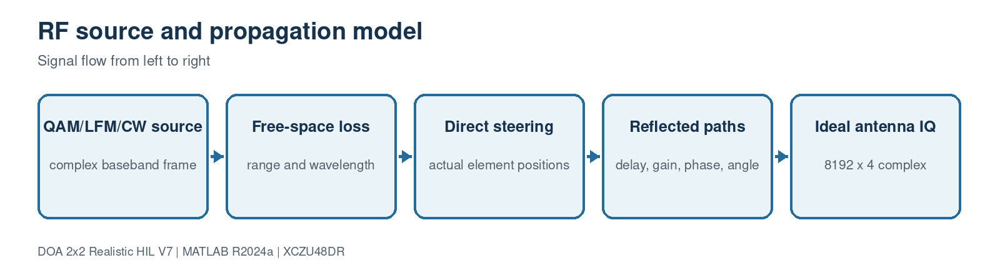

This block contains 3 implementation source file(s). Use the file links below to jump directly to the code explanation.

- [`SourceModel3D.m`](#file-sourcemodel3d-m)
- [`source_modulation_profile.m`](#file-source-modulation-profile-m)
- [`source_modulation_summary.m`](#file-source-modulation-summary-m)

<a id="file-sourcemodel3d-m"></a>

## File: `SourceModel3D.m`

### Purpose

Generates waveform, path loss, full-attitude array steering and reflected propagation paths.

### Where it runs

MATLAB R2024a behavioral, processor-reference or verification environment.

### Editing guidance

Edit only with the interfaces, dimensions and conventions in the surrounding block preserved.

### Size

214 source lines.

### Functions, classes and build targets

| Line | Kind | Definition | What the function/definition does |
| ---: | --- | --- | --- |
| 1 | class | `classdef SourceModel3D < matlab.System` | Declares the System object/class that owns this block's configuration, state and execution methods. |
| 40 | function/method | `function obj=SourceModel3D(varargin)` | Generates waveform, path loss, full-attitude array steering and reflected propagation paths. |
| 46 | function/method | `function X4=stepImpl(obj,platformPosition,platformYaw,platformPitch,platformRoll)` | Runs once per input frame and implements the block's main signal-processing algorithm. |
| 105 | function/method | `function sizeOut=getOutputSizeImpl(obj), sizeOut=[obj.FrameLength 4]; end` | Declares fixed Simulink output dimensions for model compilation. |
| 106 | function/method | `function typeOut=getOutputDataTypeImpl(~), typeOut='double'; end` | Declares output numeric types for Simulink propagation. |
| 107 | function/method | `function value=isOutputComplexImpl(~), value=true; end` | Declares whether each output is real or complex. |
| 108 | function/method | `function value=isOutputFixedSizeImpl(~), value=true; end` | Declares that output dimensions remain fixed while running. |
| 109 | function/method | `function [a,b,c,d]=getInputNamesImpl(~)` | Assigns readable names to generated MATLAB System block input ports. |
| 112 | function/method | `function name=getOutputNamesImpl(~), name='X4'; end` | Assigns readable names to generated MATLAB System block output ports. |
| 113 | function/method | `function icon=getIconImpl(obj)` | Builds the label shown on the generated Simulink block. |
| 119 | function/method | `function signal=generateSignal(obj,N)` | Implements the `generateSignal` helper used by this file; inputs, outputs and operations are visible in the signature and source below. |

### Important code lines explained

| Line | Source statement | Function of the line |
| ---: | --- | --- |
| 1 | `classdef SourceModel3D < matlab.System` | Declares the MATLAB class and its base type. |
| 4 | `SourcePosition = [500 300 200]` | Assigns the left-hand variable/property from the expression on the right. |
| 5 | `CenterFreqHz = 4e9` | Assigns the left-hand variable/property from the expression on the right. |
| 6 | `BandwidthHz = 30e6` | Assigns the left-hand variable/property from the expression on the right. |
| 7 | `ModulationType = 'QAM16'` | Assigns the left-hand variable/property from the expression on the right. |
| 8 | `PowerdBm = 20` | Assigns the left-hand variable/property from the expression on the right. |
| 9 | `ChipRateHz = 20e6` | Assigns the left-hand variable/property from the expression on the right. |
| 10 | `SweepStartHz = -15e6` | Assigns the left-hand variable/property from the expression on the right. |
| 11 | `SweepStopHz = 15e6` | Assigns the left-hand variable/property from the expression on the right. |
| 40 | `function obj=SourceModel3D(varargin)` | Declares a callable function or System object method, including its inputs and outputs. |
| 46 | `function X4=stepImpl(obj,platformPosition,platformYaw,platformPitch,platformRoll)` | Declares a callable function or System object method, including its inputs and outputs. |
| 105 | `function sizeOut=getOutputSizeImpl(obj), sizeOut=[obj.FrameLength 4]; end` | Declares a callable function or System object method, including its inputs and outputs. |
| 106 | `function typeOut=getOutputDataTypeImpl(~), typeOut='double'; end` | Declares a callable function or System object method, including its inputs and outputs. |
| 107 | `function value=isOutputComplexImpl(~), value=true; end` | Declares a callable function or System object method, including its inputs and outputs. |
| 108 | `function value=isOutputFixedSizeImpl(~), value=true; end` | Declares a callable function or System object method, including its inputs and outputs. |
| 109 | `function [a,b,c,d]=getInputNamesImpl(~)` | Declares a callable function or System object method, including its inputs and outputs. |
| 123 | `switch modulation` | Selects the requested algorithm, waveform, mode or profile. |
| 124 | `case 'CW'` | Selects the requested algorithm, waveform, mode or profile. |
| 126 | `case {'BPSK','QPSK','8PSK','QAM16','QAM64'}` | Selects the requested algorithm, waveform, mode or profile. |
| 129 | `switch modulation` | Selects the requested algorithm, waveform, mode or profile. |
| 130 | `case 'BPSK'` | Selects the requested algorithm, waveform, mode or profile. |
| 132 | `case 'QPSK'` | Selects the requested algorithm, waveform, mode or profile. |
| 135 | `case '8PSK'` | Selects the requested algorithm, waveform, mode or profile. |
| 137 | `case 'QAM16'` | Selects the requested algorithm, waveform, mode or profile. |

### Complete source code

<details>
<summary>Open the complete SourceModel3D.m source</summary>

```matlab
classdef SourceModel3D < matlab.System
    % Coherent four-channel RF source and propagation model.
    properties (Nontunable)
        SourcePosition = [500 300 200]
        CenterFreqHz = 4e9
        BandwidthHz = 30e6
        ModulationType = 'QAM16'
        PowerdBm = 20
        ChipRateHz = 20e6
        SweepStartHz = -15e6
        SweepStopHz = 15e6
        SweepTimeSeconds = 4e-6
        ModulationToneHz = 2e6
        PMIndexRad = 2.5
        AMDepth = 0.8
        FMDeviationHz = 10e6
        FSKDeviationHz = 7.5e6
        NLFMShape = 2.0
        PulseWidthSeconds = 1e-6
        PRFHz = 250e3
        Fs = 2.048e9
        FrameLength = 8192
        % Nose-mounted square 2x2 array in the Y-Z plane; boresight is +X.
        AntennaPositions = [0 -0.0125 -0.0125; 0 0.0125 -0.0125; ...
                            0 -0.0125  0.0125; 0 0.0125  0.0125]
        ChannelGain_dB = [0 0.3 -0.2 0.15]
        ChannelPhaseError_deg = [0 1.0 -0.7 0.5]
        NoiseFiguredB = 3.0
        PathLossExponent = 2.0
        AddReceiverNoise = true
        MultipathRelativeGain_dB = []
        MultipathDelaySamples = []
        MultipathAzOffset_deg = []
        MultipathElOffset_deg = []
        MultipathPhase_deg = []
        c = 299792458
    end

    methods
        function obj=SourceModel3D(varargin)
            setProperties(obj,nargin,varargin{:});
        end
    end

    methods (Access=protected)
        function X4=stepImpl(obj,platformPosition,platformYaw,platformPitch,platformRoll)
            N=obj.FrameLength;
            platformPosition=reshape(platformPosition,1,3);
            sourcePosition=reshape(obj.SourcePosition,1,3);
            delta=sourcePosition-platformPosition;
            range=max(norm(delta),1);
            worldDirection=delta(:)/range;
            bodyDirection=body_to_navigation_dcm( ...
                platformYaw,platformPitch,platformRoll).'*worldDirection;
            az=atan2d(bodyDirection(2),bodyDirection(1));
            el=atan2d(bodyDirection(3),hypot(bodyDirection(1),bodyDirection(2)));

            lambda=obj.c/obj.CenterFreqHz;
            fspl1m=20*log10(4*pi/lambda);
            pathLoss_dB=fspl1m+10*obj.PathLossExponent*log10(range);
            receivedPower_W=10^((obj.PowerdBm-pathLoss_dB-30)/10);
            signal=obj.generateSignal(N)*sqrt(max(receivedPower_W,0));

            azr=deg2rad(az); elr=deg2rad(el);
            ux=cos(elr)*cos(azr); uy=cos(elr)*sin(azr); uz=sin(elr);
            X4=complex(zeros(N,4));
            for channel=1:4
                tau=(obj.AntennaPositions(channel,1)*ux+ ...
                    obj.AntennaPositions(channel,2)*uy+ ...
                    obj.AntennaPositions(channel,3)*uz)/obj.c;
                X4(:,channel)=signal*exp(-1j*2*pi*obj.CenterFreqHz*tau);
            end

            numberPaths=min([numel(obj.MultipathRelativeGain_dB), ...
                numel(obj.MultipathDelaySamples),numel(obj.MultipathAzOffset_deg), ...
                numel(obj.MultipathElOffset_deg),numel(obj.MultipathPhase_deg)]);
            for pathIndex=1:numberPaths
                delay=max(0,min(N-1,round(obj.MultipathDelaySamples(pathIndex))));
                delayed=[complex(zeros(delay,1)); signal(1:N-delay)];
                pathAz=az+obj.MultipathAzOffset_deg(pathIndex);
                pathEl=max(-89,min(89,el+obj.MultipathElOffset_deg(pathIndex)));
                pathDirection=[cosd(pathEl)*cosd(pathAz); ...
                    cosd(pathEl)*sind(pathAz); sind(pathEl)];
                pathScale=10^(obj.MultipathRelativeGain_dB(pathIndex)/20)* ...
                    exp(1j*deg2rad(obj.MultipathPhase_deg(pathIndex)));
                for channel=1:4
                    tau=obj.AntennaPositions(channel,:)*pathDirection/obj.c;
                    X4(:,channel)=X4(:,channel)+pathScale*delayed* ...
                        exp(-1j*2*pi*obj.CenterFreqHz*tau);
                end
            end

            if obj.AddReceiverNoise
                kB=1.380649e-23;
                noisePower=kB*290*obj.Fs*10^(obj.NoiseFiguredB/10);
                X4=X4+sqrt(noisePower/2)*(randn(N,4)+1j*randn(N,4));
                for channel=1:4
                    gain=10^(obj.ChannelGain_dB(channel)/20);
                    phase=exp(1j*deg2rad(obj.ChannelPhaseError_deg(channel)));
                    X4(:,channel)=X4(:,channel)*gain*phase;
                end
            end
        end

        function sizeOut=getOutputSizeImpl(obj), sizeOut=[obj.FrameLength 4]; end
        function typeOut=getOutputDataTypeImpl(~), typeOut='double'; end
        function value=isOutputComplexImpl(~), value=true; end
        function value=isOutputFixedSizeImpl(~), value=true; end
        function [a,b,c,d]=getInputNamesImpl(~)
            a='PlatformPosition'; b='PlatformYaw'; c='PlatformPitch'; d='PlatformRoll';
        end
        function name=getOutputNamesImpl(~), name='X4'; end
        function icon=getIconImpl(obj)
            icon=sprintf('Source 3D\n%s %.1f GHz',obj.ModulationType,obj.CenterFreqHz/1e9);
        end
    end

    methods (Access=private)
        function signal=generateSignal(obj,N)
            frequency=((0:N-1).'-floor(N/2))*(obj.Fs/N);
            time=(0:N-1).'/obj.Fs;
            modulation=upper(char(obj.ModulationType));
            switch modulation
                case 'CW'
                    signal=ones(N,1);
                case {'BPSK','QPSK','8PSK','QAM16','QAM64'}
                    symbolCount=max(1,ceil(N*obj.ChipRateHz/obj.Fs));
                    repeatCount=ceil(N/symbolCount);
                    switch modulation
                        case 'BPSK'
                            symbols=2*randi([0 1],symbolCount,1)-1;
                        case 'QPSK'
                            symbols=((2*randi([0 1],symbolCount,1)-1)+ ...
                                1j*(2*randi([0 1],symbolCount,1)-1))/sqrt(2);
                        case '8PSK'
                            symbols=exp(1j*(pi/4)*randi([0 7],symbolCount,1));
                        case 'QAM16'
                            constellation=(-3:2:3).'+1j*(-3:2:3);
                            constellation=constellation(:)/sqrt(10);
                            symbols=constellation(randi(16,symbolCount,1));
                        otherwise
                            constellation=(-7:2:7).'+1j*(-7:2:7);
                            constellation=constellation(:)/sqrt(42);
                            symbols=constellation(randi(64,symbolCount,1));
                    end
                    signal=repelem(symbols,repeatCount);
                    signal=signal(1:N);
                case {'LFM','CHIRP'}
                    sweepTime=max(obj.SweepTimeSeconds,1/obj.Fs);
                    sweepTimeLocal=mod(time,sweepTime);
                    chirpSlope=(obj.SweepStopHz-obj.SweepStartHz)/sweepTime;
                    instantaneousFrequency=obj.SweepStartHz+ ...
                        chirpSlope*sweepTimeLocal;
                    phase=2*pi*cumsum(instantaneousFrequency)/obj.Fs;
                    signal=exp(1j*phase);
                case 'NLFM'
                    sweepTime=max(obj.SweepTimeSeconds,1/obj.Fs);
                    sweepTimeLocal=mod(time,sweepTime);
                    normalizedTime=2*sweepTimeLocal/sweepTime-1;
                    shape=max(0,obj.NLFMShape);
                    sweepCenter=(obj.SweepStartHz+obj.SweepStopHz)/2;
                    sweepHalfSpan=(obj.SweepStopHz-obj.SweepStartHz)/2;
                    instantaneousFrequency=sweepCenter+sweepHalfSpan* ...
                        (normalizedTime+shape*normalizedTime.^3)/(1+shape);
                    phase=2*pi*cumsum(instantaneousFrequency)/obj.Fs;
                    signal=exp(1j*phase);
                case 'PM'
                    phase=obj.PMIndexRad*sin(2*pi*obj.ModulationToneHz*time);
                    signal=exp(1j*phase);
                case 'FM'
                    modulationIndex=obj.FMDeviationHz/max(obj.ModulationToneHz,eps);
                    phase=modulationIndex*sin(2*pi*obj.ModulationToneHz*time);
                    signal=exp(1j*phase);
                case 'AM'
                    depth=max(0,min(1,obj.AMDepth));
                    signal=1+depth*cos(2*pi*obj.ModulationToneHz*time);
                case 'FSK'
                    symbolCount=max(1,ceil(N*obj.ChipRateHz/obj.Fs));
                    repeatCount=ceil(N/symbolCount);
                    symbols=2*randi([0 1],symbolCount,1)-1;
                    instantaneousFrequency=repelem(symbols,repeatCount);
                    instantaneousFrequency=instantaneousFrequency(1:N)*obj.FSKDeviationHz;
                    phase=2*pi*cumsum(instantaneousFrequency)/obj.Fs;
                    signal=exp(1j*phase);
                case {'PULSED_LFM','LFM_PULSE'}
                    pulsePeriod=1/max(obj.PRFHz,eps);
                    pulseWidth=min(max(obj.PulseWidthSeconds,1/obj.Fs),pulsePeriod);
                    pulseTime=mod(time,pulsePeriod);
                    active=pulseTime<pulseWidth;
                    chirpSlope=(obj.SweepStopHz-obj.SweepStartHz)/pulseWidth;
                    phase=2*pi*(obj.SweepStartHz*pulseTime+ ...
                        0.5*chirpSlope*pulseTime.^2);
                    signal=double(active).*exp(1j*phase);
                case {'NOISE','WIDEBAND_NOISE'}
                    spectrum=complex(zeros(N,1));
                    active=abs(frequency)<=obj.BandwidthHz/2;
                    activeCount=sum(active);
                    spectrum(active)=(randn(activeCount,1)+1j*randn(activeCount,1))/sqrt(2);
                    signal=ifft(ifftshift(spectrum))*sqrt(N);
                otherwise
                    error('DOA3D:ModulationType', ...
                        ['Unsupported ModulationType "%s". Use CW, BPSK, QPSK, ' ...
                        '8PSK, QAM16, QAM64, LFM, NLFM, PM, FM, AM, FSK, ' ...
                        'PULSED_LFM, or WIDEBAND_NOISE.'],obj.ModulationType);
            end

            shaped=fftshift(fft(signal));
            shaped(abs(frequency)>obj.BandwidthHz/2)=0;
            signal=ifft(ifftshift(shaped));
            powerValue=mean(abs(signal).^2);
            if powerValue>0, signal=signal/sqrt(powerValue); end
        end
    end
end
```

</details>

[Back to the document index](#document-header-index)

<a id="file-source-modulation-profile-m"></a>

## File: `source_modulation_profile.m`

### Purpose

Returns the complete parameter set for the selected waveform family.

### Where it runs

MATLAB R2024a behavioral, processor-reference or verification environment.

### Editing guidance

Edit only with the interfaces, dimensions and conventions in the surrounding block preserved.

### Size

96 source lines.

### Functions, classes and build targets

| Line | Kind | Definition | What the function/definition does |
| ---: | --- | --- | --- |
| 1 | function/method | `function waveform=source_modulation_profile(modulationType)` | Returns the complete parameter set for the selected waveform family. |

### Important code lines explained

| Line | Source statement | Function of the line |
| ---: | --- | --- |
| 1 | `function waveform=source_modulation_profile(modulationType)` | Declares a callable function or System object method, including its inputs and outputs. |
| 5 | `modulation=upper(char(modulationType));` | Assigns the left-hand variable/property from the expression on the right. |
| 9 | `waveform.BandwidthHz = 30e6;` | Assigns the left-hand variable/property from the expression on the right. |
| 10 | `waveform.ChipRateHz = 20e6;` | Assigns the left-hand variable/property from the expression on the right. |
| 11 | `waveform.SweepStartHz = -15e6;` | Assigns the left-hand variable/property from the expression on the right. |
| 12 | `waveform.SweepStopHz = 15e6;` | Assigns the left-hand variable/property from the expression on the right. |
| 13 | `waveform.SweepTimeSeconds = 4e-6;` | Assigns the left-hand variable/property from the expression on the right. |
| 14 | `waveform.ModulationToneHz = 2e6;` | Assigns the left-hand variable/property from the expression on the right. |
| 23 | `switch modulation` | Selects the requested algorithm, waveform, mode or profile. |
| 24 | `case 'CW'` | Selects the requested algorithm, waveform, mode or profile. |
| 27 | `case 'BPSK'` | Selects the requested algorithm, waveform, mode or profile. |
| 31 | `case 'QPSK'` | Selects the requested algorithm, waveform, mode or profile. |
| 35 | `case '8PSK'` | Selects the requested algorithm, waveform, mode or profile. |
| 39 | `case 'QAM16'` | Selects the requested algorithm, waveform, mode or profile. |
| 43 | `case 'QAM64'` | Selects the requested algorithm, waveform, mode or profile. |
| 47 | `case {'LFM','CHIRP'}` | Selects the requested algorithm, waveform, mode or profile. |
| 53 | `case 'NLFM'` | Selects the requested algorithm, waveform, mode or profile. |
| 60 | `case 'PM'` | Selects the requested algorithm, waveform, mode or profile. |
| 65 | `case 'FM'` | Selects the requested algorithm, waveform, mode or profile. |
| 70 | `case 'AM'` | Selects the requested algorithm, waveform, mode or profile. |

### Complete source code

<details>
<summary>Open the complete source_modulation_profile.m source</summary>

```matlab
function waveform=source_modulation_profile(modulationType)
%SOURCE_MODULATION_PROFILE Return parameters for the selected source mode.
% Edit the appropriate case below to create an experiment-specific profile.

modulation=upper(char(modulationType));

% Complete defaults keep the SourceModel3D interface fixed in Simulink. A
% case only changes the parameters that are meaningful for that waveform.
waveform.BandwidthHz = 30e6;
waveform.ChipRateHz = 20e6;
waveform.SweepStartHz = -15e6;
waveform.SweepStopHz = 15e6;
waveform.SweepTimeSeconds = 4e-6;
waveform.ModulationToneHz = 2e6;
waveform.PMIndexRad = 2.5;
waveform.AMDepth = 0.8;
waveform.FMDeviationHz = 10e6;
waveform.FSKDeviationHz = 7.5e6;
waveform.NLFMShape = 2.0;
waveform.PulseWidthSeconds = 1e-6;
waveform.PRFHz = 250e3;

switch modulation
    case 'CW'
        waveform.BandwidthHz = 2e6;

    case 'BPSK'
        waveform.ChipRateHz = 20e6;
        waveform.BandwidthHz = 30e6;

    case 'QPSK'
        waveform.ChipRateHz = 20e6;
        waveform.BandwidthHz = 30e6;

    case '8PSK'
        waveform.ChipRateHz = 20e6;
        waveform.BandwidthHz = 30e6;

    case 'QAM16'
        waveform.ChipRateHz = 20e6;
        waveform.BandwidthHz = 30e6;

    case 'QAM64'
        waveform.ChipRateHz = 25e6;
        waveform.BandwidthHz = 40e6;

    case {'LFM','CHIRP'}
        waveform.SweepStartHz = -15e6;
        waveform.SweepStopHz = 15e6;
        waveform.SweepTimeSeconds = 4e-6;
        waveform.BandwidthHz = 30e6;

    case 'NLFM'
        waveform.SweepStartHz = -15e6;
        waveform.SweepStopHz = 15e6;
        waveform.SweepTimeSeconds = 4e-6;
        waveform.NLFMShape = 2.0;
        waveform.BandwidthHz = 30e6;

    case 'PM'
        waveform.ModulationToneHz = 2e6;
        waveform.PMIndexRad = 2.5;
        waveform.BandwidthHz = 20e6;

    case 'FM'
        waveform.ModulationToneHz = 1e6;
        waveform.FMDeviationHz = 8e6;
        waveform.BandwidthHz = 24e6;

    case 'AM'
        waveform.ModulationToneHz = 2e6;
        waveform.AMDepth = 0.8;
        waveform.BandwidthHz = 10e6;

    case 'FSK'
        waveform.ChipRateHz = 10e6;
        waveform.FSKDeviationHz = 7.5e6;
        waveform.BandwidthHz = 30e6;

    case {'PULSED_LFM','LFM_PULSE'}
        waveform.SweepStartHz = -25e6;
        waveform.SweepStopHz = 25e6;
        waveform.SweepTimeSeconds = 1e-6;
        waveform.PulseWidthSeconds = 1e-6;
        waveform.PRFHz = 250e3;
        waveform.BandwidthHz = 50e6;

    case {'NOISE','WIDEBAND_NOISE'}
        waveform.BandwidthHz = 30e6;

    otherwise
        error('DOA3D:ModulationProfile', ...
            ['No source profile exists for "%s". Add a case to ' ...
            'source_modulation_profile.m and SourceModel3D.m.'],modulationType);
end
end
```

</details>

[Back to the document index](#document-header-index)

<a id="file-source-modulation-summary-m"></a>

## File: `source_modulation_summary.m`

### Purpose

Formats the active waveform parameters for console and dashboard text.

### Where it runs

MATLAB R2024a behavioral, processor-reference or verification environment.

### Editing guidance

Edit only with the interfaces, dimensions and conventions in the surrounding block preserved.

### Size

33 source lines.

### Functions, classes and build targets

| Line | Kind | Definition | What the function/definition does |
| ---: | --- | --- | --- |
| 1 | function/method | `function textValue=source_modulation_summary(source)` | Formats the active waveform parameters for console and dashboard text. |

### Important code lines explained

| Line | Source statement | Function of the line |
| ---: | --- | --- |
| 1 | `function textValue=source_modulation_summary(source)` | Declares a callable function or System object method, including its inputs and outputs. |
| 3 | `switch upper(char(source.ModulationType))` | Selects the requested algorithm, waveform, mode or profile. |
| 4 | `case {'BPSK','QPSK','8PSK','QAM16','QAM64'}` | Selects the requested algorithm, waveform, mode or profile. |
| 5 | `textValue=sprintf('symbol rate %.2f Msym/s',source.ChipRateHz/1e6);` | Assigns the left-hand variable/property from the expression on the right. |
| 6 | `case {'LFM','CHIRP'}` | Selects the requested algorithm, waveform, mode or profile. |
| 7 | `textValue=sprintf('sweep %.1f to %.1f MHz, T=%.2f us', ...` | Assigns the left-hand variable/property from the expression on the right. |
| 10 | `case 'NLFM'` | Selects the requested algorithm, waveform, mode or profile. |
| 11 | `textValue=sprintf('sweep %.1f to %.1f MHz, T=%.2f us, shape %.2f', ...` | Assigns the left-hand variable/property from the expression on the right. |
| 14 | `case 'PM'` | Selects the requested algorithm, waveform, mode or profile. |
| 15 | `textValue=sprintf('tone %.2f MHz, phase index %.2f rad', ...` | Assigns the left-hand variable/property from the expression on the right. |
| 17 | `case 'FM'` | Selects the requested algorithm, waveform, mode or profile. |
| 18 | `textValue=sprintf('tone %.2f MHz, deviation %.2f MHz', ...` | Assigns the left-hand variable/property from the expression on the right. |
| 20 | `case 'AM'` | Selects the requested algorithm, waveform, mode or profile. |
| 21 | `textValue=sprintf('tone %.2f MHz, depth %.2f', ...` | Assigns the left-hand variable/property from the expression on the right. |
| 23 | `case 'FSK'` | Selects the requested algorithm, waveform, mode or profile. |
| 24 | `textValue=sprintf('symbol rate %.2f Msym/s, deviation %.2f MHz', ...` | Assigns the left-hand variable/property from the expression on the right. |
| 26 | `case {'PULSED_LFM','LFM_PULSE'}` | Selects the requested algorithm, waveform, mode or profile. |

### Complete source code

<details>
<summary>Open the complete source_modulation_summary.m source</summary>

```matlab
function textValue=source_modulation_summary(source)
%SOURCE_MODULATION_SUMMARY Format only the selected waveform's parameters.
switch upper(char(source.ModulationType))
    case {'BPSK','QPSK','8PSK','QAM16','QAM64'}
        textValue=sprintf('symbol rate %.2f Msym/s',source.ChipRateHz/1e6);
    case {'LFM','CHIRP'}
        textValue=sprintf('sweep %.1f to %.1f MHz, T=%.2f us', ...
            source.SweepStartHz/1e6,source.SweepStopHz/1e6, ...
            source.SweepTimeSeconds*1e6);
    case 'NLFM'
        textValue=sprintf('sweep %.1f to %.1f MHz, T=%.2f us, shape %.2f', ...
            source.SweepStartHz/1e6,source.SweepStopHz/1e6, ...
            source.SweepTimeSeconds*1e6,source.NLFMShape);
    case 'PM'
        textValue=sprintf('tone %.2f MHz, phase index %.2f rad', ...
            source.ModulationToneHz/1e6,source.PMIndexRad);
    case 'FM'
        textValue=sprintf('tone %.2f MHz, deviation %.2f MHz', ...
            source.ModulationToneHz/1e6,source.FMDeviationHz/1e6);
    case 'AM'
        textValue=sprintf('tone %.2f MHz, depth %.2f', ...
            source.ModulationToneHz/1e6,source.AMDepth);
    case 'FSK'
        textValue=sprintf('symbol rate %.2f Msym/s, deviation %.2f MHz', ...
            source.ChipRateHz/1e6,source.FSKDeviationHz/1e6);
    case {'PULSED_LFM','LFM_PULSE'}
        textValue=sprintf('%.1f to %.1f MHz, PW %.2f us, PRF %.1f kHz', ...
            source.SweepStartHz/1e6,source.SweepStopHz/1e6, ...
            source.PulseWidthSeconds*1e6,source.PRFHz/1e3);
    otherwise
        textValue=sprintf('occupied bandwidth %.1f MHz',source.BandwidthHz/1e6);
end
end
```

</details>

[Back to the document index](#document-header-index)

<a id="block-3-realistic-receiver-and-calibration"></a>

# Block 3: Realistic receiver and calibration

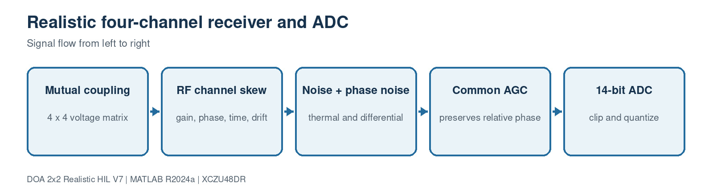

This block contains 4 implementation source file(s). Use the file links below to jump directly to the code explanation.

- [`RealisticReceiver4.m`](#file-realisticreceiver4-m)
- [`realism_profile.m`](#file-realism-profile-m)
- [`simulate_realistic_snapshots.m`](#file-simulate-realistic-snapshots-m)
- [`estimate_multifrequency_calibration.m`](#file-estimate-multifrequency-calibration-m)

<a id="file-realisticreceiver4-m"></a>

## File: `RealisticReceiver4.m`

### Purpose

Models coupling, receiver mismatch, skew, drift, noise, AGC, DC, clipping and ADC quantization.

### Where it runs

MATLAB R2024a behavioral, processor-reference or verification environment.

### Editing guidance

Edit only with the interfaces, dimensions and conventions in the surrounding block preserved.

### Size

96 source lines.

### Functions, classes and build targets

| Line | Kind | Definition | What the function/definition does |
| ---: | --- | --- | --- |
| 1 | class | `classdef RealisticReceiver4 < matlab.System` | Declares the System object/class that owns this block's configuration, state and execution methods. |
| 28 | function/method | `function obj=RealisticReceiver4(varargin)` | Models coupling, receiver mismatch, skew, drift, noise, AGC, DC, clipping and ADC quantization. |
| 33 | function/method | `function setupImpl(obj,~)` | Runs once when the System object locks; validates configuration and creates persistent processing resources. |
| 39 | function/method | `function output=stepImpl(obj,input)` | Runs once per input frame and implements the block's main signal-processing algorithm. |
| 85 | function/method | `function sizeOut=getOutputSizeImpl(obj), sizeOut=[obj.FrameLength 4]; end` | Declares fixed Simulink output dimensions for model compilation. |
| 86 | function/method | `function typeOut=getOutputDataTypeImpl(~), typeOut='double'; end` | Declares output numeric types for Simulink propagation. |
| 87 | function/method | `function value=isOutputComplexImpl(~), value=true; end` | Declares whether each output is real or complex. |
| 88 | function/method | `function value=isOutputFixedSizeImpl(~), value=true; end` | Declares that output dimensions remain fixed while running. |
| 89 | function/method | `function name=getInputNamesImpl(~), name='IdealAntennaIQ'; end` | Assigns readable names to generated MATLAB System block input ports. |
| 90 | function/method | `function name=getOutputNamesImpl(~), name='ADC_IQ'; end` | Assigns readable names to generated MATLAB System block output ports. |
| 91 | function/method | `function icon=getIconImpl(obj)` | Builds the label shown on the generated Simulink block. |

### Important code lines explained

| Line | Source statement | Function of the line |
| ---: | --- | --- |
| 1 | `classdef RealisticReceiver4 < matlab.System` | Declares the MATLAB class and its base type. |
| 4 | `Fs = 2.048e9` | Assigns the left-hand variable/property from the expression on the right. |
| 5 | `FrameLength = 8192` | Assigns the left-hand variable/property from the expression on the right. |
| 6 | `CenterFreqHz = 4e9` | Assigns the left-hand variable/property from the expression on the right. |
| 7 | `NoiseFigure_dB = 3` | Assigns the left-hand variable/property from the expression on the right. |
| 8 | `NoiseTemperature_K = 290` | Assigns the left-hand variable/property from the expression on the right. |
| 9 | `ChannelGain_dB = [0 0.3 -0.2 0.15]` | Assigns the left-hand variable/property from the expression on the right. |
| 10 | `ChannelPhase_deg = [0 1.0 -0.7 0.5]` | Assigns the left-hand variable/property from the expression on the right. |
| 11 | `RelativeTimeSkew_ps = [0 0.4 -0.3 0.2]` | Assigns the left-hand variable/property from the expression on the right. |
| 28 | `function obj=RealisticReceiver4(varargin)` | Declares a callable function or System object method, including its inputs and outputs. |
| 33 | `function setupImpl(obj,~)` | Declares a callable function or System object method, including its inputs and outputs. |
| 39 | `function output=stepImpl(obj,input)` | Declares a callable function or System object method, including its inputs and outputs. |
| 85 | `function sizeOut=getOutputSizeImpl(obj), sizeOut=[obj.FrameLength 4]; end` | Declares a callable function or System object method, including its inputs and outputs. |
| 86 | `function typeOut=getOutputDataTypeImpl(~), typeOut='double'; end` | Declares a callable function or System object method, including its inputs and outputs. |
| 87 | `function value=isOutputComplexImpl(~), value=true; end` | Declares a callable function or System object method, including its inputs and outputs. |
| 88 | `function value=isOutputFixedSizeImpl(~), value=true; end` | Declares a callable function or System object method, including its inputs and outputs. |

### Complete source code

<details>
<summary>Open the complete RealisticReceiver4.m source</summary>

```matlab
classdef RealisticReceiver4 < matlab.System
    % Four-channel RF/ADC impairment model kept outside the synthesizable DUT.
    properties (Nontunable)
        Fs = 2.048e9
        FrameLength = 8192
        CenterFreqHz = 4e9
        NoiseFigure_dB = 3
        NoiseTemperature_K = 290
        ChannelGain_dB = [0 0.3 -0.2 0.15]
        ChannelPhase_deg = [0 1.0 -0.7 0.5]
        RelativeTimeSkew_ps = [0 0.4 -0.3 0.2]
        GainDrift_dB = [0 0.004 -0.003 0.005]
        PhaseDrift_deg = [0 0.015 -0.012 0.018]
        CouplingMatrix = eye(4)
        CommonPhaseNoiseStep_deg = 0.002
        DifferentialPhaseNoiseStep_deg = 0.0001
        FramePhaseJitter_deg = 0.005
        AGCTargetRMS = 0.25
        AGCMaximumGain_dB = 90
        ADCBits = 14
        ADCFullScale = 1
        DCOffset = [0 0 0 0]
        EnableThermalNoise = true
        EnableAGC = true
        EnableADCQuantization = true
    end
    methods
        function obj=RealisticReceiver4(varargin)
            setProperties(obj,nargin,varargin{:});
        end
    end
    methods (Access=protected)
        function setupImpl(obj,~)
            validateattributes(obj.CouplingMatrix,{'numeric'}, ...
                {'size',[4 4],'finite'},mfilename,'CouplingMatrix');
            validateattributes(obj.ADCBits,{'numeric'}, ...
                {'scalar','integer','>=',8,'<=',24},mfilename,'ADCBits');
        end
        function output=stepImpl(obj,input)
            numberSamples=size(input,1);

            % Direction-dependent antenna voltages are mixed by mutual
            % coupling before the independent receiver chains.
            output=input*obj.CouplingMatrix.';
            timeSkewPhase_deg=-360*obj.CenterFreqHz* ...
                (obj.RelativeTimeSkew_ps*1e-12);
            frameJitter=obj.FramePhaseJitter_deg*randn(1,4);
            totalGain=obj.ChannelGain_dB+obj.GainDrift_dB;
            totalPhase=obj.ChannelPhase_deg+obj.PhaseDrift_deg+ ...
                timeSkewPhase_deg+frameJitter;
            transfer=10.^(totalGain/20).*exp(1j*deg2rad(totalPhase));
            output=output.*transfer;

            if obj.EnableThermalNoise
                boltzmann=1.380649e-23;
                noisePower=boltzmann*obj.NoiseTemperature_K*obj.Fs* ...
                    10^(obj.NoiseFigure_dB/10);
                output=output+sqrt(noisePower/2)*( ...
                    randn(numberSamples,4)+1j*randn(numberSamples,4));
            end

            commonPhase=cumsum(obj.CommonPhaseNoiseStep_deg* ...
                randn(numberSamples,1));
            differentialPhase=cumsum(obj.DifferentialPhaseNoiseStep_deg* ...
                randn(numberSamples,4),1);
            output=output.*exp(1j*deg2rad(commonPhase+differentialPhase));

            if obj.EnableAGC
                measuredRMS=sqrt(mean(abs(output(:)).^2));
                requestedGain=obj.AGCTargetRMS/max(measuredRMS,eps);
                maximumGain=10^(obj.AGCMaximumGain_dB/20);
                output=output*min(requestedGain,maximumGain);
            end

            output=output+reshape(obj.DCOffset,1,4);
            if obj.EnableADCQuantization
                scale=2^(obj.ADCBits-1);
                normalized=output/obj.ADCFullScale;
                realPart=min(max(real(normalized),-1),1-1/scale);
                imagPart=min(max(imag(normalized),-1),1-1/scale);
                output=obj.ADCFullScale*(round(realPart*scale)/scale+ ...
                    1j*round(imagPart*scale)/scale);
            end
        end
        function sizeOut=getOutputSizeImpl(obj), sizeOut=[obj.FrameLength 4]; end
        function typeOut=getOutputDataTypeImpl(~), typeOut='double'; end
        function value=isOutputComplexImpl(~), value=true; end
        function value=isOutputFixedSizeImpl(~), value=true; end
        function name=getInputNamesImpl(~), name='IdealAntennaIQ'; end
        function name=getOutputNamesImpl(~), name='ADC_IQ'; end
        function icon=getIconImpl(obj)
            icon=sprintf('Real RF + ADC\n%d bit, NF %.1f dB', ...
                obj.ADCBits,obj.NoiseFigure_dB);
        end
    end
end
```

</details>

[Back to the document index](#document-header-index)

<a id="file-realism-profile-m"></a>

## File: `realism_profile.m`

### Purpose

Defines IDEAL, CALIBRATED_LOS and FIELD_STRESS physical/calibration assumptions.

### Where it runs

MATLAB R2024a behavioral, processor-reference or verification environment.

### Editing guidance

Change impairment budgets here; do not hide FIELD_STRESS failures by loosening the acceptance threshold.

### Size

65 source lines.

### Functions, classes and build targets

| Line | Kind | Definition | What the function/definition does |
| ---: | --- | --- | --- |
| 1 | function/method | `function R=realism_profile(name,nominalPositions,centerFreqHz)` | Defines IDEAL, CALIBRATED_LOS and FIELD_STRESS physical/calibration assumptions. |

### Important code lines explained

| Line | Source statement | Function of the line |
| ---: | --- | --- |
| 1 | `function R=realism_profile(name,nominalPositions,centerFreqHz)` | Declares a callable function or System object method, including its inputs and outputs. |
| 7 | `name=upper(char(name));` | Assigns the left-hand variable/property from the expression on the right. |
| 9 | `positionError_um=[0 0 0; 0 18 -7; 0 -11 15; 0 9 -13];` | Assigns the left-hand variable/property from the expression on the right. |
| 10 | `calibrationResidual_um=[0 0 0; 0 3 -2; 0 -2 3; 0 2 -2];` | Assigns the left-hand variable/property from the expression on the right. |
| 11 | `R.Name=name;` | Assigns the left-hand variable/property from the expression on the right. |
| 12 | `R.Array.ActualPositions=nominalPositions+positionError_um*1e-6;` | Assigns the left-hand variable/property from the expression on the right. |
| 13 | `R.Array.CalibratedPositions=R.Array.ActualPositions- ...` | Assigns the left-hand variable/property from the expression on the right. |
| 16 | `switch name` | Selects the requested algorithm, waveform, mode or profile. |
| 17 | `case 'IDEAL'` | Selects the requested algorithm, waveform, mode or profile. |
| 18 | `couplingAmplitude=0;` | Assigns the left-hand variable/property from the expression on the right. |
| 29 | `case 'FIELD_STRESS'` | Selects the requested algorithm, waveform, mode or profile. |

### Complete source code

<details>
<summary>Open the complete realism_profile.m source</summary>

```matlab
function R=realism_profile(name,nominalPositions,centerFreqHz)
%REALISM_PROFILE Reproducible calibrated-LOS and field-stress assumptions.
if nargin<1 || isempty(name), name='CALIBRATED_LOS'; end
if nargin<2, nominalPositions=[0 -.0125 -.0125;0 .0125 -.0125; ...
        0 -.0125 .0125;0 .0125 .0125]; end
if nargin<3, centerFreqHz=4e9; end
name=upper(char(name));

positionError_um=[0 0 0; 0 18 -7; 0 -11 15; 0 9 -13];
calibrationResidual_um=[0 0 0; 0 3 -2; 0 -2 3; 0 2 -2];
R.Name=name;
R.Array.ActualPositions=nominalPositions+positionError_um*1e-6;
R.Array.CalibratedPositions=R.Array.ActualPositions- ...
    calibrationResidual_um*1e-6;

switch name
    case 'IDEAL'
        couplingAmplitude=0;
        couplingResidualFraction=0;
        R.Multipath.RelativeGain_dB=[];
        R.Multipath.DelaySamples=[];
        R.Multipath.AzOffset_deg=[];
        R.Multipath.ElOffset_deg=[];
        R.Multipath.Phase_deg=[];
        R.Receiver.GainDrift_dB=zeros(1,4);
        R.Receiver.PhaseDrift_deg=zeros(1,4);
        R.Receiver.FramePhaseJitter_deg=0;
        R.Receiver.DifferentialPhaseNoiseStep_deg=0;
    case 'FIELD_STRESS'
        couplingAmplitude=10^(-30/20);
        couplingResidualFraction=0.05;
        R.Multipath.RelativeGain_dB=[-28 -35];
        R.Multipath.DelaySamples=[7 19];
        R.Multipath.AzOffset_deg=[18 -27];
        R.Multipath.ElOffset_deg=[-9 13];
        R.Multipath.Phase_deg=[40 -115];
        R.Receiver.GainDrift_dB=[0 .012 -.010 .015];
        R.Receiver.PhaseDrift_deg=[0 .055 -.045 .070];
        R.Receiver.FramePhaseJitter_deg=.020;
        R.Receiver.DifferentialPhaseNoiseStep_deg=.0004;
    otherwise
        R.Name='CALIBRATED_LOS';
        couplingAmplitude=10^(-36/20);
        couplingResidualFraction=0.02;
        R.Multipath.RelativeGain_dB=[-48 -54];
        R.Multipath.DelaySamples=[5 17];
        R.Multipath.AzOffset_deg=[14 -22];
        R.Multipath.ElOffset_deg=[-7 11];
        R.Multipath.Phase_deg=[35 -90];
        R.Receiver.GainDrift_dB=[0 .004 -.003 .005];
        R.Receiver.PhaseDrift_deg=[0 .015 -.012 .018];
        R.Receiver.FramePhaseJitter_deg=.005;
        R.Receiver.DifferentialPhaseNoiseStep_deg=.0001;
end

phasePattern=[0 25 -40 70; -25 0 55 -30; 40 -55 0 20; -70 30 -20 0];
actualCoupling=eye(4)+couplingAmplitude*exp(1j*deg2rad(phasePattern)).*(1-eye(4));
estimatedCoupling=eye(4)+couplingAmplitude*(1-couplingResidualFraction)* ...
    exp(1j*deg2rad(phasePattern+0.2)).*(1-eye(4));
R.Receiver.CouplingMatrix=actualCoupling;
R.Calibration.DecouplingMatrix=inv(estimatedCoupling);
R.Receiver.RelativeTimeSkew_ps=[0 .35 -.28 .20];
timeSkewPhase=-360*centerFreqHz*(R.Receiver.RelativeTimeSkew_ps*1e-12);
R.Calibration.TimeSkewPhase_deg=timeSkewPhase;
end
```

</details>

[Back to the document index](#document-header-index)

<a id="file-simulate-realistic-snapshots-m"></a>

## File: `simulate_realistic_snapshots.m`

### Purpose

Creates controlled-SNR Monte-Carlo snapshots using the same physical impairment model.

### Where it runs

MATLAB R2024a behavioral, processor-reference or verification environment.

### Editing guidance

Edit only with the interfaces, dimensions and conventions in the surrounding block preserved.

### Size

61 source lines.

### Functions, classes and build targets

| Line | Kind | Definition | What the function/definition does |
| ---: | --- | --- | --- |
| 1 | function/method | `function snapshots=simulate_realistic_snapshots(P,azimuth,elevation,snr_dB,numberSnapshots)` | Creates controlled-SNR Monte-Carlo snapshots using the same physical impairment model. |

### Important code lines explained

| Line | Source statement | Function of the line |
| ---: | --- | --- |
| 1 | `function snapshots=simulate_realistic_snapshots(P,azimuth,elevation,snr_dB,numberSnapshots)` | Declares a callable function or System object method, including its inputs and outputs. |
| 3 | `truth=[cosd(elevation)*cosd(azimuth); ...` | Assigns the left-hand variable/property from the expression on the right. |
| 5 | `waveNumber=2*pi*P.Source.CenterFreqHz/P.c;` | Assigns the left-hand variable/property from the expression on the right. |
| 6 | `steering=exp(-1j*waveNumber*(P.Antenna.ActualPositions*truth));` | Computes an array direction/steering quantity using the calibrated geometry. |
| 7 | `symbols=exp(1j*(pi/2)*randi([0 3],numberSnapshots,1));` | Assigns the left-hand variable/property from the expression on the right. |
| 8 | `ideal=symbols*steering.';` | Computes an array direction/steering quantity using the calibrated geometry. |
| 10 | `numberPaths=min([numel(P.Multipath.RelativeGain_dB), ...` | Assigns the left-hand variable/property from the expression on the right. |
| 13 | `for pathIndex=1:numberPaths` | Begins a bounded loop over samples, channels, candidates or trials. |

### Complete source code

<details>
<summary>Open the complete simulate_realistic_snapshots.m source</summary>

```matlab
function snapshots=simulate_realistic_snapshots(P,azimuth,elevation,snr_dB,numberSnapshots)
%SIMULATE_REALISTIC_SNAPSHOTS Controlled-SNR RF/array/ADC Monte Carlo frame.
truth=[cosd(elevation)*cosd(azimuth); ...
    cosd(elevation)*sind(azimuth); sind(elevation)];
waveNumber=2*pi*P.Source.CenterFreqHz/P.c;
steering=exp(-1j*waveNumber*(P.Antenna.ActualPositions*truth));
symbols=exp(1j*(pi/2)*randi([0 3],numberSnapshots,1));
ideal=symbols*steering.';

numberPaths=min([numel(P.Multipath.RelativeGain_dB), ...
    numel(P.Multipath.DelaySamples),numel(P.Multipath.AzOffset_deg), ...
    numel(P.Multipath.ElOffset_deg),numel(P.Multipath.Phase_deg)]);
for pathIndex=1:numberPaths
    delay=max(0,min(numberSnapshots-1,round(P.Multipath.DelaySamples(pathIndex))));
    delayed=[complex(zeros(delay,1)); symbols(1:numberSnapshots-delay)];
    pathAz=azimuth+P.Multipath.AzOffset_deg(pathIndex);
    pathEl=elevation+P.Multipath.ElOffset_deg(pathIndex);
    pathDirection=[cosd(pathEl)*cosd(pathAz); ...
        cosd(pathEl)*sind(pathAz); sind(pathEl)];
    pathSteering=exp(-1j*waveNumber*(P.Antenna.ActualPositions*pathDirection));
    pathScale=10^(P.Multipath.RelativeGain_dB(pathIndex)/20)* ...
        exp(1j*deg2rad(P.Multipath.Phase_deg(pathIndex)));
    ideal=ideal+pathScale*delayed*pathSteering.';
end

coupled=ideal*P.Receiver.CouplingMatrix.';
timeSkewPhase=-360*P.Source.CenterFreqHz* ...
    (P.Receiver.RelativeTimeSkew_ps*1e-12);
frameJitter=P.Receiver.FramePhaseJitter_deg*randn(1,4);
gain=P.Receiver.ChannelGain_dB+P.Receiver.GainDrift_dB;
phase=P.Receiver.ChannelPhase_deg+P.Receiver.PhaseDrift_deg+ ...
    timeSkewPhase+frameJitter;
transfer=10.^(gain/20).*exp(1j*deg2rad(phase));
snapshots=coupled.*transfer;

signalRMS=sqrt(mean(abs(snapshots(:)).^2));
noiseRMS=signalRMS*10^(-snr_dB/20);
snapshots=snapshots+noiseRMS/sqrt(2)*( ...
    randn(numberSnapshots,4)+1j*randn(numberSnapshots,4));
commonPhase=cumsum(P.Receiver.CommonPhaseNoiseStep_deg* ...
    randn(numberSnapshots,1));
differentialPhase=cumsum(P.Receiver.DifferentialPhaseNoiseStep_deg* ...
    randn(numberSnapshots,4),1);
snapshots=snapshots.*exp(1j*deg2rad(commonPhase+differentialPhase));

if P.Receiver.EnableAGC
    measuredRMS=sqrt(mean(abs(snapshots(:)).^2));
    requestedGain=P.Receiver.AGCTargetRMS/max(measuredRMS,eps);
    maximumGain=10^(P.Receiver.AGCMaximumGain_dB/20);
    snapshots=snapshots*min(requestedGain,maximumGain);
end
snapshots=snapshots+reshape(P.Receiver.DCOffset,1,4);
if P.Receiver.EnableADCQuantization
    scale=2^(P.Receiver.ADCBits-1);
    normalized=snapshots/P.Receiver.ADCFullScale;
    realPart=min(max(real(normalized),-1),1-1/scale);
    imagPart=min(max(imag(normalized),-1),1-1/scale);
    snapshots=P.Receiver.ADCFullScale*(round(realPart*scale)/scale+ ...
        1j*round(imagPart*scale)/scale);
end
end
```

</details>

[Back to the document index](#document-header-index)

<a id="file-estimate-multifrequency-calibration-m"></a>

## File: `estimate_multifrequency_calibration.m`

### Purpose

Estimates relative gain, center phase and time skew and packs PL Q2.14 corrections.

### Where it runs

MATLAB R2024a behavioral, processor-reference or verification environment.

### Editing guidance

Edit only with the interfaces, dimensions and conventions in the surrounding block preserved.

### Size

68 source lines.

### Functions, classes and build targets

| Line | Kind | Definition | What the function/definition does |
| ---: | --- | --- | --- |
| 1 | function/method | `function calibration=estimate_multifrequency_calibration( ...` | Estimates relative gain, center phase and time skew and packs PL Q2.14 corrections. |
| 66 | function/method | `function angle=wrap180(angle)` | Wraps an angle into the half-open -180 to +180 degree interval. |

### Important code lines explained

| Line | Source statement | Function of the line |
| ---: | --- | --- |
| 1 | `function calibration=estimate_multifrequency_calibration( ...` | Declares a callable function or System object method, including its inputs and outputs. |
| 10 | `assert(ndims(toneSnapshots)==3,'toneSnapshots must be N-by-4-by-F.');` | Rejects an invalid dimension, type, geometry or configuration before processing. |
| 11 | `assert(size(toneSnapshots,2)==4,'Calibration input must contain four channels.');` | Rejects an invalid dimension, type, geometry or configuration before processing. |
| 12 | `frequenciesHz=frequenciesHz(:);` | Assigns the left-hand variable/property from the expression on the right. |
| 13 | `assert(size(toneSnapshots,3)==numel(frequenciesHz), ...` | Rejects an invalid dimension, type, geometry or configuration before processing. |
| 15 | `assert(referenceChannel>=1 && referenceChannel<=4, ...` | Rejects an invalid dimension, type, geometry or configuration before processing. |
| 18 | `numberFrequencies=numel(frequenciesHz);` | Assigns the left-hand variable/property from the expression on the right. |
| 19 | `response=complex(zeros(numberFrequencies,4));` | Assigns the left-hand variable/property from the expression on the right. |
| 24 | `assert(all(abs(reference)>100*eps),'Reference-channel calibration tone is too small.');` | Rejects an invalid dimension, type, geometry or configuration before processing. |
| 33 | `unwrappedPhase=unwrap(angle(relative(:,channel)));` | Assigns the left-hand variable/property from the expression on the right. |
| 34 | `coefficients=polyfit(frequencyOffset,unwrappedPhase,1);` | Assigns the left-hand variable/property from the expression on the right. |
| 66 | `function angle=wrap180(angle)` | Declares a callable function or System object method, including its inputs and outputs. |

### Complete source code

<details>
<summary>Open the complete estimate_multifrequency_calibration.m source</summary>

```matlab
function calibration=estimate_multifrequency_calibration( ...
        toneSnapshots,frequenciesHz,centerFreqHz,referenceChannel)
%ESTIMATE_MULTIFREQUENCY_CALIBRATION Relative RF gain, phase and time skew.
% toneSnapshots is N-by-4-by-F complex IQ measured from a known boresight
% calibration signal. The signal generator phase/amplitude may change between
% frequencies because every channel is divided by the reference channel.
if nargin<4, referenceChannel=1; end
validateattributes(toneSnapshots,{'numeric'}, ...
    {'nonempty','finite'},mfilename,'toneSnapshots');
assert(ndims(toneSnapshots)==3,'toneSnapshots must be N-by-4-by-F.');
assert(size(toneSnapshots,2)==4,'Calibration input must contain four channels.');
frequenciesHz=frequenciesHz(:);
assert(size(toneSnapshots,3)==numel(frequenciesHz), ...
    'The third snapshot dimension must match frequenciesHz.');
assert(referenceChannel>=1 && referenceChannel<=4, ...
    'referenceChannel must be in the interval 1..4.');

numberFrequencies=numel(frequenciesHz);
response=complex(zeros(numberFrequencies,4));
for frequencyIndex=1:numberFrequencies
    response(frequencyIndex,:)=mean(toneSnapshots(:,:,frequencyIndex),1);
end
reference=response(:,referenceChannel);
assert(all(abs(reference)>100*eps),'Reference-channel calibration tone is too small.');
relative=response./reference;

frequencyOrigin=mean(frequenciesHz);
frequencyOffset=frequenciesHz-frequencyOrigin;
gain_dB=zeros(1,4); phase_deg=zeros(1,4); timeSkew_ps=zeros(1,4);
phaseFitResidual_deg=zeros(1,4);
for channel=1:4
    gain_dB(channel)=mean(20*log10(max(abs(relative(:,channel)),eps)));
    unwrappedPhase=unwrap(angle(relative(:,channel)));
    coefficients=polyfit(frequencyOffset,unwrappedPhase,1);
    timeSkew_ps(channel)=-coefficients(1)/(2*pi)*1e12;
    phaseAtCenter=polyval(coefficients,centerFreqHz-frequencyOrigin);
    phase_deg(channel)=wrap180(rad2deg(phaseAtCenter));
    fitted=polyval(coefficients,frequencyOffset);
    phaseFitResidual_deg(channel)=sqrt(mean(rad2deg(unwrappedPhase-fitted).^2));
end

% Remove numerical residue in the selected reference channel.
gain_dB(referenceChannel)=0;
phase_deg(referenceChannel)=0;
timeSkew_ps(referenceChannel)=0;
phaseFitResidual_deg(referenceChannel)=0;
correction=10.^(-gain_dB/20).*exp(-1j*deg2rad(phase_deg));

coefficientReal=int16(round(min(max(real(correction),-2),2-2^-14)*2^14));
coefficientImag=int16(round(min(max(imag(correction),-2),2-2^-14)*2^14));
packed=zeros(1,4,'uint32');
for channel=1:4
    low=uint32(typecast(coefficientReal(channel),'uint16'));
    high=bitshift(uint32(typecast(coefficientImag(channel),'uint16')),16);
    packed(channel)=bitor(low,high);
end

calibration=struct('ReferenceChannel',referenceChannel, ...
    'CenterFreqHz',centerFreqHz,'FrequenciesHz',frequenciesHz, ...
    'RelativeGain_dB',gain_dB,'RelativePhaseAtCenter_deg',phase_deg, ...
    'RelativeTimeSkew_ps',timeSkew_ps, ...
    'PhaseFitResidual_deg',phaseFitResidual_deg, ...
    'ComplexCorrection',correction,'PackedQ2_14',packed);
end

function angle=wrap180(angle)
angle=mod(angle+180,360)-180;
end
```

</details>

[Back to the document index](#document-header-index)

<a id="block-4-pfb-search-cfar-and-candidate-selection"></a>

# Block 4: PFB search, CFAR and candidate selection

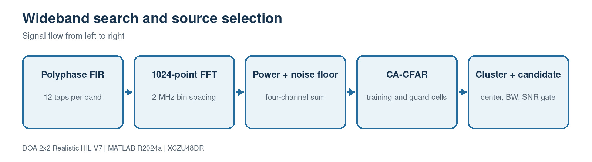

This block contains 12 implementation source file(s). Use the file links below to jump directly to the code explanation.

- [`PFBFFTChannelizer4.m`](#file-pfbfftchannelizer4-m)
- [`SpectrumEstimator4.m`](#file-spectrumestimator4-m)
- [`NoiseFloorEstimator1D.m`](#file-noisefloorestimator1d-m)
- [`CACFAR1D.m`](#file-cacfar1d-m)
- [`BinClusterEstimator.m`](#file-binclusterestimator-m)
- [`CandidateSelector.m`](#file-candidateselector-m)
- [`SignalMetricsMonitor.m`](#file-signalmetricsmonitor-m)
- [`SnapshotDecimator4.m`](#file-snapshotdecimator4-m)
- [`SyntheticFourChannelSource.m`](#file-syntheticfourchannelsource-m)
- [`doa_search_params.m`](#file-doa-search-params-m)
- [`run_search_chain_matlab.m`](#file-run-search-chain-matlab-m)
- [`build_doa_search_model.m`](#file-build-doa-search-model-m)

<a id="file-pfbfftchannelizer4-m"></a>

## File: `PFBFFTChannelizer4.m`

### Purpose

Behavioral four-channel polyphase FFT channelizer.

### Where it runs

MATLAB R2024a behavioral, processor-reference or verification environment.

### Editing guidance

Edit only with the interfaces, dimensions and conventions in the surrounding block preserved.

### Size

65 source lines.

### Functions, classes and build targets

| Line | Kind | Definition | What the function/definition does |
| ---: | --- | --- | --- |
| 1 | class | `classdef PFBFFTChannelizer4 < matlab.System` | Declares the System object/class that owns this block's configuration, state and execution methods. |
| 18 | function/method | `function obj=PFBFFTChannelizer4(varargin)` | Behavioral four-channel polyphase FFT channelizer. |
| 24 | function/method | `function setupImpl(obj,~)` | Runs once when the System object locks; validates configuration and creates persistent processing resources. |
| 30 | function/method | `function output=stepImpl(obj,input)` | Runs once per input frame and implements the block's main signal-processing algorithm. |
| 37 | function/method | `function resetImpl(obj)` | Restores persistent algorithm/tracker/filter state to its initial condition. |
| 41 | function/method | `function releaseImpl(obj)` | Releases locked child System objects and hardware/software resources. |
| 45 | function/method | `function sizeOut=getOutputSizeImpl(obj)` | Declares fixed Simulink output dimensions for model compilation. |
| 48 | function/method | `function typeOut=getOutputDataTypeImpl(~), typeOut='double'; end` | Declares output numeric types for Simulink propagation. |
| 49 | function/method | `function value=isOutputComplexImpl(~), value=true; end` | Declares whether each output is real or complex. |
| 50 | function/method | `function value=isOutputFixedSizeImpl(~), value=true; end` | Declares that output dimensions remain fixed while running. |
| 51 | function/method | `function name=getInputNamesImpl(~), name='X4'; end` | Assigns readable names to generated MATLAB System block input ports. |
| 52 | function/method | `function name=getOutputNamesImpl(~), name='Ysub'; end` | Assigns readable names to generated MATLAB System block output ports. |
| 53 | function/method | `function icon=getIconImpl(obj)` | Builds the label shown on the generated Simulink block. |
| 58 | function/method | `function channelizer=createChannelizer(obj)` | Implements the `createChannelizer` helper used by this file; inputs, outputs and operations are visible in the signature and source below. |

### Important code lines explained

| Line | Source statement | Function of the line |
| ---: | --- | --- |
| 1 | `classdef PFBFFTChannelizer4 < matlab.System` | Declares the MATLAB class and its base type. |
| 4 | `FrameLength = 8192` | Assigns the left-hand variable/property from the expression on the right. |
| 5 | `NumBands = 1024` | Assigns the left-hand variable/property from the expression on the right. |
| 6 | `DecimationFactor = 1024` | Assigns the left-hand variable/property from the expression on the right. |
| 7 | `TapsPerBand = 12` | Assigns the left-hand variable/property from the expression on the right. |
| 8 | `StopbandAttenuation_dB = 100` | Assigns the left-hand variable/property from the expression on the right. |
| 10 | `properties (Access=private)` | Begins a property group; nontunable values become fixed after System object setup. |
| 18 | `function obj=PFBFFTChannelizer4(varargin)` | Declares a callable function or System object method, including its inputs and outputs. |
| 23 | `methods (Access=protected)` | Begins a method group; protected methods define System object execution behavior. |
| 24 | `function setupImpl(obj,~)` | Declares a callable function or System object method, including its inputs and outputs. |
| 30 | `function output=stepImpl(obj,input)` | Declares a callable function or System object method, including its inputs and outputs. |
| 37 | `function resetImpl(obj)` | Declares a callable function or System object method, including its inputs and outputs. |
| 41 | `function releaseImpl(obj)` | Declares a callable function or System object method, including its inputs and outputs. |
| 45 | `function sizeOut=getOutputSizeImpl(obj)` | Declares a callable function or System object method, including its inputs and outputs. |
| 48 | `function typeOut=getOutputDataTypeImpl(~), typeOut='double'; end` | Declares a callable function or System object method, including its inputs and outputs. |

### Complete source code

<details>
<summary>Open the complete PFBFFTChannelizer4.m source</summary>

```matlab
classdef PFBFFTChannelizer4 < matlab.System
    % Frame-based floating-point PFB/FFT reference model.
    properties (Nontunable)
        FrameLength = 8192
        NumBands = 1024
        DecimationFactor = 1024
        TapsPerBand = 12
        StopbandAttenuation_dB = 100
    end
    properties (Access=private)
        Channelizer0
        Channelizer1
        Channelizer2
        Channelizer3
    end

    methods
        function obj=PFBFFTChannelizer4(varargin)
            setProperties(obj,nargin,varargin{:});
        end
    end

    methods (Access=protected)
        function setupImpl(obj,~)
            obj.Channelizer0=obj.createChannelizer();
            obj.Channelizer1=obj.createChannelizer();
            obj.Channelizer2=obj.createChannelizer();
            obj.Channelizer3=obj.createChannelizer();
        end
        function output=stepImpl(obj,input)
            output=complex(zeros(obj.FrameLength/obj.DecimationFactor,obj.NumBands,4));
            output(:,:,1)=obj.Channelizer0(input(:,1));
            output(:,:,2)=obj.Channelizer1(input(:,2));
            output(:,:,3)=obj.Channelizer2(input(:,3));
            output(:,:,4)=obj.Channelizer3(input(:,4));
        end
        function resetImpl(obj)
            reset(obj.Channelizer0); reset(obj.Channelizer1);
            reset(obj.Channelizer2); reset(obj.Channelizer3);
        end
        function releaseImpl(obj)
            release(obj.Channelizer0); release(obj.Channelizer1);
            release(obj.Channelizer2); release(obj.Channelizer3);
        end
        function sizeOut=getOutputSizeImpl(obj)
            sizeOut=[obj.FrameLength/obj.DecimationFactor obj.NumBands 4];
        end
        function typeOut=getOutputDataTypeImpl(~), typeOut='double'; end
        function value=isOutputComplexImpl(~), value=true; end
        function value=isOutputFixedSizeImpl(~), value=true; end
        function name=getInputNamesImpl(~), name='X4'; end
        function name=getOutputNamesImpl(~), name='Ysub'; end
        function icon=getIconImpl(obj)
            icon=sprintf('PFB + FFT\nM=%d, D=%d',obj.NumBands,obj.DecimationFactor);
        end
    end
    methods (Access=private)
        function channelizer=createChannelizer(obj)
            channelizer=dsp.Channelizer(obj.NumBands,obj.DecimationFactor, ...
                'Specification','Number of taps per band and stopband attenuation', ...
                'NumTapsPerBand',obj.TapsPerBand, ...
                'StopbandAttenuation',obj.StopbandAttenuation_dB);
        end
    end
end
```

</details>

[Back to the document index](#document-header-index)

<a id="file-spectrumestimator4-m"></a>

## File: `SpectrumEstimator4.m`

### Purpose

Calculates smoothed per-bin and summed power plus the RF frequency axis.

### Where it runs

MATLAB R2024a behavioral, processor-reference or verification environment.

### Editing guidance

Edit only with the interfaces, dimensions and conventions in the surrounding block preserved.

### Size

50 source lines.

### Functions, classes and build targets

| Line | Kind | Definition | What the function/definition does |
| ---: | --- | --- | --- |
| 1 | class | `classdef SpectrumEstimator4 < matlab.System` | Declares the System object/class that owns this block's configuration, state and execution methods. |
| 13 | function/method | `function obj=SpectrumEstimator4(varargin)` | Calculates smoothed per-bin and summed power plus the RF frequency axis. |
| 19 | function/method | `function setupImpl(obj,~), obj.PowerState=zeros(obj.NumBands,4); end` | Runs once when the System object locks; validates configuration and creates persistent processing resources. |
| 20 | function/method | `function [power4,powerSum,power_dB,frequencyHz]=stepImpl(obj,input)` | Runs once per input frame and implements the block's main signal-processing algorithm. |
| 31 | function/method | `function resetImpl(obj), obj.PowerState=zeros(obj.NumBands,4); end` | Restores persistent algorithm/tracker/filter state to its initial condition. |
| 32 | function/method | `function [a,b,c,d]=getOutputSizeImpl(obj)` | Declares fixed Simulink output dimensions for model compilation. |
| 35 | function/method | `function [a,b,c,d]=getOutputDataTypeImpl(~)` | Declares output numeric types for Simulink propagation. |
| 38 | function/method | `function [a,b,c,d]=isOutputComplexImpl(~)` | Declares whether each output is real or complex. |
| 41 | function/method | `function [a,b,c,d]=isOutputFixedSizeImpl(~)` | Declares that output dimensions remain fixed while running. |
| 44 | function/method | `function name=getInputNamesImpl(~), name='Ysub'; end` | Assigns readable names to generated MATLAB System block input ports. |
| 45 | function/method | `function [a,b,c,d]=getOutputNamesImpl(~)` | Assigns readable names to generated MATLAB System block output ports. |
| 48 | function/method | `function icon=getIconImpl(~), icon=sprintf('Spectrum / PSD\n4 channels'); end` | Builds the label shown on the generated Simulink block. |

### Important code lines explained

| Line | Source statement | Function of the line |
| ---: | --- | --- |
| 1 | `classdef SpectrumEstimator4 < matlab.System` | Declares the MATLAB class and its base type. |
| 3 | `Fs = 2.048e9` | Assigns the left-hand variable/property from the expression on the right. |
| 4 | `NumBands = 1024` | Assigns the left-hand variable/property from the expression on the right. |
| 5 | `AverageAlpha = 0.25` | Assigns the left-hand variable/property from the expression on the right. |
| 6 | `PowerFloor = 1e-15` | Assigns the left-hand variable/property from the expression on the right. |
| 8 | `properties (Access=private)` | Begins a property group; nontunable values become fixed after System object setup. |
| 13 | `function obj=SpectrumEstimator4(varargin)` | Declares a callable function or System object method, including its inputs and outputs. |
| 18 | `methods (Access=protected)` | Begins a method group; protected methods define System object execution behavior. |
| 19 | `function setupImpl(obj,~), obj.PowerState=zeros(obj.NumBands,4); end` | Declares a callable function or System object method, including its inputs and outputs. |
| 20 | `function [power4,powerSum,power_dB,frequencyHz]=stepImpl(obj,input)` | Declares a callable function or System object method, including its inputs and outputs. |
| 31 | `function resetImpl(obj), obj.PowerState=zeros(obj.NumBands,4); end` | Declares a callable function or System object method, including its inputs and outputs. |
| 32 | `function [a,b,c,d]=getOutputSizeImpl(obj)` | Declares a callable function or System object method, including its inputs and outputs. |
| 35 | `function [a,b,c,d]=getOutputDataTypeImpl(~)` | Declares a callable function or System object method, including its inputs and outputs. |
| 38 | `function [a,b,c,d]=isOutputComplexImpl(~)` | Declares a callable function or System object method, including its inputs and outputs. |

### Complete source code

<details>
<summary>Open the complete SpectrumEstimator4.m source</summary>

```matlab
classdef SpectrumEstimator4 < matlab.System
    properties (Nontunable)
        Fs = 2.048e9
        NumBands = 1024
        AverageAlpha = 0.25
        PowerFloor = 1e-15
    end
    properties (Access=private)
        PowerState
    end

    methods
        function obj=SpectrumEstimator4(varargin)
            setProperties(obj,nargin,varargin{:});
        end
    end

    methods (Access=protected)
        function setupImpl(obj,~), obj.PowerState=zeros(obj.NumBands,4); end
        function [power4,powerSum,power_dB,frequencyHz]=stepImpl(obj,input)
            shifted=fftshift(input,2);
            current=squeeze(mean(abs(shifted).^2,1));
            current=reshape(current,obj.NumBands,4);
            alpha=obj.AverageAlpha;
            obj.PowerState=(1-alpha)*obj.PowerState+alpha*current;
            power4=obj.PowerState;
            powerSum=mean(power4,2);
            power_dB=10*log10(max(powerSum,obj.PowerFloor));
            frequencyHz=((0:obj.NumBands-1).'-floor(obj.NumBands/2))*(obj.Fs/obj.NumBands);
        end
        function resetImpl(obj), obj.PowerState=zeros(obj.NumBands,4); end
        function [a,b,c,d]=getOutputSizeImpl(obj)
            a=[obj.NumBands 4]; b=[obj.NumBands 1]; c=b; d=b;
        end
        function [a,b,c,d]=getOutputDataTypeImpl(~)
            a='double'; b='double'; c='double'; d='double';
        end
        function [a,b,c,d]=isOutputComplexImpl(~)
            a=false; b=false; c=false; d=false;
        end
        function [a,b,c,d]=isOutputFixedSizeImpl(~)
            a=true; b=true; c=true; d=true;
        end
        function name=getInputNamesImpl(~), name='Ysub'; end
        function [a,b,c,d]=getOutputNamesImpl(~)
            a='P4'; b='Psum'; c='P_dB'; d='f_Hz';
        end
        function icon=getIconImpl(~), icon=sprintf('Spectrum / PSD\n4 channels'); end
    end
end
```

</details>

[Back to the document index](#document-header-index)

<a id="file-noisefloorestimator1d-m"></a>

## File: `NoiseFloorEstimator1D.m`

### Purpose

Estimates robust local/global spectral noise using a sliding median.

### Where it runs

MATLAB R2024a behavioral, processor-reference or verification environment.

### Editing guidance

Edit only with the interfaces, dimensions and conventions in the surrounding block preserved.

### Size

34 source lines.

### Functions, classes and build targets

| Line | Kind | Definition | What the function/definition does |
| ---: | --- | --- | --- |
| 1 | class | `classdef NoiseFloorEstimator1D < matlab.System` | Declares the System object/class that owns this block's configuration, state and execution methods. |
| 8 | function/method | `function obj=NoiseFloorEstimator1D(varargin)` | Estimates robust local/global spectral noise using a sliding median. |
| 13 | function/method | `function [localNoise,globalNoise,globalNoise_dB]=stepImpl(obj,powerValue)` | Runs once per input frame and implements the block's main signal-processing algorithm. |
| 24 | function/method | `function [a,b,c]=getOutputSizeImpl(obj)` | Declares fixed Simulink output dimensions for model compilation. |
| 27 | function/method | `function [a,b,c]=getOutputDataTypeImpl(~), a='double'; b='double'; c='double'; end` | Declares output numeric types for Simulink propagation. |
| 28 | function/method | `function [a,b,c]=isOutputComplexImpl(~), a=false; b=false; c=false; end` | Declares whether each output is real or complex. |
| 29 | function/method | `function [a,b,c]=isOutputFixedSizeImpl(~), a=true; b=true; c=true; end` | Declares that output dimensions remain fixed while running. |
| 30 | function/method | `function name=getInputNamesImpl(~), name='Psum'; end` | Assigns readable names to generated MATLAB System block input ports. |
| 31 | function/method | `function [a,b,c]=getOutputNamesImpl(~), a='Nlocal'; b='Nglobal'; c='Nglobal_dB'; end` | Assigns readable names to generated MATLAB System block output ports. |
| 32 | function/method | `function icon=getIconImpl(obj), icon=sprintf('Noise Floor\nMedian W=%d',obj.MedianWindowBins); end` | Builds the label shown on the generated Simulink block. |

### Important code lines explained

| Line | Source statement | Function of the line |
| ---: | --- | --- |
| 1 | `classdef NoiseFloorEstimator1D < matlab.System` | Declares the MATLAB class and its base type. |
| 3 | `NumBins = 1024` | Assigns the left-hand variable/property from the expression on the right. |
| 4 | `MedianWindowBins = 81` | Assigns the left-hand variable/property from the expression on the right. |
| 5 | `PowerFloor = 1e-15` | Assigns the left-hand variable/property from the expression on the right. |
| 8 | `function obj=NoiseFloorEstimator1D(varargin)` | Declares a callable function or System object method, including its inputs and outputs. |
| 12 | `methods (Access=protected)` | Begins a method group; protected methods define System object execution behavior. |
| 13 | `function [localNoise,globalNoise,globalNoise_dB]=stepImpl(obj,powerValue)` | Declares a callable function or System object method, including its inputs and outputs. |
| 14 | `halfWindow=floor(obj.MedianWindowBins/2);` | Assigns the left-hand variable/property from the expression on the right. |
| 15 | `localNoise=zeros(obj.NumBins,1);` | Assigns the left-hand variable/property from the expression on the right. |
| 24 | `function [a,b,c]=getOutputSizeImpl(obj)` | Declares a callable function or System object method, including its inputs and outputs. |
| 27 | `function [a,b,c]=getOutputDataTypeImpl(~), a='double'; b='double'; c='double'; end` | Declares a callable function or System object method, including its inputs and outputs. |
| 28 | `function [a,b,c]=isOutputComplexImpl(~), a=false; b=false; c=false; end` | Declares a callable function or System object method, including its inputs and outputs. |
| 29 | `function [a,b,c]=isOutputFixedSizeImpl(~), a=true; b=true; c=true; end` | Declares a callable function or System object method, including its inputs and outputs. |
| 30 | `function name=getInputNamesImpl(~), name='Psum'; end` | Declares a callable function or System object method, including its inputs and outputs. |

### Complete source code

<details>
<summary>Open the complete NoiseFloorEstimator1D.m source</summary>

```matlab
classdef NoiseFloorEstimator1D < matlab.System
    properties (Nontunable)
        NumBins = 1024
        MedianWindowBins = 81
        PowerFloor = 1e-15
    end
    methods
        function obj=NoiseFloorEstimator1D(varargin)
            setProperties(obj,nargin,varargin{:});
        end
    end
    methods (Access=protected)
        function [localNoise,globalNoise,globalNoise_dB]=stepImpl(obj,powerValue)
            halfWindow=floor(obj.MedianWindowBins/2);
            localNoise=zeros(obj.NumBins,1);
            for index=1:obj.NumBins
                first=max(1,index-halfWindow);
                last=min(obj.NumBins,index+halfWindow);
                localNoise(index)=median(powerValue(first:last));
            end
            globalNoise=median(powerValue);
            globalNoise_dB=10*log10(max(globalNoise,obj.PowerFloor));
        end
        function [a,b,c]=getOutputSizeImpl(obj)
            a=[obj.NumBins 1]; b=[1 1]; c=[1 1];
        end
        function [a,b,c]=getOutputDataTypeImpl(~), a='double'; b='double'; c='double'; end
        function [a,b,c]=isOutputComplexImpl(~), a=false; b=false; c=false; end
        function [a,b,c]=isOutputFixedSizeImpl(~), a=true; b=true; c=true; end
        function name=getInputNamesImpl(~), name='Psum'; end
        function [a,b,c]=getOutputNamesImpl(~), a='Nlocal'; b='Nglobal'; c='Nglobal_dB'; end
        function icon=getIconImpl(obj), icon=sprintf('Noise Floor\nMedian W=%d',obj.MedianWindowBins); end
    end
end
```

</details>

[Back to the document index](#document-header-index)

<a id="file-cacfar1d-m"></a>

## File: `CACFAR1D.m`

### Purpose

Applies one-dimensional cell-averaging CFAR thresholds.

### Where it runs

MATLAB R2024a behavioral, processor-reference or verification environment.

### Editing guidance

Edit only with the interfaces, dimensions and conventions in the surrounding block preserved.

### Size

41 source lines.

### Functions, classes and build targets

| Line | Kind | Definition | What the function/definition does |
| ---: | --- | --- | --- |
| 1 | class | `classdef CACFAR1D < matlab.System` | Declares the System object/class that owns this block's configuration, state and execution methods. |
| 9 | function/method | `function obj=CACFAR1D(varargin)` | Applies one-dimensional cell-averaging CFAR thresholds. |
| 14 | function/method | `function [detections,threshold,noiseEstimate]=stepImpl(obj,powerValue)` | Runs once per input frame and implements the block's main signal-processing algorithm. |
| 31 | function/method | `function [a,b,c]=getOutputSizeImpl(obj), a=[obj.NumBins 1]; b=a; c=a; end` | Declares fixed Simulink output dimensions for model compilation. |
| 32 | function/method | `function [a,b,c]=getOutputDataTypeImpl(~), a='logical'; b='double'; c='double'; end` | Declares output numeric types for Simulink propagation. |
| 33 | function/method | `function [a,b,c]=isOutputComplexImpl(~), a=false; b=false; c=false; end` | Declares whether each output is real or complex. |
| 34 | function/method | `function [a,b,c]=isOutputFixedSizeImpl(~), a=true; b=true; c=true; end` | Declares that output dimensions remain fixed while running. |
| 35 | function/method | `function name=getInputNamesImpl(~), name='Psum'; end` | Assigns readable names to generated MATLAB System block input ports. |
| 36 | function/method | `function [a,b,c]=getOutputNamesImpl(~), a='Detect'; b='Threshold'; c='CFAR_Noise'; end` | Assigns readable names to generated MATLAB System block output ports. |
| 37 | function/method | `function icon=getIconImpl(obj)` | Builds the label shown on the generated Simulink block. |

### Important code lines explained

| Line | Source statement | Function of the line |
| ---: | --- | --- |
| 1 | `classdef CACFAR1D < matlab.System` | Declares the MATLAB class and its base type. |
| 3 | `NumBins = 1024` | Assigns the left-hand variable/property from the expression on the right. |
| 4 | `TrainCells = 24` | Assigns the left-hand variable/property from the expression on the right. |
| 5 | `GuardCells = 4` | Assigns the left-hand variable/property from the expression on the right. |
| 6 | `Pfa = 1e-5` | Assigns the left-hand variable/property from the expression on the right. |
| 9 | `function obj=CACFAR1D(varargin)` | Declares a callable function or System object method, including its inputs and outputs. |
| 13 | `methods (Access=protected)` | Begins a method group; protected methods define System object execution behavior. |
| 14 | `function [detections,threshold,noiseEstimate]=stepImpl(obj,powerValue)` | Declares a callable function or System object method, including its inputs and outputs. |
| 15 | `trainingCount=2*obj.TrainCells;` | Assigns the left-hand variable/property from the expression on the right. |
| 31 | `function [a,b,c]=getOutputSizeImpl(obj), a=[obj.NumBins 1]; b=a; c=a; end` | Declares a callable function or System object method, including its inputs and outputs. |
| 32 | `function [a,b,c]=getOutputDataTypeImpl(~), a='logical'; b='double'; c='double'; end` | Declares a callable function or System object method, including its inputs and outputs. |
| 33 | `function [a,b,c]=isOutputComplexImpl(~), a=false; b=false; c=false; end` | Declares a callable function or System object method, including its inputs and outputs. |
| 34 | `function [a,b,c]=isOutputFixedSizeImpl(~), a=true; b=true; c=true; end` | Declares a callable function or System object method, including its inputs and outputs. |
| 35 | `function name=getInputNamesImpl(~), name='Psum'; end` | Declares a callable function or System object method, including its inputs and outputs. |

### Complete source code

<details>
<summary>Open the complete CACFAR1D.m source</summary>

```matlab
classdef CACFAR1D < matlab.System
    properties (Nontunable)
        NumBins = 1024
        TrainCells = 24
        GuardCells = 4
        Pfa = 1e-5
    end
    methods
        function obj=CACFAR1D(varargin)
            setProperties(obj,nargin,varargin{:});
        end
    end
    methods (Access=protected)
        function [detections,threshold,noiseEstimate]=stepImpl(obj,powerValue)
            trainingCount=2*obj.TrainCells;
            alpha=trainingCount*(obj.Pfa^(-1/trainingCount)-1);
            detections=false(obj.NumBins,1);
            threshold=inf(obj.NumBins,1);
            noiseEstimate=zeros(obj.NumBins,1);
            first=1+obj.TrainCells+obj.GuardCells;
            last=obj.NumBins-(obj.TrainCells+obj.GuardCells);
            for index=first:last
                left=powerValue(index-obj.GuardCells-obj.TrainCells:index-obj.GuardCells-1);
                right=powerValue(index+obj.GuardCells+1:index+obj.GuardCells+obj.TrainCells);
                noise=(sum(left)+sum(right))/trainingCount;
                noiseEstimate(index)=noise;
                threshold(index)=alpha*noise;
                detections(index)=powerValue(index)>threshold(index);
            end
        end
        function [a,b,c]=getOutputSizeImpl(obj), a=[obj.NumBins 1]; b=a; c=a; end
        function [a,b,c]=getOutputDataTypeImpl(~), a='logical'; b='double'; c='double'; end
        function [a,b,c]=isOutputComplexImpl(~), a=false; b=false; c=false; end
        function [a,b,c]=isOutputFixedSizeImpl(~), a=true; b=true; c=true; end
        function name=getInputNamesImpl(~), name='Psum'; end
        function [a,b,c]=getOutputNamesImpl(~), a='Detect'; b='Threshold'; c='CFAR_Noise'; end
        function icon=getIconImpl(obj)
            icon=sprintf('CA-CFAR\nT=%d, G=%d',obj.TrainCells,obj.GuardCells);
        end
    end
end
```

</details>

[Back to the document index](#document-header-index)

<a id="file-binclusterestimator-m"></a>

## File: `BinClusterEstimator.m`

### Purpose

Merges detected bins and estimates cluster center, width and peak power.

### Where it runs

MATLAB R2024a behavioral, processor-reference or verification environment.

### Editing guidance

Edit only with the interfaces, dimensions and conventions in the surrounding block preserved.

### Size

92 source lines.

### Functions, classes and build targets

| Line | Kind | Definition | What the function/definition does |
| ---: | --- | --- | --- |
| 1 | class | `classdef BinClusterEstimator < matlab.System` | Declares the System object/class that owns this block's configuration, state and execution methods. |
| 10 | function/method | `function obj=BinClusterEstimator(varargin)` | Merges detected bins and estimates cluster center, width and peak power. |
| 15 | function/method | `function [count,centerHz,bandwidthHz,startHz,stopHz,peakPower_dB]= ...` | Implements the `function` helper used by this file; inputs, outputs and operations are visible in the signature and source below. |
| 74 | function/method | `function [a,b,c,d,e,f]=getOutputSizeImpl(obj)` | Declares fixed Simulink output dimensions for model compilation. |
| 77 | function/method | `function [a,b,c,d,e,f]=getOutputDataTypeImpl(~)` | Declares output numeric types for Simulink propagation. |
| 80 | function/method | `function [a,b,c,d,e,f]=isOutputComplexImpl(~)` | Declares whether each output is real or complex. |
| 83 | function/method | `function [a,b,c,d,e,f]=isOutputFixedSizeImpl(~)` | Declares that output dimensions remain fixed while running. |
| 86 | function/method | `function [a,b,c]=getInputNamesImpl(~), a='Detect'; b='Psum'; c='f_Hz'; end` | Assigns readable names to generated MATLAB System block input ports. |
| 87 | function/method | `function [a,b,c,d,e,f]=getOutputNamesImpl(~)` | Assigns readable names to generated MATLAB System block output ports. |
| 90 | function/method | `function icon=getIconImpl(~), icon=sprintf('Bin Clustering\nfc and BW'); end` | Builds the label shown on the generated Simulink block. |

### Important code lines explained

| Line | Source statement | Function of the line |
| ---: | --- | --- |
| 1 | `classdef BinClusterEstimator < matlab.System` | Declares the MATLAB class and its base type. |
| 3 | `NumBins = 1024` | Assigns the left-hand variable/property from the expression on the right. |
| 4 | `MaxClusters = 16` | Assigns the left-hand variable/property from the expression on the right. |
| 5 | `MergeGapBins = 1` | Assigns the left-hand variable/property from the expression on the right. |
| 6 | `MinClusterBins = 1` | Assigns the left-hand variable/property from the expression on the right. |
| 7 | `PowerFloor = 1e-15` | Assigns the left-hand variable/property from the expression on the right. |
| 10 | `function obj=BinClusterEstimator(varargin)` | Declares a callable function or System object method, including its inputs and outputs. |
| 14 | `methods (Access=protected)` | Begins a method group; protected methods define System object execution behavior. |
| 15 | `function [count,centerHz,bandwidthHz,startHz,stopHz,peakPower_dB]= ...` | Declares a callable function or System object method, including its inputs and outputs. |
| 74 | `function [a,b,c,d,e,f]=getOutputSizeImpl(obj)` | Declares a callable function or System object method, including its inputs and outputs. |
| 77 | `function [a,b,c,d,e,f]=getOutputDataTypeImpl(~)` | Declares a callable function or System object method, including its inputs and outputs. |
| 80 | `function [a,b,c,d,e,f]=isOutputComplexImpl(~)` | Declares a callable function or System object method, including its inputs and outputs. |
| 83 | `function [a,b,c,d,e,f]=isOutputFixedSizeImpl(~)` | Declares a callable function or System object method, including its inputs and outputs. |
| 86 | `function [a,b,c]=getInputNamesImpl(~), a='Detect'; b='Psum'; c='f_Hz'; end` | Declares a callable function or System object method, including its inputs and outputs. |

### Complete source code

<details>
<summary>Open the complete BinClusterEstimator.m source</summary>

```matlab
classdef BinClusterEstimator < matlab.System
    properties (Nontunable)
        NumBins = 1024
        MaxClusters = 16
        MergeGapBins = 1
        MinClusterBins = 1
        PowerFloor = 1e-15
    end
    methods
        function obj=BinClusterEstimator(varargin)
            setProperties(obj,nargin,varargin{:});
        end
    end
    methods (Access=protected)
        function [count,centerHz,bandwidthHz,startHz,stopHz,peakPower_dB]= ...
                stepImpl(obj,detect,powerSum,frequencyHz)
            mask=logical(detect(:));
            if obj.MergeGapBins>0
                index=1;
                while index<=obj.NumBins
                    if mask(index)
                        next=index+1;
                        while next<=obj.NumBins && ~mask(next) && ...
                                (next-index-1)<=obj.MergeGapBins
                            next=next+1;
                        end
                        if next<=obj.NumBins && mask(next) && ...
                                (next-index-1)<=obj.MergeGapBins
                            mask(index:next)=true;
                        end
                    end
                    index=index+1;
                end
            end

            centerHz=zeros(obj.MaxClusters,1);
            bandwidthHz=zeros(obj.MaxClusters,1);
            startHz=zeros(obj.MaxClusters,1);
            stopHz=zeros(obj.MaxClusters,1);
            peakPower_dB=-inf(obj.MaxClusters,1);
            count=uint16(0);
            if obj.NumBins>1
                binWidth=abs(frequencyHz(2)-frequencyHz(1));
            else
                binWidth=0;
            end

            index=1;
            while index<=obj.NumBins && double(count)<obj.MaxClusters
                if ~mask(index), index=index+1; continue; end
                first=index;
                while index<obj.NumBins && mask(index+1), index=index+1; end
                last=index;
                numberOfBins=last-first+1;
                if numberOfBins>=obj.MinClusterBins
                    count=count+1;
                    outputIndex=double(count);
                    clusterPower=powerSum(first:last);
                    clusterFrequency=frequencyHz(first:last);
                    denominator=sum(clusterPower);
                    if denominator>0
                        centerHz(outputIndex)=sum(clusterFrequency.*clusterPower)/denominator;
                    else
                        centerHz(outputIndex)=mean(clusterFrequency);
                    end
                    startHz(outputIndex)=frequencyHz(first)-binWidth/2;
                    stopHz(outputIndex)=frequencyHz(last)+binWidth/2;
                    bandwidthHz(outputIndex)=numberOfBins*binWidth;
                    peakPower_dB(outputIndex)=10*log10(max(max(clusterPower),obj.PowerFloor));
                end
                index=index+1;
            end
        end
        function [a,b,c,d,e,f]=getOutputSizeImpl(obj)
            a=[1 1]; b=[obj.MaxClusters 1]; c=b; d=b; e=b; f=b;
        end
        function [a,b,c,d,e,f]=getOutputDataTypeImpl(~)
            a='uint16'; b='double'; c='double'; d='double'; e='double'; f='double';
        end
        function [a,b,c,d,e,f]=isOutputComplexImpl(~)
            a=false; b=false; c=false; d=false; e=false; f=false;
        end
        function [a,b,c,d,e,f]=isOutputFixedSizeImpl(~)
            a=true; b=true; c=true; d=true; e=true; f=true;
        end
        function [a,b,c]=getInputNamesImpl(~), a='Detect'; b='Psum'; c='f_Hz'; end
        function [a,b,c,d,e,f]=getOutputNamesImpl(~)
            a='Nclusters'; b='Center_Hz'; c='BW_Hz'; d='Start_Hz'; e='Stop_Hz'; f='Peak_dB';
        end
        function icon=getIconImpl(~), icon=sprintf('Bin Clustering\nfc and BW'); end
    end
end
```

</details>

[Back to the document index](#document-header-index)

<a id="file-candidateselector-m"></a>

## File: `CandidateSelector.m`

### Purpose

Selects a source cluster using bandwidth and SNR rules.

### Where it runs

MATLAB R2024a behavioral, processor-reference or verification environment.

### Editing guidance

Edit only with the interfaces, dimensions and conventions in the surrounding block preserved.

### Size

55 source lines.

### Functions, classes and build targets

| Line | Kind | Definition | What the function/definition does |
| ---: | --- | --- | --- |
| 1 | class | `classdef CandidateSelector < matlab.System` | Declares the System object/class that owns this block's configuration, state and execution methods. |
| 9 | function/method | `function obj=CandidateSelector(varargin)` | Selects a source cluster using bandwidth and SNR rules. |
| 14 | function/method | `function [valid,indexSelected,centerHz,bandwidthHz,peak_dB]= ...` | Implements the `function` helper used by this file; inputs, outputs and operations are visible in the signature and source below. |
| 37 | function/method | `function [a,b,c,d,e]=getOutputSizeImpl(~), a=[1 1]; b=a; c=a; d=a; e=a; end` | Declares fixed Simulink output dimensions for model compilation. |
| 38 | function/method | `function [a,b,c,d,e]=getOutputDataTypeImpl(~)` | Declares output numeric types for Simulink propagation. |
| 41 | function/method | `function [a,b,c,d,e]=isOutputComplexImpl(~)` | Declares whether each output is real or complex. |
| 44 | function/method | `function [a,b,c,d,e]=isOutputFixedSizeImpl(~)` | Declares that output dimensions remain fixed while running. |
| 47 | function/method | `function [a,b,c,d,e]=getInputNamesImpl(~)` | Assigns readable names to generated MATLAB System block input ports. |
| 50 | function/method | `function [a,b,c,d,e]=getOutputNamesImpl(~)` | Assigns readable names to generated MATLAB System block output ports. |
| 53 | function/method | `function icon=getIconImpl(~), icon=sprintf('Candidate Selector\nBW + SNR'); end` | Builds the label shown on the generated Simulink block. |

### Important code lines explained

| Line | Source statement | Function of the line |
| ---: | --- | --- |
| 1 | `classdef CandidateSelector < matlab.System` | Declares the MATLAB class and its base type. |
| 3 | `MaxClusters = 16` | Assigns the left-hand variable/property from the expression on the right. |
| 4 | `BW_MinHz = 0.5e6` | Assigns the left-hand variable/property from the expression on the right. |
| 5 | `BW_MaxHz = 40e6` | Assigns the left-hand variable/property from the expression on the right. |
| 6 | `MinCandidateSNRdB = 0` | Assigns the left-hand variable/property from the expression on the right. |
| 9 | `function obj=CandidateSelector(varargin)` | Declares a callable function or System object method, including its inputs and outputs. |
| 13 | `methods (Access=protected)` | Begins a method group; protected methods define System object execution behavior. |
| 14 | `function [valid,indexSelected,centerHz,bandwidthHz,peak_dB]= ...` | Declares a callable function or System object method, including its inputs and outputs. |
| 16 | `number=min(double(count),obj.MaxClusters);` | Assigns the left-hand variable/property from the expression on the right. |
| 37 | `function [a,b,c,d,e]=getOutputSizeImpl(~), a=[1 1]; b=a; c=a; d=a; e=a; end` | Declares a callable function or System object method, including its inputs and outputs. |
| 38 | `function [a,b,c,d,e]=getOutputDataTypeImpl(~)` | Declares a callable function or System object method, including its inputs and outputs. |
| 41 | `function [a,b,c,d,e]=isOutputComplexImpl(~)` | Declares a callable function or System object method, including its inputs and outputs. |
| 44 | `function [a,b,c,d,e]=isOutputFixedSizeImpl(~)` | Declares a callable function or System object method, including its inputs and outputs. |
| 47 | `function [a,b,c,d,e]=getInputNamesImpl(~)` | Declares a callable function or System object method, including its inputs and outputs. |

### Complete source code

<details>
<summary>Open the complete CandidateSelector.m source</summary>

```matlab
classdef CandidateSelector < matlab.System
    properties (Nontunable)
        MaxClusters = 16
        BW_MinHz = 0.5e6
        BW_MaxHz = 40e6
        MinCandidateSNRdB = 0
    end
    methods
        function obj=CandidateSelector(varargin)
            setProperties(obj,nargin,varargin{:});
        end
    end
    methods (Access=protected)
        function [valid,indexSelected,centerHz,bandwidthHz,peak_dB]= ...
                stepImpl(obj,count,centers,bandwidths,peaks,noise_dB)
            number=min(double(count),obj.MaxClusters);
            bestScore=-inf;
            selected=0;
            for index=1:number
                bandwidth=bandwidths(index);
                snr=peaks(index)-noise_dB;
                if bandwidth>=obj.BW_MinHz && bandwidth<=obj.BW_MaxHz && ...
                        snr>=obj.MinCandidateSNRdB
                    score=snr-0.05*abs(bandwidth-30e6)/1e6;
                    if score>bestScore, bestScore=score; selected=index; end
                end
            end
            valid=selected>0;
            indexSelected=uint16(selected);
            centerHz=0; bandwidthHz=0; peak_dB=-inf;
            if valid
                centerHz=centers(selected);
                bandwidthHz=bandwidths(selected);
                peak_dB=peaks(selected);
            end
        end
        function [a,b,c,d,e]=getOutputSizeImpl(~), a=[1 1]; b=a; c=a; d=a; e=a; end
        function [a,b,c,d,e]=getOutputDataTypeImpl(~)
            a='logical'; b='uint16'; c='double'; d='double'; e='double';
        end
        function [a,b,c,d,e]=isOutputComplexImpl(~)
            a=false; b=false; c=false; d=false; e=false;
        end
        function [a,b,c,d,e]=isOutputFixedSizeImpl(~)
            a=true; b=true; c=true; d=true; e=true;
        end
        function [a,b,c,d,e]=getInputNamesImpl(~)
            a='Nclusters'; b='Centers'; c='BWs'; d='Peaks'; e='Noise_dB';
        end
        function [a,b,c,d,e]=getOutputNamesImpl(~)
            a='Valid'; b='Index'; c='fc_Hz'; d='BW_Hz'; e='Peak_dB';
        end
        function icon=getIconImpl(~), icon=sprintf('Candidate Selector\nBW + SNR'); end
    end
end
```

</details>

[Back to the document index](#document-header-index)

<a id="file-signalmetricsmonitor-m"></a>

## File: `SignalMetricsMonitor.m`

### Purpose

Formats peak power, SNR, RF center and bandwidth for displays/logging.

### Where it runs

MATLAB R2024a behavioral, processor-reference or verification environment.

### Editing guidance

Edit only with the interfaces, dimensions and conventions in the surrounding block preserved.

### Size

39 source lines.

### Functions, classes and build targets

| Line | Kind | Definition | What the function/definition does |
| ---: | --- | --- | --- |
| 1 | class | `classdef SignalMetricsMonitor < matlab.System` | Declares the System object/class that owns this block's configuration, state and execution methods. |
| 8 | function/method | `function obj=SignalMetricsMonitor(varargin)` | Formats peak power, SNR, RF center and bandwidth for displays/logging. |
| 13 | function/method | `function [peak_dB,snr_dB,selectedRF_GHz,selectedBW_MHz]= ...` | Implements the `function` helper used by this file; inputs, outputs and operations are visible in the signature and source below. |
| 24 | function/method | `function [a,b,c,d]=getOutputSizeImpl(~), a=[1 1]; b=a; c=a; d=a; end` | Declares fixed Simulink output dimensions for model compilation. |
| 25 | function/method | `function [a,b,c,d]=getOutputDataTypeImpl(~)` | Declares output numeric types for Simulink propagation. |
| 28 | function/method | `function [a,b,c,d]=isOutputComplexImpl(~), a=false; b=false; c=false; d=false; end` | Declares whether each output is real or complex. |
| 29 | function/method | `function [a,b,c,d]=isOutputFixedSizeImpl(~), a=true; b=true; c=true; d=true; end` | Declares that output dimensions remain fixed while running. |
| 30 | function/method | `function [a,b,c,d,e]=getInputNamesImpl(~)` | Assigns readable names to generated MATLAB System block input ports. |
| 34 | function/method | `function [a,b,c,d]=getOutputNamesImpl(~)` | Assigns readable names to generated MATLAB System block output ports. |
| 37 | function/method | `function icon=getIconImpl(~), icon=sprintf('Signal Metrics\nPeak / SNR / fc / BW'); end` | Builds the label shown on the generated Simulink block. |

### Important code lines explained

| Line | Source statement | Function of the line |
| ---: | --- | --- |
| 1 | `classdef SignalMetricsMonitor < matlab.System` | Declares the MATLAB class and its base type. |
| 4 | `SearchCenterHz = 4e9` | Assigns the left-hand variable/property from the expression on the right. |
| 5 | `NumBins = 1024` | Assigns the left-hand variable/property from the expression on the right. |
| 8 | `function obj=SignalMetricsMonitor(varargin)` | Declares a callable function or System object method, including its inputs and outputs. |
| 12 | `methods (Access=protected)` | Begins a method group; protected methods define System object execution behavior. |
| 13 | `function [peak_dB,snr_dB,selectedRF_GHz,selectedBW_MHz]= ...` | Declares a callable function or System object method, including its inputs and outputs. |
| 15 | `peak_dB=max(spectrum_dB);` | Assigns the left-hand variable/property from the expression on the right. |
| 16 | `snr_dB=peak_dB-noise_dB;` | Assigns the left-hand variable/property from the expression on the right. |
| 17 | `selectedRF_GHz=NaN;` | Assigns the left-hand variable/property from the expression on the right. |
| 24 | `function [a,b,c,d]=getOutputSizeImpl(~), a=[1 1]; b=a; c=a; d=a; end` | Declares a callable function or System object method, including its inputs and outputs. |
| 25 | `function [a,b,c,d]=getOutputDataTypeImpl(~)` | Declares a callable function or System object method, including its inputs and outputs. |
| 28 | `function [a,b,c,d]=isOutputComplexImpl(~), a=false; b=false; c=false; d=false; end` | Declares a callable function or System object method, including its inputs and outputs. |
| 29 | `function [a,b,c,d]=isOutputFixedSizeImpl(~), a=true; b=true; c=true; d=true; end` | Declares a callable function or System object method, including its inputs and outputs. |
| 30 | `function [a,b,c,d,e]=getInputNamesImpl(~)` | Declares a callable function or System object method, including its inputs and outputs. |

### Complete source code

<details>
<summary>Open the complete SignalMetricsMonitor.m source</summary>

```matlab
classdef SignalMetricsMonitor < matlab.System
    % Convert spectrum/candidate values into display-friendly metrics.
    properties (Nontunable)
        SearchCenterHz = 4e9
        NumBins = 1024
    end
    methods
        function obj=SignalMetricsMonitor(varargin)
            setProperties(obj,nargin,varargin{:});
        end
    end
    methods (Access=protected)
        function [peak_dB,snr_dB,selectedRF_GHz,selectedBW_MHz]= ...
                stepImpl(obj,spectrum_dB,noise_dB,valid,centerOffsetHz,bandwidthHz)
            peak_dB=max(spectrum_dB);
            snr_dB=peak_dB-noise_dB;
            selectedRF_GHz=NaN;
            selectedBW_MHz=NaN;
            if valid
                selectedRF_GHz=(obj.SearchCenterHz+centerOffsetHz)/1e9;
                selectedBW_MHz=bandwidthHz/1e6;
            end
        end
        function [a,b,c,d]=getOutputSizeImpl(~), a=[1 1]; b=a; c=a; d=a; end
        function [a,b,c,d]=getOutputDataTypeImpl(~)
            a='double'; b='double'; c='double'; d='double';
        end
        function [a,b,c,d]=isOutputComplexImpl(~), a=false; b=false; c=false; d=false; end
        function [a,b,c,d]=isOutputFixedSizeImpl(~), a=true; b=true; c=true; d=true; end
        function [a,b,c,d,e]=getInputNamesImpl(~)
            a='Spectrum_dB'; b='Noise_dB'; c='DetectionValid';
            d='CenterOffset_Hz'; e='Bandwidth_Hz';
        end
        function [a,b,c,d]=getOutputNamesImpl(~)
            a='Peak_dB'; b='SNR_dB'; c='SelectedRF_GHz'; d='SelectedBW_MHz';
        end
        function icon=getIconImpl(~), icon=sprintf('Signal Metrics\nPeak / SNR / fc / BW'); end
    end
end
```

</details>

[Back to the document index](#document-header-index)

<a id="file-snapshotdecimator4-m"></a>

## File: `SnapshotDecimator4.m`

### Purpose

Selects the fixed 4096 coherent spatial snapshots used by DOA.

### Where it runs

MATLAB R2024a behavioral, processor-reference or verification environment.

### Editing guidance

Edit only with the interfaces, dimensions and conventions in the surrounding block preserved.

### Size

23 source lines.

### Functions, classes and build targets

| Line | Kind | Definition | What the function/definition does |
| ---: | --- | --- | --- |
| 1 | class | `classdef SnapshotDecimator4 < matlab.System` | Declares the System object/class that owns this block's configuration, state and execution methods. |
| 7 | function/method | `function obj=SnapshotDecimator4(varargin)` | Selects the fixed 4096 coherent spatial snapshots used by DOA. |
| 12 | function/method | `function output=stepImpl(obj,input), output=input(1:obj.DecimationFactor:end,:); end` | Runs once per input frame and implements the block's main signal-processing algorithm. |
| 13 | function/method | `function sizeOut=getOutputSizeImpl(obj)` | Declares fixed Simulink output dimensions for model compilation. |
| 16 | function/method | `function typeOut=getOutputDataTypeImpl(~), typeOut='double'; end` | Declares output numeric types for Simulink propagation. |
| 17 | function/method | `function value=isOutputComplexImpl(~), value=true; end` | Declares whether each output is real or complex. |
| 18 | function/method | `function value=isOutputFixedSizeImpl(~), value=true; end` | Declares that output dimensions remain fixed while running. |
| 19 | function/method | `function name=getInputNamesImpl(~), name='X4'; end` | Assigns readable names to generated MATLAB System block input ports. |
| 20 | function/method | `function name=getOutputNamesImpl(~), name='Snapshots'; end` | Assigns readable names to generated MATLAB System block output ports. |
| 21 | function/method | `function icon=getIconImpl(obj), icon=sprintf('Snapshots\n1:%d:end',obj.DecimationFactor); end` | Builds the label shown on the generated Simulink block. |

### Important code lines explained

| Line | Source statement | Function of the line |
| ---: | --- | --- |
| 1 | `classdef SnapshotDecimator4 < matlab.System` | Declares the MATLAB class and its base type. |
| 3 | `FrameLength = 8192` | Assigns the left-hand variable/property from the expression on the right. |
| 4 | `DecimationFactor = 1024` | Assigns the left-hand variable/property from the expression on the right. |
| 7 | `function obj=SnapshotDecimator4(varargin)` | Declares a callable function or System object method, including its inputs and outputs. |
| 11 | `methods (Access=protected)` | Begins a method group; protected methods define System object execution behavior. |
| 12 | `function output=stepImpl(obj,input), output=input(1:obj.DecimationFactor:end,:); end` | Declares a callable function or System object method, including its inputs and outputs. |
| 13 | `function sizeOut=getOutputSizeImpl(obj)` | Declares a callable function or System object method, including its inputs and outputs. |
| 14 | `sizeOut=[ceil(obj.FrameLength/obj.DecimationFactor) 4];` | Assigns the left-hand variable/property from the expression on the right. |
| 16 | `function typeOut=getOutputDataTypeImpl(~), typeOut='double'; end` | Declares a callable function or System object method, including its inputs and outputs. |
| 17 | `function value=isOutputComplexImpl(~), value=true; end` | Declares a callable function or System object method, including its inputs and outputs. |
| 18 | `function value=isOutputFixedSizeImpl(~), value=true; end` | Declares a callable function or System object method, including its inputs and outputs. |
| 19 | `function name=getInputNamesImpl(~), name='X4'; end` | Declares a callable function or System object method, including its inputs and outputs. |

### Complete source code

<details>
<summary>Open the complete SnapshotDecimator4.m source</summary>

```matlab
classdef SnapshotDecimator4 < matlab.System
    properties (Nontunable)
        FrameLength = 8192
        DecimationFactor = 1024
    end
    methods
        function obj=SnapshotDecimator4(varargin)
            setProperties(obj,nargin,varargin{:});
        end
    end
    methods (Access=protected)
        function output=stepImpl(obj,input), output=input(1:obj.DecimationFactor:end,:); end
        function sizeOut=getOutputSizeImpl(obj)
            sizeOut=[ceil(obj.FrameLength/obj.DecimationFactor) 4];
        end
        function typeOut=getOutputDataTypeImpl(~), typeOut='double'; end
        function value=isOutputComplexImpl(~), value=true; end
        function value=isOutputFixedSizeImpl(~), value=true; end
        function name=getInputNamesImpl(~), name='X4'; end
        function name=getOutputNamesImpl(~), name='Snapshots'; end
        function icon=getIconImpl(obj), icon=sprintf('Snapshots\n1:%d:end',obj.DecimationFactor); end
    end
end
```

</details>

[Back to the document index](#document-header-index)

<a id="file-syntheticfourchannelsource-m"></a>

## File: `SyntheticFourChannelSource.m`

### Purpose

Deterministic four-channel source for isolated search-chain testing.

### Where it runs

MATLAB R2024a behavioral, processor-reference or verification environment.

### Editing guidance

Edit only with the interfaces, dimensions and conventions in the surrounding block preserved.

### Size

82 source lines.

### Functions, classes and build targets

| Line | Kind | Definition | What the function/definition does |
| ---: | --- | --- | --- |
| 1 | class | `classdef SyntheticFourChannelSource < matlab.System` | Declares the System object/class that owns this block's configuration, state and execution methods. |
| 25 | function/method | `function obj=SyntheticFourChannelSource(varargin)` | Deterministic four-channel source for isolated search-chain testing. |
| 30 | function/method | `function output=stepImpl(obj)` | Runs once per input frame and implements the block's main signal-processing algorithm. |
| 55 | function/method | `function sizeOut=getOutputSizeImpl(obj), sizeOut=[obj.FrameLength 4]; end` | Declares fixed Simulink output dimensions for model compilation. |
| 56 | function/method | `function typeOut=getOutputDataTypeImpl(~), typeOut='double'; end` | Declares output numeric types for Simulink propagation. |
| 57 | function/method | `function value=isOutputComplexImpl(~), value=true; end` | Declares whether each output is real or complex. |
| 58 | function/method | `function value=isOutputFixedSizeImpl(~), value=true; end` | Declares that output dimensions remain fixed while running. |
| 59 | function/method | `function name=getOutputNamesImpl(~), name='X4'; end` | Assigns readable names to generated MATLAB System block output ports. |
| 60 | function/method | `function icon=getIconImpl(~), icon=sprintf('4CH Synthetic IQ\nTargets + Interferers'); end` | Builds the label shown on the generated Simulink block. |
| 63 | function/method | `function signal=makeBand(obj,frequency,center,bandwidth,snr_dB)` | Implements the `makeBand` helper used by this file; inputs, outputs and operations are visible in the signature and source below. |
| 73 | function/method | `function output=addSpatialSignal(~,output,signal,positions,rfFrequency,azimuth,elevation,c)` | Implements the `addSpatialSignal` helper used by this file; inputs, outputs and operations are visible in the signature and source below. |

### Important code lines explained

| Line | Source statement | Function of the line |
| ---: | --- | --- |
| 1 | `classdef SyntheticFourChannelSource < matlab.System` | Declares the MATLAB class and its base type. |
| 4 | `Fs = 2.048e9` | Assigns the left-hand variable/property from the expression on the right. |
| 5 | `FrameLength = 8192` | Assigns the left-hand variable/property from the expression on the right. |
| 6 | `SearchCenterHz = 4e9` | Assigns the left-hand variable/property from the expression on the right. |
| 7 | `dx = 0.025` | Assigns the left-hand variable/property from the expression on the right. |
| 8 | `dy = 0.025` | Assigns the left-hand variable/property from the expression on the right. |
| 9 | `NumTargets = 2` | Assigns the left-hand variable/property from the expression on the right. |
| 10 | `TargetOffsetHz = [250e6 250e6]` | Assigns the left-hand variable/property from the expression on the right. |
| 11 | `TargetBandwidthHz = [30e6 30e6]` | Assigns the left-hand variable/property from the expression on the right. |
| 25 | `function obj=SyntheticFourChannelSource(varargin)` | Declares a callable function or System object method, including its inputs and outputs. |
| 30 | `function output=stepImpl(obj)` | Declares a callable function or System object method, including its inputs and outputs. |
| 55 | `function sizeOut=getOutputSizeImpl(obj), sizeOut=[obj.FrameLength 4]; end` | Declares a callable function or System object method, including its inputs and outputs. |
| 56 | `function typeOut=getOutputDataTypeImpl(~), typeOut='double'; end` | Declares a callable function or System object method, including its inputs and outputs. |
| 57 | `function value=isOutputComplexImpl(~), value=true; end` | Declares a callable function or System object method, including its inputs and outputs. |
| 58 | `function value=isOutputFixedSizeImpl(~), value=true; end` | Declares a callable function or System object method, including its inputs and outputs. |
| 59 | `function name=getOutputNamesImpl(~), name='X4'; end` | Declares a callable function or System object method, including its inputs and outputs. |

### Complete source code

<details>
<summary>Open the complete SyntheticFourChannelSource.m source</summary>

```matlab
classdef SyntheticFourChannelSource < matlab.System
    % Multi-target wideband source for the standalone search-stage test.
    properties (Nontunable)
        Fs = 2.048e9
        FrameLength = 8192
        SearchCenterHz = 4e9
        dx = 0.025
        dy = 0.025
        NumTargets = 2
        TargetOffsetHz = [250e6 250e6]
        TargetBandwidthHz = [30e6 30e6]
        TargetSNRdB = [5 0]
        TargetAzDeg = [15 16.5]
        TargetElDeg = [8 8]
        NumInterferers = 2
        InterfererOffsetHz = [-620e6 560e6]
        InterfererBandwidthHz = [20e6 80e6]
        InterfererSNRdB = [12 15]
        InterfererAzDeg = [-35 50]
        InterfererElDeg = [5 0]
        ChannelGain_dB = [0 0.3 -0.2 0.15]
        ChannelPhaseError_deg = [0 1.0 -0.7 0.5]
    end
    methods
        function obj=SyntheticFourChannelSource(varargin)
            setProperties(obj,nargin,varargin{:});
        end
    end
    methods (Access=protected)
        function output=stepImpl(obj)
            N=obj.FrameLength; c=299792458;
            frequency=((0:N-1).'-floor(N/2))*(obj.Fs/N);
            output=complex(zeros(N,4));
            positions=[0 0; obj.dx 0; 0 obj.dy; obj.dx obj.dy];
            for index=1:obj.NumTargets
                signal=obj.makeBand(frequency,obj.TargetOffsetHz(index), ...
                    obj.TargetBandwidthHz(index),obj.TargetSNRdB(index));
                output=obj.addSpatialSignal(output,signal,positions, ...
                    obj.SearchCenterHz+obj.TargetOffsetHz(index), ...
                    obj.TargetAzDeg(index),obj.TargetElDeg(index),c);
            end
            for index=1:obj.NumInterferers
                signal=obj.makeBand(frequency,obj.InterfererOffsetHz(index), ...
                    obj.InterfererBandwidthHz(index),obj.InterfererSNRdB(index));
                output=obj.addSpatialSignal(output,signal,positions, ...
                    obj.SearchCenterHz+obj.InterfererOffsetHz(index), ...
                    obj.InterfererAzDeg(index),obj.InterfererElDeg(index),c);
            end
            output=output+(randn(N,4)+1j*randn(N,4))/sqrt(2);
            for channel=1:4
                output(:,channel)=output(:,channel)*10^(obj.ChannelGain_dB(channel)/20)* ...
                    exp(1j*deg2rad(obj.ChannelPhaseError_deg(channel)));
            end
        end
        function sizeOut=getOutputSizeImpl(obj), sizeOut=[obj.FrameLength 4]; end
        function typeOut=getOutputDataTypeImpl(~), typeOut='double'; end
        function value=isOutputComplexImpl(~), value=true; end
        function value=isOutputFixedSizeImpl(~), value=true; end
        function name=getOutputNamesImpl(~), name='X4'; end
        function icon=getIconImpl(~), icon=sprintf('4CH Synthetic IQ\nTargets + Interferers'); end
    end
    methods (Access=private)
        function signal=makeBand(obj,frequency,center,bandwidth,snr_dB)
            spectrum=complex(zeros(obj.FrameLength,1));
            active=abs(frequency-center)<=bandwidth/2;
            count=sum(active);
            spectrum(active)=(randn(count,1)+1j*randn(count,1))/sqrt(2);
            signal=ifft(ifftshift(spectrum))*sqrt(obj.FrameLength);
            powerValue=mean(abs(signal).^2);
            if powerValue>0, signal=signal/sqrt(powerValue); end
            signal=signal*sqrt(10^(snr_dB/10));
        end
        function output=addSpatialSignal(~,output,signal,positions,rfFrequency,azimuth,elevation,c)
            ux=cosd(elevation)*cosd(azimuth);
            uy=cosd(elevation)*sind(azimuth);
            for channel=1:4
                delay=(positions(channel,1)*ux+positions(channel,2)*uy)/c;
                output(:,channel)=output(:,channel)+signal*exp(-1j*2*pi*rfFrequency*delay);
            end
        end
    end
end
```

</details>

[Back to the document index](#document-header-index)

<a id="file-doa-search-params-m"></a>

## File: `doa_search_params.m`

### Purpose

Compact parameter script for the standalone search-chain example.

### Where it runs

MATLAB R2024a behavioral, processor-reference or verification environment.

### Editing guidance

Edit only with the interfaces, dimensions and conventions in the surrounding block preserved.

### Size

44 source lines.

### Functions, classes and build targets

This is an execution/configuration script and does not declare a separate function or class.

### Important code lines explained

| Line | Source statement | Function of the line |
| ---: | --- | --- |
| 3 | `P.Fs = 2.048e9;` | Assigns the left-hand variable/property from the expression on the right. |
| 4 | `P.FrameLength = 8192;` | Assigns the left-hand variable/property from the expression on the right. |
| 5 | `P.SearchCenterHz = 4.0e9;` | Assigns the left-hand variable/property from the expression on the right. |
| 6 | `P.dx = 0.025;` | Assigns the left-hand variable/property from the expression on the right. |
| 7 | `P.dy = 0.025;` | Assigns the left-hand variable/property from the expression on the right. |
| 8 | `P.NumTargets = 2;` | Assigns the left-hand variable/property from the expression on the right. |
| 9 | `P.TargetOffsetHz = [250e6 250e6];` | Assigns the left-hand variable/property from the expression on the right. |
| 10 | `P.TargetBandwidthHz = [30e6 30e6];` | Assigns the left-hand variable/property from the expression on the right. |
| 42 | `assert(mod(P.FrameLength,P.DecimationFactor)==0);` | Rejects an invalid dimension, type, geometry or configuration before processing. |
| 43 | `assert(P.DecimationFactor<=P.NumBands);` | Rejects an invalid dimension, type, geometry or configuration before processing. |
| 44 | `assert(mod(P.NoiseMedianWindowBins,2)==1);` | Rejects an invalid dimension, type, geometry or configuration before processing. |

### Complete source code

<details>
<summary>Open the complete doa_search_params.m source</summary>

```matlab
%% STANDALONE DOA SEARCH-STAGE PARAMETERS
clear P
P.Fs = 2.048e9;
P.FrameLength = 8192;
P.SearchCenterHz = 4.0e9;
P.dx = 0.025;
P.dy = 0.025;
P.NumTargets = 2;
P.TargetOffsetHz = [250e6 250e6];
P.TargetBandwidthHz = [30e6 30e6];
P.TargetSNRdB = [5 0];
P.TargetAzDeg = [15 16.5];
P.TargetElDeg = [8 8];
P.NumInterferers = 2;
P.InterfererOffsetHz = [-620e6 560e6];
P.InterfererBandwidthHz = [20e6 80e6];
P.InterfererSNRdB = [12 15];
P.InterfererAzDeg = [-35 50];
P.InterfererElDeg = [5 0];
P.ChannelGain_dB = [0 0.3 -0.2 0.15];
P.ChannelPhaseError_deg = [0 1.0 -0.7 0.5];
P.NumBands = 1024;
P.DecimationFactor = 1024;
P.TapsPerBand = 12;
P.StopbandAttenuation_dB = 100;
P.ChannelSpacingHz = P.Fs/P.NumBands;
P.SpectrumAverageAlpha = 0.25;
P.SpectrumFloor = 1e-15;
P.NoiseMedianWindowBins = 81;
P.CFAR_TrainCells = 24;
P.CFAR_GuardCells = 4;
P.CFAR_Pfa = 1e-5;
P.MergeGapBins = 1;
P.MinClusterBins = 1;
P.MaxClusters = 16;
P.TargetBW_MinHz = 0.5e6;
P.TargetBW_MaxHz = 40e6;
P.MinCandidateSNRdB = 0;
P.StopTime = 0.050;
P.FramePeriod = P.FrameLength/P.Fs;
P.RandomSeed = 8675309;
assert(mod(P.FrameLength,P.DecimationFactor)==0);
assert(P.DecimationFactor<=P.NumBands);
assert(mod(P.NoiseMedianWindowBins,2)==1);
```

</details>

[Back to the document index](#document-header-index)

<a id="file-run-search-chain-matlab-m"></a>

## File: `run_search_chain_matlab.m`

### Purpose

Runs the search/detection blocks without navigation.

### Where it runs

MATLAB R2024a behavioral, processor-reference or verification environment.

### Editing guidance

Edit only with the interfaces, dimensions and conventions in the surrounding block preserved.

### Size

50 source lines.

### Functions, classes and build targets

This is an execution/configuration script and does not declare a separate function or class.

### Important code lines explained

| Line | Source statement | Function of the line |
| ---: | --- | --- |
| 4 | `source=SyntheticFourChannelSource('Fs',P.Fs,'FrameLength',P.FrameLength, ...` | Assigns the left-hand variable/property from the expression on the right. |
| 14 | `channelizer=PFBFFTChannelizer4('FrameLength',P.FrameLength,'NumBands',P.NumBands, ...` | Assigns the left-hand variable/property from the expression on the right. |
| 17 | `spectrum=SpectrumEstimator4('Fs',P.Fs,'NumBands',P.NumBands, ...` | Assigns the left-hand variable/property from the expression on the right. |
| 19 | `noise=NoiseFloorEstimator1D('NumBins',P.NumBands, ...` | Assigns the left-hand variable/property from the expression on the right. |
| 21 | `cfar=CACFAR1D('NumBins',P.NumBands,'TrainCells',P.CFAR_TrainCells, ...` | Assigns the left-hand variable/property from the expression on the right. |
| 23 | `cluster=BinClusterEstimator('NumBins',P.NumBands,'MaxClusters',P.MaxClusters, ...` | Assigns the left-hand variable/property from the expression on the right. |
| 26 | `selector=CandidateSelector('MaxClusters',P.MaxClusters, ...` | Assigns the left-hand variable/property from the expression on the right. |
| 30 | `for frame=1:30` | Begins a bounded loop over samples, channels, candidates or trials. |

### Complete source code

<details>
<summary>Open the complete run_search_chain_matlab.m source</summary>

```matlab
%% Run the standalone wideband search stage directly in MATLAB.
clearvars; rehash path; clc;
run('doa_search_params.m'); rng(P.RandomSeed,'twister');
source=SyntheticFourChannelSource('Fs',P.Fs,'FrameLength',P.FrameLength, ...
    'SearchCenterHz',P.SearchCenterHz,'dx',P.dx,'dy',P.dy, ...
    'NumTargets',P.NumTargets,'TargetOffsetHz',P.TargetOffsetHz, ...
    'TargetBandwidthHz',P.TargetBandwidthHz,'TargetSNRdB',P.TargetSNRdB, ...
    'TargetAzDeg',P.TargetAzDeg,'TargetElDeg',P.TargetElDeg, ...
    'NumInterferers',P.NumInterferers,'InterfererOffsetHz',P.InterfererOffsetHz, ...
    'InterfererBandwidthHz',P.InterfererBandwidthHz, ...
    'InterfererSNRdB',P.InterfererSNRdB,'InterfererAzDeg',P.InterfererAzDeg, ...
    'InterfererElDeg',P.InterfererElDeg,'ChannelGain_dB',P.ChannelGain_dB, ...
    'ChannelPhaseError_deg',P.ChannelPhaseError_deg);
channelizer=PFBFFTChannelizer4('FrameLength',P.FrameLength,'NumBands',P.NumBands, ...
    'DecimationFactor',P.DecimationFactor,'TapsPerBand',P.TapsPerBand, ...
    'StopbandAttenuation_dB',P.StopbandAttenuation_dB);
spectrum=SpectrumEstimator4('Fs',P.Fs,'NumBands',P.NumBands, ...
    'AverageAlpha',P.SpectrumAverageAlpha,'PowerFloor',P.SpectrumFloor);
noise=NoiseFloorEstimator1D('NumBins',P.NumBands, ...
    'MedianWindowBins',P.NoiseMedianWindowBins,'PowerFloor',P.SpectrumFloor);
cfar=CACFAR1D('NumBins',P.NumBands,'TrainCells',P.CFAR_TrainCells, ...
    'GuardCells',P.CFAR_GuardCells,'Pfa',P.CFAR_Pfa);
cluster=BinClusterEstimator('NumBins',P.NumBands,'MaxClusters',P.MaxClusters, ...
    'MergeGapBins',P.MergeGapBins,'MinClusterBins',P.MinClusterBins, ...
    'PowerFloor',P.SpectrumFloor);
selector=CandidateSelector('MaxClusters',P.MaxClusters, ...
    'BW_MinHz',P.TargetBW_MinHz,'BW_MaxHz',P.TargetBW_MaxHz, ...
    'MinCandidateSNRdB',P.MinCandidateSNRdB);

for frame=1:30
    iq4=source(); subbands=channelizer(iq4);
    [~,powerSum,power_dB,frequencyHz]=spectrum(subbands);
    [~,~,noise_dB]=noise(powerSum);
    [detections,threshold,~]=cfar(powerSum);
    [count,centers,bandwidths,~,~,peaks]=cluster(detections,powerSum,frequencyHz);
    [valid,~,centerHz,bandwidthHz,~]=selector(count,centers,bandwidths,peaks,noise_dB);
end
fprintf('Detected clusters: %d\n',count);
if valid
    fprintf('Selected baseband center: %.3f MHz\n',centerHz/1e6);
    fprintf('Selected RF center: %.9f GHz\n',(P.SearchCenterHz+centerHz)/1e9);
    fprintf('Estimated bandwidth: %.3f MHz\n',bandwidthHz/1e6);
else
    fprintf('No candidate passed the current rules.\n');
end
figure('Name','Search Stage');
plot((P.SearchCenterHz+frequencyHz)/1e9,power_dB,'LineWidth',1.2); hold on;
plot((P.SearchCenterHz+frequencyHz)/1e9,10*log10(max(threshold,P.SpectrumFloor)),'--');
grid on; xlabel('RF Frequency (GHz)'); ylabel('Power (dB)');
legend('Spectrum','CFAR threshold');
```

</details>

[Back to the document index](#document-header-index)

<a id="file-build-doa-search-model-m"></a>

## File: `build_doa_search_model.m`

### Purpose

Builds a focused Simulink search-chain model.

### Where it runs

MATLAB R2024a behavioral, processor-reference or verification environment.

### Editing guidance

Edit only with the interfaces, dimensions and conventions in the surrounding block preserved.

### Size

93 source lines.

### Functions, classes and build targets

| Line | Kind | Definition | What the function/definition does |
| ---: | --- | --- | --- |
| 1 | function/method | `function build_doa_search_model()` | Builds a focused Simulink search-chain model. |
| 76 | function/method | `function block=addSystem(model,name,className,position)` | Implements the `addSystem` helper used by this file; inputs, outputs and operations are visible in the signature and source below. |
| 81 | function/method | `function applyProperties(block,values)` | Implements the `applyProperties` helper used by this file; inputs, outputs and operations are visible in the signature and source below. |
| 90 | function/method | `function addToWorkspace(model,name,position,variableName)` | Implements the `addToWorkspace` helper used by this file; inputs, outputs and operations are visible in the signature and source below. |

### Important code lines explained

| Line | Source statement | Function of the line |
| ---: | --- | --- |
| 1 | `function build_doa_search_model()` | Declares a callable function or System object method, including its inputs and outputs. |
| 4 | `model='DOA_SearchStage_Executable';` | Assigns the left-hand variable/property from the expression on the right. |
| 11 | `source=addSystem(model,'Synthetic_4CH_Source','SyntheticFourChannelSource',[30 90 200 180]);` | Creates or configures a generated Simulink block. |
| 12 | `channelizer=addSystem(model,'PFB_FFT_Channelizer','PFBFFTChannelizer4',[270 90 450 180]);` | Creates or configures a generated Simulink block. |
| 13 | `spectrum=addSystem(model,'Spectrum_Estimator','SpectrumEstimator4',[520 70 685 200]);` | Creates or configures a generated Simulink block. |
| 14 | `noise=addSystem(model,'Noise_Floor','NoiseFloorEstimator1D',[755 245 910 325]);` | Creates or configures a generated Simulink block. |
| 15 | `cfar=addSystem(model,'CA_CFAR','CACFAR1D',[755 70 910 185]);` | Creates or configures a generated Simulink block. |
| 16 | `cluster=addSystem(model,'Bin_Clustering','BinClusterEstimator',[980 70 1145 225]);` | Creates or configures a generated Simulink block. |
| 17 | `selector=addSystem(model,'Candidate_Selector','CandidateSelector',[1220 70 1390 225]);` | Creates or configures a generated Simulink block. |
| 45 | `add_line(model,'Synthetic_4CH_Source/1','PFB_FFT_Channelizer/1','autorouting','on');` | Connects two generated Simulink block ports. |
| 46 | `add_line(model,'PFB_FFT_Channelizer/1','Spectrum_Estimator/1','autorouting','on');` | Connects two generated Simulink block ports. |
| 47 | `add_line(model,'Spectrum_Estimator/2','CA_CFAR/1','autorouting','on');` | Connects two generated Simulink block ports. |
| 48 | `add_line(model,'Spectrum_Estimator/2','Noise_Floor/1','autorouting','on');` | Connects two generated Simulink block ports. |
| 49 | `add_line(model,'CA_CFAR/1','Bin_Clustering/1','autorouting','on');` | Connects two generated Simulink block ports. |
| 50 | `add_line(model,'Spectrum_Estimator/2','Bin_Clustering/2','autorouting','on');` | Connects two generated Simulink block ports. |
| 51 | `add_line(model,'Spectrum_Estimator/4','Bin_Clustering/3','autorouting','on');` | Connects two generated Simulink block ports. |
| 52 | `add_line(model,'Bin_Clustering/1','Candidate_Selector/1','autorouting','on');` | Connects two generated Simulink block ports. |
| 53 | `add_line(model,'Bin_Clustering/2','Candidate_Selector/2','autorouting','on');` | Connects two generated Simulink block ports. |
| 54 | `add_line(model,'Bin_Clustering/3','Candidate_Selector/3','autorouting','on');` | Connects two generated Simulink block ports. |
| 55 | `add_line(model,'Bin_Clustering/6','Candidate_Selector/4','autorouting','on');` | Connects two generated Simulink block ports. |
| 56 | `add_line(model,'Noise_Floor/3','Candidate_Selector/5','autorouting','on');` | Connects two generated Simulink block ports. |
| 76 | `function block=addSystem(model,name,className,position)` | Declares a callable function or System object method, including its inputs and outputs. |
| 81 | `function applyProperties(block,values)` | Declares a callable function or System object method, including its inputs and outputs. |
| 90 | `function addToWorkspace(model,name,position,variableName)` | Declares a callable function or System object method, including its inputs and outputs. |

### Complete source code

<details>
<summary>Open the complete build_doa_search_model.m source</summary>

```matlab
function build_doa_search_model()
%BUILD_DOA_SEARCH_MODEL Create the executable standalone search-stage model.
run('doa_search_params.m');
model='DOA_SearchStage_Executable';
if bdIsLoaded(model), close_system(model,0); end
if exist([model '.slx'],'file'), delete([model '.slx']); end
new_system(model); open_system(model);
set_param(model,'SolverType','Fixed-step','Solver','FixedStepDiscrete', ...
    'FixedStep',num2str(P.FramePeriod,17),'StopTime',num2str(P.StopTime,17));

source=addSystem(model,'Synthetic_4CH_Source','SyntheticFourChannelSource',[30 90 200 180]);
channelizer=addSystem(model,'PFB_FFT_Channelizer','PFBFFTChannelizer4',[270 90 450 180]);
spectrum=addSystem(model,'Spectrum_Estimator','SpectrumEstimator4',[520 70 685 200]);
noise=addSystem(model,'Noise_Floor','NoiseFloorEstimator1D',[755 245 910 325]);
cfar=addSystem(model,'CA_CFAR','CACFAR1D',[755 70 910 185]);
cluster=addSystem(model,'Bin_Clustering','BinClusterEstimator',[980 70 1145 225]);
selector=addSystem(model,'Candidate_Selector','CandidateSelector',[1220 70 1390 225]);

applyProperties(source,struct('Fs',P.Fs,'FrameLength',P.FrameLength, ...
    'SearchCenterHz',P.SearchCenterHz,'dx',P.dx,'dy',P.dy, ...
    'NumTargets',P.NumTargets,'TargetOffsetHz',P.TargetOffsetHz, ...
    'TargetBandwidthHz',P.TargetBandwidthHz,'TargetSNRdB',P.TargetSNRdB, ...
    'TargetAzDeg',P.TargetAzDeg,'TargetElDeg',P.TargetElDeg, ...
    'NumInterferers',P.NumInterferers,'InterfererOffsetHz',P.InterfererOffsetHz, ...
    'InterfererBandwidthHz',P.InterfererBandwidthHz, ...
    'InterfererSNRdB',P.InterfererSNRdB,'InterfererAzDeg',P.InterfererAzDeg, ...
    'InterfererElDeg',P.InterfererElDeg,'ChannelGain_dB',P.ChannelGain_dB, ...
    'ChannelPhaseError_deg',P.ChannelPhaseError_deg));
applyProperties(channelizer,struct('FrameLength',P.FrameLength,'NumBands',P.NumBands, ...
    'DecimationFactor',P.DecimationFactor,'TapsPerBand',P.TapsPerBand, ...
    'StopbandAttenuation_dB',P.StopbandAttenuation_dB));
applyProperties(spectrum,struct('Fs',P.Fs,'NumBands',P.NumBands, ...
    'AverageAlpha',P.SpectrumAverageAlpha,'PowerFloor',P.SpectrumFloor));
applyProperties(noise,struct('NumBins',P.NumBands, ...
    'MedianWindowBins',P.NoiseMedianWindowBins,'PowerFloor',P.SpectrumFloor));
applyProperties(cfar,struct('NumBins',P.NumBands,'TrainCells',P.CFAR_TrainCells, ...
    'GuardCells',P.CFAR_GuardCells,'Pfa',P.CFAR_Pfa));
applyProperties(cluster,struct('NumBins',P.NumBands,'MaxClusters',P.MaxClusters, ...
    'MergeGapBins',P.MergeGapBins,'MinClusterBins',P.MinClusterBins, ...
    'PowerFloor',P.SpectrumFloor));
applyProperties(selector,struct('MaxClusters',P.MaxClusters, ...
    'BW_MinHz',P.TargetBW_MinHz,'BW_MaxHz',P.TargetBW_MaxHz, ...
    'MinCandidateSNRdB',P.MinCandidateSNRdB));

add_line(model,'Synthetic_4CH_Source/1','PFB_FFT_Channelizer/1','autorouting','on');
add_line(model,'PFB_FFT_Channelizer/1','Spectrum_Estimator/1','autorouting','on');
add_line(model,'Spectrum_Estimator/2','CA_CFAR/1','autorouting','on');
add_line(model,'Spectrum_Estimator/2','Noise_Floor/1','autorouting','on');
add_line(model,'CA_CFAR/1','Bin_Clustering/1','autorouting','on');
add_line(model,'Spectrum_Estimator/2','Bin_Clustering/2','autorouting','on');
add_line(model,'Spectrum_Estimator/4','Bin_Clustering/3','autorouting','on');
add_line(model,'Bin_Clustering/1','Candidate_Selector/1','autorouting','on');
add_line(model,'Bin_Clustering/2','Candidate_Selector/2','autorouting','on');
add_line(model,'Bin_Clustering/3','Candidate_Selector/3','autorouting','on');
add_line(model,'Bin_Clustering/6','Candidate_Selector/4','autorouting','on');
add_line(model,'Noise_Floor/3','Candidate_Selector/5','autorouting','on');

addToWorkspace(model,'Spectrum_dB',[755 365 860 395],'Spectrum_dB');
addToWorkspace(model,'Frequency_Hz',[755 415 860 445],'Frequency_Hz');
addToWorkspace(model,'Detections',[940 365 1045 395],'Detections');
addToWorkspace(model,'Selected_fc_Hz',[1190 300 1310 330],'Selected_fc_Hz');
addToWorkspace(model,'Selected_BW_Hz',[1340 300 1460 330],'Selected_BW_Hz');
addToWorkspace(model,'Candidate_Valid',[1190 350 1310 380],'Candidate_Valid');
add_line(model,'Spectrum_Estimator/3','Spectrum_dB/1','autorouting','on');
add_line(model,'Spectrum_Estimator/4','Frequency_Hz/1','autorouting','on');
add_line(model,'CA_CFAR/1','Detections/1','autorouting','on');
add_line(model,'Candidate_Selector/3','Selected_fc_Hz/1','autorouting','on');
add_line(model,'Candidate_Selector/4','Selected_BW_Hz/1','autorouting','on');
add_line(model,'Candidate_Selector/1','Candidate_Valid/1','autorouting','on');

set_param(model,'SimulationCommand','update');
save_system(model,[model '.slx']); open_system(model);
fprintf('Created %s.slx\n',model);
end

function block=addSystem(model,name,className,position)
block=[model '/' name];
add_block('simulink/User-Defined Functions/MATLAB System',block,'Position',position);
set_param(block,'System',className);
end
function applyProperties(block,values)
names=fieldnames(values);
for index=1:numel(names)
    value=values.(names{index});
    if ischar(value) || isstring(value), textValue=char(value);
    else, textValue=mat2str(value,17); end
    set_param(block,names{index},textValue);
end
end
function addToWorkspace(model,name,position,variableName)
add_block('simulink/Sinks/To Workspace',[model '/' name],'Position',position, ...
    'VariableName',variableName,'SaveFormat','Array');
end
```

</details>

[Back to the document index](#document-header-index)

<a id="block-5-doa-seed-and-off-grid-refinement"></a>

# Block 5: DOA seed and off-grid refinement

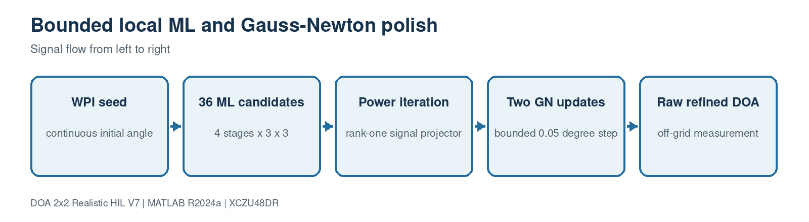

This block contains 3 implementation source file(s). Use the file links below to jump directly to the code explanation.

- [`DOAEstimator4Ch.m`](#file-doaestimator4ch-m)
- [`estimate_doa_from_covariance_v7.m`](#file-estimate-doa-from-covariance-v7-m)
- [`body_to_navigation_dcm.m`](#file-body-to-navigation-dcm-m)

<a id="file-doaestimator4ch-m"></a>

## File: `DOAEstimator4Ch.m`

### Purpose

Implements calibration, covariance, six-baseline WPI, bounded ML/GN and navigation-frame EKF.

### Where it runs

MATLAB R2024a behavioral, processor-reference or verification environment.

### Editing guidance

Keep loop counts bounded for the processor/HDL implementation and preserve covariance sign convention.

### Size

381 source lines.

### Functions, classes and build targets

| Line | Kind | Definition | What the function/definition does |
| ---: | --- | --- | --- |
| 1 | class | `classdef DOAEstimator4Ch < matlab.System` | Declares the System object/class that owns this block's configuration, state and execution methods. |
| 45 | function/method | `function obj=DOAEstimator4Ch(varargin)` | Implements calibration, covariance, six-baseline WPI, bounded ML/GN and navigation-frame EKF. |
| 50 | function/method | `function setupImpl(obj,~,~,~,~)` | Runs once when the System object locks; validates configuration and creates persistent processing resources. |
| 81 | function/method | `function [azimuth,elevation,spectrum]=stepImpl( ...` | Runs once per input frame and implements the block's main signal-processing algorithm. |
| 123 | function/method | `function resetImpl(obj)` | Restores persistent algorithm/tracker/filter state to its initial condition. |
| 129 | function/method | `function [a,b,c]=getOutputSizeImpl(obj)` | Declares fixed Simulink output dimensions for model compilation. |
| 135 | function/method | `function [a,b,c]=getOutputDataTypeImpl(~), a='double'; b='double'; c='double'; end` | Declares output numeric types for Simulink propagation. |
| 136 | function/method | `function [a,b,c]=isOutputComplexImpl(~), a=false; b=false; c=false; end` | Declares whether each output is real or complex. |
| 137 | function/method | `function [a,b,c]=isOutputFixedSizeImpl(~), a=true; b=true; c=true; end` | Declares that output dimensions remain fixed while running. |
| 138 | function/method | `function [a,b,c,d]=getInputNamesImpl(~)` | Assigns readable names to generated MATLAB System block input ports. |
| 142 | function/method | `function [a,b,c]=getOutputNamesImpl(~), a='Az_deg'; b='El_deg'; c='DOA_Spectrum'; end` | Assigns readable names to generated MATLAB System block output ports. |
| 143 | function/method | `function icon=getIconImpl(obj), icon=sprintf('2x2 %s\ncal + WPI + ML + EKF',obj.Algorithm); end` | Builds the label shown on the generated Simulink block. |
| 147 | function/method | `function calibrated=applyCalibration(obj,snapshots)` | Applies inverse gain/phase correction and the calibrated coupling-decoupling matrix. |
| 157 | function/method | `function [azimuth,elevation]=weightedPhaseSeed(obj,covariance)` | Solves the six-baseline coherence-weighted phase equations for a continuous initial direction. |
| 188 | function/method | `function [azimuth,elevation]=localMLRefinement(obj,covariance,azimuth,elevation)` | Evaluates the fixed 36-candidate local likelihood schedule around the WPI seed. |
| 214 | function/method | `function [azimuth,elevation]=gaussNewtonPolish( ...` | Applies the fixed power iteration and bounded Gauss-Newton off-grid correction. |
| 253 | function/method | `function [azimuth,elevation]=unitVectorEKF( ...` | Transforms the measurement to navigation coordinates, updates the six-state EKF and returns body DOA. |
| 296 | function/method | `function steering=steeringVector(obj,azimuth,elevation)` | Calculates a four-channel steering vector from azimuth/elevation and calibrated positions. |
| 302 | function/method | `function [azimuth,elevation,spectrum]=musicDOA(obj,covariance)` | Runs the optional legacy full-grid MUSIC estimator. |
| 323 | function/method | `function [azimuth,elevation,spectrum]=mvdrDOA(obj,covariance)` | Runs the optional legacy full-grid MVDR estimator. |
| 341 | function/method | `function spectrum=markerSpectrum(obj,azimuth,elevation)` | Implements the `markerSpectrum` helper used by this file; inputs, outputs and operations are visible in the signature and source below. |
| 348 | function/method | `function vector=anglesToUnitVector(~,azimuth,elevation)` | Implements the `anglesToUnitVector` helper used by this file; inputs, outputs and operations are visible in the signature and source below. |
| 353 | function/method | `function [azimuth,elevation]=unitVectorToAngles(~,vector)` | Implements the `unitVectorToAngles` helper used by this file; inputs, outputs and operations are visible in the signature and source below. |
| 359 | function/method | `function [azimuth,elevation]=yzCosinesToAngles(~,uy,uz)` | Implements the `yzCosinesToAngles` helper used by this file; inputs, outputs and operations are visible in the signature and source below. |
| 373 | function/method | `function vector=normalizeVector(~,vector)` | Implements the `normalizeVector` helper used by this file; inputs, outputs and operations are visible in the signature and source below. |
| 377 | function/method | `function angle=wrap180(~,angle)` | Wraps an angle into the half-open -180 to +180 degree interval. |

### Important code lines explained

| Line | Source statement | Function of the line |
| ---: | --- | --- |
| 1 | `classdef DOAEstimator4Ch < matlab.System` | Declares the MATLAB class and its base type. |
| 15 | `Algorithm = 'HYBRID_CAL_WPI_ML_EKF'` | Assigns the left-hand variable/property from the expression on the right. |
| 16 | `CenterFreqHz = 4e9` | Assigns the left-hand variable/property from the expression on the right. |
| 17 | `ArrayPositions = [0 -0.0125 -0.0125; 0 0.0125 -0.0125; ...` | Assigns the left-hand variable/property from the expression on the right. |
| 19 | `NumSignals = 1` | Assigns the left-hand variable/property from the expression on the right. |
| 20 | `AzScanRange = [-55 55]` | Assigns the left-hand variable/property from the expression on the right. |
| 21 | `ElScanRange = [-45 45]` | Assigns the left-hand variable/property from the expression on the right. |
| 22 | `ScanResolution = 1` | Assigns the left-hand variable/property from the expression on the right. |
| 23 | `ForwardBackwardAvg = true` | Assigns the left-hand variable/property from the expression on the right. |
| 45 | `function obj=DOAEstimator4Ch(varargin)` | Declares a callable function or System object method, including its inputs and outputs. |
| 50 | `function setupImpl(obj,~,~,~,~)` | Declares a callable function or System object method, including its inputs and outputs. |
| 81 | `function [azimuth,elevation,spectrum]=stepImpl( ...` | Declares a callable function or System object method, including its inputs and outputs. |
| 84 | `covariance=(calibrated.'*conj(calibrated))/size(calibrated,1);` | Creates, conditions or consumes the four-channel spatial covariance matrix. |
| 85 | `covariance=(covariance+covariance')/2;` | Creates, conditions or consumes the four-channel spatial covariance matrix. |
| 88 | `covariance=0.5*(covariance+exchange*conj(covariance)*exchange);` | Creates, conditions or consumes the four-channel spatial covariance matrix. |
| 91 | `switch upper(char(obj.Algorithm))` | Selects the requested algorithm, waveform, mode or profile. |
| 92 | `case {'HYBRID_CAL_WPI_ML_EKF','HYBRID','WPI_ML_EKF'}` | Selects the requested algorithm, waveform, mode or profile. |
| 93 | `[rawAzimuth,rawElevation]=obj.weightedPhaseSeed(covariance);` | Creates, conditions or consumes the four-channel spatial covariance matrix. |
| 95 | `covariance,rawAzimuth,rawElevation);` | Creates, conditions or consumes the four-channel spatial covariance matrix. |
| 98 | `covariance,rawAzimuth,rawElevation);` | Creates, conditions or consumes the four-channel spatial covariance matrix. |
| 108 | `case 'PHASE_INTERFEROMETRY'` | Selects the requested algorithm, waveform, mode or profile. |
| 109 | `[azimuth,elevation]=obj.weightedPhaseSeed(covariance);` | Creates, conditions or consumes the four-channel spatial covariance matrix. |
| 111 | `case 'MVDR'` | Selects the requested algorithm, waveform, mode or profile. |
| 112 | `[azimuth,elevation,spectrum]=obj.mvdrDOA(covariance);` | Creates, conditions or consumes the four-channel spatial covariance matrix. |

### Complete source code

<details>
<summary>Open the complete DOAEstimator4Ch.m source</summary>

```matlab
classdef DOAEstimator4Ch < matlab.System
    % Four-channel 2x2 DOA estimator with an RFSoC-oriented fast path.
    %
    % HYBRID_CAL_WPI_ML_EKF performs:
    %   1) per-channel complex gain/phase calibration;
    %   2) accumulation of a 4x4 spatial covariance matrix;
    %   3) six-baseline, coherence-weighted phase least squares;
    %   4) a fixed 36-candidate off-grid single-source ML refinement; and
    %   5) a normalized constant-rate unit-vector EKF.
    %
    % The default array lies in the Y-Z plane and therefore needs the known
    % forward-hemisphere (+X) constraint.  It cannot distinguish a source in
    % front of the array from its mirror source behind the array.
    properties (Nontunable)
        Algorithm = 'HYBRID_CAL_WPI_ML_EKF'
        CenterFreqHz = 4e9
        ArrayPositions = [0 -0.0125 -0.0125; 0 0.0125 -0.0125; ...
                          0 -0.0125  0.0125; 0 0.0125  0.0125]
        NumSignals = 1
        AzScanRange = [-55 55]
        ElScanRange = [-45 45]
        ScanResolution = 1
        ForwardBackwardAvg = true
        CalibrationGain_dB = [0 0 0 0]
        CalibrationPhase_deg = [0 0 0 0]
        CalibrationDecouplingMatrix = eye(4)
        MLStepSchedule_deg = [0.5 0.1 0.02 0.005]
        EnableGNPolish = true
        GNIterations = 2
        GNMaxStep_deg = 0.05
        EnableTracking = true
        TrackerDt = 0.1
        EKFProcessNoise = 2e-5
        EKFMeasurementNoise = 1.5e-5
        c = 299792458
    end
    properties (Access=private)
        AzimuthGrid
        ElevationGrid
        TrackerState
        TrackerCovariance
        TrackerInitialized
    end
    methods
        function obj=DOAEstimator4Ch(varargin)
            setProperties(obj,nargin,varargin{:});
        end
    end
    methods (Access=protected)
        function setupImpl(obj,~,~,~,~)
            validateattributes(obj.ArrayPositions,{'numeric'}, ...
                {'size',[4 3],'real','finite'},mfilename,'ArrayPositions');
            validateattributes(obj.CalibrationGain_dB,{'numeric'}, ...
                {'vector','numel',4,'real','finite'},mfilename,'CalibrationGain_dB');
            validateattributes(obj.CalibrationPhase_deg,{'numeric'}, ...
                {'vector','numel',4,'real','finite'},mfilename,'CalibrationPhase_deg');
            validateattributes(obj.CalibrationDecouplingMatrix,{'numeric'}, ...
                {'size',[4 4],'finite'},mfilename,'CalibrationDecouplingMatrix');
            obj.AzimuthGrid=obj.AzScanRange(1):obj.ScanResolution:obj.AzScanRange(2);
            obj.ElevationGrid=obj.ElScanRange(1):obj.ScanResolution:obj.ElScanRange(2);
            obj.TrackerState=zeros(6,1);
            obj.TrackerCovariance=eye(6);
            obj.TrackerInitialized=false;

            lambda=obj.c/obj.CenterFreqHz;
            maximumBaseline=0;
            for first=1:3
                for second=first+1:4
                    maximumBaseline=max(maximumBaseline, ...
                        norm(obj.ArrayPositions(second,:)-obj.ArrayPositions(first,:)));
                end
            end
            if maximumBaseline>lambda/2+10*eps(lambda)
                error('DOA2x2:AmbiguousBaseline', ...
                    ['The largest baseline is %.5f m, greater than lambda/2 ' ...
                     '(%.5f m). Weighted phase LS would need phase unwrapping.'], ...
                    maximumBaseline,lambda/2);
            end
        end

        function [azimuth,elevation,spectrum]=stepImpl( ...
                obj,snapshots,platformYaw,platformPitch,platformRoll)
            calibrated=obj.applyCalibration(snapshots);
            covariance=(calibrated.'*conj(calibrated))/size(calibrated,1);
            covariance=(covariance+covariance')/2;
            if obj.ForwardBackwardAvg
                exchange=fliplr(eye(4));
                covariance=0.5*(covariance+exchange*conj(covariance)*exchange);
            end

            switch upper(char(obj.Algorithm))
                case {'HYBRID_CAL_WPI_ML_EKF','HYBRID','WPI_ML_EKF'}
                    [rawAzimuth,rawElevation]=obj.weightedPhaseSeed(covariance);
                    [rawAzimuth,rawElevation]=obj.localMLRefinement( ...
                        covariance,rawAzimuth,rawElevation);
                    if obj.EnableGNPolish
                        [rawAzimuth,rawElevation]=obj.gaussNewtonPolish( ...
                            covariance,rawAzimuth,rawElevation);
                    end
                    if obj.EnableTracking
                        [azimuth,elevation]=obj.unitVectorEKF( ...
                            rawAzimuth,rawElevation,platformYaw,platformPitch,platformRoll);
                    else
                        azimuth=rawAzimuth;
                        elevation=rawElevation;
                    end
                    spectrum=obj.markerSpectrum(azimuth,elevation);
                case 'PHASE_INTERFEROMETRY'
                    [azimuth,elevation]=obj.weightedPhaseSeed(covariance);
                    spectrum=obj.markerSpectrum(azimuth,elevation);
                case 'MVDR'
                    [azimuth,elevation,spectrum]=obj.mvdrDOA(covariance);
                case 'ESPRIT'
                    % For a single source on this non-shift-invariant 2x2
                    % ordering, calibrated phase LS is the fast solution.
                    [azimuth,elevation]=obj.weightedPhaseSeed(covariance);
                    spectrum=obj.markerSpectrum(azimuth,elevation);
                otherwise
                    [azimuth,elevation,spectrum]=obj.musicDOA(covariance);
            end
        end

        function resetImpl(obj)
            obj.TrackerState=zeros(6,1);
            obj.TrackerCovariance=eye(6);
            obj.TrackerInitialized=false;
        end

        function [a,b,c]=getOutputSizeImpl(obj)
            a=[1 1]; b=[1 1];
            numberAz=numel(obj.AzScanRange(1):obj.ScanResolution:obj.AzScanRange(2));
            numberEl=numel(obj.ElScanRange(1):obj.ScanResolution:obj.ElScanRange(2));
            c=[numberEl numberAz];
        end
        function [a,b,c]=getOutputDataTypeImpl(~), a='double'; b='double'; c='double'; end
        function [a,b,c]=isOutputComplexImpl(~), a=false; b=false; c=false; end
        function [a,b,c]=isOutputFixedSizeImpl(~), a=true; b=true; c=true; end
        function [a,b,c,d]=getInputNamesImpl(~)
            a='X4_snapshots'; b='PlatformYaw_deg'; c='PlatformPitch_deg';
            d='PlatformRoll_deg';
        end
        function [a,b,c]=getOutputNamesImpl(~), a='Az_deg'; b='El_deg'; c='DOA_Spectrum'; end
        function icon=getIconImpl(obj), icon=sprintf('2x2 %s\ncal + WPI + ML + EKF',obj.Algorithm); end
    end

    methods (Access=private)
        function calibrated=applyCalibration(obj,snapshots)
            calibrated=snapshots;
            for channel=1:4
                correction=10^(-obj.CalibrationGain_dB(channel)/20)* ...
                    exp(-1j*deg2rad(obj.CalibrationPhase_deg(channel)));
                calibrated(:,channel)=calibrated(:,channel)*correction;
            end
            calibrated=calibrated*obj.CalibrationDecouplingMatrix.';
        end

        function [azimuth,elevation]=weightedPhaseSeed(obj,covariance)
            pairs=[1 2; 1 3; 1 4; 2 3; 2 4; 3 4];
            baseline=zeros(6,2);
            phase=zeros(6,1);
            weight=zeros(6,1);
            for pairIndex=1:6
                first=pairs(pairIndex,1);
                second=pairs(pairIndex,2);
                difference=obj.ArrayPositions(second,:)-obj.ArrayPositions(first,:);
                baseline(pairIndex,:)=difference(2:3);
                crossValue=covariance(second,first);
                phase(pairIndex)=angle(crossValue);
                denominator=max(real(covariance(first,first))* ...
                    real(covariance(second,second)),eps);
                coherence=min(0.999,max(0.001,abs(crossValue)^2/denominator));
                weight(pairIndex)=min(100,max(0.05,coherence/(1-coherence)));
            end
            normal=baseline'*(weight.*baseline);
            rightSide=baseline'*(weight.*phase);
            waveNumber=2*pi*obj.CenterFreqHz/obj.c;
            directionYZ=-(normal+1e-12*eye(2))\rightSide/waveNumber;
            magnitude=norm(directionYZ);
            if magnitude>0.999999
                directionYZ=directionYZ*(0.999999/magnitude);
            end
            [azimuth,elevation]=obj.yzCosinesToAngles( ...
                directionYZ(1),directionYZ(2));
            azimuth=max(obj.AzScanRange(1),min(obj.AzScanRange(2),azimuth));
            elevation=max(obj.ElScanRange(1),min(obj.ElScanRange(2),elevation));
        end

        function [azimuth,elevation]=localMLRefinement(obj,covariance,azimuth,elevation)
            for stage=1:numel(obj.MLStepSchedule_deg)
                stepSize=obj.MLStepSchedule_deg(stage);
                bestScore=-inf;
                bestAzimuth=azimuth;
                bestElevation=elevation;
                for elevationOffset=-1:1
                    for azimuthOffset=-1:1
                        candidateAzimuth=max(obj.AzScanRange(1), ...
                            min(obj.AzScanRange(2),azimuth+azimuthOffset*stepSize));
                        candidateElevation=max(obj.ElScanRange(1), ...
                            min(obj.ElScanRange(2),elevation+elevationOffset*stepSize));
                        steering=obj.steeringVector(candidateAzimuth,candidateElevation);
                        score=real(steering'*covariance*steering)/4;
                        if score>bestScore
                            bestScore=score;
                            bestAzimuth=candidateAzimuth;
                            bestElevation=candidateElevation;
                        end
                    end
                end
                azimuth=bestAzimuth;
                elevation=bestElevation;
            end
        end

        function [azimuth,elevation]=gaussNewtonPolish( ...
                obj,covariance,azimuth,elevation)
            % A fixed four-step power iteration forms a rank-one signal
            % projector without a general eigendecomposition. Two bounded
            % Gauss-Newton updates then remove the last local grid residue.
            signalVector=obj.steeringVector(azimuth,elevation);
            for powerIteration=1:4
                signalVector=covariance*signalVector;
                signalVector=signalVector/max(norm(signalVector),eps);
            end
            noiseProjector=eye(4)-signalVector*signalVector';
            waveNumber=2*pi*obj.CenterFreqHz/obj.c;
            for iteration=1:obj.GNIterations
                azimuthRad=deg2rad(azimuth);
                elevationRad=deg2rad(elevation);
                direction=[cos(elevationRad)*cos(azimuthRad); ...
                    cos(elevationRad)*sin(azimuthRad); sin(elevationRad)];
                directionAz=[-cos(elevationRad)*sin(azimuthRad); ...
                    cos(elevationRad)*cos(azimuthRad); 0];
                directionEl=[-sin(elevationRad)*cos(azimuthRad); ...
                    -sin(elevationRad)*sin(azimuthRad); cos(elevationRad)];
                steering=exp(-1j*waveNumber*(obj.ArrayPositions*direction));
                derivative=[ ...
                    -1j*waveNumber*(obj.ArrayPositions*directionAz).*steering, ...
                    -1j*waveNumber*(obj.ArrayPositions*directionEl).*steering];
                gradient=2*real(derivative'*(noiseProjector*steering));
                hessian=2*real(derivative'*noiseProjector*derivative)+1e-7*eye(2);
                step_deg=rad2deg(hessian\gradient);
                stepNorm=norm(step_deg);
                if stepNorm>obj.GNMaxStep_deg
                    step_deg=step_deg*(obj.GNMaxStep_deg/stepNorm);
                end
                azimuth=azimuth-step_deg(1);
                elevation=elevation-step_deg(2);
                azimuth=max(obj.AzScanRange(1),min(obj.AzScanRange(2),azimuth));
                elevation=max(obj.ElScanRange(1),min(obj.ElScanRange(2),elevation));
            end
        end

        function [azimuth,elevation]=unitVectorEKF( ...
                obj,measuredAzimuth,measuredElevation,platformYaw,platformPitch,platformRoll)
            % The array measurement is in the rotating body frame. Track in
            % the navigation/world frame so commanded yaw and pitch do not
            % appear as fictitious target motion inside the EKF.
            bodyMeasurement=obj.anglesToUnitVector( ...
                measuredAzimuth,measuredElevation);
            rotation=body_to_navigation_dcm( ...
                platformYaw,platformPitch,platformRoll);
            measurement=rotation*bodyMeasurement;
            if ~obj.TrackerInitialized
                obj.TrackerState=[measurement; zeros(3,1)];
                obj.TrackerCovariance=diag([1e-4 1e-4 1e-4 1e-2 1e-2 1e-2]);
                obj.TrackerInitialized=true;
            else
                dt=obj.TrackerDt;
                transition=[eye(3) dt*eye(3); zeros(3) eye(3)];
                predicted=transition*obj.TrackerState;
                predicted(1:3)=obj.normalizeVector(predicted(1:3));
                predicted(4:6)=predicted(4:6)- ...
                    predicted(1:3)*(predicted(1:3)'*predicted(4:6));
                process=obj.EKFProcessNoise*diag([dt^2 dt^2 dt^2 1 1 1]);
                predictedCovariance=transition*obj.TrackerCovariance*transition'+process;
                observation=[eye(3) zeros(3)];
                measurementCovariance=obj.EKFMeasurementNoise*eye(3);
                innovationCovariance=observation*predictedCovariance* ...
                    observation'+measurementCovariance;
                gain=(predictedCovariance*observation')/innovationCovariance;
                updated=predicted+gain*(measurement-observation*predicted);
                updated(1:3)=obj.normalizeVector(updated(1:3));
                updated(4:6)=updated(4:6)- ...
                    updated(1:3)*(updated(1:3)'*updated(4:6));
                identity=eye(6);
                residual=identity-gain*observation;
                obj.TrackerCovariance=residual*predictedCovariance*residual'+ ...
                    gain*measurementCovariance*gain';
                obj.TrackerState=updated;
            end
            bodyEstimate=rotation.'*obj.TrackerState(1:3);
            [azimuth,elevation]=obj.unitVectorToAngles(bodyEstimate);
            azimuth=obj.wrap180(azimuth);
        end

        function steering=steeringVector(obj,azimuth,elevation)
            direction=obj.anglesToUnitVector(azimuth,elevation);
            delay=obj.ArrayPositions*direction/obj.c;
            steering=exp(-1j*2*pi*obj.CenterFreqHz*delay);
        end

        function [azimuth,elevation,spectrum]=musicDOA(obj,covariance)
            [vectors,values]=eig(covariance,'vector');
            [~,order]=sort(real(values),'descend');
            noiseSpace=vectors(:,order(obj.NumSignals+1:end));
            projector=noiseSpace*noiseSpace';
            spectrum=zeros(numel(obj.ElevationGrid),numel(obj.AzimuthGrid));
            for elIndex=1:numel(obj.ElevationGrid)
                for azIndex=1:numel(obj.AzimuthGrid)
                    steering=obj.steeringVector( ...
                        obj.AzimuthGrid(azIndex),obj.ElevationGrid(elIndex));
                    denominator=abs(steering'*projector*steering);
                    spectrum(elIndex,azIndex)=1/max(denominator,eps);
                end
            end
            spectrum=10*log10(spectrum/max(spectrum(:))+1e-15);
            [~,maximum]=max(spectrum(:));
            [elIndex,azIndex]=ind2sub(size(spectrum),maximum);
            azimuth=obj.AzimuthGrid(azIndex);
            elevation=obj.ElevationGrid(elIndex);
        end

        function [azimuth,elevation,spectrum]=mvdrDOA(obj,covariance)
            inverse=(covariance+1e-6*trace(covariance)/4*eye(4))\eye(4);
            spectrum=zeros(numel(obj.ElevationGrid),numel(obj.AzimuthGrid));
            for elIndex=1:numel(obj.ElevationGrid)
                for azIndex=1:numel(obj.AzimuthGrid)
                    steering=obj.steeringVector( ...
                        obj.AzimuthGrid(azIndex),obj.ElevationGrid(elIndex));
                    spectrum(elIndex,azIndex)=1/max( ...
                        abs(steering'*inverse*steering),eps);
                end
            end
            spectrum=10*log10(spectrum/max(spectrum(:))+1e-15);
            [~,maximum]=max(spectrum(:));
            [elIndex,azIndex]=ind2sub(size(spectrum),maximum);
            azimuth=obj.AzimuthGrid(azIndex);
            elevation=obj.ElevationGrid(elIndex);
        end

        function spectrum=markerSpectrum(obj,azimuth,elevation)
            spectrum=-120*ones(numel(obj.ElevationGrid),numel(obj.AzimuthGrid));
            [~,azIndex]=min(abs(obj.AzimuthGrid-azimuth));
            [~,elIndex]=min(abs(obj.ElevationGrid-elevation));
            spectrum(elIndex,azIndex)=0;
        end

        function vector=anglesToUnitVector(~,azimuth,elevation)
            vector=[cosd(elevation)*cosd(azimuth); ...
                    cosd(elevation)*sind(azimuth); sind(elevation)];
        end

        function [azimuth,elevation]=unitVectorToAngles(~,vector)
            vector=vector/max(norm(vector),eps);
            azimuth=atan2d(vector(2),vector(1));
            elevation=asind(max(-1,min(1,vector(3))));
        end

        function [azimuth,elevation]=yzCosinesToAngles(~,uy,uz)
            uy=max(-0.999999,min(0.999999,real(uy)));
            uz=max(-0.999999,min(0.999999,real(uz)));
            horizontalYZ=uy^2+uz^2;
            if horizontalYZ>=1
                scale=0.999999/sqrt(horizontalYZ);
                uy=uy*scale;
                uz=uz*scale;
            end
            ux=sqrt(max(1-uy^2-uz^2,eps));
            azimuth=atan2d(uy,ux);
            elevation=asind(uz);
        end

        function vector=normalizeVector(~,vector)
            vector=vector/max(norm(vector),eps);
        end

        function angle=wrap180(~,angle)
            angle=mod(angle+180,360)-180;
        end
    end
end
```

</details>

[Back to the document index](#document-header-index)

<a id="file-estimate-doa-from-covariance-v7-m"></a>

## File: `estimate_doa_from_covariance_v7.m`

### Purpose

Processor-side reference that estimates DOA directly from a captured PL covariance packet.

### Where it runs

MATLAB R2024a behavioral, processor-reference or verification environment.

### Editing guidance

Edit only with the interfaces, dimensions and conventions in the surrounding block preserved.

### Size

78 source lines.

### Functions, classes and build targets

| Line | Kind | Definition | What the function/definition does |
| ---: | --- | --- | --- |
| 1 | function/method | `function [azimuth,elevation]=estimate_doa_from_covariance_v7(covariance,P)` | Processor-side reference that estimates DOA directly from a captured PL covariance packet. |
| 73 | function/method | `function steering=steeringVector(azimuth,elevation,P)` | Calculates a four-channel steering vector from azimuth/elevation and calibrated positions. |

### Important code lines explained

| Line | Source statement | Function of the line |
| ---: | --- | --- |
| 1 | `function [azimuth,elevation]=estimate_doa_from_covariance_v7(covariance,P)` | Declares a callable function or System object method, including its inputs and outputs. |
| 3 | `covariance=P.DOA.CalibrationDecouplingMatrix*covariance* ...` | Creates, conditions or consumes the four-channel spatial covariance matrix. |
| 5 | `covariance=(covariance+covariance')/2;` | Creates, conditions or consumes the four-channel spatial covariance matrix. |
| 7 | `exchange=fliplr(eye(4));` | Assigns the left-hand variable/property from the expression on the right. |
| 8 | `covariance=.5*(covariance+exchange*conj(covariance)*exchange);` | Creates, conditions or consumes the four-channel spatial covariance matrix. |
| 10 | `pairs=[1 2;1 3;1 4;2 3;2 4;3 4];` | Assigns the left-hand variable/property from the expression on the right. |
| 11 | `baseline=zeros(6,2); phase=zeros(6,1); weight=zeros(6,1);` | Assigns the left-hand variable/property from the expression on the right. |
| 12 | `for pair=1:6` | Begins a bounded loop over samples, channels, candidates or trials. |
| 16 | `crossValue=covariance(second,first);` | Creates, conditions or consumes the four-channel spatial covariance matrix. |
| 17 | `phase(pair)=angle(crossValue);` | Assigns the left-hand variable/property from the expression on the right. |
| 18 | `coherence=abs(crossValue)^2/max(real(covariance(first,first))* ...` | Creates, conditions or consumes the four-channel spatial covariance matrix. |
| 19 | `real(covariance(second,second)),eps);` | Creates, conditions or consumes the four-channel spatial covariance matrix. |
| 24 | `directionYZ=-(baseline'*(weight.*baseline)+1e-12*eye(2))\ ...` | Computes an array direction/steering quantity using the calibrated geometry. |
| 26 | `if norm(directionYZ)>.999999, directionYZ=.999999*directionYZ/norm(directionYZ); end` | Applies the stated runtime condition without changing the defined interface. |
| 27 | `ux=sqrt(max(1-sum(directionYZ.^2),eps));` | Computes an array direction/steering quantity using the calibrated geometry. |
| 28 | `azimuth=atan2d(directionYZ(1),ux); elevation=asind(directionYZ(2));` | Computes an array direction/steering quantity using the calibrated geometry. |
| 73 | `function steering=steeringVector(azimuth,elevation,P)` | Declares a callable function or System object method, including its inputs and outputs. |

### Complete source code

<details>
<summary>Open the complete estimate_doa_from_covariance_v7.m source</summary>

```matlab
function [azimuth,elevation]=estimate_doa_from_covariance_v7(covariance,P)
%ESTIMATE_DOA_FROM_COVARIANCE_V7 PS reference using a captured PL covariance.
covariance=P.DOA.CalibrationDecouplingMatrix*covariance* ...
    P.DOA.CalibrationDecouplingMatrix';
covariance=(covariance+covariance')/2;
if P.DOA.ForwardBackwardAvg
    exchange=fliplr(eye(4));
    covariance=.5*(covariance+exchange*conj(covariance)*exchange);
end
pairs=[1 2;1 3;1 4;2 3;2 4;3 4];
baseline=zeros(6,2); phase=zeros(6,1); weight=zeros(6,1);
for pair=1:6
    first=pairs(pair,1); second=pairs(pair,2);
    difference=P.DOA.ArrayPositions(second,:)-P.DOA.ArrayPositions(first,:);
    baseline(pair,:)=difference(2:3);
    crossValue=covariance(second,first);
    phase(pair)=angle(crossValue);
    coherence=abs(crossValue)^2/max(real(covariance(first,first))* ...
        real(covariance(second,second)),eps);
    coherence=min(.999,max(.001,coherence));
    weight(pair)=min(100,max(.05,coherence/(1-coherence)));
end
waveNumber=2*pi*P.Source.CenterFreqHz/P.c;
directionYZ=-(baseline'*(weight.*baseline)+1e-12*eye(2))\ ...
    (baseline'*(weight.*phase))/waveNumber;
if norm(directionYZ)>.999999, directionYZ=.999999*directionYZ/norm(directionYZ); end
ux=sqrt(max(1-sum(directionYZ.^2),eps));
azimuth=atan2d(directionYZ(1),ux); elevation=asind(directionYZ(2));

for stage=1:numel(P.DOA.MLStepSchedule_deg)
    step=P.DOA.MLStepSchedule_deg(stage); best=-inf;
    for elOffset=-1:1
        for azOffset=-1:1
            candidateAz=max(P.DOA.AzScanRange(1), ...
                min(P.DOA.AzScanRange(2),azimuth+azOffset*step));
            candidateEl=max(P.DOA.ElScanRange(1), ...
                min(P.DOA.ElScanRange(2),elevation+elOffset*step));
            steering=steeringVector(candidateAz,candidateEl,P);
            score=real(steering'*covariance*steering);
            if score>best, best=score; bestAz=candidateAz; bestEl=candidateEl; end
        end
    end
    azimuth=bestAz; elevation=bestEl;
end

signalVector=steeringVector(azimuth,elevation,P);
for iteration=1:4
    signalVector=covariance*signalVector;
    signalVector=signalVector/max(norm(signalVector),eps);
end
projector=eye(4)-signalVector*signalVector';
for iteration=1:P.DOA.GNIterations
    az=deg2rad(azimuth); el=deg2rad(elevation);
    direction=[cos(el)*cos(az);cos(el)*sin(az);sin(el)];
    dAz=[-cos(el)*sin(az);cos(el)*cos(az);0];
    dEl=[-sin(el)*cos(az);-sin(el)*sin(az);cos(el)];
    steering=exp(-1j*waveNumber*(P.DOA.ArrayPositions*direction));
    derivative=[-1j*waveNumber*(P.DOA.ArrayPositions*dAz).*steering, ...
        -1j*waveNumber*(P.DOA.ArrayPositions*dEl).*steering];
    gradient=2*real(derivative'*(projector*steering));
    hessian=2*real(derivative'*projector*derivative)+1e-7*eye(2);
    delta=rad2deg(hessian\gradient);
    if norm(delta)>P.DOA.GNMaxStep_deg
        delta=delta*P.DOA.GNMaxStep_deg/norm(delta);
    end
    azimuth=max(P.DOA.AzScanRange(1), ...
        min(P.DOA.AzScanRange(2),azimuth-delta(1)));
    elevation=max(P.DOA.ElScanRange(1), ...
        min(P.DOA.ElScanRange(2),elevation-delta(2)));
end
end

function steering=steeringVector(azimuth,elevation,P)
direction=[cosd(elevation)*cosd(azimuth); ...
    cosd(elevation)*sind(azimuth);sind(elevation)];
steering=exp(-1j*2*pi*P.Source.CenterFreqHz/P.c* ...
    (P.DOA.ArrayPositions*direction));
end
```

</details>

[Back to the document index](#document-header-index)

<a id="file-body-to-navigation-dcm-m"></a>

## File: `body_to_navigation_dcm.m`

### Purpose

Returns the project ZYX yaw/pitch/roll body-to-navigation direction-cosine matrix.

### Where it runs

MATLAB R2024a behavioral, processor-reference or verification environment.

### Editing guidance

Edit only with the interfaces, dimensions and conventions in the surrounding block preserved.

### Size

13 source lines.

### Functions, classes and build targets

| Line | Kind | Definition | What the function/definition does |
| ---: | --- | --- | --- |
| 1 | function/method | `function rotation=body_to_navigation_dcm(yaw_deg,pitch_deg,roll_deg)` | Creates the full ZYX body-to-navigation rotation matrix. |

### Important code lines explained

| Line | Source statement | Function of the line |
| ---: | --- | --- |
| 1 | `function rotation=body_to_navigation_dcm(yaw_deg,pitch_deg,roll_deg)` | Declares a callable function or System object method, including its inputs and outputs. |
| 6 | `cy=cosd(yaw_deg); sy=sind(yaw_deg);` | Assigns the left-hand variable/property from the expression on the right. |
| 7 | `cp=cosd(pitch_deg); sp=sind(pitch_deg);` | Assigns the left-hand variable/property from the expression on the right. |
| 8 | `cr=cosd(roll_deg); sr=sind(roll_deg);` | Assigns the left-hand variable/property from the expression on the right. |
| 9 | `rotation=[ ...` | Assigns the left-hand variable/property from the expression on the right. |

### Complete source code

<details>
<summary>Open the complete body_to_navigation_dcm.m source</summary>

```matlab
function rotation=body_to_navigation_dcm(yaw_deg,pitch_deg,roll_deg)
%BODY_TO_NAVIGATION_DCM ZYX body-to-navigation rotation for this project.
% Coordinates are right-handed X-forward, Y-right, Z-up. Positive yaw turns
% +X toward +Y, positive pitch raises the nose, and positive roll rotates
% +Y toward +Z.
cy=cosd(yaw_deg); sy=sind(yaw_deg);
cp=cosd(pitch_deg); sp=sind(pitch_deg);
cr=cosd(roll_deg); sr=sind(roll_deg);
rotation=[ ...
    cy*cp, -sy*cr-cy*sp*sr,  sy*sr-cy*sp*cr; ...
    sy*cp,  cy*cr-sy*sp*sr, -cy*sr-sy*sp*cr; ...
       sp,              cp*sr,              cp*cr];
end
```

</details>

[Back to the document index](#document-header-index)

<a id="block-6-tracking-guidance-and-truth"></a>

# Block 6: Tracking, guidance and truth

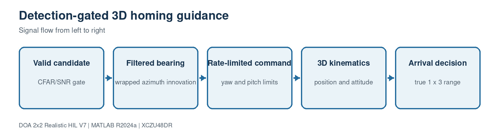

This block contains 2 implementation source file(s). Use the file links below to jump directly to the code explanation.

- [`PlatformDynamics3D.m`](#file-platformdynamics3d-m)
- [`TruthErrorMonitor3D.m`](#file-trutherrormonitor3d-m)

<a id="file-platformdynamics3d-m"></a>

## File: `PlatformDynamics3D.m`

### Purpose

Implements detection-gated guidance, rate limits, 3-D kinematics, roll and arrival.

### Where it runs

MATLAB R2024a behavioral, processor-reference or verification environment.

### Editing guidance

Edit only with the interfaces, dimensions and conventions in the surrounding block preserved.

### Size

120 source lines.

### Functions, classes and build targets

| Line | Kind | Definition | What the function/definition does |
| ---: | --- | --- | --- |
| 1 | class | `classdef PlatformDynamics3D < matlab.System` | Declares the System object/class that owns this block's configuration, state and execution methods. |
| 28 | function/method | `function obj=PlatformDynamics3D(varargin)` | Implements detection-gated guidance, rate limits, 3-D kinematics, roll and arrival. |
| 33 | function/method | `function setupImpl(obj), obj.initializeState(); end` | Runs once when the System object locks; validates configuration and creates persistent processing resources. |
| 34 | function/method | `function [position,yaw,pitch,roll,range,arrived]= ...` | Implements the `function` helper used by this file; inputs, outputs and operations are visible in the signature and source below. |
| 88 | function/method | `function resetImpl(obj), obj.initializeState(); end` | Restores persistent algorithm/tracker/filter state to its initial condition. |
| 89 | function/method | `function [a,b,c,d,e,f]=getOutputSizeImpl(~)` | Declares fixed Simulink output dimensions for model compilation. |
| 92 | function/method | `function [a,b,c,d,e,f]=getOutputDataTypeImpl(~)` | Declares output numeric types for Simulink propagation. |
| 95 | function/method | `function [a,b,c,d,e,f]=isOutputComplexImpl(~)` | Declares whether each output is real or complex. |
| 98 | function/method | `function [a,b,c,d,e,f]=isOutputFixedSizeImpl(~)` | Declares that output dimensions remain fixed while running. |
| 101 | function/method | `function [a,b,c,d]=getInputNamesImpl(~)` | Assigns readable names to generated MATLAB System block input ports. |
| 104 | function/method | `function [a,b,c,d,e,f]=getOutputNamesImpl(~)` | Assigns readable names to generated MATLAB System block output ports. |
| 107 | function/method | `function icon=getIconImpl(obj), icon=sprintf('Platform 3D\n%s, V=%.0f',obj.GuidanceLaw,obj.Velocity); end` | Builds the label shown on the generated Simulink block. |
| 110 | function/method | `function initializeState(obj)` | Initializes platform position, attitude and navigation-filter state. |
| 116 | function/method | `function angle=wrap180(~,angle)` | Wraps an angle into the half-open -180 to +180 degree interval. |

### Important code lines explained

| Line | Source statement | Function of the line |
| ---: | --- | --- |
| 1 | `classdef PlatformDynamics3D < matlab.System` | Declares the MATLAB class and its base type. |
| 3 | `Velocity = 25` | Assigns the left-hand variable/property from the expression on the right. |
| 4 | `MaxTurnRate = 15` | Assigns the left-hand variable/property from the expression on the right. |
| 5 | `MaxClimbRate = 10` | Assigns the left-hand variable/property from the expression on the right. |
| 6 | `GuidanceLaw = 'proportional'` | Assigns the left-hand variable/property from the expression on the right. |
| 7 | `ProNavGain = 3` | Assigns the left-hand variable/property from the expression on the right. |
| 8 | `NavFilterAlpha = 0.3` | Assigns the left-hand variable/property from the expression on the right. |
| 9 | `Dt = 0.1` | Assigns the left-hand variable/property from the expression on the right. |
| 10 | `InitialPosition = [0 0 50]` | Assigns the left-hand variable/property from the expression on the right. |
| 28 | `function obj=PlatformDynamics3D(varargin)` | Declares a callable function or System object method, including its inputs and outputs. |
| 33 | `function setupImpl(obj), obj.initializeState(); end` | Declares a callable function or System object method, including its inputs and outputs. |
| 34 | `function [position,yaw,pitch,roll,range,arrived]= ...` | Declares a callable function or System object method, including its inputs and outputs. |
| 59 | `switch lower(obj.GuidanceLaw)` | Selects the requested algorithm, waveform, mode or profile. |
| 60 | `case 'proportional'` | Selects the requested algorithm, waveform, mode or profile. |
| 65 | `case 'lead'` | Selects the requested algorithm, waveform, mode or profile. |
| 88 | `function resetImpl(obj), obj.initializeState(); end` | Declares a callable function or System object method, including its inputs and outputs. |
| 89 | `function [a,b,c,d,e,f]=getOutputSizeImpl(~)` | Declares a callable function or System object method, including its inputs and outputs. |
| 92 | `function [a,b,c,d,e,f]=getOutputDataTypeImpl(~)` | Declares a callable function or System object method, including its inputs and outputs. |
| 95 | `function [a,b,c,d,e,f]=isOutputComplexImpl(~)` | Declares a callable function or System object method, including its inputs and outputs. |

### Complete source code

<details>
<summary>Open the complete PlatformDynamics3D.m source</summary>

```matlab
classdef PlatformDynamics3D < matlab.System
    properties (Nontunable)
        Velocity = 25
        MaxTurnRate = 15
        MaxClimbRate = 10
        GuidanceLaw = 'proportional'
        ProNavGain = 3
        NavFilterAlpha = 0.3
        Dt = 0.1
        InitialPosition = [0 0 50]
        InitialYaw = 0
        InitialPitch = 0
        InitialRoll = 0
        ArrivalRadius = 10
    end
    properties (Access=private)
        Position
        Yaw
        Pitch
        Roll
        FilteredAz
        FilteredEl
        PreviousAz
        PreviousEl
        Initialized
    end
    methods
        function obj=PlatformDynamics3D(varargin)
            setProperties(obj,nargin,varargin{:});
        end
    end
    methods (Access=protected)
        function setupImpl(obj), obj.initializeState(); end
        function [position,yaw,pitch,roll,range,arrived]= ...
                stepImpl(obj,doaAz,doaEl,detectionValid,sourcePosition)
            % Simulink Constant blocks can propagate a 3-element vector as
            % 3x1.  Keep all Cartesian vectors explicitly 1x3 so implicit
            % expansion cannot turn a position difference into a 3x3 matrix.
            sourcePosition=reshape(sourcePosition,1,3);
            range=norm(sourcePosition-obj.Position);
            arrived=range<=obj.ArrivalRadius;
            if arrived
                position=obj.Position; yaw=obj.Yaw;
                pitch=obj.Pitch; roll=obj.Roll;
                return
            end
            yawCommand=0; pitchCommand=0;
            if detectionValid
                measuredAz=obj.wrap180(doaAz);
                if ~obj.Initialized
                    obj.FilteredAz=measuredAz; obj.FilteredEl=doaEl;
                    obj.PreviousAz=measuredAz; obj.PreviousEl=doaEl;
                    obj.Initialized=true;
                end
                alpha=obj.NavFilterAlpha;
                azInnovation=obj.wrap180(measuredAz-obj.FilteredAz);
                obj.FilteredAz=obj.wrap180(obj.FilteredAz+alpha*azInnovation);
                obj.FilteredEl=obj.FilteredEl+alpha*(doaEl-obj.FilteredEl);
                switch lower(obj.GuidanceLaw)
                    case 'proportional'
                        azRate=obj.wrap180(obj.FilteredAz-obj.PreviousAz)/obj.Dt;
                        elRate=(obj.FilteredEl-obj.PreviousEl)/obj.Dt;
                        yawCommand=obj.FilteredAz+obj.ProNavGain*azRate*obj.Dt;
                        pitchCommand=obj.FilteredEl+obj.ProNavGain*elRate*obj.Dt;
                    case 'lead'
                        yawCommand=1.2*obj.FilteredAz;
                        pitchCommand=1.2*obj.FilteredEl;
                    otherwise
                        yawCommand=obj.FilteredAz;
                        pitchCommand=obj.FilteredEl;
                end
                obj.PreviousAz=obj.FilteredAz;
                obj.PreviousEl=obj.FilteredEl;
            end
            yawRate=max(-obj.MaxTurnRate,min(obj.MaxTurnRate,yawCommand/obj.Dt));
            pitchRate=max(-obj.MaxClimbRate,min(obj.MaxClimbRate,pitchCommand/obj.Dt));
            obj.Yaw=obj.wrap180(obj.Yaw+yawRate*obj.Dt);
            obj.Pitch=max(-60,min(60,obj.Pitch+pitchRate*obj.Dt));
            obj.Roll=max(-45,min(45,-2*yawRate));
            velocity=[obj.Velocity*cosd(obj.Pitch)*cosd(obj.Yaw), ...
                obj.Velocity*cosd(obj.Pitch)*sind(obj.Yaw), ...
                obj.Velocity*sind(obj.Pitch)];
            obj.Position=obj.Position+velocity*obj.Dt;
            position=obj.Position; yaw=obj.Yaw; pitch=obj.Pitch; roll=obj.Roll;
            range=norm(sourcePosition-obj.Position);
            arrived=range<=obj.ArrivalRadius;
        end
        function resetImpl(obj), obj.initializeState(); end
        function [a,b,c,d,e,f]=getOutputSizeImpl(~)
            a=[1 3]; b=[1 1]; c=[1 1]; d=[1 1]; e=[1 1]; f=[1 1];
        end
        function [a,b,c,d,e,f]=getOutputDataTypeImpl(~)
            a='double'; b='double'; c='double'; d='double'; e='double'; f='logical';
        end
        function [a,b,c,d,e,f]=isOutputComplexImpl(~)
            a=false; b=false; c=false; d=false; e=false; f=false;
        end
        function [a,b,c,d,e,f]=isOutputFixedSizeImpl(~)
            a=true; b=true; c=true; d=true; e=true; f=true;
        end
        function [a,b,c,d]=getInputNamesImpl(~)
            a='DOA_Az'; b='DOA_El'; c='DetectionValid'; d='SourcePosition';
        end
        function [a,b,c,d,e,f]=getOutputNamesImpl(~)
            a='Position'; b='Yaw'; c='Pitch'; d='Roll'; e='Range'; f='Arrived';
        end
        function icon=getIconImpl(obj), icon=sprintf('Platform 3D\n%s, V=%.0f',obj.GuidanceLaw,obj.Velocity); end
    end
    methods (Access=private)
        function initializeState(obj)
            obj.Position=reshape(obj.InitialPosition,1,3);
            obj.Yaw=obj.InitialYaw; obj.Pitch=obj.InitialPitch; obj.Roll=obj.InitialRoll;
            obj.FilteredAz=0; obj.FilteredEl=0;
            obj.PreviousAz=0; obj.PreviousEl=0; obj.Initialized=false;
        end
        function angle=wrap180(~,angle)
            angle=mod(angle+180,360)-180;
        end
    end
end
```

</details>

[Back to the document index](#document-header-index)

<a id="file-trutherrormonitor3d-m"></a>

## File: `TruthErrorMonitor3D.m`

### Purpose

Computes true body-frame direction and azimuth/elevation/great-circle errors.

### Where it runs

MATLAB R2024a behavioral, processor-reference or verification environment.

### Editing guidance

Edit only with the interfaces, dimensions and conventions in the surrounding block preserved.

### Size

54 source lines.

### Functions, classes and build targets

| Line | Kind | Definition | What the function/definition does |
| ---: | --- | --- | --- |
| 1 | class | `classdef TruthErrorMonitor3D < matlab.System` | Declares the System object/class that owns this block's configuration, state and execution methods. |
| 7 | function/method | `function obj=TruthErrorMonitor3D(varargin)` | Computes true body-frame direction and azimuth/elevation/great-circle errors. |
| 12 | function/method | `function [trueAz,trueEl,azError,elError,angularError]= ...` | Implements the `function` helper used by this file; inputs, outputs and operations are visible in the signature and source below. |
| 32 | function/method | `function [a,b,c,d,e]=getOutputSizeImpl(~), a=[1 1]; b=a; c=a; d=a; e=a; end` | Declares fixed Simulink output dimensions for model compilation. |
| 33 | function/method | `function [a,b,c,d,e]=getOutputDataTypeImpl(~)` | Declares output numeric types for Simulink propagation. |
| 36 | function/method | `function [a,b,c,d,e]=isOutputComplexImpl(~)` | Declares whether each output is real or complex. |
| 39 | function/method | `function [a,b,c,d,e]=isOutputFixedSizeImpl(~)` | Declares that output dimensions remain fixed while running. |
| 42 | function/method | `function [a,b,c,d,e,f]=getInputNamesImpl(~)` | Assigns readable names to generated MATLAB System block input ports. |
| 46 | function/method | `function [a,b,c,d,e]=getOutputNamesImpl(~)` | Assigns readable names to generated MATLAB System block output ports. |
| 49 | function/method | `function icon=getIconImpl(~), icon=sprintf('Truth + DOA Error\nAz / El / Total'); end` | Builds the label shown on the generated Simulink block. |
| 52 | function/method | `function angle=wrap180(~,angle), angle=mod(angle+180,360)-180; end` | Wraps an angle into the half-open -180 to +180 degree interval. |

### Important code lines explained

| Line | Source statement | Function of the line |
| ---: | --- | --- |
| 1 | `classdef TruthErrorMonitor3D < matlab.System` | Declares the MATLAB class and its base type. |
| 4 | `SourcePosition = [500 300 200]` | Assigns the left-hand variable/property from the expression on the right. |
| 7 | `function obj=TruthErrorMonitor3D(varargin)` | Declares a callable function or System object method, including its inputs and outputs. |
| 11 | `methods (Access=protected)` | Begins a method group; protected methods define System object execution behavior. |
| 12 | `function [trueAz,trueEl,azError,elError,angularError]= ...` | Declares a callable function or System object method, including its inputs and outputs. |
| 15 | `platformPosition=reshape(platformPosition,1,3);` | Assigns the left-hand variable/property from the expression on the right. |
| 16 | `sourcePosition=reshape(obj.SourcePosition,1,3);` | Assigns the left-hand variable/property from the expression on the right. |
| 17 | `delta=sourcePosition-platformPosition;` | Assigns the left-hand variable/property from the expression on the right. |
| 18 | `worldDirection=delta(:)/max(norm(delta),eps);` | Computes an array direction/steering quantity using the calibrated geometry. |
| 30 | `angularError=acosd(cosine);` | Assigns the left-hand variable/property from the expression on the right. |
| 32 | `function [a,b,c,d,e]=getOutputSizeImpl(~), a=[1 1]; b=a; c=a; d=a; e=a; end` | Declares a callable function or System object method, including its inputs and outputs. |
| 33 | `function [a,b,c,d,e]=getOutputDataTypeImpl(~)` | Declares a callable function or System object method, including its inputs and outputs. |
| 36 | `function [a,b,c,d,e]=isOutputComplexImpl(~)` | Declares a callable function or System object method, including its inputs and outputs. |
| 39 | `function [a,b,c,d,e]=isOutputFixedSizeImpl(~)` | Declares a callable function or System object method, including its inputs and outputs. |
| 42 | `function [a,b,c,d,e,f]=getInputNamesImpl(~)` | Declares a callable function or System object method, including its inputs and outputs. |

### Complete source code

<details>
<summary>Open the complete TruthErrorMonitor3D.m source</summary>

```matlab
classdef TruthErrorMonitor3D < matlab.System
    % Compute ground-truth body-frame DOA and estimation errors.
    properties (Nontunable)
        SourcePosition = [500 300 200]
    end
    methods
        function obj=TruthErrorMonitor3D(varargin)
            setProperties(obj,nargin,varargin{:});
        end
    end
    methods (Access=protected)
        function [trueAz,trueEl,azError,elError,angularError]= ...
                stepImpl(obj,platformPosition,platformYaw,platformPitch,platformRoll, ...
                estimatedAz,estimatedEl)
            platformPosition=reshape(platformPosition,1,3);
            sourcePosition=reshape(obj.SourcePosition,1,3);
            delta=sourcePosition-platformPosition;
            worldDirection=delta(:)/max(norm(delta),eps);
            bodyDirection=body_to_navigation_dcm( ...
                platformYaw,platformPitch,platformRoll).'*worldDirection;
            trueAz=obj.wrap180(atan2d(bodyDirection(2),bodyDirection(1)));
            trueEl=atan2d(bodyDirection(3),hypot(bodyDirection(1),bodyDirection(2)));
            azError=obj.wrap180(estimatedAz-trueAz);
            elError=estimatedEl-trueEl;
            estimatedVector=[cosd(estimatedEl)*cosd(estimatedAz), ...
                cosd(estimatedEl)*sind(estimatedAz),sind(estimatedEl)];
            trueVector=[cosd(trueEl)*cosd(trueAz), ...
                cosd(trueEl)*sind(trueAz),sind(trueEl)];
            cosine=max(-1,min(1,dot(estimatedVector,trueVector)));
            angularError=acosd(cosine);
        end
        function [a,b,c,d,e]=getOutputSizeImpl(~), a=[1 1]; b=a; c=a; d=a; e=a; end
        function [a,b,c,d,e]=getOutputDataTypeImpl(~)
            a='double'; b='double'; c='double'; d='double'; e='double';
        end
        function [a,b,c,d,e]=isOutputComplexImpl(~)
            a=false; b=false; c=false; d=false; e=false;
        end
        function [a,b,c,d,e]=isOutputFixedSizeImpl(~)
            a=true; b=true; c=true; d=true; e=true;
        end
        function [a,b,c,d,e,f]=getInputNamesImpl(~)
            a='PlatformPosition'; b='PlatformYaw'; c='PlatformPitch';
            d='PlatformRoll'; e='EstimatedAz'; f='EstimatedEl';
        end
        function [a,b,c,d,e]=getOutputNamesImpl(~)
            a='TrueAz'; b='TrueEl'; c='AzError'; d='ElError'; e='AngularError';
        end
        function icon=getIconImpl(~), icon=sprintf('Truth + DOA Error\nAz / El / Total'); end
    end
    methods (Access=private)
        function angle=wrap180(~,angle), angle=mod(angle+180,360)-180; end
    end
end
```

</details>

[Back to the document index](#document-header-index)

<a id="block-7-matlab-verification-and-accuracy-campaigns"></a>

# Block 7: MATLAB verification and accuracy campaigns

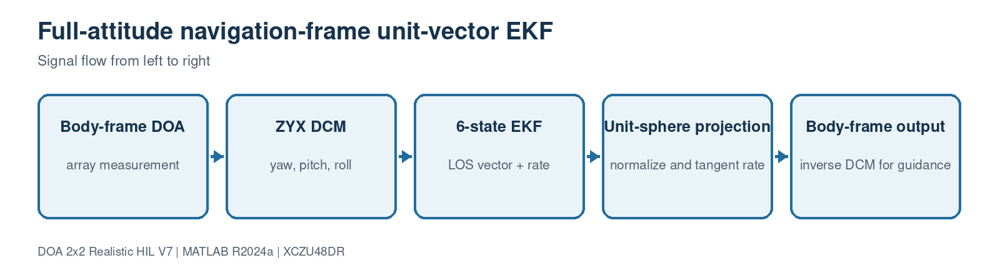

This block contains 11 implementation source file(s). Use the file links below to jump directly to the code explanation.

- [`verify_r2024a_setup.m`](#file-verify-r2024a-setup-m)
- [`verify_doa_direction.m`](#file-verify-doa-direction-m)
- [`verify_hybrid_doa_2x2.m`](#file-verify-hybrid-doa-2x2-m)
- [`verify_rotating_frame_ekf.m`](#file-verify-rotating-frame-ekf-m)
- [`verify_full_attitude_geometry.m`](#file-verify-full-attitude-geometry-m)
- [`verify_simulink_vector_shapes.m`](#file-verify-simulink-vector-shapes-m)
- [`verify_source_waveforms.m`](#file-verify-source-waveforms-m)
- [`verify_multifrequency_calibration.m`](#file-verify-multifrequency-calibration-m)
- [`run_accuracy_campaign.m`](#file-run-accuracy-campaign-m)
- [`run_realistic_accuracy_campaign.m`](#file-run-realistic-accuracy-campaign-m)
- [`run_fixed_point_input_parity.m`](#file-run-fixed-point-input-parity-m)

<a id="file-verify-r2024a-setup-m"></a>

## File: `verify_r2024a_setup.m`

### Purpose

Runs the complete constructor, geometry, calibration, waveform and toolbox smoke suite.

### Where it runs

MATLAB R2024a behavioral, processor-reference or verification environment.

### Editing guidance

Edit only with the interfaces, dimensions and conventions in the surrounding block preserved.

### Size

46 source lines.

### Functions, classes and build targets

This is an execution/configuration script and does not declare a separate function or class.

### Important code lines explained

| Line | Source statement | Function of the line |
| ---: | --- | --- |
| 3 | `run('sim3d_params.m');` | Loads the single authoritative project parameter structure P. |
| 4 | `matches=which('SourceModel3D','-all');` | Assigns the left-hand variable/property from the expression on the right. |
| 7 | `for index=1:numel(matches), fprintf('  %s\n',matches{index}); end` | Begins a bounded loop over samples, channels, candidates or trials. |
| 11 | `assert(exist('matlab.System','class')==8,'matlab.System is unavailable.');` | Rejects an invalid dimension, type, geometry or configuration before processing. |
| 12 | `assert(exist('dsp.Channelizer','class')==8,'DSP System Toolbox is required.');` | Rejects an invalid dimension, type, geometry or configuration before processing. |
| 14 | `objects={SourceModel3D('FrameLength',P.PFB.FrameLength), ...` | Assigns the left-hand variable/property from the expression on the right. |
| 29 | `verify_doa_direction;` | Computes an array direction/steering quantity using the calibrated geometry. |
| 45 | `fprintf(['  Simulink: build_3d_doa_simulink; simulationOutput=' ...` | Prints a traceable status, metric or next command. |

### Complete source code

<details>
<summary>Open the complete verify_r2024a_setup.m source</summary>

```matlab
%% Fast R2024a constructor, path, and toolbox check.
rehash path;
run('sim3d_params.m');
matches=which('SourceModel3D','-all');
if ischar(matches), matches={matches}; end
fprintf('SourceModel3D path resolution:\n');
for index=1:numel(matches), fprintf('  %s\n',matches{index}); end
if numel(matches)>1
    warning('DOA3D:DuplicateClass','Multiple SourceModel3D files are on the MATLAB path.');
end
assert(exist('matlab.System','class')==8,'matlab.System is unavailable.');
assert(exist('dsp.Channelizer','class')==8,'DSP System Toolbox is required.');

objects={SourceModel3D('FrameLength',P.PFB.FrameLength), ...
    RealisticReceiver4('FrameLength',P.PFB.FrameLength), ...
    PFBFFTChannelizer4('NumBands',P.PFB.NumBands), ...
    SpectrumEstimator4('NumBands',P.PFB.NumBands), ...
    NoiseFloorEstimator1D('NumBins',P.PFB.NumBands), ...
    CACFAR1D('NumBins',P.PFB.NumBands), ...
    BinClusterEstimator('NumBins',P.PFB.NumBands), ...
    CandidateSelector('MaxClusters',P.Cluster.MaxClusters), ...
    SnapshotDecimator4('FrameLength',P.PFB.FrameLength), ...
    DOAEstimator4Ch('Algorithm',P.DOA.Algorithm), ...
    TruthErrorMonitor3D('SourcePosition',P.Source.Position), ...
    SignalMetricsMonitor('SearchCenterHz',P.Source.CenterFreqHz), ...
    PlatformDynamics3D('InitialPosition',P.Platform.Position0), ...
    SyntheticFourChannelSource('FrameLength',P.PFB.FrameLength)}; %#ok<NASGU>
fprintf('PASS: all custom System object constructors accept name-value pairs.\n');
verify_doa_direction;
verify_hybrid_doa_2x2;
verify_rotating_frame_ekf;
verify_full_attitude_geometry;
verify_multifrequency_calibration;
verify_simulink_vector_shapes;
verify_source_waveforms;
if exist('dsphdl.Channelizer','class')==8
    fprintf('PASS: DSP HDL Toolbox found; RFSoC HDL builder is available.\n');
else
    fprintf('NOTE: DSP HDL Toolbox not found; behavioral simulation is still available.\n');
end
fprintf('Next commands:\n');
fprintf('  MATLAB:   run_3d_doa_sim\n');
fprintf('  Accuracy: run_accuracy_campaign(''acceptance'')\n');
fprintf('  Realism:  run_realistic_accuracy_campaign(''acceptance'')\n');
fprintf(['  Simulink: build_3d_doa_simulink; simulationOutput=' ...
    'sim(''DOA_3D_Homing''); plot_simulink_results(simulationOutput)\n']);
```

</details>

[Back to the document index](#document-header-index)

<a id="file-verify-doa-direction-m"></a>

## File: `verify_doa_direction.m`

### Purpose

Checks estimator sign at positive and negative directions.

### Where it runs

MATLAB R2024a behavioral, processor-reference or verification environment.

### Editing guidance

Edit only with the interfaces, dimensions and conventions in the surrounding block preserved.

### Size

34 source lines.

### Functions, classes and build targets

| Line | Kind | Definition | What the function/definition does |
| ---: | --- | --- | --- |
| 1 | function/method | `function verify_doa_direction()` | Checks estimator sign at positive and negative directions. |

### Important code lines explained

| Line | Source statement | Function of the line |
| ---: | --- | --- |
| 1 | `function verify_doa_direction()` | Declares a callable function or System object method, including its inputs and outputs. |
| 3 | `run('sim3d_params.m');` | Loads the single authoritative project parameter structure P. |
| 5 | `estimator=DOAEstimator4Ch( ...` | Assigns the left-hand variable/property from the expression on the right. |
| 10 | `truthCases=[32 18; -27 -22];` | Assigns the left-hand variable/property from the expression on the right. |
| 11 | `numberSnapshots=2048;` | Assigns the left-hand variable/property from the expression on the right. |
| 12 | `positions=P.Antenna.Positions;` | Assigns the left-hand variable/property from the expression on the right. |
| 13 | `for caseIndex=1:size(truthCases,1)` | Begins a bounded loop over samples, channels, candidates or trials. |
| 14 | `trueAzimuth=truthCases(caseIndex,1);` | Assigns the left-hand variable/property from the expression on the right. |
| 15 | `trueElevation=truthCases(caseIndex,2);` | Assigns the left-hand variable/property from the expression on the right. |
| 16 | `ux=cosd(trueElevation)*cosd(trueAzimuth);` | Assigns the left-hand variable/property from the expression on the right. |
| 20 | `steering=exp(-1j*2*pi*P.Source.CenterFreqHz*delay);` | Computes an array direction/steering quantity using the calibrated geometry. |
| 23 | `snapshots=symbols*steering.'+noise;` | Computes an array direction/steering quantity using the calibrated geometry. |
| 27 | `assert(abs(azimuthError)<=1 && abs(elevationError)<=1, ...` | Rejects an invalid dimension, type, geometry or configuration before processing. |
| 30 | `fprintf('PASS: DOA direction sign. Truth=[%.1f %.1f], estimate=[%.1f %.1f] deg.\n', ...` | Computes an array direction/steering quantity using the calibrated geometry. |

### Complete source code

<details>
<summary>Open the complete verify_doa_direction.m source</summary>

```matlab
function verify_doa_direction()
%VERIFY_DOA_DIRECTION Confirm that the array covariance does not mirror DOA.
run('sim3d_params.m');
rng(41,'twister');
estimator=DOAEstimator4Ch( ...
    'Algorithm','MUSIC','CenterFreqHz',P.Source.CenterFreqHz, ...
    'ArrayPositions',P.Antenna.Positions,'NumSignals',1, ...
    'AzScanRange',P.DOA.AzScanRange,'ElScanRange',P.DOA.ElScanRange, ...
    'ScanResolution',1,'ForwardBackwardAvg',true,'EnableTracking',false);
truthCases=[32 18; -27 -22];
numberSnapshots=2048;
positions=P.Antenna.Positions;
for caseIndex=1:size(truthCases,1)
    trueAzimuth=truthCases(caseIndex,1);
    trueElevation=truthCases(caseIndex,2);
    ux=cosd(trueElevation)*cosd(trueAzimuth);
    uy=cosd(trueElevation)*sind(trueAzimuth);
    uz=sind(trueElevation);
    delay=(positions(:,1)*ux+positions(:,2)*uy+positions(:,3)*uz)/P.c;
    steering=exp(-1j*2*pi*P.Source.CenterFreqHz*delay);
    symbols=(randn(numberSnapshots,1)+1j*randn(numberSnapshots,1))/sqrt(2);
    noise=0.01*(randn(numberSnapshots,4)+1j*randn(numberSnapshots,4))/sqrt(2);
    snapshots=symbols*steering.'+noise;
    [estimatedAzimuth,estimatedElevation]=estimator(snapshots,0,0,0);
    azimuthError=mod(estimatedAzimuth-trueAzimuth+180,360)-180;
    elevationError=estimatedElevation-trueElevation;
    assert(abs(azimuthError)<=1 && abs(elevationError)<=1, ...
        'DOA sign check failed: truth=[%.1f %.1f], estimate=[%.1f %.1f].', ...
        trueAzimuth,trueElevation,estimatedAzimuth,estimatedElevation);
    fprintf('PASS: DOA direction sign. Truth=[%.1f %.1f], estimate=[%.1f %.1f] deg.\n', ...
        trueAzimuth,trueElevation,estimatedAzimuth,estimatedElevation);
end
release(estimator);
end
```

</details>

[Back to the document index](#document-header-index)

<a id="file-verify-hybrid-doa-2x2-m"></a>

## File: `verify_hybrid_doa_2x2.m`

### Purpose

Checks exact deterministic 2x2 geometry and calibration at representative angles.

### Where it runs

MATLAB R2024a behavioral, processor-reference or verification environment.

### Editing guidance

Edit only with the interfaces, dimensions and conventions in the surrounding block preserved.

### Size

39 source lines.

### Functions, classes and build targets

| Line | Kind | Definition | What the function/definition does |
| ---: | --- | --- | --- |
| 1 | function/method | `function verify_hybrid_doa_2x2()` | Checks exact deterministic 2x2 geometry and calibration at representative angles. |

### Important code lines explained

| Line | Source statement | Function of the line |
| ---: | --- | --- |
| 1 | `function verify_hybrid_doa_2x2()` | Declares a callable function or System object method, including its inputs and outputs. |
| 3 | `run('sim3d_params.m');` | Loads the single authoritative project parameter structure P. |
| 4 | `directions=[0 0; 25 15; -35 20; 40 -25; -45 -30];` | Computes an array direction/steering quantity using the calibrated geometry. |
| 5 | `numberSnapshots=4096;` | Assigns the left-hand variable/property from the expression on the right. |
| 6 | `estimator=DOAEstimator4Ch( ...` | Assigns the left-hand variable/property from the expression on the right. |
| 17 | `fprintf('\n=== DETERMINISTIC 2x2 HYBRID DOA CHECK ===\n');` | Prints a traceable status, metric or next command. |
| 18 | `for index=1:size(directions,1)` | Begins a bounded loop over samples, channels, candidates or trials. |
| 19 | `trueAzimuth=directions(index,1);` | Computes an array direction/steering quantity using the calibrated geometry. |
| 20 | `trueElevation=directions(index,2);` | Computes an array direction/steering quantity using the calibrated geometry. |
| 21 | `direction=[cosd(trueElevation)*cosd(trueAzimuth); ...` | Computes an array direction/steering quantity using the calibrated geometry. |
| 23 | `steering=exp(-1j*2*pi*P.Source.CenterFreqHz/P.c* ...` | Computes an array direction/steering quantity using the calibrated geometry. |
| 24 | `(P.Antenna.Positions*direction));` | Computes an array direction/steering quantity using the calibrated geometry. |
| 27 | `snapshots=ones(numberSnapshots,1)*(steering.'.*channelTransfer);` | Computes an array direction/steering quantity using the calibrated geometry. |
| 31 | `error3d=acosd(max(-1,min(1,dot(direction,estimatedDirection))));` | Computes an array direction/steering quantity using the calibrated geometry. |
| 34 | `assert(error3d<0.02,'DOA2x2:DeterministicAccuracy', ...` | Rejects an invalid dimension, type, geometry or configuration before processing. |
| 38 | `fprintf('Deterministic direction, sign, geometry, and calibration checks: PASS\n');` | Computes an array direction/steering quantity using the calibrated geometry. |

### Complete source code

<details>
<summary>Open the complete verify_hybrid_doa_2x2.m source</summary>

```matlab
function verify_hybrid_doa_2x2()
%VERIFY_HYBRID_DOA_2X2 Deterministic direction/sign/calibration regression.
run('sim3d_params.m');
directions=[0 0; 25 15; -35 20; 40 -25; -45 -30];
numberSnapshots=4096;
estimator=DOAEstimator4Ch( ...
    'Algorithm','HYBRID_CAL_WPI_ML_EKF', ...
    'CenterFreqHz',P.Source.CenterFreqHz, ...
    'ArrayPositions',P.Antenna.Positions, ...
    'AzScanRange',P.DOA.AzScanRange,'ElScanRange',P.DOA.ElScanRange, ...
    'ScanResolution',P.DOA.ScanResolution, ...
    'CalibrationGain_dB',P.Channel.Gain_dB, ...
    'CalibrationPhase_deg',P.Channel.PhaseError_deg, ...
    'MLStepSchedule_deg',P.DOA.MLStepSchedule_deg, ...
    'EnableTracking',false);

fprintf('\n=== DETERMINISTIC 2x2 HYBRID DOA CHECK ===\n');
for index=1:size(directions,1)
    trueAzimuth=directions(index,1);
    trueElevation=directions(index,2);
    direction=[cosd(trueElevation)*cosd(trueAzimuth); ...
        cosd(trueElevation)*sind(trueAzimuth); sind(trueElevation)];
    steering=exp(-1j*2*pi*P.Source.CenterFreqHz/P.c* ...
        (P.Antenna.Positions*direction));
    channelTransfer=10.^(P.Channel.Gain_dB/20).* ...
        exp(1j*deg2rad(P.Channel.PhaseError_deg));
    snapshots=ones(numberSnapshots,1)*(steering.'.*channelTransfer);
    [estimatedAzimuth,estimatedElevation]=estimator(snapshots,0,0,0);
    estimatedDirection=[cosd(estimatedElevation)*cosd(estimatedAzimuth); ...
        cosd(estimatedElevation)*sind(estimatedAzimuth); sind(estimatedElevation)];
    error3d=acosd(max(-1,min(1,dot(direction,estimatedDirection))));
    fprintf('True=[%7.3f %7.3f] Est=[%8.4f %8.4f] 3-D=%8.5f deg\n', ...
        trueAzimuth,trueElevation,estimatedAzimuth,estimatedElevation,error3d);
    assert(error3d<0.02,'DOA2x2:DeterministicAccuracy', ...
        'Noise-free calibrated error exceeded 0.02 degree.');
end
release(estimator);
fprintf('Deterministic direction, sign, geometry, and calibration checks: PASS\n');
end
```

</details>

[Back to the document index](#document-header-index)

<a id="file-verify-rotating-frame-ekf-m"></a>

## File: `verify_rotating_frame_ekf.m`

### Purpose

Checks that platform rotation is not interpreted as source motion.

### Where it runs

MATLAB R2024a behavioral, processor-reference or verification environment.

### Editing guidance

Edit only with the interfaces, dimensions and conventions in the surrounding block preserved.

### Size

49 source lines.

### Functions, classes and build targets

| Line | Kind | Definition | What the function/definition does |
| ---: | --- | --- | --- |
| 1 | function/method | `function verify_rotating_frame_ekf()` | Checks that platform rotation is not interpreted as source motion. |
| 47 | function/method | `function angle=wrap180(angle)` | Wraps an angle into the half-open -180 to +180 degree interval. |

### Important code lines explained

| Line | Source statement | Function of the line |
| ---: | --- | --- |
| 1 | `function verify_rotating_frame_ekf()` | Declares a callable function or System object method, including its inputs and outputs. |
| 5 | `run('sim3d_params.m');` | Loads the single authoritative project parameter structure P. |
| 6 | `numberSnapshots=1024;` | Assigns the left-hand variable/property from the expression on the right. |
| 7 | `worldAzimuth=31;` | Assigns the left-hand variable/property from the expression on the right. |
| 8 | `worldElevation=14;` | Assigns the left-hand variable/property from the expression on the right. |
| 9 | `yawSequence=linspace(0,38,80);` | Assigns the left-hand variable/property from the expression on the right. |
| 10 | `pitchSequence=linspace(0,16,80);` | Assigns the left-hand variable/property from the expression on the right. |
| 11 | `rollSequence=12*sin(linspace(0,2*pi,80));` | Assigns the left-hand variable/property from the expression on the right. |
| 12 | `worldDirection=[cosd(worldElevation)*cosd(worldAzimuth); ...` | Computes an array direction/steering quantity using the calibrated geometry. |
| 14 | `estimator=DOAEstimator4Ch( ...` | Assigns the left-hand variable/property from the expression on the right. |
| 29 | `direction=body_to_navigation_dcm(yaw,pitch,roll).'*worldDirection;` | Computes an array direction/steering quantity using the calibrated geometry. |
| 30 | `steering=exp(-1j*2*pi*P.Source.CenterFreqHz/P.c* ...` | Computes an array direction/steering quantity using the calibrated geometry. |
| 31 | `(P.Antenna.Positions*direction));` | Computes an array direction/steering quantity using the calibrated geometry. |
| 34 | `snapshots=ones(numberSnapshots,1)*(steering.'.*channelTransfer);` | Computes an array direction/steering quantity using the calibrated geometry. |
| 38 | `error3d(index)=acosd(max(-1,min(1,dot(estimate,direction))));` | Computes an array direction/steering quantity using the calibrated geometry. |
| 41 | `assert(max(error3d)<0.02,'DOA2x2:RotatingFrameEKF', ...` | Rejects an invalid dimension, type, geometry or configuration before processing. |
| 47 | `function angle=wrap180(angle)` | Declares a callable function or System object method, including its inputs and outputs. |

### Complete source code

<details>
<summary>Open the complete verify_rotating_frame_ekf.m source</summary>

```matlab
function verify_rotating_frame_ekf()
%VERIFY_ROTATING_FRAME_EKF Regression for body/navigation-frame tracking.
% A fixed world LOS is observed while the platform yaw/pitch change. The EKF
% must not interpret platform attitude motion as emitter motion.
run('sim3d_params.m');
numberSnapshots=1024;
worldAzimuth=31;
worldElevation=14;
yawSequence=linspace(0,38,80);
pitchSequence=linspace(0,16,80);
rollSequence=12*sin(linspace(0,2*pi,80));
worldDirection=[cosd(worldElevation)*cosd(worldAzimuth); ...
    cosd(worldElevation)*sind(worldAzimuth); sind(worldElevation)];
estimator=DOAEstimator4Ch( ...
    'Algorithm','HYBRID_CAL_WPI_ML_EKF', ...
    'CenterFreqHz',P.Source.CenterFreqHz, ...
    'ArrayPositions',P.Antenna.Positions, ...
    'AzScanRange',P.DOA.AzScanRange,'ElScanRange',P.DOA.ElScanRange, ...
    'ScanResolution',P.DOA.ScanResolution, ...
    'CalibrationGain_dB',P.Channel.Gain_dB, ...
    'CalibrationPhase_deg',P.Channel.PhaseError_deg, ...
    'MLStepSchedule_deg',P.DOA.MLStepSchedule_deg, ...
    'EnableTracking',true,'TrackerDt',P.DOA.TrackerDt, ...
    'EKFProcessNoise',P.DOA.EKFProcessNoise, ...
    'EKFMeasurementNoise',P.DOA.EKFMeasurementNoise);
error3d=zeros(numel(yawSequence),1);
for index=1:numel(yawSequence)
    yaw=yawSequence(index); pitch=pitchSequence(index); roll=rollSequence(index);
    direction=body_to_navigation_dcm(yaw,pitch,roll).'*worldDirection;
    steering=exp(-1j*2*pi*P.Source.CenterFreqHz/P.c* ...
        (P.Antenna.Positions*direction));
    channelTransfer=10.^(P.Channel.Gain_dB/20).* ...
        exp(1j*deg2rad(P.Channel.PhaseError_deg));
    snapshots=ones(numberSnapshots,1)*(steering.'.*channelTransfer);
    [estimatedAzimuth,estimatedElevation]=estimator(snapshots,yaw,pitch,roll);
    estimate=[cosd(estimatedElevation)*cosd(estimatedAzimuth); ...
        cosd(estimatedElevation)*sind(estimatedAzimuth); sind(estimatedElevation)];
    error3d(index)=acosd(max(-1,min(1,dot(estimate,direction))));
end
release(estimator);
assert(max(error3d)<0.02,'DOA2x2:RotatingFrameEKF', ...
    'Navigation-frame EKF regression exceeded 0.02 degree.');
fprintf('PASS: rotating-platform navigation-frame EKF, max error %.6f deg.\n', ...
    max(error3d));
end

function angle=wrap180(angle)
angle=mod(angle+180,360)-180;
end
```

</details>

[Back to the document index](#document-header-index)

<a id="file-verify-full-attitude-geometry-m"></a>

## File: `verify_full_attitude_geometry.m`

### Purpose

Checks DCM orthogonality and yaw/pitch/roll truth consistency.

### Where it runs

MATLAB R2024a behavioral, processor-reference or verification environment.

### Editing guidance

Edit only with the interfaces, dimensions and conventions in the surrounding block preserved.

### Size

24 source lines.

### Functions, classes and build targets

| Line | Kind | Definition | What the function/definition does |
| ---: | --- | --- | --- |
| 1 | function/method | `function verify_full_attitude_geometry()` | Checks DCM orthogonality and yaw/pitch/roll truth consistency. |

### Important code lines explained

| Line | Source statement | Function of the line |
| ---: | --- | --- |
| 1 | `function verify_full_attitude_geometry()` | Declares a callable function or System object method, including its inputs and outputs. |
| 3 | `run('sim3d_params.m');` | Loads the single authoritative project parameter structure P. |
| 4 | `worldDirection=[.72;.51;.47]; worldDirection=worldDirection/norm(worldDirection);` | Computes an array direction/steering quantity using the calibrated geometry. |
| 5 | `attitudes=[0 0 0;35 18 12;-47 21 -19;130 -25 31];` | Assigns the left-hand variable/property from the expression on the right. |
| 6 | `truth=TruthErrorMonitor3D('SourcePosition',1000*worldDirection.');` | Computes an array direction/steering quantity using the calibrated geometry. |
| 7 | `for index=1:size(attitudes,1)` | Begins a bounded loop over samples, channels, candidates or trials. |
| 8 | `yaw=attitudes(index,1); pitch=attitudes(index,2); roll=attitudes(index,3);` | Assigns the left-hand variable/property from the expression on the right. |
| 9 | `rotation=body_to_navigation_dcm(yaw,pitch,roll);` | Assigns the left-hand variable/property from the expression on the right. |
| 10 | `assert(norm(rotation'*rotation-eye(3),'fro')<1e-12, ...` | Rejects an invalid dimension, type, geometry or configuration before processing. |
| 12 | `body=rotation'*worldDirection;` | Computes an array direction/steering quantity using the calibrated geometry. |
| 13 | `azimuth=atan2d(body(2),body(1));` | Assigns the left-hand variable/property from the expression on the right. |
| 17 | `assert(abs(trueAz-azimuth)<1e-10 && abs(trueEl-elevation)<1e-10, ...` | Rejects an invalid dimension, type, geometry or configuration before processing. |
| 19 | `assert(abs(azError)<1e-10 && abs(elError)<1e-10 && error3d<1e-6, ...` | Rejects an invalid dimension, type, geometry or configuration before processing. |

### Complete source code

<details>
<summary>Open the complete verify_full_attitude_geometry.m source</summary>

```matlab
function verify_full_attitude_geometry()
%VERIFY_FULL_ATTITUDE_GEOMETRY Validate combined yaw, pitch, and roll frames.
run('sim3d_params.m');
worldDirection=[.72;.51;.47]; worldDirection=worldDirection/norm(worldDirection);
attitudes=[0 0 0;35 18 12;-47 21 -19;130 -25 31];
truth=TruthErrorMonitor3D('SourcePosition',1000*worldDirection.');
for index=1:size(attitudes,1)
    yaw=attitudes(index,1); pitch=attitudes(index,2); roll=attitudes(index,3);
    rotation=body_to_navigation_dcm(yaw,pitch,roll);
    assert(norm(rotation'*rotation-eye(3),'fro')<1e-12, ...
        'Body/navigation DCM is not orthonormal.');
    body=rotation'*worldDirection;
    azimuth=atan2d(body(2),body(1));
    elevation=atan2d(body(3),hypot(body(1),body(2)));
    [trueAz,trueEl,azError,elError,error3d]=truth( ...
        [0;0;0],yaw,pitch,roll,azimuth,elevation);
    assert(abs(trueAz-azimuth)<1e-10 && abs(trueEl-elevation)<1e-10, ...
        'Truth monitor attitude transform mismatch.');
    assert(abs(azError)<1e-10 && abs(elError)<1e-10 && error3d<1e-6, ...
        'Full-attitude truth error is not zero.');
end
release(truth);
fprintf('PASS: full yaw/pitch/roll body-navigation geometry.\n');
end
```

</details>

[Back to the document index](#document-header-index)

<a id="file-verify-simulink-vector-shapes-m"></a>

## File: `verify_simulink_vector_shapes.m`

### Purpose

Prevents the earlier 3x1/1x3 implicit-expansion and circling bug.

### Where it runs

MATLAB R2024a behavioral, processor-reference or verification environment.

### Editing guidance

Edit only with the interfaces, dimensions and conventions in the surrounding block preserved.

### Size

46 source lines.

### Functions, classes and build targets

| Line | Kind | Definition | What the function/definition does |
| ---: | --- | --- | --- |
| 1 | function/method | `function verify_simulink_vector_shapes()` | Prevents the earlier 3x1/1x3 implicit-expansion and circling bug. |

### Important code lines explained

| Line | Source statement | Function of the line |
| ---: | --- | --- |
| 1 | `function verify_simulink_vector_shapes()` | Declares a callable function or System object method, including its inputs and outputs. |
| 3 | `run('sim3d_params.m');` | Loads the single authoritative project parameter structure P. |
| 5 | `sourceColumn=P.Source.Position(:);` | Assigns the left-hand variable/property from the expression on the right. |
| 6 | `expectedRange=norm(P.Source.Position-P.Platform.Position0);` | Assigns the left-hand variable/property from the expression on the right. |
| 7 | `platform=PlatformDynamics3D( ...` | Assigns the left-hand variable/property from the expression on the right. |
| 15 | `[~,~,~,~,measuredRange,arrived]=platform(0,0,false,sourceColumn);` | Assigns the left-hand variable/property from the expression on the right. |
| 16 | `assert(abs(measuredRange-expectedRange)<1e-9, ...` | Rejects an invalid dimension, type, geometry or configuration before processing. |
| 18 | `assert(~arrived,'Initial platform position must not satisfy the arrival test.');` | Rejects an invalid dimension, type, geometry or configuration before processing. |
| 21 | `nearPosition=P.Source.Position-[5 0 0];` | Assigns the left-hand variable/property from the expression on the right. |
| 22 | `platform=PlatformDynamics3D( ...` | Assigns the left-hand variable/property from the expression on the right. |
| 27 | `[~,~,~,~,nearRange,arrived]=platform(0,0,false,sourceColumn);` | Assigns the left-hand variable/property from the expression on the right. |
| 28 | `assert(abs(nearRange-5)<1e-9 && arrived, ...` | Rejects an invalid dimension, type, geometry or configuration before processing. |
| 32 | `delta=P.Source.Position-P.Platform.Position0;` | Assigns the left-hand variable/property from the expression on the right. |
| 38 | `assert(abs(trueAz-expectedAz)<1e-9 && abs(trueEl-expectedEl)<1e-9, ...` | Rejects an invalid dimension, type, geometry or configuration before processing. |
| 40 | `assert(abs(azError)<1e-9 && abs(elError)<1e-9 && angularError<1e-6, ...` | Rejects an invalid dimension, type, geometry or configuration before processing. |

### Complete source code

<details>
<summary>Open the complete verify_simulink_vector_shapes.m source</summary>

```matlab
function verify_simulink_vector_shapes()
%VERIFY_SIMULINK_VECTOR_SHAPES Guard against 3x1/1x3 position expansion.
run('sim3d_params.m');

sourceColumn=P.Source.Position(:);
expectedRange=norm(P.Source.Position-P.Platform.Position0);
platform=PlatformDynamics3D( ...
    'Velocity',0, ...
    'InitialPosition',P.Platform.Position0, ...
    'InitialYaw',P.Platform.Heading0, ...
    'InitialPitch',P.Platform.Pitch0, ...
    'InitialRoll',P.Platform.Roll0, ...
    'ArrivalRadius',P.Nav.ArrivalRadius, ...
    'Dt',P.Sim.Dt);
[~,~,~,~,measuredRange,arrived]=platform(0,0,false,sourceColumn);
assert(abs(measuredRange-expectedRange)<1e-9, ...
    'Column-vector source position produced an incorrect platform range.');
assert(~arrived,'Initial platform position must not satisfy the arrival test.');
release(platform);

nearPosition=P.Source.Position-[5 0 0];
platform=PlatformDynamics3D( ...
    'Velocity',0, ...
    'InitialPosition',nearPosition, ...
    'ArrivalRadius',P.Nav.ArrivalRadius, ...
    'Dt',P.Sim.Dt);
[~,~,~,~,nearRange,arrived]=platform(0,0,false,sourceColumn);
assert(abs(nearRange-5)<1e-9 && arrived, ...
    'Column-vector source position did not trigger the arrival test.');
release(platform);

delta=P.Source.Position-P.Platform.Position0;
expectedAz=atan2d(delta(2),delta(1));
expectedEl=atan2d(delta(3),norm(delta(1:2)));
truth=TruthErrorMonitor3D('SourcePosition',P.Source.Position);
[trueAz,trueEl,azError,elError,angularError]=truth( ...
    P.Platform.Position0(:),0,0,0,expectedAz,expectedEl);
assert(abs(trueAz-expectedAz)<1e-9 && abs(trueEl-expectedEl)<1e-9, ...
    'Column-vector platform position produced incorrect truth angles.');
assert(abs(azError)<1e-9 && abs(elError)<1e-9 && angularError<1e-6, ...
    'Truth monitor row/column parity failed.');
release(truth);

fprintf(['PASS: Simulink row/column position parity; initial range %.4f m, ' ...
    '5 m arrival detected.\n'],measuredRange);
end
```

</details>

[Back to the document index](#document-header-index)

<a id="file-verify-source-waveforms-m"></a>

## File: `verify_source_waveforms.m`

### Purpose

Exercises all documented waveform modes and verifies finite four-channel IQ.

### Where it runs

MATLAB R2024a behavioral, processor-reference or verification environment.

### Editing guidance

Edit only with the interfaces, dimensions and conventions in the surrounding block preserved.

### Size

36 source lines.

### Functions, classes and build targets

| Line | Kind | Definition | What the function/definition does |
| ---: | --- | --- | --- |
| 1 | function/method | `function verify_source_waveforms()` | Exercises all documented waveform modes and verifies finite four-channel IQ. |

### Important code lines explained

| Line | Source statement | Function of the line |
| ---: | --- | --- |
| 1 | `function verify_source_waveforms()` | Declares a callable function or System object method, including its inputs and outputs. |
| 3 | `waveformNames={'CW','BPSK','QPSK','8PSK','QAM16','QAM64', ...` | Assigns the left-hand variable/property from the expression on the right. |
| 5 | `expectedSize=[8192 4];` | Assigns the left-hand variable/property from the expression on the right. |
| 7 | `for index=1:numel(waveformNames)` | Begins a bounded loop over samples, channels, candidates or trials. |
| 8 | `waveform=source_modulation_profile(waveformNames{index});` | Assigns the left-hand variable/property from the expression on the right. |
| 9 | `summaryInput=waveform;` | Assigns the left-hand variable/property from the expression on the right. |
| 10 | `summaryInput.ModulationType=waveformNames{index};` | Assigns the left-hand variable/property from the expression on the right. |
| 11 | `description=source_modulation_summary(summaryInput);` | Assigns the left-hand variable/property from the expression on the right. |
| 12 | `assert(ischar(description) && ~isempty(description), ...` | Rejects an invalid dimension, type, geometry or configuration before processing. |
| 14 | `source=SourceModel3D('ModulationType',waveformNames{index}, ...` | Assigns the left-hand variable/property from the expression on the right. |
| 27 | `assert(isequal(size(output),expectedSize), ...` | Rejects an invalid dimension, type, geometry or configuration before processing. |
| 29 | `assert(all(isfinite(real(output(:)))) && all(isfinite(imag(output(:)))), ...` | Rejects an invalid dimension, type, geometry or configuration before processing. |
| 31 | `assert(any(abs(output(:))>0),'Zero output for %s.',waveformNames{index});` | Rejects an invalid dimension, type, geometry or configuration before processing. |

### Complete source code

<details>
<summary>Open the complete verify_source_waveforms.m source</summary>

```matlab
function verify_source_waveforms()
%VERIFY_SOURCE_WAVEFORMS Check every documented SourceModel3D waveform mode.
waveformNames={'CW','BPSK','QPSK','8PSK','QAM16','QAM64', ...
    'LFM','NLFM','PM','FM','AM','FSK','PULSED_LFM','WIDEBAND_NOISE'};
expectedSize=[8192 4];
rng(73,'twister');
for index=1:numel(waveformNames)
    waveform=source_modulation_profile(waveformNames{index});
    summaryInput=waveform;
    summaryInput.ModulationType=waveformNames{index};
    description=source_modulation_summary(summaryInput);
    assert(ischar(description) && ~isempty(description), ...
        'Missing profile summary for %s.',waveformNames{index});
    source=SourceModel3D('ModulationType',waveformNames{index}, ...
        'SourcePosition',[100 60 40],'PowerdBm',50, ...
        'FrameLength',expectedSize(1), ...
        'BandwidthHz',waveform.BandwidthHz,'ChipRateHz',waveform.ChipRateHz, ...
        'SweepStartHz',waveform.SweepStartHz,'SweepStopHz',waveform.SweepStopHz, ...
        'SweepTimeSeconds',waveform.SweepTimeSeconds, ...
        'ModulationToneHz',waveform.ModulationToneHz, ...
        'PMIndexRad',waveform.PMIndexRad,'AMDepth',waveform.AMDepth, ...
        'FMDeviationHz',waveform.FMDeviationHz, ...
        'FSKDeviationHz',waveform.FSKDeviationHz, ...
        'NLFMShape',waveform.NLFMShape, ...
        'PulseWidthSeconds',waveform.PulseWidthSeconds,'PRFHz',waveform.PRFHz);
    output=source([0 0 0],0,0,0);
    assert(isequal(size(output),expectedSize), ...
        'Unexpected output size for %s.',waveformNames{index});
    assert(all(isfinite(real(output(:)))) && all(isfinite(imag(output(:)))), ...
        'Nonfinite output for %s.',waveformNames{index});
    assert(any(abs(output(:))>0),'Zero output for %s.',waveformNames{index});
    release(source);
end
fprintf('PASS: all %d documented source waveform modes generated finite 4-channel IQ.\n', ...
    numel(waveformNames));
end
```

</details>

[Back to the document index](#document-header-index)

<a id="file-verify-multifrequency-calibration-m"></a>

## File: `verify_multifrequency_calibration.m`

### Purpose

Regression for gain, phase and picosecond time-skew estimation.

### Where it runs

MATLAB R2024a behavioral, processor-reference or verification environment.

### Editing guidance

Edit only with the interfaces, dimensions and conventions in the surrounding block preserved.

### Size

36 source lines.

### Functions, classes and build targets

| Line | Kind | Definition | What the function/definition does |
| ---: | --- | --- | --- |
| 1 | function/method | `function verify_multifrequency_calibration()` | Regression for gain, phase and picosecond time-skew estimation. |
| 34 | function/method | `function angle=wrap180(angle)` | Wraps an angle into the half-open -180 to +180 degree interval. |

### Important code lines explained

| Line | Source statement | Function of the line |
| ---: | --- | --- |
| 1 | `function verify_multifrequency_calibration()` | Declares a callable function or System object method, including its inputs and outputs. |
| 3 | `run('sim3d_params.m'); rng(P.Sim.RandomSeed+91,'twister');` | Loads the single authoritative project parameter structure P. |
| 4 | `frequenciesHz=P.Source.CenterFreqHz+[-40 -20 0 20 40]*1e6;` | Assigns the left-hand variable/property from the expression on the right. |
| 5 | `numberSamples=8192;` | Assigns the left-hand variable/property from the expression on the right. |
| 6 | `actualGain_dB=P.Channel.Gain_dB-P.Channel.Gain_dB(1);` | Assigns the left-hand variable/property from the expression on the right. |
| 7 | `actualPhase_deg=P.Channel.PhaseError_deg-P.Channel.PhaseError_deg(1);` | Assigns the left-hand variable/property from the expression on the right. |
| 8 | `actualSkew_ps=P.Receiver.RelativeTimeSkew_ps- ...` | Assigns the left-hand variable/property from the expression on the right. |
| 10 | `tone=complex(zeros(numberSamples,4,numel(frequenciesHz)));` | Assigns the left-hand variable/property from the expression on the right. |
| 11 | `for frequencyIndex=1:numel(frequenciesHz)` | Begins a bounded loop over samples, channels, candidates or trials. |
| 12 | `commonPhase=2*pi*rand;` | Assigns the left-hand variable/property from the expression on the right. |
| 28 | `assert(gainError<1e-3 && phaseError<1e-3 && skewError<.01, ...` | Rejects an invalid dimension, type, geometry or configuration before processing. |
| 34 | `function angle=wrap180(angle)` | Declares a callable function or System object method, including its inputs and outputs. |

### Complete source code

<details>
<summary>Open the complete verify_multifrequency_calibration.m source</summary>

```matlab
function verify_multifrequency_calibration()
%VERIFY_MULTIFREQUENCY_CALIBRATION Deterministic calibration-tone regression.
run('sim3d_params.m'); rng(P.Sim.RandomSeed+91,'twister');
frequenciesHz=P.Source.CenterFreqHz+[-40 -20 0 20 40]*1e6;
numberSamples=8192;
actualGain_dB=P.Channel.Gain_dB-P.Channel.Gain_dB(1);
actualPhase_deg=P.Channel.PhaseError_deg-P.Channel.PhaseError_deg(1);
actualSkew_ps=P.Receiver.RelativeTimeSkew_ps- ...
    P.Receiver.RelativeTimeSkew_ps(1);
tone=complex(zeros(numberSamples,4,numel(frequenciesHz)));
for frequencyIndex=1:numel(frequenciesHz)
    commonPhase=2*pi*rand;
    transfer=10.^(actualGain_dB/20).*exp(1j*deg2rad( ...
        actualPhase_deg-360*frequenciesHz(frequencyIndex)*actualSkew_ps*1e-12));
    ideal=exp(1j*commonPhase)*ones(numberSamples,1)*transfer;
    noise=10^(-80/20)/sqrt(2)*(randn(numberSamples,4)+ ...
        1j*randn(numberSamples,4));
    tone(:,:,frequencyIndex)=ideal+noise;
end
calibration=estimate_multifrequency_calibration( ...
    tone,frequenciesHz,P.Source.CenterFreqHz,1);
expectedPhase=wrap180(actualPhase_deg- ...
    360*P.Source.CenterFreqHz*actualSkew_ps*1e-12);
gainError=max(abs(calibration.RelativeGain_dB-actualGain_dB));
phaseError=max(abs(wrap180( ...
    calibration.RelativePhaseAtCenter_deg-expectedPhase)));
skewError=max(abs(calibration.RelativeTimeSkew_ps-actualSkew_ps));
assert(gainError<1e-3 && phaseError<1e-3 && skewError<.01, ...
    'Multi-frequency calibration regression exceeded its tolerance.');
fprintf(['PASS: multi-frequency calibration; max gain %.6f dB, phase %.6f deg, ' ...
    'skew %.6f ps error.\n'],gainError,phaseError,skewError);
end

function angle=wrap180(angle)
angle=mod(angle+180,360)-180;
end
```

</details>

[Back to the document index](#document-header-index)

<a id="file-run-accuracy-campaign-m"></a>

## File: `run_accuracy_campaign.m`

### Purpose

Runs the controlled 1000-trial 0.1-degree baseline campaign.

### Where it runs

MATLAB R2024a behavioral, processor-reference or verification environment.

### Editing guidance

Edit only with the interfaces, dimensions and conventions in the surrounding block preserved.

### Size

148 source lines.

### Functions, classes and build targets

| Line | Kind | Definition | What the function/definition does |
| ---: | --- | --- | --- |
| 1 | function/method | `function results=run_accuracy_campaign(mode)` | Runs the controlled 1000-trial 0.1-degree baseline campaign. |
| 122 | function/method | `function value=uniformRandom(limits)` | Implements the `uniformRandom` helper used by this file; inputs, outputs and operations are visible in the signature and source below. |
| 126 | function/method | `function vector=anglesToVector(azimuth,elevation)` | Implements the `anglesToVector` helper used by this file; inputs, outputs and operations are visible in the signature and source below. |
| 131 | function/method | `function angle=wrap180(angle)` | Wraps an angle into the half-open -180 to +180 degree interval. |
| 135 | function/method | `function value=percentileLocal(values,percentage)` | Implements the `percentileLocal` helper used by this file; inputs, outputs and operations are visible in the signature and source below. |
| 146 | function/method | `function text=passText(value)` | Implements the `passText` helper used by this file; inputs, outputs and operations are visible in the signature and source below. |

### Important code lines explained

| Line | Source statement | Function of the line |
| ---: | --- | --- |
| 1 | `function results=run_accuracy_campaign(mode)` | Declares a callable function or System object method, including its inputs and outputs. |
| 13 | `mode=lower(char(mode));` | Assigns the left-hand variable/property from the expression on the right. |
| 14 | `run('sim3d_params.m');` | Loads the single authoritative project parameter structure P. |
| 16 | `switch mode` | Selects the requested algorithm, waveform, mode or profile. |
| 17 | `case 'quick'` | Selects the requested algorithm, waveform, mode or profile. |
| 18 | `numberTrials=100;` | Assigns the left-hand variable/property from the expression on the right. |
| 19 | `case 'acceptance'` | Selects the requested algorithm, waveform, mode or profile. |
| 20 | `numberTrials=P.Accuracy.MonteCarloTrials;` | Assigns the left-hand variable/property from the expression on the right. |
| 25 | `snrValues=[10 15 18 20 25];` | Assigns the left-hand variable/property from the expression on the right. |
| 26 | `numberSnapshots=P.Accuracy.SnapshotsPerEstimate;` | Assigns the left-hand variable/property from the expression on the right. |
| 29 | `metricNames={'SNR_dB','Snapshots','Trials','AzBias_deg','ElBias_deg', ...` | Assigns the left-hand variable/property from the expression on the right. |
| 31 | `metricValues=zeros(numel(snrValues),numel(metricNames));` | Assigns the left-hand variable/property from the expression on the right. |
| 64 | `steering=exp(-1j*2*pi*P.Source.CenterFreqHz/P.c* ...` | Computes an array direction/steering quantity using the calibrated geometry. |
| 77 | `snapshots=(symbols*steering.'+receiverNoise).*channelTransfer;` | Computes an array direction/steering quantity using the calibrated geometry. |
| 83 | `angularError(trial)=acosd(max(-1,min(1, ...` | Assigns the left-hand variable/property from the expression on the right. |
| 122 | `function value=uniformRandom(limits)` | Declares a callable function or System object method, including its inputs and outputs. |
| 126 | `function vector=anglesToVector(azimuth,elevation)` | Declares a callable function or System object method, including its inputs and outputs. |
| 131 | `function angle=wrap180(angle)` | Declares a callable function or System object method, including its inputs and outputs. |
| 135 | `function value=percentileLocal(values,percentage)` | Declares a callable function or System object method, including its inputs and outputs. |
| 146 | `function text=passText(value)` | Declares a callable function or System object method, including its inputs and outputs. |

### Complete source code

<details>
<summary>Open the complete run_accuracy_campaign.m source</summary>

```matlab
function results=run_accuracy_campaign(mode)
%RUN_ACCURACY_CAMPAIGN Reproducible statistical test of the 0.1-degree claim.
%
%   RESULTS=RUN_ACCURACY_CAMPAIGN('acceptance') runs 1000 independent
%   directions at each SNR.  'quick' uses 100 trials for a short smoke test.
%
% Accuracy is the root mean square of the exact great-circle separation
% between true and estimated unit vectors.  Azimuth/elevation RMSE, bias,
% and 95th-percentile great-circle error are reported separately.  This is
% not a grid step, a single plot point, or an average of 1000 output angles.

if nargin<1, mode='acceptance'; end
mode=lower(char(mode));
run('sim3d_params.m');

switch mode
    case 'quick'
        numberTrials=100;
    case 'acceptance'
        numberTrials=P.Accuracy.MonteCarloTrials;
    otherwise
        error('DOA2x2:CampaignMode','Mode must be ''quick'' or ''acceptance''.');
end

snrValues=[10 15 18 20 25];
numberSnapshots=P.Accuracy.SnapshotsPerEstimate;
rng(P.Sim.RandomSeed,'twister');

metricNames={'SNR_dB','Snapshots','Trials','AzBias_deg','ElBias_deg', ...
    'AzRMSE_deg','ElRMSE_deg','RMSE3D_deg','P95_3D_deg','Pass_0p1deg'};
metricValues=zeros(numel(snrValues),numel(metricNames));

fprintf('\n=== 2x2 HYBRID DOA ACCURACY CAMPAIGN ===\n');
fprintf(['Definition: great-circle RMSE over independent Monte-Carlo estimates; ' ...
    'Az %.0f..%.0f deg, El %.0f..%.0f deg, %d snapshots/estimate.\n'], ...
    P.Accuracy.AzQualified_deg,P.Accuracy.ElQualified_deg,numberSnapshots);
fprintf('Receiver calibration residual phase = [%s] deg.\n\n', ...
    sprintf(' %.3f',P.Calibration.ResidualPhase_deg));

for snrIndex=1:numel(snrValues)
    snr_dB=snrValues(snrIndex);
    estimator=DOAEstimator4Ch( ...
        'Algorithm','HYBRID_CAL_WPI_ML_EKF', ...
        'CenterFreqHz',P.Source.CenterFreqHz, ...
        'ArrayPositions',P.Antenna.Positions, ...
        'AzScanRange',P.DOA.AzScanRange,'ElScanRange',P.DOA.ElScanRange, ...
        'ScanResolution',P.DOA.ScanResolution, ...
        'ForwardBackwardAvg',P.DOA.ForwardBackwardAvg, ...
        'CalibrationGain_dB',P.Calibration.EstimatedGain_dB, ...
        'CalibrationPhase_deg',P.Calibration.EstimatedPhase_deg, ...
        'MLStepSchedule_deg',P.DOA.MLStepSchedule_deg, ...
        'EnableGNPolish',P.DOA.EnableGNPolish, ...
        'GNIterations',P.DOA.GNIterations, ...
        'GNMaxStep_deg',P.DOA.GNMaxStep_deg, ...
        'EnableTracking',false);

    azimuthError=zeros(numberTrials,1);
    elevationError=zeros(numberTrials,1);
    angularError=zeros(numberTrials,1);
    for trial=1:numberTrials
        trueAzimuth=uniformRandom(P.Accuracy.AzQualified_deg);
        trueElevation=uniformRandom(P.Accuracy.ElQualified_deg);
        trueVector=anglesToVector(trueAzimuth,trueElevation);
        steering=exp(-1j*2*pi*P.Source.CenterFreqHz/P.c* ...
            (P.Antenna.Positions*trueVector));
        symbols=exp(1j*(pi/2)*randi([0 3],numberSnapshots,1));
        noiseScale=10^(-snr_dB/20)/sqrt(2);
        receiverNoise=noiseScale*(randn(numberSnapshots,4)+ ...
            1j*randn(numberSnapshots,4));
        % The V7 calibration table corrects both static receiver phase and
        % RFDC/channel time skew. Inject that same skew into this controlled
        % baseline so the applied calibration and test signal are consistent.
        timeSkewPhase_deg=-360*P.Source.CenterFreqHz* ...
            (P.Receiver.RelativeTimeSkew_ps*1e-12);
        channelTransfer=10.^(P.Channel.Gain_dB/20).* ...
            exp(1j*deg2rad(P.Channel.PhaseError_deg+timeSkewPhase_deg));
        snapshots=(symbols*steering.'+receiverNoise).*channelTransfer;

        [estimatedAzimuth,estimatedElevation]=estimator(snapshots,0,0,0);
        estimatedVector=anglesToVector(estimatedAzimuth,estimatedElevation);
        azimuthError(trial)=wrap180(estimatedAzimuth-trueAzimuth);
        elevationError(trial)=estimatedElevation-trueElevation;
        angularError(trial)=acosd(max(-1,min(1, ...
            dot(estimatedVector,trueVector))));
    end
    release(estimator);

    azimuthRMSE=sqrt(mean(azimuthError.^2));
    elevationRMSE=sqrt(mean(elevationError.^2));
    rmse3d=sqrt(mean(angularError.^2));
    p95=percentileLocal(angularError,95);
    passes=snr_dB>=P.Accuracy.MinimumInputSNR_dB && ...
        rmse3d<=P.Accuracy.Required3DRMSE_deg;
    metricValues(snrIndex,:)=[snr_dB numberSnapshots numberTrials, ...
        mean(azimuthError),mean(elevationError),azimuthRMSE,elevationRMSE, ...
        rmse3d,p95,double(passes)];
    fprintf(['SNR=%2.0f dB | Az RMSE=%7.4f | El RMSE=%7.4f | ' ...
        '3-D RMSE=%7.4f | P95=%7.4f deg | %s\n'], ...
        snr_dB,azimuthRMSE,elevationRMSE,rmse3d,p95,passText(passes));
end

results=array2table(metricValues,'VariableNames',metricNames);
results.Pass_0p1deg=logical(results.Pass_0p1deg);
writetable(results,'accuracy_results.csv');
save('accuracy_results.mat','results','P','mode');

qualified=results.SNR_dB>=P.Accuracy.MinimumInputSNR_dB;
acceptancePass=all(results.RMSE3D_deg(qualified)<= ...
    P.Accuracy.Required3DRMSE_deg);
fprintf('\nAcceptance over every qualified SNR row: %s\n',passText(acceptancePass));

figure('Name','2x2 DOA accuracy','Color','w');
plot(results.SNR_dB,results.RMSE3D_deg,'o-','LineWidth',1.6); hold on;
yline(P.Accuracy.Required3DRMSE_deg,'r--','0.1 deg requirement');
xline(P.Accuracy.MinimumInputSNR_dB,'k:','qualified SNR');
grid on; xlabel('Per-channel input SNR (dB)');
ylabel('3-D great-circle RMSE (deg)');
title(sprintf('Calibrated 2x2 WPI + local ML, N=%d',numberSnapshots));
exportgraphics(gcf,'accuracy_rmse_vs_snr.png','Resolution',160);
end

function value=uniformRandom(limits)
value=limits(1)+(limits(2)-limits(1))*rand;
end

function vector=anglesToVector(azimuth,elevation)
vector=[cosd(elevation)*cosd(azimuth); ...
        cosd(elevation)*sind(azimuth); sind(elevation)];
end

function angle=wrap180(angle)
angle=mod(angle+180,360)-180;
end

function value=percentileLocal(values,percentage)
values=sort(values(:));
position=1+(numel(values)-1)*percentage/100;
lower=floor(position); upper=ceil(position);
if lower==upper
    value=values(lower);
else
    value=values(lower)+(position-lower)*(values(upper)-values(lower));
end
end

function text=passText(value)
if value, text='PASS'; else, text='FAIL'; end
end
```

</details>

[Back to the document index](#document-header-index)

<a id="file-run-realistic-accuracy-campaign-m"></a>

## File: `run_realistic_accuracy_campaign.m`

### Purpose

Runs the calibrated-LOS array/RF/ADC Monte-Carlo campaign.

### Where it runs

MATLAB R2024a behavioral, processor-reference or verification environment.

### Editing guidance

Edit only with the interfaces, dimensions and conventions in the surrounding block preserved.

### Size

68 source lines.

### Functions, classes and build targets

| Line | Kind | Definition | What the function/definition does |
| ---: | --- | --- | --- |
| 1 | function/method | `function results=run_realistic_accuracy_campaign(mode)` | Runs the calibrated-LOS array/RF/ADC Monte-Carlo campaign. |
| 58 | function/method | `function angle=wrap180(angle), angle=mod(angle+180,360)-180; end` | Wraps an angle into the half-open -180 to +180 degree interval. |
| 59 | function/method | `function value=percentileLocal(values,percentage)` | Implements the `percentileLocal` helper used by this file; inputs, outputs and operations are visible in the signature and source below. |
| 66 | function/method | `function text=passText(value)` | Implements the `passText` helper used by this file; inputs, outputs and operations are visible in the signature and source below. |

### Important code lines explained

| Line | Source statement | Function of the line |
| ---: | --- | --- |
| 1 | `function results=run_realistic_accuracy_campaign(mode)` | Declares a callable function or System object method, including its inputs and outputs. |
| 4 | `run('sim3d_params.m');` | Loads the single authoritative project parameter structure P. |
| 6 | `snrValues=[15 20 25];` | Assigns the left-hand variable/property from the expression on the right. |
| 8 | `values=zeros(numel(snrValues),7);` | Assigns the left-hand variable/property from the expression on the right. |
| 9 | `fprintf('\n=== V7 REALISTIC 2x2 DOA CAMPAIGN: %s ===\n',P.Realism.Profile);` | Prints a traceable status, metric or next command. |
| 10 | `for snrIndex=1:numel(snrValues)` | Begins a bounded loop over samples, channels, candidates or trials. |
| 11 | `estimator=DOAEstimator4Ch( ...` | Assigns the left-hand variable/property from the expression on the right. |
| 22 | `azError=zeros(numberTrials,1); elError=azError; angularError=azError;` | Assigns the left-hand variable/property from the expression on the right. |
| 23 | `for trial=1:numberTrials` | Begins a bounded loop over samples, channels, candidates or trials. |
| 34 | `angularError(trial)=acosd(max(-1,min(1,dot(estimate,truth))));` | Assigns the left-hand variable/property from the expression on the right. |
| 58 | `function angle=wrap180(angle), angle=mod(angle+180,360)-180; end` | Declares a callable function or System object method, including its inputs and outputs. |
| 59 | `function value=percentileLocal(values,percentage)` | Declares a callable function or System object method, including its inputs and outputs. |
| 66 | `function text=passText(value)` | Declares a callable function or System object method, including its inputs and outputs. |

### Complete source code

<details>
<summary>Open the complete run_realistic_accuracy_campaign.m source</summary>

```matlab
function results=run_realistic_accuracy_campaign(mode)
%RUN_REALISTIC_ACCURACY_CAMPAIGN Calibrated array/RF/ADC Monte Carlo audit.
if nargin<1, mode='acceptance'; end
run('sim3d_params.m');
if strcmpi(mode,'quick'), numberTrials=100; else, numberTrials=1000; end
snrValues=[15 20 25];
rng(P.Sim.RandomSeed+21,'twister');
values=zeros(numel(snrValues),7);
fprintf('\n=== V7 REALISTIC 2x2 DOA CAMPAIGN: %s ===\n',P.Realism.Profile);
for snrIndex=1:numel(snrValues)
    estimator=DOAEstimator4Ch( ...
        'Algorithm',P.DOA.Algorithm,'CenterFreqHz',P.Source.CenterFreqHz, ...
        'ArrayPositions',P.DOA.ArrayPositions, ...
        'AzScanRange',P.DOA.AzScanRange,'ElScanRange',P.DOA.ElScanRange, ...
        'CalibrationGain_dB',P.DOA.CalibrationGain_dB, ...
        'CalibrationPhase_deg',P.DOA.CalibrationPhase_deg, ...
        'CalibrationDecouplingMatrix',P.DOA.CalibrationDecouplingMatrix, ...
        'MLStepSchedule_deg',P.DOA.MLStepSchedule_deg, ...
        'EnableGNPolish',P.DOA.EnableGNPolish, ...
        'GNIterations',P.DOA.GNIterations,'GNMaxStep_deg',P.DOA.GNMaxStep_deg, ...
        'EnableTracking',false);
    azError=zeros(numberTrials,1); elError=azError; angularError=azError;
    for trial=1:numberTrials
        trueAz=P.Accuracy.AzQualified_deg(1)+diff(P.Accuracy.AzQualified_deg)*rand;
        trueEl=P.Accuracy.ElQualified_deg(1)+diff(P.Accuracy.ElQualified_deg)*rand;
        truth=[cosd(trueEl)*cosd(trueAz);cosd(trueEl)*sind(trueAz);sind(trueEl)];
        snapshots=simulate_realistic_snapshots( ...
            P,trueAz,trueEl,snrValues(snrIndex),P.DOA.NumSnapshots);
        [estimatedAz,estimatedEl]=estimator(snapshots,0,0,0);
        estimate=[cosd(estimatedEl)*cosd(estimatedAz); ...
            cosd(estimatedEl)*sind(estimatedAz);sind(estimatedEl)];
        azError(trial)=wrap180(estimatedAz-trueAz);
        elError(trial)=estimatedEl-trueEl;
        angularError(trial)=acosd(max(-1,min(1,dot(estimate,truth))));
    end
    release(estimator);
    rmse3d=sqrt(mean(angularError.^2));
    p95=percentileLocal(angularError,95);
    values(snrIndex,:)=[snrValues(snrIndex) numberTrials ...
        sqrt(mean(azError.^2)) sqrt(mean(elError.^2)) rmse3d p95 ...
        double(rmse3d<=P.Accuracy.Required3DRMSE_deg)];
    fprintf('SNR=%2d dB | Az %.4f | El %.4f | 3-D %.4f | P95 %.4f | %s\n', ...
        snrValues(snrIndex),values(snrIndex,3:6),passText(logical(values(snrIndex,7))));
end
results=array2table(values,'VariableNames',{'SNR_dB','Trials','AzRMSE_deg', ...
    'ElRMSE_deg','RMSE3D_deg','P95_3D_deg','Pass_0p1deg'});
results.Pass_0p1deg=logical(results.Pass_0p1deg);
writetable(results,'realistic_accuracy_results.csv');
save('realistic_accuracy_results.mat','results','P','mode');
acceptancePass=all(results.Pass_0p1deg);
fprintf('\nRealistic qualified-SNR acceptance: %s\n',passText(acceptancePass));
if strcmpi(mode,'acceptance') && ~acceptancePass
    warning('DOA2x2:RealisticAcceptance', ...
        'One or more calibrated-LOS SNR rows exceeded 0.1-degree RMSE.');
end
end

function angle=wrap180(angle), angle=mod(angle+180,360)-180; end
function value=percentileLocal(values,percentage)
values=sort(values(:)); position=1+(numel(values)-1)*percentage/100;
lower=floor(position); upper=ceil(position);
if lower==upper, value=values(lower); else
    value=values(lower)+(position-lower)*(values(upper)-values(lower));
end
end
function text=passText(value)
if value, text='PASS'; else, text='FAIL'; end
end
```

</details>

[Back to the document index](#document-header-index)

<a id="file-run-fixed-point-input-parity-m"></a>

## File: `run_fixed_point_input_parity.m`

### Purpose

Measures DOA degradation caused by ADC input quantization.

### Where it runs

MATLAB R2024a behavioral, processor-reference or verification environment.

### Editing guidance

Edit only with the interfaces, dimensions and conventions in the surrounding block preserved.

### Size

68 source lines.

### Functions, classes and build targets

| Line | Kind | Definition | What the function/definition does |
| ---: | --- | --- | --- |
| 1 | function/method | `function report=run_fixed_point_input_parity()` | Measures DOA degradation caused by ADC input quantization. |

### Important code lines explained

| Line | Source statement | Function of the line |
| ---: | --- | --- |
| 1 | `function report=run_fixed_point_input_parity()` | Declares a callable function or System object method, including its inputs and outputs. |
| 5 | `run('sim3d_params.m');` | Loads the single authoritative project parameter structure P. |
| 7 | `numberTrials=250;` | Assigns the left-hand variable/property from the expression on the right. |
| 8 | `numberSnapshots=P.DOA.NumSnapshots;` | Assigns the left-hand variable/property from the expression on the right. |
| 9 | `snr_dB=20;` | Assigns the left-hand variable/property from the expression on the right. |
| 10 | `fractionLength=14;` | Assigns the left-hand variable/property from the expression on the right. |
| 11 | `scale=2^fractionLength;` | Assigns the left-hand variable/property from the expression on the right. |
| 12 | `minimum=-2;` | Assigns the left-hand variable/property from the expression on the right. |
| 13 | `maximum=2-1/scale;` | Assigns the left-hand variable/property from the expression on the right. |
| 34 | `steering=exp(-1j*2*pi*P.Source.CenterFreqHz/P.c* ...` | Computes an array direction/steering quantity using the calibrated geometry. |
| 41 | `floating=(symbols*steering.'+noise).*channelTransfer;` | Computes an array direction/steering quantity using the calibrated geometry. |
| 53 | `floatingError(trial)=acosd(max(-1,min(1,dot(floatingVector,truth))));` | Assigns the left-hand variable/property from the expression on the right. |
| 54 | `quantizedError(trial)=acosd(max(-1,min(1,dot(quantizedVector,truth))));` | Assigns the left-hand variable/property from the expression on the right. |
| 64 | `assert(report.QuantizedInputRMSE3D_deg<=P.Accuracy.Required3DRMSE_deg, ...` | Rejects an invalid dimension, type, geometry or configuration before processing. |
| 66 | `assert(report.RMSEDegradation_deg<0.02, ...` | Rejects an invalid dimension, type, geometry or configuration before processing. |

### Complete source code

<details>
<summary>Open the complete run_fixed_point_input_parity.m source</summary>

```matlab
function report=run_fixed_point_input_parity()
%RUN_FIXED_POINT_INPUT_PARITY Compare double and signed-16-bit IQ inputs.
% This checks ADC/input quantization sensitivity. It is not a substitute for
% HDL Coder/Vitis HLS cosimulation of the complete covariance and CORDIC path.
run('sim3d_params.m');
rng(P.Sim.RandomSeed+1,'twister');
numberTrials=250;
numberSnapshots=P.DOA.NumSnapshots;
snr_dB=20;
fractionLength=14;
scale=2^fractionLength;
minimum=-2;
maximum=2-1/scale;

commonArguments={ ...
    'Algorithm','HYBRID_CAL_WPI_ML_EKF', ...
    'CenterFreqHz',P.Source.CenterFreqHz, ...
    'ArrayPositions',P.Antenna.Positions, ...
    'AzScanRange',P.DOA.AzScanRange,'ElScanRange',P.DOA.ElScanRange, ...
    'ScanResolution',P.DOA.ScanResolution, ...
    'CalibrationGain_dB',P.Calibration.EstimatedGain_dB, ...
    'CalibrationPhase_deg',P.Calibration.EstimatedPhase_deg, ...
    'MLStepSchedule_deg',P.DOA.MLStepSchedule_deg, ...
    'EnableTracking',false};
floatingEstimator=DOAEstimator4Ch(commonArguments{:});
quantizedEstimator=DOAEstimator4Ch(commonArguments{:});
floatingError=zeros(numberTrials,1);
quantizedError=zeros(numberTrials,1);

for trial=1:numberTrials
    az=P.Accuracy.AzQualified_deg(1)+diff(P.Accuracy.AzQualified_deg)*rand;
    el=P.Accuracy.ElQualified_deg(1)+diff(P.Accuracy.ElQualified_deg)*rand;
    truth=[cosd(el)*cosd(az); cosd(el)*sind(az); sind(el)];
    steering=exp(-1j*2*pi*P.Source.CenterFreqHz/P.c* ...
        (P.Antenna.Positions*truth));
    symbols=exp(1j*(pi/2)*randi([0 3],numberSnapshots,1));
    noiseScale=10^(-snr_dB/20)/sqrt(2);
    noise=noiseScale*(randn(numberSnapshots,4)+1j*randn(numberSnapshots,4));
    channelTransfer=10.^(P.Channel.Gain_dB/20).* ...
        exp(1j*deg2rad(P.Channel.PhaseError_deg));
    floating=(symbols*steering.'+noise).*channelTransfer;
    quantizedReal=min(max(real(floating),minimum),maximum);
    quantizedImag=min(max(imag(floating),minimum),maximum);
    quantized=round(quantizedReal*scale)/scale+ ...
        1j*round(quantizedImag*scale)/scale;

    [azFloat,elFloat]=floatingEstimator(floating,0,0,0);
    [azFixed,elFixed]=quantizedEstimator(quantized,0,0,0);
    floatingVector=[cosd(elFloat)*cosd(azFloat); ...
        cosd(elFloat)*sind(azFloat); sind(elFloat)];
    quantizedVector=[cosd(elFixed)*cosd(azFixed); ...
        cosd(elFixed)*sind(azFixed); sind(elFixed)];
    floatingError(trial)=acosd(max(-1,min(1,dot(floatingVector,truth))));
    quantizedError(trial)=acosd(max(-1,min(1,dot(quantizedVector,truth))));
end
release(floatingEstimator); release(quantizedEstimator);

report=table(snr_dB,numberSnapshots,numberTrials, ...
    sqrt(mean(floatingError.^2)),sqrt(mean(quantizedError.^2)), ...
    sqrt(mean(quantizedError.^2))-sqrt(mean(floatingError.^2)), ...
    'VariableNames',{'SNR_dB','Snapshots','Trials','FloatRMSE3D_deg', ...
    'QuantizedInputRMSE3D_deg','RMSEDegradation_deg'});
disp(report);
assert(report.QuantizedInputRMSE3D_deg<=P.Accuracy.Required3DRMSE_deg, ...
    'DOA2x2:FixedInputAccuracy','Signed-16-bit input failed 0.1-degree RMSE.');
assert(report.RMSEDegradation_deg<0.02, ...
    'DOA2x2:FixedInputDegradation','Input quantization added >=0.02 degree RMSE.');
end
```

</details>

[Back to the document index](#document-header-index)

<a id="block-8-separate-zcu48dr-hil-flow"></a>

# Block 8: Separate ZCU48DR HIL flow

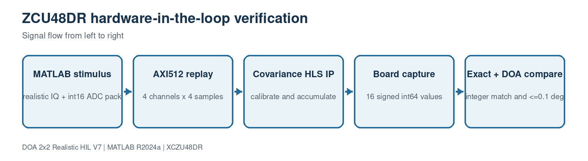

This block contains 3 implementation source file(s). Use the file links below to jump directly to the code explanation.

- [`generate_zcu48dr_hil_vectors.m`](#file-generate-zcu48dr-hil-vectors-m)
- [`hil_fixed_covariance_reference.m`](#file-hil-fixed-covariance-reference-m)
- [`run_zcu48dr_hil.m`](#file-run-zcu48dr-hil-m)

<a id="file-generate-zcu48dr-hil-vectors-m"></a>

## File: `generate_zcu48dr_hil_vectors.m`

### Purpose

Writes packed AXI512 stimulus, calibration registers, manifest and golden covariance.

### Where it runs

MATLAB R2024a behavioral, processor-reference or verification environment.

### Editing guidance

Edit only with the interfaces, dimensions and conventions in the surrounding block preserved.

### Size

61 source lines.

### Functions, classes and build targets

| Line | Kind | Definition | What the function/definition does |
| ---: | --- | --- | --- |
| 1 | function/method | `function manifest=generate_zcu48dr_hil_vectors(outputDirectory)` | Writes packed AXI512 stimulus, calibration registers, manifest and golden covariance. |

### Important code lines explained

| Line | Source statement | Function of the line |
| ---: | --- | --- |
| 1 | `function manifest=generate_zcu48dr_hil_vectors(outputDirectory)` | Declares a callable function or System object method, including its inputs and outputs. |
| 5 | `run('sim3d_params.m'); rng(P.Sim.RandomSeed+77,'twister');` | Loads the single authoritative project parameter structure P. |
| 6 | `trueAz_deg=27.35; trueEl_deg=-13.20;` | Assigns the left-hand variable/property from the expression on the right. |
| 7 | `snapshots=simulate_realistic_snapshots( ...` | Assigns the left-hand variable/property from the expression on the right. |
| 9 | `adcScale=2^(P.Receiver.ADCBits-1);` | Assigns the left-hand variable/property from the expression on the right. |
| 10 | `adcReal=int16(round(min(max(real(snapshots),-1),1-1/adcScale)*adcScale));` | Assigns the left-hand variable/property from the expression on the right. |
| 11 | `adcImag=int16(round(min(max(imag(snapshots),-1),1-1/adcScale)*adcScale));` | Assigns the left-hand variable/property from the expression on the right. |
| 12 | `iqInteger=complex(double(adcReal),double(adcImag));` | Assigns the left-hand variable/property from the expression on the right. |
| 14 | `correction=10.^(-P.DOA.CalibrationGain_dB/20).* ...` | Assigns the left-hand variable/property from the expression on the right. |
| 26 | `file=fopen(stimulusPath,'w'); assert(file>=0,'Cannot create HIL stimulus file.');` | Assigns the left-hand variable/property from the expression on the right. |
| 46 | `golden=hil_fixed_covariance_reference(iqInteger,calibrationQ2_14);` | Creates, conditions or consumes the four-channel spatial covariance matrix. |
| 47 | `writematrix(golden,fullfile(outputDirectory,'golden_covariance_i64.csv'));` | Creates, conditions or consumes the four-channel spatial covariance matrix. |
| 54 | `'golden_file','golden_covariance_i64.csv');` | Creates, conditions or consumes the four-channel spatial covariance matrix. |
| 56 | `assert(jsonFile>=0,'Cannot create HIL manifest.');` | Rejects an invalid dimension, type, geometry or configuration before processing. |

### Complete source code

<details>
<summary>Open the complete generate_zcu48dr_hil_vectors.m source</summary>

```matlab
function manifest=generate_zcu48dr_hil_vectors(outputDirectory)
%GENERATE_ZCU48DR_HIL_VECTORS Write 512-bit AXI stimuli and golden covariance.
if nargin<1, outputDirectory=fullfile(pwd,'hil_vectors'); end
if ~exist(outputDirectory,'dir'), mkdir(outputDirectory); end
run('sim3d_params.m'); rng(P.Sim.RandomSeed+77,'twister');
trueAz_deg=27.35; trueEl_deg=-13.20;
snapshots=simulate_realistic_snapshots( ...
    P,trueAz_deg,trueEl_deg,25,P.DOA.NumSnapshots);
adcScale=2^(P.Receiver.ADCBits-1);
adcReal=int16(round(min(max(real(snapshots),-1),1-1/adcScale)*adcScale));
adcImag=int16(round(min(max(imag(snapshots),-1),1-1/adcScale)*adcScale));
iqInteger=complex(double(adcReal),double(adcImag));

correction=10.^(-P.DOA.CalibrationGain_dB/20).* ...
    exp(-1j*deg2rad(P.DOA.CalibrationPhase_deg));
coefficientReal=int16(round(min(max(real(correction),-2),2-2^-14)*2^14));
coefficientImag=int16(round(min(max(imag(correction),-2),2-2^-14)*2^14));
calibrationQ2_14=zeros(1,4,'uint32');
for channel=1:4
    low=uint32(typecast(coefficientReal(channel),'uint16'));
    high=bitshift(uint32(typecast(coefficientImag(channel),'uint16')),16);
    calibrationQ2_14(channel)=bitor(low,high);
end

stimulusPath=fullfile(outputDirectory,'adc_4ch_4spc_axis512.hex');
file=fopen(stimulusPath,'w'); assert(file>=0,'Cannot create HIL stimulus file.');
cleanup=onCleanup(@()fclose(file));
for firstSample=1:4:size(iqInteger,1)
    words=zeros(1,16,'uint32'); wordIndex=0;
    for lane=0:3
        for channel=1:4
            wordIndex=wordIndex+1; sampleIndex=firstSample+lane;
            if sampleIndex<=size(iqInteger,1)
                low=uint32(typecast(int16(real(iqInteger(sampleIndex,channel))),'uint16'));
                high=bitshift(uint32(typecast(int16(imag(iqInteger(sampleIndex,channel))),'uint16')),16);
                words(wordIndex)=bitor(low,high);
            end
        end
    end
    text='';
    for index=16:-1:1, text=[text dec2hex(words(index),8)]; end %#ok<AGROW>
    fprintf(file,'%s\n',text);
end
clear cleanup

golden=hil_fixed_covariance_reference(iqInteger,calibrationQ2_14);
writematrix(golden,fullfile(outputDirectory,'golden_covariance_i64.csv'));
writematrix([adcReal adcImag],fullfile(outputDirectory,'adc_iq_int16.csv'));
manifest=struct('format_version',1,'samples_per_beat',4, ...
    'frame_samples',size(iqInteger,1),'true_az_deg',trueAz_deg, ...
    'true_el_deg',trueEl_deg,'adc_bits',P.Receiver.ADCBits, ...
    'calibration_q2_14',double(calibrationQ2_14), ...
    'stimulus_file','adc_4ch_4spc_axis512.hex', ...
    'golden_file','golden_covariance_i64.csv');
jsonFile=fopen(fullfile(outputDirectory,'hil_manifest.json'),'w');
assert(jsonFile>=0,'Cannot create HIL manifest.');
fprintf(jsonFile,'%s',jsonencode(manifest,'PrettyPrint',true)); fclose(jsonFile);
save(fullfile(outputDirectory,'hil_reference.mat'),'P','manifest','golden', ...
    'calibrationQ2_14','trueAz_deg','trueEl_deg');
fprintf('Created ZU48DR HIL vectors in %s\n',outputDirectory);
end
```

</details>

[Back to the document index](#document-header-index)

<a id="file-hil-fixed-covariance-reference-m"></a>

## File: `hil_fixed_covariance_reference.m`

### Purpose

Bit-accurate MATLAB model of HLS calibration shifts and covariance accumulators.

### Where it runs

MATLAB R2024a behavioral, processor-reference or verification environment.

### Editing guidance

Edit only with the interfaces, dimensions and conventions in the surrounding block preserved.

### Size

34 source lines.

### Functions, classes and build targets

| Line | Kind | Definition | What the function/definition does |
| ---: | --- | --- | --- |
| 1 | function/method | `function values=hil_fixed_covariance_reference(iqInteger,calibrationQ2_14)` | Bit-accurate MATLAB model of HLS calibration shifts and covariance accumulators. |

### Important code lines explained

| Line | Source statement | Function of the line |
| ---: | --- | --- |
| 1 | `function values=hil_fixed_covariance_reference(iqInteger,calibrationQ2_14)` | Declares a callable function or System object method, including its inputs and outputs. |
| 3 | `assert(size(iqInteger,2)==4,'iqInteger must be N-by-4 complex integer data.');` | Rejects an invalid dimension, type, geometry or configuration before processing. |
| 4 | `assert(numel(calibrationQ2_14)==4,'Four packed complex calibration values required.');` | Rejects an invalid dimension, type, geometry or configuration before processing. |
| 5 | `numberSamples=size(iqInteger,1);` | Assigns the left-hand variable/property from the expression on the right. |
| 6 | `calibratedReal=zeros(numberSamples,4);` | Assigns the left-hand variable/property from the expression on the right. |
| 7 | `calibratedImag=zeros(numberSamples,4);` | Assigns the left-hand variable/property from the expression on the right. |
| 8 | `for channel=1:4` | Begins a bounded loop over samples, channels, candidates or trials. |
| 9 | `packed=uint32(calibrationQ2_14(channel));` | Assigns the left-hand variable/property from the expression on the right. |

### Complete source code

<details>
<summary>Open the complete hil_fixed_covariance_reference.m source</summary>

```matlab
function values=hil_fixed_covariance_reference(iqInteger,calibrationQ2_14)
%HIL_FIXED_COVARIANCE_REFERENCE Bit-accurate model of covariance HLS output.
assert(size(iqInteger,2)==4,'iqInteger must be N-by-4 complex integer data.');
assert(numel(calibrationQ2_14)==4,'Four packed complex calibration values required.');
numberSamples=size(iqInteger,1);
calibratedReal=zeros(numberSamples,4);
calibratedImag=zeros(numberSamples,4);
for channel=1:4
    packed=uint32(calibrationQ2_14(channel));
    coefficientReal=double(typecast(uint16(bitand(packed,65535)),'int16'));
    coefficientImag=double(typecast(uint16(bitshift(packed,-16)),'int16'));
    inputReal=double(real(iqInteger(:,channel)));
    inputImag=double(imag(iqInteger(:,channel)));
    calibratedReal(:,channel)=floor((inputReal*coefficientReal- ...
        inputImag*coefficientImag)/2^14);
    calibratedImag(:,channel)=floor((inputReal*coefficientImag+ ...
        inputImag*coefficientReal)/2^14);
end

pairs=[1 2;1 3;1 4;2 3;2 4;3 4];
power=zeros(4,1); crossReal=zeros(6,1); crossImag=zeros(6,1);
for channel=1:4
    power(channel)=sum(calibratedReal(:,channel).^2+ ...
        calibratedImag(:,channel).^2);
end
for pair=1:6
    first=pairs(pair,1); second=pairs(pair,2);
    crossReal(pair)=sum(calibratedReal(:,second).*calibratedReal(:,first)+ ...
        calibratedImag(:,second).*calibratedImag(:,first));
    crossImag(pair)=sum(calibratedImag(:,second).*calibratedReal(:,first)- ...
        calibratedReal(:,second).*calibratedImag(:,first));
end
values=int64([power;crossReal;crossImag]);
end
```

</details>

[Back to the document index](#document-header-index)

<a id="file-run-zcu48dr-hil-m"></a>

## File: `run_zcu48dr_hil.m`

### Purpose

Provides separate prepare, host-loopback and real board-capture comparison modes.

### Where it runs

MATLAB R2024a behavioral, processor-reference or verification environment.

### Editing guidance

Loopback is host-only; only compare mode with a board-produced CSV is HIL evidence.

### Size

60 source lines.

### Functions, classes and build targets

| Line | Kind | Definition | What the function/definition does |
| ---: | --- | --- | --- |
| 1 | function/method | `function report=run_zcu48dr_hil(mode,captureFile)` | Provides separate prepare, host-loopback and real board-capture comparison modes. |
| 50 | function/method | `function covariance=covarianceFromValues(values)` | Reconstructs the Hermitian 4x4 covariance from the 16-word HIL packet. |

### Important code lines explained

| Line | Source statement | Function of the line |
| ---: | --- | --- |
| 1 | `function report=run_zcu48dr_hil(mode,captureFile)` | Declares a callable function or System object method, including its inputs and outputs. |
| 6 | `vectorDirectory=fullfile(pwd,'hil_vectors');` | Assigns the left-hand variable/property from the expression on the right. |
| 7 | `switch lower(char(mode))` | Selects the requested algorithm, waveform, mode or profile. |
| 8 | `case 'prepare'` | Selects the requested algorithm, waveform, mode or profile. |
| 9 | `manifest=generate_zcu48dr_hil_vectors(vectorDirectory);` | Assigns the left-hand variable/property from the expression on the right. |
| 10 | `report=struct('Mode','prepare','Pass',true,'Manifest',manifest);` | Assigns the left-hand variable/property from the expression on the right. |
| 12 | `'doa_covariance_4ch_v4 and save its 16 outputs as capture.csv.\n']);` | Creates, conditions or consumes the four-channel spatial covariance matrix. |
| 14 | `case 'loopback'` | Selects the requested algorithm, waveform, mode or profile. |
| 18 | `captureFile=fullfile(vectorDirectory,'golden_covariance_i64.csv');` | Creates, conditions or consumes the four-channel spatial covariance matrix. |
| 19 | `case 'compare'` | Selects the requested algorithm, waveform, mode or profile. |
| 20 | `assert(nargin>=2 && exist(captureFile,'file')==2, ...` | Rejects an invalid dimension, type, geometry or configuration before processing. |
| 26 | `assert(exist(fullfile(vectorDirectory,'hil_reference.mat'),'file')==2, ...` | Rejects an invalid dimension, type, geometry or configuration before processing. |
| 28 | `reference=load(fullfile(vectorDirectory,'hil_reference.mat'));` | Assigns the left-hand variable/property from the expression on the right. |
| 31 | `assert(numel(captured)==16,'Board capture must contain exactly 16 int64 values.');` | Rejects an invalid dimension, type, geometry or configuration before processing. |
| 36 | `covariance=covarianceFromValues(captured);` | Creates, conditions or consumes the four-channel spatial covariance matrix. |
| 37 | `[azimuth,elevation]=estimate_doa_from_covariance_v7(covariance,reference.P);` | Creates, conditions or consumes the four-channel spatial covariance matrix. |
| 41 | `angularError=acosd(max(-1,min(1,dot(truth,estimate))));` | Assigns the left-hand variable/property from the expression on the right. |
| 50 | `function covariance=covarianceFromValues(values)` | Declares a callable function or System object method, including its inputs and outputs. |

### Complete source code

<details>
<summary>Open the complete run_zcu48dr_hil.m source</summary>

```matlab
function report=run_zcu48dr_hil(mode,captureFile)
%RUN_ZCU48DR_HIL Separate prepare/compare harness for the real ZCU48DR board.
% PREPARE creates AXI512 stimulus and golden output. COMPARE consumes the
% 16 signed int64 values captured from the board's covariance AXI stream.
if nargin<1, mode='prepare'; end
vectorDirectory=fullfile(pwd,'hil_vectors');
switch lower(char(mode))
    case 'prepare'
        manifest=generate_zcu48dr_hil_vectors(vectorDirectory);
        report=struct('Mode','prepare','Pass',true,'Manifest',manifest);
        fprintf(['Next: replay adc_4ch_4spc_axis512.hex through ' ...
            'doa_covariance_4ch_v4 and save its 16 outputs as capture.csv.\n']);
        return
    case 'loopback'
        if ~exist(fullfile(vectorDirectory,'hil_reference.mat'),'file')
            generate_zcu48dr_hil_vectors(vectorDirectory);
        end
        captureFile=fullfile(vectorDirectory,'golden_covariance_i64.csv');
    case 'compare'
        assert(nargin>=2 && exist(captureFile,'file')==2, ...
            'Provide the board capture CSV for compare mode.');
    otherwise
        error('HIL:Mode','Mode must be prepare, loopback, or compare.');
end

assert(exist(fullfile(vectorDirectory,'hil_reference.mat'),'file')==2, ...
    'Run run_zcu48dr_hil(''prepare'') before comparing a board capture.');
reference=load(fullfile(vectorDirectory,'hil_reference.mat'));
captured=int64(readmatrix(captureFile)); captured=captured(:);
golden=reference.golden(:);
assert(numel(captured)==16,'Board capture must contain exactly 16 int64 values.');
difference=double(captured)-double(golden);
exact=all(difference==0);
relative=max(abs(difference)./max(abs(double(golden)),1));

covariance=covarianceFromValues(captured);
[azimuth,elevation]=estimate_doa_from_covariance_v7(covariance,reference.P);
truth=[cosd(reference.trueEl_deg)*cosd(reference.trueAz_deg); ...
    cosd(reference.trueEl_deg)*sind(reference.trueAz_deg);sind(reference.trueEl_deg)];
estimate=[cosd(elevation)*cosd(azimuth);cosd(elevation)*sind(azimuth);sind(elevation)];
angularError=acosd(max(-1,min(1,dot(truth,estimate))));
report=struct('Mode',char(mode),'ExactIntegerMatch',exact, ...
    'MaximumRelativeCovarianceError',relative,'EstimatedAz_deg',azimuth, ...
    'EstimatedEl_deg',elevation,'AngularError_deg',angularError, ...
    'Pass',exact && angularError<=reference.P.Accuracy.Required3DRMSE_deg);
disp(report);
assert(report.Pass,'HIL comparison failed exact covariance or 0.1-degree DOA.');
end

function covariance=covarianceFromValues(values)
pairs=[1 2;1 3;1 4;2 3;2 4;3 4];
covariance=complex(zeros(4));
for channel=1:4, covariance(channel,channel)=double(values(channel)); end
for pair=1:6
    second=pairs(pair,2); first=pairs(pair,1);
    value=double(values(4+pair))+1j*double(values(10+pair));
    covariance(second,first)=value;
    covariance(first,second)=conj(value);
end
end
```

</details>

[Back to the document index](#document-header-index)

<a id="block-9-matlab-hdl-front-end-reference"></a>

# Block 9: MATLAB HDL front-end reference

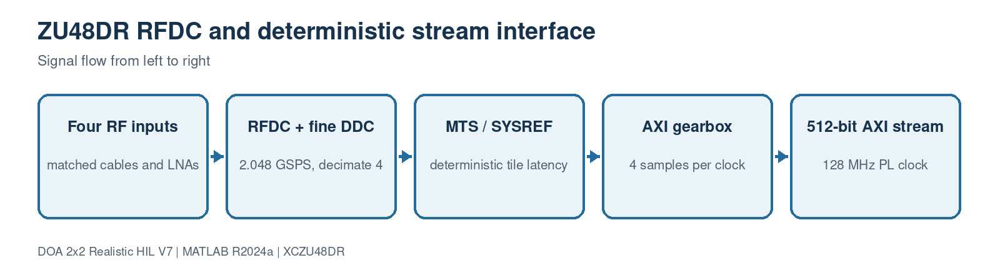

This block contains 4 implementation source file(s). Use the file links below to jump directly to the code explanation.

- [`ZU48DRChannelizer4.m`](#file-zu48drchannelizer4-m)
- [`design_pfb_coefficients.m`](#file-design-pfb-coefficients-m)
- [`build_rfsoc_hdl_frontend_model.m`](#file-build-rfsoc-hdl-frontend-model-m)
- [`generate_rfsoc_hdl_frontend.m`](#file-generate-rfsoc-hdl-frontend-m)

<a id="file-zu48drchannelizer4-m"></a>

## File: `ZU48DRChannelizer4.m`

### Purpose

Synthesizable four-channel DSP HDL channelizer wrapper.

### Where it runs

MATLAB/DSP HDL reference and HDL Coder flow.

### Editing guidance

Edit only with the interfaces, dimensions and conventions in the surrounding block preserved.

### Size

67 source lines.

### Functions, classes and build targets

| Line | Kind | Definition | What the function/definition does |
| ---: | --- | --- | --- |
| 1 | class | `classdef ZU48DRChannelizer4 < matlab.System` | Declares the System object/class that owns this block's configuration, state and execution methods. |
| 14 | function/method | `function obj=ZU48DRChannelizer4(varargin)` | Synthesizable four-channel DSP HDL channelizer wrapper. |
| 19 | function/method | `function setupImpl(obj,~,~,~,~,~)` | Runs once when the System object locks; validates configuration and creates persistent processing resources. |
| 27 | function/method | `function [bins0,bins1,bins2,bins3,validOut]= ...` | Implements the `function` helper used by this file; inputs, outputs and operations are visible in the signature and source below. |
| 35 | function/method | `function resetImpl(obj)` | Restores persistent algorithm/tracker/filter state to its initial condition. |
| 39 | function/method | `function releaseImpl(obj)` | Releases locked child System objects and hardware/software resources. |
| 43 | function/method | `function [a,b,c,d,e]=getOutputSizeImpl(obj)` | Declares fixed Simulink output dimensions for model compilation. |
| 46 | function/method | `function [a,b,c,d,e]=getOutputDataTypeImpl(obj)` | Declares output numeric types for Simulink propagation. |
| 51 | function/method | `function [a,b,c,d,e]=isOutputComplexImpl(~)` | Declares whether each output is real or complex. |
| 54 | function/method | `function [a,b,c,d,e]=isOutputFixedSizeImpl(~)` | Declares that output dimensions remain fixed while running. |
| 57 | function/method | `function [a,b,c,d,e]=getInputNamesImpl(~)` | Assigns readable names to generated MATLAB System block input ports. |
| 60 | function/method | `function [a,b,c,d,e]=getOutputNamesImpl(~)` | Assigns readable names to generated MATLAB System block output ports. |
| 63 | function/method | `function icon=getIconImpl(obj)` | Builds the label shown on the generated Simulink block. |

### Important code lines explained

| Line | Source statement | Function of the line |
| ---: | --- | --- |
| 1 | `classdef ZU48DRChannelizer4 < matlab.System` | Declares the MATLAB class and its base type. |
| 4 | `NumBands = 1024` | Assigns the left-hand variable/property from the expression on the right. |
| 5 | `FilterCoefficients = 1` | Assigns the left-hand variable/property from the expression on the right. |
| 7 | `properties (Access=private)` | Begins a property group; nontunable values become fixed after System object setup. |
| 14 | `function obj=ZU48DRChannelizer4(varargin)` | Declares a callable function or System object method, including its inputs and outputs. |
| 18 | `methods (Access=protected)` | Begins a method group; protected methods define System object execution behavior. |
| 19 | `function setupImpl(obj,~,~,~,~,~)` | Declares a callable function or System object method, including its inputs and outputs. |
| 20 | `arguments={'NumFrequencyBands',obj.NumBands, ...` | Assigns the left-hand variable/property from the expression on the right. |
| 22 | `obj.Channelizer0=dsphdl.Channelizer(arguments{:});` | Assigns the left-hand variable/property from the expression on the right. |
| 23 | `obj.Channelizer1=dsphdl.Channelizer(arguments{:});` | Assigns the left-hand variable/property from the expression on the right. |
| 27 | `function [bins0,bins1,bins2,bins3,validOut]= ...` | Declares a callable function or System object method, including its inputs and outputs. |
| 35 | `function resetImpl(obj)` | Declares a callable function or System object method, including its inputs and outputs. |
| 39 | `function releaseImpl(obj)` | Declares a callable function or System object method, including its inputs and outputs. |
| 43 | `function [a,b,c,d,e]=getOutputSizeImpl(obj)` | Declares a callable function or System object method, including its inputs and outputs. |
| 46 | `function [a,b,c,d,e]=getOutputDataTypeImpl(obj)` | Declares a callable function or System object method, including its inputs and outputs. |

### Complete source code

<details>
<summary>Open the complete ZU48DRChannelizer4.m source</summary>

```matlab
classdef ZU48DRChannelizer4 < matlab.System
    % Four parallel hardware-oriented channelizers for coherent RFSoC input.
    properties (Nontunable)
        NumBands = 1024
        FilterCoefficients = 1
    end
    properties (Access=private)
        Channelizer0
        Channelizer1
        Channelizer2
        Channelizer3
    end
    methods
        function obj=ZU48DRChannelizer4(varargin)
            setProperties(obj,nargin,varargin{:});
        end
    end
    methods (Access=protected)
        function setupImpl(obj,~,~,~,~,~)
            arguments={'NumFrequencyBands',obj.NumBands, ...
                'FilterCoefficients',obj.FilterCoefficients,'Normalize',true};
            obj.Channelizer0=dsphdl.Channelizer(arguments{:});
            obj.Channelizer1=dsphdl.Channelizer(arguments{:});
            obj.Channelizer2=dsphdl.Channelizer(arguments{:});
            obj.Channelizer3=dsphdl.Channelizer(arguments{:});
        end
        function [bins0,bins1,bins2,bins3,validOut]= ...
                stepImpl(obj,adc0,adc1,adc2,adc3,validIn)
            [bins0,valid0]=obj.Channelizer0(adc0,validIn);
            [bins1,valid1]=obj.Channelizer1(adc1,validIn);
            [bins2,valid2]=obj.Channelizer2(adc2,validIn);
            [bins3,valid3]=obj.Channelizer3(adc3,validIn);
            validOut=valid0 && valid1 && valid2 && valid3;
        end
        function resetImpl(obj)
            reset(obj.Channelizer0); reset(obj.Channelizer1);
            reset(obj.Channelizer2); reset(obj.Channelizer3);
        end
        function releaseImpl(obj)
            release(obj.Channelizer0); release(obj.Channelizer1);
            release(obj.Channelizer2); release(obj.Channelizer3);
        end
        function [a,b,c,d,e]=getOutputSizeImpl(obj)
            a=[1 obj.NumBands]; b=a; c=a; d=a; e=[1 1];
        end
        function [a,b,c,d,e]=getOutputDataTypeImpl(obj)
            a=propagatedInputDataType(obj,1); b=propagatedInputDataType(obj,2);
            c=propagatedInputDataType(obj,3); d=propagatedInputDataType(obj,4);
            e='logical';
        end
        function [a,b,c,d,e]=isOutputComplexImpl(~)
            a=true; b=true; c=true; d=true; e=false;
        end
        function [a,b,c,d,e]=isOutputFixedSizeImpl(~)
            a=true; b=true; c=true; d=true; e=true;
        end
        function [a,b,c,d,e]=getInputNamesImpl(~)
            a='ADC0_IQ'; b='ADC1_IQ'; c='ADC2_IQ'; d='ADC3_IQ'; e='validIn';
        end
        function [a,b,c,d,e]=getOutputNamesImpl(~)
            a='Bins0'; b='Bins1'; c='Bins2'; d='Bins3'; e='validOut';
        end
        function icon=getIconImpl(obj)
            icon=sprintf('RFSoC HDL 4CH\nChannelizer M=%d',obj.NumBands);
        end
    end
end
```

</details>

[Back to the document index](#document-header-index)

<a id="file-design-pfb-coefficients-m"></a>

## File: `design_pfb_coefficients.m`

### Purpose

Creates one shared fixed-point prototype filter for coherent HDL paths.

### Where it runs

MATLAB/DSP HDL reference and HDL Coder flow.

### Editing guidance

Edit only with the interfaces, dimensions and conventions in the surrounding block preserved.

### Size

11 source lines.

### Functions, classes and build targets

| Line | Kind | Definition | What the function/definition does |
| ---: | --- | --- | --- |
| 1 | function/method | `function coefficients=design_pfb_coefficients(numberBands,decimationFactor,tapsPerBand,attenuation_dB)` | Creates one shared fixed-point prototype filter for coherent HDL paths. |

### Important code lines explained

| Line | Source statement | Function of the line |
| ---: | --- | --- |
| 1 | `function coefficients=design_pfb_coefficients(numberBands,decimationFactor,tapsPerBand,attenuation_dB)` | Declares a callable function or System object method, including its inputs and outputs. |
| 3 | `assert(decimationFactor==numberBands,'RFSoCHDL:CriticalSamplingRequired', ...` | Rejects an invalid dimension, type, geometry or configuration before processing. |
| 4 | `'The R2024a dsphdl.Channelizer path requires DecimationFactor == NumBands.');` | Assigns the left-hand variable/property from the expression on the right. |
| 5 | `reference=dsp.Channelizer(numberBands,decimationFactor, ...` | Assigns the left-hand variable/property from the expression on the right. |
| 8 | `coefficients=tf(reference);` | Assigns the left-hand variable/property from the expression on the right. |
| 10 | `coefficients=coefficients(:).';` | Assigns the left-hand variable/property from the expression on the right. |

### Complete source code

<details>
<summary>Open the complete design_pfb_coefficients.m source</summary>

```matlab
function coefficients=design_pfb_coefficients(numberBands,decimationFactor,tapsPerBand,attenuation_dB)
%DESIGN_PFB_COEFFICIENTS Share the behavioral prototype with the HDL DUT.
assert(decimationFactor==numberBands,'RFSoCHDL:CriticalSamplingRequired', ...
    'The R2024a dsphdl.Channelizer path requires DecimationFactor == NumBands.');
reference=dsp.Channelizer(numberBands,decimationFactor, ...
    'Specification','Number of taps per band and stopband attenuation', ...
    'NumTapsPerBand',tapsPerBand,'StopbandAttenuation',attenuation_dB);
coefficients=tf(reference);
release(reference);
coefficients=coefficients(:).';
end
```

</details>

[Back to the document index](#document-header-index)

<a id="file-build-rfsoc-hdl-frontend-model-m"></a>

## File: `build_rfsoc_hdl_frontend_model.m`

### Purpose

Builds the MATLAB HDL reference front-end model for ZCU208.

### Where it runs

MATLAB/DSP HDL reference and HDL Coder flow.

### Editing guidance

Edit only with the interfaces, dimensions and conventions in the surrounding block preserved.

### Size

63 source lines.

### Functions, classes and build targets

| Line | Kind | Definition | What the function/definition does |
| ---: | --- | --- | --- |
| 1 | function/method | `function build_rfsoc_hdl_frontend_model()` | Builds the MATLAB HDL reference front-end model for ZCU208. |

### Important code lines explained

| Line | Source statement | Function of the line |
| ---: | --- | --- |
| 1 | `function build_rfsoc_hdl_frontend_model()` | Declares a callable function or System object method, including its inputs and outputs. |
| 3 | `run('sim3d_params.m');` | Loads the single authoritative project parameter structure P. |
| 7 | `coefficients=design_pfb_coefficients(P.PFB.NumBands,P.PFB.DecimationFactor, ...` | Assigns the left-hand variable/property from the expression on the right. |
| 10 | `model='DOA_RFSoC_HDL_FrontEnd';` | Assigns the left-hand variable/property from the expression on the right. |
| 16 | `inputNames={'ADC0_IQ','ADC1_IQ','ADC2_IQ','ADC3_IQ'};` | Assigns the left-hand variable/property from the expression on the right. |
| 17 | `yPositions=[55 105 155 205];` | Assigns the left-hand variable/property from the expression on the right. |
| 18 | `for index=1:4` | Begins a bounded loop over samples, channels, candidates or trials. |
| 19 | `add_block('simulink/Sources/In1',[model '/' inputNames{index}], ...` | Creates or configures a generated Simulink block. |
| 23 | `add_block('simulink/Sources/In1',[model '/validIn'],'Position',[35 265 65 285], ...` | Creates or configures a generated Simulink block. |
| 26 | `dut=[model '/RFSoC_HDL_Channelizer4'];` | Assigns the left-hand variable/property from the expression on the right. |
| 27 | `add_block('simulink/User-Defined Functions/MATLAB System',dut, ...` | Creates or configures a generated Simulink block. |
| 33 | `outputNames={'Bins0','Bins1','Bins2','Bins3'};` | Assigns the left-hand variable/property from the expression on the right. |
| 34 | `for index=1:4` | Begins a bounded loop over samples, channels, candidates or trials. |
| 35 | `add_block('simulink/Sinks/Out1',[model '/' outputNames{index}], ...` | Creates or configures a generated Simulink block. |
| 38 | `add_line(model,[inputNames{index} '/1'],['RFSoC_HDL_Channelizer4/' num2str(index)]);` | Connects two generated Simulink block ports. |
| 39 | `add_line(model,['RFSoC_HDL_Channelizer4/' num2str(index)],[outputNames{index} '/1']);` | Connects two generated Simulink block ports. |
| 41 | `add_block('simulink/Sinks/Out1',[model '/validOut'], ...` | Creates or configures a generated Simulink block. |
| 43 | `add_line(model,'validIn/1','RFSoC_HDL_Channelizer4/5');` | Connects two generated Simulink block ports. |
| 44 | `add_line(model,'RFSoC_HDL_Channelizer4/5','validOut/1');` | Connects two generated Simulink block ports. |

### Complete source code

<details>
<summary>Open the complete build_rfsoc_hdl_frontend_model.m source</summary>

```matlab
function build_rfsoc_hdl_frontend_model()
%BUILD_RFSOC_HDL_FRONTEND_MODEL Build the synthesizable four-channel DUT.
run('sim3d_params.m');
if exist('dsphdl.Channelizer','class')~=8
    error('RFSoCHDL:MissingDSPHDL','DSP HDL Toolbox is required.');
end
coefficients=design_pfb_coefficients(P.PFB.NumBands,P.PFB.DecimationFactor, ...
    P.PFB.TapsPerBand,P.PFB.StopbandAttenuation_dB);

model='DOA_RFSoC_HDL_FrontEnd';
if bdIsLoaded(model), close_system(model,0); end
if exist([model '.slx'],'file'), delete([model '.slx']); end
new_system(model); open_system(model);
set_param(model,'SolverType','Fixed-step','Solver','FixedStepDiscrete','FixedStep','1');

inputNames={'ADC0_IQ','ADC1_IQ','ADC2_IQ','ADC3_IQ'};
yPositions=[55 105 155 205];
for index=1:4
    add_block('simulink/Sources/In1',[model '/' inputNames{index}], ...
        'Position',[35 yPositions(index) 65 yPositions(index)+20], ...
        'Port',num2str(index),'OutDataTypeStr','fixdt(1,16,14)','SignalType','complex');
end
add_block('simulink/Sources/In1',[model '/validIn'],'Position',[35 265 65 285], ...
    'Port','5','OutDataTypeStr','boolean');

dut=[model '/RFSoC_HDL_Channelizer4'];
add_block('simulink/User-Defined Functions/MATLAB System',dut, ...
    'Position',[190 70 415 285]);
set_param(dut,'System','ZU48DRChannelizer4', ...
    'NumBands',mat2str(P.PFB.NumBands,17), ...
    'FilterCoefficients',mat2str(coefficients,17));

outputNames={'Bins0','Bins1','Bins2','Bins3'};
for index=1:4
    add_block('simulink/Sinks/Out1',[model '/' outputNames{index}], ...
        'Position',[545 yPositions(index) 575 yPositions(index)+20], ...
        'Port',num2str(index));
    add_line(model,[inputNames{index} '/1'],['RFSoC_HDL_Channelizer4/' num2str(index)]);
    add_line(model,['RFSoC_HDL_Channelizer4/' num2str(index)],[outputNames{index} '/1']);
end
add_block('simulink/Sinks/Out1',[model '/validOut'], ...
    'Position',[545 265 575 285],'Port','5');
add_line(model,'validIn/1','RFSoC_HDL_Channelizer4/5');
add_line(model,'RFSoC_HDL_Channelizer4/5','validOut/1');

annotation=Simulink.Annotation(model,sprintf([ ...
    'RFSoC HDL FRONT END - MATLAB R2024a\n' ...
    '4 coherent scalar complex streams + valid -> 4 parallel dsphdl.Channelizer cores\n' ...
    'M=%d, signed 16-bit fixed-point inputs'],P.PFB.NumBands));
annotation.Position=[75 345 535 420]; annotation.FontSize=11;
set_param(model,'SimulationCommand','update');

if exist('hdlset_param','file')==2
    hdlset_param(model,'HDLSubsystem',dut);
    hdlset_param(model,'TargetLanguage','Verilog');
    hdlset_param(model,'SynthesisTool','Xilinx Vivado');
    hdlset_param(model,'SynthesisToolChipFamily','Zynq UltraScale+ RFSoC');
    hdlset_param(model,'SynthesisToolDeviceName','xczu48dr-fsvg1517-2-e');
    hdlset_param(model,'TargetDirectory',fullfile(pwd,'hdl_prj','hdlsrc'));
end
save_system(model,[model '.slx']); open_system(model);
fprintf('Created RFSoC HDL model: %s.slx\n',model);
end
```

</details>

[Back to the document index](#document-header-index)

<a id="file-generate-rfsoc-hdl-frontend-m"></a>

## File: `generate_rfsoc_hdl_frontend.m`

### Purpose

Launches HDL Coder for the reference channelizer subsystem.

### Where it runs

MATLAB/DSP HDL reference and HDL Coder flow.

### Editing guidance

Edit only with the interfaces, dimensions and conventions in the surrounding block preserved.

### Size

8 source lines.

### Functions, classes and build targets

This is an execution/configuration script and does not declare a separate function or class.

### Important code lines explained

| Line | Source statement | Function of the line |
| ---: | --- | --- |

### Complete source code

<details>
<summary>Open the complete generate_rfsoc_hdl_frontend.m source</summary>

```matlab
%% Generate Verilog for the RFSoC channelizer DUT.
rehash path;
build_rfsoc_hdl_frontend_model;
if exist('makehdl','file')~=2
    error('RFSoCHDL:MissingHDLCoder','HDL Coder is required to generate Verilog.');
end
makehdl('DOA_RFSoC_HDL_FrontEnd/RFSoC_HDL_Channelizer4');
fprintf('HDL generated under %s\n',fullfile(pwd,'hdl_prj','hdlsrc'));
```

</details>

[Back to the document index](#document-header-index)

<a id="block-10-four-sample-per-clock-production-hls-core"></a>

# Block 10: Four-sample-per-clock production HLS core

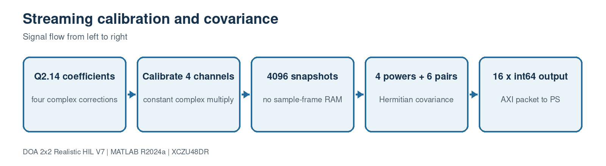

This block contains 5 implementation source file(s). Use the file links below to jump directly to the code explanation.

- [`rfsoc_buildkit_overlay/ip/custom/doa_covariance_4ch_v4/src/doa_covariance_4ch_v4.hpp`](#file-rfsoc-buildkit-overlay-ip-custom-doa-covariance-4ch-v4-src-doa-covariance-4ch-v4-hpp)
- [`rfsoc_buildkit_overlay/ip/custom/doa_covariance_4ch_v4/src/doa_covariance_4ch_v4.cpp`](#file-rfsoc-buildkit-overlay-ip-custom-doa-covariance-4ch-v4-src-doa-covariance-4ch-v4-cpp)
- [`rfsoc_buildkit_overlay/ip/custom/doa_covariance_4ch_v4/tb/doa_covariance_4ch_v4_tb.cpp`](#file-rfsoc-buildkit-overlay-ip-custom-doa-covariance-4ch-v4-tb-doa-covariance-4ch-v4-tb-cpp)
- [`rfsoc_buildkit_overlay/ip/custom/doa_covariance_4ch_v4/build_hls.tcl`](#file-rfsoc-buildkit-overlay-ip-custom-doa-covariance-4ch-v4-build-hls-tcl)
- [`rfsoc_buildkit_overlay/ip/custom/doa_covariance_4ch_v4/Makefile`](#file-rfsoc-buildkit-overlay-ip-custom-doa-covariance-4ch-v4-makefile)

<a id="file-rfsoc-buildkit-overlay-ip-custom-doa-covariance-4ch-v4-src-doa-covariance-4ch-v4-hpp"></a>

## File: `rfsoc_buildkit_overlay/ip/custom/doa_covariance_4ch_v4/src/doa_covariance_4ch_v4.hpp`

### Purpose

Declares AXI types and the production HLS top-level interface.

### Where it runs

Vitis HLS / programmable-logic build flow.

### Editing guidance

Edit only with the interfaces, dimensions and conventions in the surrounding block preserved.

### Size

19 source lines.

### Functions, classes and build targets

| Line | Kind | Definition | What the function/definition does |
| ---: | --- | --- | --- |
| 11 | C/C++ function | `extern "C" void doa_covariance_4ch_v4(hls::stream<axis512_t>& s_axis, hls::stream<axis64_t>& m_axis, ap_uint<32> cal0, ap_uint<32> cal1, ap_uint<32> cal2, ap_uint<32> cal3, ap_uint<16> frameSamples)` | Production HLS top: accepts AXI512 frames, calibrates four lanes/channels and emits covariance. |

### Important code lines explained

| Line | Source statement | Function of the line |
| ---: | --- | --- |
| 11 | `extern "C" void doa_covariance_4ch_v4(hls::stream<axis512_t>& s_axis,` | Creates, conditions or consumes the four-channel spatial covariance matrix. |

### Complete source code

<details>
<summary>Open the complete rfsoc_buildkit_overlay/ip/custom/doa_covariance_4ch_v4/src/doa_covariance_4ch_v4.hpp source</summary>

```cpp
#ifndef DOA_COVARIANCE_4CH_V4_HPP
#define DOA_COVARIANCE_4CH_V4_HPP

#include <ap_int.h>
#include <hls_stream.h>
#include <ap_axi_sdata.h>

typedef ap_axiu<512,0,0,0> axis512_t;
typedef ap_axiu<64,0,0,0> axis64_t;

extern "C" void doa_covariance_4ch_v4(hls::stream<axis512_t>& s_axis,
                                        hls::stream<axis64_t>& m_axis,
                                        ap_uint<32> cal0,
                                        ap_uint<32> cal1,
                                        ap_uint<32> cal2,
                                        ap_uint<32> cal3,
                                        ap_uint<16> frameSamples);

#endif
```

</details>

[Back to the document index](#document-header-index)

<a id="file-rfsoc-buildkit-overlay-ip-custom-doa-covariance-4ch-v4-src-doa-covariance-4ch-v4-cpp"></a>

## File: `rfsoc_buildkit_overlay/ip/custom/doa_covariance_4ch_v4/src/doa_covariance_4ch_v4.cpp`

### Purpose

Four-sample-per-clock calibration and covariance HLS implementation.

### Where it runs

Vitis HLS / programmable-logic build flow.

### Editing guidance

Do not change packing or conjugation without updating MATLAB HIL reference and capture software together.

### Size

96 source lines.

### Functions, classes and build targets

| Line | Kind | Definition | What the function/definition does |
| ---: | --- | --- | --- |
| 3 | C/C++ function | `static ap_int<16> low16(ap_uint<32> value)` | Extracts and sign-interprets the low 16-bit half-word. |
| 6 | C/C++ function | `static ap_int<16> high16(ap_uint<32> value)` | Extracts and sign-interprets the high 16-bit half-word. |
| 9 | C/C++ function | `static void calibrate(ap_int<16> xr, ap_int<16> xi, ap_uint<32> packed, ap_int<20>& yr, ap_int<20>& yi)` | Applies one packed complex Q2.14 channel correction using fixed-point arithmetic. |
| 19 | C/C++ function | `extern "C" void doa_covariance_4ch_v4(hls::stream<axis512_t>& s_axis, hls::stream<axis64_t>& m_axis, ap_uint<32> cal0, ap_uint<32> cal1, ap_uint<32> cal2, ap_uint<32> cal3, ap_uint<16> frameSamples)` | Production HLS top: accepts AXI512 frames, calibrates four lanes/channels and emits covariance. |

### Important code lines explained

| Line | Source statement | Function of the line |
| ---: | --- | --- |
| 1 | `#include "doa_covariance_4ch_v4.hpp"` | Creates, conditions or consumes the four-channel spatial covariance matrix. |
| 11 | `#pragma HLS INLINE` | Executes this control, function-call or interface statement in source order. |
| 12 | `ap_int<16> cr=low16(packed), ci=high16(packed);` | Assigns the left-hand variable/property from the expression on the right. |
| 13 | `ap_int<36> realProduct=(ap_int<32>)xr*cr-(ap_int<32>)xi*ci;` | Assigns the left-hand variable/property from the expression on the right. |
| 14 | `ap_int<36> imagProduct=(ap_int<32>)xr*ci+(ap_int<32>)xi*cr;` | Assigns the left-hand variable/property from the expression on the right. |
| 15 | `yr=(ap_int<20>)(realProduct>>14);` | Assigns the left-hand variable/property from the expression on the right. |
| 16 | `yi=(ap_int<20>)(imagProduct>>14);` | Assigns the left-hand variable/property from the expression on the right. |
| 19 | `extern "C" void doa_covariance_4ch_v4(hls::stream<axis512_t>& s_axis,` | Creates, conditions or consumes the four-channel spatial covariance matrix. |
| 26 | `#pragma HLS INTERFACE axis port=s_axis` | Defines an AXI-Stream or AXI-Lite hardware port. |
| 27 | `#pragma HLS INTERFACE axis port=m_axis` | Defines an AXI-Stream or AXI-Lite hardware port. |
| 28 | `#pragma HLS INTERFACE s_axilite port=cal0 bundle=ctrl` | Defines an AXI-Stream or AXI-Lite hardware port. |
| 29 | `#pragma HLS INTERFACE s_axilite port=cal1 bundle=ctrl` | Defines an AXI-Stream or AXI-Lite hardware port. |
| 30 | `#pragma HLS INTERFACE s_axilite port=cal2 bundle=ctrl` | Defines an AXI-Stream or AXI-Lite hardware port. |
| 31 | `#pragma HLS INTERFACE s_axilite port=cal3 bundle=ctrl` | Defines an AXI-Stream or AXI-Lite hardware port. |
| 32 | `#pragma HLS INTERFACE s_axilite port=frameSamples bundle=ctrl` | Defines an AXI-Stream or AXI-Lite hardware port. |
| 33 | `#pragma HLS INTERFACE s_axilite port=return bundle=ctrl` | Defines an AXI-Stream or AXI-Lite hardware port. |
| 35 | `const ap_uint<32> coefficients[4]={cal0,cal1,cal2,cal3};` | Assigns the left-hand variable/property from the expression on the right. |
| 36 | `#pragma HLS ARRAY_PARTITION variable=coefficients complete` | Assigns the left-hand variable/property from the expression on the right. |
| 37 | `const ap_uint<3> firstChannel[6]={0,0,0,1,1,2};` | Assigns the left-hand variable/property from the expression on the right. |
| 38 | `const ap_uint<3> secondChannel[6]={1,2,3,2,3,3};` | Assigns the left-hand variable/property from the expression on the right. |

### Complete source code

<details>
<summary>Open the complete rfsoc_buildkit_overlay/ip/custom/doa_covariance_4ch_v4/src/doa_covariance_4ch_v4.cpp source</summary>

```cpp
#include "doa_covariance_4ch_v4.hpp"

static ap_int<16> low16(ap_uint<32> value) {
    return (ap_int<16>)value.range(15,0);
}
static ap_int<16> high16(ap_uint<32> value) {
    return (ap_int<16>)value.range(31,16);
}
static void calibrate(ap_int<16> xr, ap_int<16> xi, ap_uint<32> packed,
                      ap_int<20>& yr, ap_int<20>& yi) {
#pragma HLS INLINE
    ap_int<16> cr=low16(packed), ci=high16(packed);
    ap_int<36> realProduct=(ap_int<32>)xr*cr-(ap_int<32>)xi*ci;
    ap_int<36> imagProduct=(ap_int<32>)xr*ci+(ap_int<32>)xi*cr;
    yr=(ap_int<20>)(realProduct>>14);
    yi=(ap_int<20>)(imagProduct>>14);
}

extern "C" void doa_covariance_4ch_v4(hls::stream<axis512_t>& s_axis,
                                        hls::stream<axis64_t>& m_axis,
                                        ap_uint<32> cal0,
                                        ap_uint<32> cal1,
                                        ap_uint<32> cal2,
                                        ap_uint<32> cal3,
                                        ap_uint<16> frameSamples) {
#pragma HLS INTERFACE axis port=s_axis
#pragma HLS INTERFACE axis port=m_axis
#pragma HLS INTERFACE s_axilite port=cal0 bundle=ctrl
#pragma HLS INTERFACE s_axilite port=cal1 bundle=ctrl
#pragma HLS INTERFACE s_axilite port=cal2 bundle=ctrl
#pragma HLS INTERFACE s_axilite port=cal3 bundle=ctrl
#pragma HLS INTERFACE s_axilite port=frameSamples bundle=ctrl
#pragma HLS INTERFACE s_axilite port=return bundle=ctrl

    const ap_uint<32> coefficients[4]={cal0,cal1,cal2,cal3};
#pragma HLS ARRAY_PARTITION variable=coefficients complete
    const ap_uint<3> firstChannel[6]={0,0,0,1,1,2};
    const ap_uint<3> secondChannel[6]={1,2,3,2,3,3};
#pragma HLS ARRAY_PARTITION variable=firstChannel complete
#pragma HLS ARRAY_PARTITION variable=secondChannel complete
    ap_int<64> power[4]={0,0,0,0};
    ap_int<64> crossReal[6]={0,0,0,0,0,0};
    ap_int<64> crossImag[6]={0,0,0,0,0,0};
#pragma HLS ARRAY_PARTITION variable=power complete
#pragma HLS ARRAY_PARTITION variable=crossReal complete
#pragma HLS ARRAY_PARTITION variable=crossImag complete

    const ap_uint<16> samples=(frameSamples==0)?(ap_uint<16>)4096:frameSamples;
beat_loop:
    for (ap_uint<16> beat=0; beat<(samples+3)/4; beat++) {
#pragma HLS PIPELINE II=1
#pragma HLS LOOP_TRIPCOUNT min=1024 max=1024 avg=1024
        axis512_t input=s_axis.read();
    lane_loop:
        for (int lane=0; lane<4; lane++) {
#pragma HLS UNROLL
            if ((ap_uint<18>)(beat*4+lane)<samples) {
                ap_int<20> realValue[4], imagValue[4];
#pragma HLS ARRAY_PARTITION variable=realValue complete
#pragma HLS ARRAY_PARTITION variable=imagValue complete
            channel_loop:
                for (int channel=0; channel<4; channel++) {
#pragma HLS UNROLL
                    int word=lane*4+channel;
                    ap_uint<32> packed=input.data.range(32*word+31,32*word);
                    calibrate(low16(packed),high16(packed),coefficients[channel],
                              realValue[channel],imagValue[channel]);
                    power[channel]+=(ap_int<40>)realValue[channel]*realValue[channel]+
                                    (ap_int<40>)imagValue[channel]*imagValue[channel];
                }
            pair_loop:
                for (int pair=0; pair<6; pair++) {
#pragma HLS UNROLL
                    int first=firstChannel[pair], second=secondChannel[pair];
                    crossReal[pair]+=(ap_int<40>)realValue[second]*realValue[first]+
                                     (ap_int<40>)imagValue[second]*imagValue[first];
                    crossImag[pair]+=(ap_int<40>)imagValue[second]*realValue[first]-
                                     (ap_int<40>)realValue[second]*imagValue[first];
                }
            }
        }
    }

output_loop:
    for (int index=0; index<16; index++) {
#pragma HLS PIPELINE II=1
        ap_int<64> value;
        if (index<4) value=power[index];
        else if (index<10) value=crossReal[index-4];
        else value=crossImag[index-10];
        axis64_t output;
        output.data=(ap_uint<64>)value;
        output.keep=-1; output.strb=-1; output.last=(index==15);
        m_axis.write(output);
    }
}
```

</details>

[Back to the document index](#document-header-index)

<a id="file-rfsoc-buildkit-overlay-ip-custom-doa-covariance-4ch-v4-tb-doa-covariance-4ch-v4-tb-cpp"></a>

## File: `rfsoc_buildkit_overlay/ip/custom/doa_covariance_4ch_v4/tb/doa_covariance_4ch_v4_tb.cpp`

### Purpose

Self-checking 4096-sample C testbench for all 16 outputs and TLAST.

### Where it runs

Vitis HLS / programmable-logic build flow.

### Editing guidance

Edit only with the interfaces, dimensions and conventions in the surrounding block preserved.

### Size

85 source lines.

### Functions, classes and build targets

| Line | Kind | Definition | What the function/definition does |
| ---: | --- | --- | --- |
| 4 | C/C++ function | `static ap_int<16> sample_real(int sample, int channel)` | Implements the `sample_real` helper used by this file; inputs, outputs and operations are visible in the signature and source below. |
| 8 | C/C++ function | `static ap_int<16> sample_imag(int sample, int channel)` | Implements the `sample_imag` helper used by this file; inputs, outputs and operations are visible in the signature and source below. |
| 12 | C/C++ function | `int main()` | Runs the self-checking C testbench and returns nonzero if any covariance/TLAST comparison fails. |

### Important code lines explained

| Line | Source statement | Function of the line |
| ---: | --- | --- |
| 1 | `#include "doa_covariance_4ch_v4.hpp"` | Creates, conditions or consumes the four-channel spatial covariance matrix. |
| 13 | `const int samples = 4096;` | Assigns the left-hand variable/property from the expression on the right. |
| 16 | `long long power[4] = {0, 0, 0, 0};` | Assigns the left-hand variable/property from the expression on the right. |
| 17 | `long long crossReal[6] = {0, 0, 0, 0, 0, 0};` | Assigns the left-hand variable/property from the expression on the right. |
| 18 | `long long crossImag[6] = {0, 0, 0, 0, 0, 0};` | Assigns the left-hand variable/property from the expression on the right. |
| 19 | `const int first[6] = {0, 0, 0, 1, 1, 2};` | Assigns the left-hand variable/property from the expression on the right. |
| 20 | `const int second[6] = {1, 2, 3, 2, 3, 3};` | Assigns the left-hand variable/property from the expression on the right. |
| 22 | `for (int beat = 0; beat < samples / 4; ++beat) {` | Begins a bounded loop over samples, channels, candidates or trials. |
| 24 | `word.data = 0;` | Assigns the left-hand variable/property from the expression on the right. |
| 56 | `doa_covariance_4ch_v4(input, output, identityQ2_14, identityQ2_14,` | Creates, conditions or consumes the four-channel spatial covariance matrix. |
| 82 | `std::cout << "PASS: 4-sample/clock covariance core, all 16 outputs."` | Creates, conditions or consumes the four-channel spatial covariance matrix. |

### Complete source code

<details>
<summary>Open the complete rfsoc_buildkit_overlay/ip/custom/doa_covariance_4ch_v4/tb/doa_covariance_4ch_v4_tb.cpp source</summary>

```cpp
#include "doa_covariance_4ch_v4.hpp"
#include <iostream>

static ap_int<16> sample_real(int sample, int channel) {
    return (ap_int<16>)(((sample * (channel + 3) + 17 * channel) % 1021) - 510);
}

static ap_int<16> sample_imag(int sample, int channel) {
    return (ap_int<16>)(((sample * (channel + 5) + 29 * channel) % 997) - 498);
}

int main() {
    const int samples = 4096;
    hls::stream<axis512_t> input;
    hls::stream<axis64_t> output;
    long long power[4] = {0, 0, 0, 0};
    long long crossReal[6] = {0, 0, 0, 0, 0, 0};
    long long crossImag[6] = {0, 0, 0, 0, 0, 0};
    const int first[6] = {0, 0, 0, 1, 1, 2};
    const int second[6] = {1, 2, 3, 2, 3, 3};

    for (int beat = 0; beat < samples / 4; ++beat) {
        axis512_t word;
        word.data = 0;
        word.keep = -1;
        word.strb = -1;
        word.last = (beat == samples / 4 - 1);
        for (int lane = 0; lane < 4; ++lane) {
            const int sample = beat * 4 + lane;
            ap_int<16> re[4];
            ap_int<16> im[4];
            for (int channel = 0; channel < 4; ++channel) {
                re[channel] = sample_real(sample, channel);
                im[channel] = sample_imag(sample, channel);
                const int index = lane * 4 + channel;
                ap_uint<32> packed = 0;
                packed.range(15, 0) = (ap_uint<16>)re[channel];
                packed.range(31, 16) = (ap_uint<16>)im[channel];
                word.data.range(32 * index + 31, 32 * index) = packed;
                power[channel] += (long long)re[channel] * re[channel] +
                                  (long long)im[channel] * im[channel];
            }
            for (int pair = 0; pair < 6; ++pair) {
                const int a = first[pair];
                const int b = second[pair];
                crossReal[pair] += (long long)re[b] * re[a] +
                                   (long long)im[b] * im[a];
                crossImag[pair] += (long long)im[b] * re[a] -
                                   (long long)re[b] * im[a];
            }
        }
        input.write(word);
    }

    const ap_uint<32> identityQ2_14 = 0x00004000;
    doa_covariance_4ch_v4(input, output, identityQ2_14, identityQ2_14,
                          identityQ2_14, identityQ2_14, samples);

    long long expected[16];
    for (int channel = 0; channel < 4; ++channel)
        expected[channel] = power[channel];
    for (int pair = 0; pair < 6; ++pair) {
        expected[4 + pair] = crossReal[pair];
        expected[10 + pair] = crossImag[pair];
    }

    int failures = 0;
    for (int index = 0; index < 16; ++index) {
        axis64_t result = output.read();
        const long long actual = (long long)(ap_int<64>)result.data;
        if (actual != expected[index]) {
            std::cerr << "Mismatch output " << index << ": actual=" << actual
                      << " expected=" << expected[index] << std::endl;
            ++failures;
        }
        if ((index == 15) != (bool)result.last) {
            std::cerr << "Incorrect TLAST at output " << index << std::endl;
            ++failures;
        }
    }
    if (failures == 0)
        std::cout << "PASS: 4-sample/clock covariance core, all 16 outputs."
                  << std::endl;
    return failures;
}
```

</details>

[Back to the document index](#document-header-index)

<a id="file-rfsoc-buildkit-overlay-ip-custom-doa-covariance-4ch-v4-build-hls-tcl"></a>

## File: `rfsoc_buildkit_overlay/ip/custom/doa_covariance_4ch_v4/build_hls.tcl`

### Purpose

Runs C simulation, synthesis and IP export for XCZU48DR at 128 MHz.

### Where it runs

Vitis HLS / programmable-logic build flow.

### Editing guidance

Edit only with the interfaces, dimensions and conventions in the surrounding block preserved.

### Size

12 source lines.

### Functions, classes and build targets

This is an execution/configuration script and does not declare a separate function or class.

### Important code lines explained

| Line | Source statement | Function of the line |
| ---: | --- | --- |
| 1 | `open_project -reset doa_covariance_4ch_v4_prj` | Creates, conditions or consumes the four-channel spatial covariance matrix. |
| 2 | `set_top doa_covariance_4ch_v4` | Creates, conditions or consumes the four-channel spatial covariance matrix. |
| 3 | `add_files src/doa_covariance_4ch_v4.cpp` | Creates, conditions or consumes the four-channel spatial covariance matrix. |
| 4 | `add_files -tb tb/doa_covariance_4ch_v4_tb.cpp -cflags "-Isrc"` | Creates, conditions or consumes the four-channel spatial covariance matrix. |
| 6 | `set_part {xczu48dr-fsvg1517-2-e}` | Targets the XCZU48DR device used by the ZCU208. |
| 7 | `create_clock -period 7.8125 -name default` | Sets the requested HLS clock period. |
| 9 | `csim_design` | Runs the self-checking C simulation before synthesis. |
| 10 | `csynth_design` | Synthesizes the C++ into an RTL architecture and reports timing/resources. |
| 11 | `export_design` | Exports the synthesized RTL as an IP-catalog component. |

### Complete source code

<details>
<summary>Open the complete rfsoc_buildkit_overlay/ip/custom/doa_covariance_4ch_v4/build_hls.tcl source</summary>

```tcl
open_project -reset doa_covariance_4ch_v4_prj
set_top doa_covariance_4ch_v4
add_files src/doa_covariance_4ch_v4.cpp
add_files -tb tb/doa_covariance_4ch_v4_tb.cpp -cflags "-Isrc"
open_solution -reset solution1
set_part {xczu48dr-fsvg1517-2-e}
create_clock -period 7.8125 -name default
config_export -format ip_catalog -rtl verilog
csim_design
csynth_design
export_design
exit
```

</details>

[Back to the document index](#document-header-index)

<a id="file-rfsoc-buildkit-overlay-ip-custom-doa-covariance-4ch-v4-makefile"></a>

## File: `rfsoc_buildkit_overlay/ip/custom/doa_covariance_4ch_v4/Makefile`

### Purpose

One-command Vitis HLS build entry point.

### Where it runs

Vitis HLS / programmable-logic build flow.

### Editing guidance

Edit only with the interfaces, dimensions and conventions in the surrounding block preserved.

### Size

5 source lines.

### Functions, classes and build targets

| Line | Kind | Definition | What the function/definition does |
| ---: | --- | --- | --- |
| 2 | Make target | `all:` | Defines a command-line build target for synthesis/export or cleanup. |
| 4 | Make target | `clean:` | Defines a command-line build target for synthesis/export or cleanup. |

### Important code lines explained

| Line | Source statement | Function of the line |
| ---: | --- | --- |
| 3 | `vitis_hls -f build_hls.tcl` | Invokes Vitis HLS with the supplied build script. |
| 5 | `rm -rf doa_covariance_4ch_v4_prj vitis_hls.log` | Creates, conditions or consumes the four-channel spatial covariance matrix. |

### Complete source code

<details>
<summary>Open the complete rfsoc_buildkit_overlay/ip/custom/doa_covariance_4ch_v4/Makefile source</summary>

```makefile
.PHONY: all clean
all:
	vitis_hls -f build_hls.tcl
clean:
	rm -rf doa_covariance_4ch_v4_prj vitis_hls.log
```

</details>

[Back to the document index](#document-header-index)

<a id="block-11-legacy-scalar-hls-compatibility-reference"></a>

# Block 11: Legacy scalar HLS compatibility reference


This block contains 3 implementation source file(s). Use the file links below to jump directly to the code explanation.

- [`rfsoc_buildkit_overlay/ip/custom/doa_covariance_4ch/src/doa_covariance_4ch.cpp`](#file-rfsoc-buildkit-overlay-ip-custom-doa-covariance-4ch-src-doa-covariance-4ch-cpp)
- [`rfsoc_buildkit_overlay/ip/custom/doa_covariance_4ch/build_hls.tcl`](#file-rfsoc-buildkit-overlay-ip-custom-doa-covariance-4ch-build-hls-tcl)
- [`rfsoc_buildkit_overlay/ip/custom/doa_covariance_4ch/Makefile`](#file-rfsoc-buildkit-overlay-ip-custom-doa-covariance-4ch-makefile)

<a id="file-rfsoc-buildkit-overlay-ip-custom-doa-covariance-4ch-src-doa-covariance-4ch-cpp"></a>

## File: `rfsoc_buildkit_overlay/ip/custom/doa_covariance_4ch/src/doa_covariance_4ch.cpp`

### Purpose

Legacy one-sample/128-bit covariance reference; not the production-rate core.

### Where it runs

Vitis HLS / programmable-logic build flow.

### Editing guidance

Edit only with the interfaces, dimensions and conventions in the surrounding block preserved.

### Size

111 source lines.

### Functions, classes and build targets

| Line | Kind | Definition | What the function/definition does |
| ---: | --- | --- | --- |
| 8 | C/C++ function | `static ap_int<16> low16(ap_uint<32> value)` | Extracts and sign-interprets the low 16-bit half-word. |
| 12 | C/C++ function | `static ap_int<16> high16(ap_uint<32> value)` | Extracts and sign-interprets the high 16-bit half-word. |
| 16 | C/C++ function | `static void calibrate(ap_int<16> inputReal, ap_int<16> inputImag, ap_uint<32> packedCoefficient, ap_int<20>& outputReal, ap_int<20>& outputImag)` | Applies one packed complex Q2.14 channel correction using fixed-point arithmetic. |
| 31 | C/C++ function | `extern "C" void doa_covariance_4ch(hls::stream<axis128_t>& s_axis, hls::stream<axis64_t>& m_axis, ap_uint<32> cal0, ap_uint<32> cal1, ap_uint<32> cal2, ap_uint<32> cal3, ap_uint<16> frameSamples)` | Implements the `doa_covariance_4ch` helper used by this file; inputs, outputs and operations are visible in the signature and source below. |

### Important code lines explained

| Line | Source statement | Function of the line |
| ---: | --- | --- |
| 19 | `#pragma HLS INLINE` | Executes this control, function-call or interface statement in source order. |
| 20 | `const ap_int<16> coefficientReal=low16(packedCoefficient);` | Assigns the left-hand variable/property from the expression on the right. |
| 21 | `const ap_int<16> coefficientImag=high16(packedCoefficient);` | Assigns the left-hand variable/property from the expression on the right. |
| 22 | `const ap_int<36> realProduct=(ap_int<32>)inputReal*coefficientReal-` | Assigns the left-hand variable/property from the expression on the right. |
| 24 | `const ap_int<36> imagProduct=(ap_int<32>)inputReal*coefficientImag+` | Assigns the left-hand variable/property from the expression on the right. |
| 27 | `outputReal=(ap_int<20>)(realProduct >> 14);` | Assigns the left-hand variable/property from the expression on the right. |
| 28 | `outputImag=(ap_int<20>)(imagProduct >> 14);` | Assigns the left-hand variable/property from the expression on the right. |
| 31 | `extern "C" void doa_covariance_4ch(hls::stream<axis128_t>& s_axis,` | Creates, conditions or consumes the four-channel spatial covariance matrix. |
| 38 | `#pragma HLS INTERFACE axis port=s_axis` | Defines an AXI-Stream or AXI-Lite hardware port. |
| 39 | `#pragma HLS INTERFACE axis port=m_axis` | Defines an AXI-Stream or AXI-Lite hardware port. |
| 40 | `#pragma HLS INTERFACE s_axilite port=cal0 bundle=ctrl` | Defines an AXI-Stream or AXI-Lite hardware port. |
| 41 | `#pragma HLS INTERFACE s_axilite port=cal1 bundle=ctrl` | Defines an AXI-Stream or AXI-Lite hardware port. |
| 42 | `#pragma HLS INTERFACE s_axilite port=cal2 bundle=ctrl` | Defines an AXI-Stream or AXI-Lite hardware port. |
| 43 | `#pragma HLS INTERFACE s_axilite port=cal3 bundle=ctrl` | Defines an AXI-Stream or AXI-Lite hardware port. |
| 44 | `#pragma HLS INTERFACE s_axilite port=frameSamples bundle=ctrl` | Defines an AXI-Stream or AXI-Lite hardware port. |
| 45 | `#pragma HLS INTERFACE s_axilite port=return bundle=ctrl` | Defines an AXI-Stream or AXI-Lite hardware port. |
| 47 | `const ap_uint<32> coefficients[4]={cal0,cal1,cal2,cal3};` | Assigns the left-hand variable/property from the expression on the right. |
| 48 | `#pragma HLS ARRAY_PARTITION variable=coefficients complete` | Assigns the left-hand variable/property from the expression on the right. |
| 49 | `const ap_uint<3> firstChannel[6]={0,0,0,1,1,2};` | Assigns the left-hand variable/property from the expression on the right. |
| 51 | `#pragma HLS ARRAY_PARTITION variable=firstChannel complete` | Assigns the left-hand variable/property from the expression on the right. |

### Complete source code

<details>
<summary>Open the complete rfsoc_buildkit_overlay/ip/custom/doa_covariance_4ch/src/doa_covariance_4ch.cpp source</summary>

```cpp
#include <ap_int.h>
#include <hls_stream.h>
#include <ap_axi_sdata.h>

typedef ap_axiu<128,0,0,0> axis128_t;
typedef ap_axiu<64,0,0,0> axis64_t;

static ap_int<16> low16(ap_uint<32> value) {
    return (ap_int<16>)value.range(15,0);
}

static ap_int<16> high16(ap_uint<32> value) {
    return (ap_int<16>)value.range(31,16);
}

static void calibrate(ap_int<16> inputReal, ap_int<16> inputImag,
                      ap_uint<32> packedCoefficient,
                      ap_int<20>& outputReal, ap_int<20>& outputImag) {
#pragma HLS INLINE
    const ap_int<16> coefficientReal=low16(packedCoefficient);
    const ap_int<16> coefficientImag=high16(packedCoefficient);
    const ap_int<36> realProduct=(ap_int<32>)inputReal*coefficientReal-
                                 (ap_int<32>)inputImag*coefficientImag;
    const ap_int<36> imagProduct=(ap_int<32>)inputReal*coefficientImag+
                                 (ap_int<32>)inputImag*coefficientReal;
    // Calibration coefficients are complex Q2.14.
    outputReal=(ap_int<20>)(realProduct >> 14);
    outputImag=(ap_int<20>)(imagProduct >> 14);
}

extern "C" void doa_covariance_4ch(hls::stream<axis128_t>& s_axis,
                                    hls::stream<axis64_t>& m_axis,
                                    ap_uint<32> cal0,
                                    ap_uint<32> cal1,
                                    ap_uint<32> cal2,
                                    ap_uint<32> cal3,
                                    ap_uint<16> frameSamples) {
#pragma HLS INTERFACE axis port=s_axis
#pragma HLS INTERFACE axis port=m_axis
#pragma HLS INTERFACE s_axilite port=cal0 bundle=ctrl
#pragma HLS INTERFACE s_axilite port=cal1 bundle=ctrl
#pragma HLS INTERFACE s_axilite port=cal2 bundle=ctrl
#pragma HLS INTERFACE s_axilite port=cal3 bundle=ctrl
#pragma HLS INTERFACE s_axilite port=frameSamples bundle=ctrl
#pragma HLS INTERFACE s_axilite port=return bundle=ctrl

    const ap_uint<32> coefficients[4]={cal0,cal1,cal2,cal3};
#pragma HLS ARRAY_PARTITION variable=coefficients complete
    const ap_uint<3> firstChannel[6]={0,0,0,1,1,2};
    const ap_uint<3> secondChannel[6]={1,2,3,2,3,3};
#pragma HLS ARRAY_PARTITION variable=firstChannel complete
#pragma HLS ARRAY_PARTITION variable=secondChannel complete

    ap_int<64> power[4]={0,0,0,0};
    ap_int<64> crossReal[6]={0,0,0,0,0,0};
    ap_int<64> crossImag[6]={0,0,0,0,0,0};
#pragma HLS ARRAY_PARTITION variable=power complete
#pragma HLS ARRAY_PARTITION variable=crossReal complete
#pragma HLS ARRAY_PARTITION variable=crossImag complete

    const ap_uint<16> samples=(frameSamples==0) ? (ap_uint<16>)4096 : frameSamples;
sample_loop:
    for (ap_uint<17> sample=0; sample<(ap_uint<17>)samples; sample++) {
#pragma HLS PIPELINE II=1
#pragma HLS LOOP_TRIPCOUNT min=4096 max=4096 avg=4096
        const axis128_t input=s_axis.read();
        ap_int<20> realValue[4];
        ap_int<20> imagValue[4];
#pragma HLS ARRAY_PARTITION variable=realValue complete
#pragma HLS ARRAY_PARTITION variable=imagValue complete
    channel_loop:
        for (int channel=0; channel<4; channel++) {
#pragma HLS UNROLL
            const ap_uint<32> packed=input.data.range(32*channel+31,32*channel);
            calibrate(low16(packed),high16(packed),coefficients[channel],
                      realValue[channel],imagValue[channel]);
            power[channel]+=(ap_int<40>)realValue[channel]*realValue[channel]+
                            (ap_int<40>)imagValue[channel]*imagValue[channel];
        }
    pair_loop:
        for (int pair=0; pair<6; pair++) {
#pragma HLS UNROLL
            const int first=firstChannel[pair];
            const int second=secondChannel[pair];
            // R(second,first) = x_second * conj(x_first).
            crossReal[pair]+=(ap_int<40>)realValue[second]*realValue[first]+
                             (ap_int<40>)imagValue[second]*imagValue[first];
            crossImag[pair]+=(ap_int<40>)imagValue[second]*realValue[first]-
                             (ap_int<40>)realValue[second]*imagValue[first];
        }
    }

output_loop:
    for (int index=0; index<16; index++) {
#pragma HLS PIPELINE II=1
        ap_int<64> value;
        if (index<4) {
            value=power[index];
        } else if (index<10) {
            value=crossReal[index-4];
        } else {
            value=crossImag[index-10];
        }
        axis64_t output;
        output.data=(ap_uint<64>)value;
        output.keep=-1;
        output.strb=-1;
        output.last=(index==15);
        m_axis.write(output);
    }
}
```

</details>

[Back to the document index](#document-header-index)

<a id="file-rfsoc-buildkit-overlay-ip-custom-doa-covariance-4ch-build-hls-tcl"></a>

## File: `rfsoc_buildkit_overlay/ip/custom/doa_covariance_4ch/build_hls.tcl`

### Purpose

Legacy scalar-core HLS build script.

### Where it runs

Vitis HLS / programmable-logic build flow.

### Editing guidance

Edit only with the interfaces, dimensions and conventions in the surrounding block preserved.

### Size

11 source lines.

### Functions, classes and build targets

This is an execution/configuration script and does not declare a separate function or class.

### Important code lines explained

| Line | Source statement | Function of the line |
| ---: | --- | --- |
| 2 | `open_project -reset doa_covariance_4ch_hls` | Creates, conditions or consumes the four-channel spatial covariance matrix. |
| 3 | `add_files src/doa_covariance_4ch.cpp` | Creates, conditions or consumes the four-channel spatial covariance matrix. |
| 4 | `set_top doa_covariance_4ch` | Creates, conditions or consumes the four-channel spatial covariance matrix. |
| 6 | `set_part $part` | Targets the XCZU48DR device used by the ZCU208. |
| 7 | `create_clock -period 4.0 -name default` | Sets the requested HLS clock period. |
| 9 | `csynth_design` | Synthesizes the C++ into an RTL architecture and reports timing/resources. |
| 10 | `export_design` | Exports the synthesized RTL as an IP-catalog component. |

### Complete source code

<details>
<summary>Open the complete rfsoc_buildkit_overlay/ip/custom/doa_covariance_4ch/build_hls.tcl source</summary>

```tcl
set part [expr {[info exists ::env(PART)] ? $::env(PART) : "xczu48dr-fsvg1517-2-e"}]
open_project -reset doa_covariance_4ch_hls
add_files src/doa_covariance_4ch.cpp
set_top doa_covariance_4ch
open_solution -reset solution1
set_part $part
create_clock -period 4.0 -name default
config_export -format ip_catalog -vendor ttr -library doa -version 1.0 -display_name "4CH Calibrated DOA Covariance"
csynth_design
export_design
exit
```

</details>

[Back to the document index](#document-header-index)

<a id="file-rfsoc-buildkit-overlay-ip-custom-doa-covariance-4ch-makefile"></a>

## File: `rfsoc_buildkit_overlay/ip/custom/doa_covariance_4ch/Makefile`

### Purpose

Legacy scalar-core make wrapper.

### Where it runs

Vitis HLS / programmable-logic build flow.

### Editing guidance

Edit only with the interfaces, dimensions and conventions in the surrounding block preserved.

### Size

15 source lines.

### Functions, classes and build targets

| Line | Kind | Definition | What the function/definition does |
| ---: | --- | --- | --- |
| 7 | Make target | `hls:` | Defines a command-line build target for synthesis/export or cleanup. |
| 14 | Make target | `clean:` | Defines a command-line build target for synthesis/export or cleanup. |

### Important code lines explained

| Line | Source statement | Function of the line |
| ---: | --- | --- |
| 1 | `ROOT := $(abspath ../../..)` | Assigns the left-hand variable/property from the expression on the right. |
| 4 | `IP_OUT := $(CURDIR)/doa_covariance_4ch_hls/solution1/impl/ip` | Creates, conditions or consumes the four-channel spatial covariance matrix. |
| 10 | `rm -rf $(ROOT)/ip_repo/doa_covariance_4ch` | Creates, conditions or consumes the four-channel spatial covariance matrix. |
| 11 | `mkdir -p $(ROOT)/ip_repo/doa_covariance_4ch` | Creates, conditions or consumes the four-channel spatial covariance matrix. |
| 12 | `cp -a $(IP_OUT)/. $(ROOT)/ip_repo/doa_covariance_4ch/` | Creates, conditions or consumes the four-channel spatial covariance matrix. |
| 13 | `cd $(ROOT) && $(VIVADO) -mode batch -source common/vivado/create_catalog_project.tcl -tclargs doa_covariance_4ch_test $(ROOT)/ip_repo/doa_covarianc...` | Creates, conditions or consumes the four-channel spatial covariance matrix. |
| 15 | `rm -rf doa_covariance_4ch_hls build .Xil` | Creates, conditions or consumes the four-channel spatial covariance matrix. |

### Complete source code

<details>
<summary>Open the complete rfsoc_buildkit_overlay/ip/custom/doa_covariance_4ch/Makefile source</summary>

```makefile
ROOT := $(abspath ../../..)
include $(ROOT)/config.mk
export PART
IP_OUT := $(CURDIR)/doa_covariance_4ch_hls/solution1/impl/ip
.PHONY: all hls catalog clean
all: hls catalog
hls:
	$(VITIS_HLS) -f build_hls.tcl
catalog: hls
	rm -rf $(ROOT)/ip_repo/doa_covariance_4ch
	mkdir -p $(ROOT)/ip_repo/doa_covariance_4ch
	cp -a $(IP_OUT)/. $(ROOT)/ip_repo/doa_covariance_4ch/
	cd $(ROOT) && $(VIVADO) -mode batch -source common/vivado/create_catalog_project.tcl -tclargs doa_covariance_4ch_test $(ROOT)/ip_repo/doa_covariance_4ch doa_covariance_4ch $(PART) "$(BOARD_PART)"
clean:
	rm -rf doa_covariance_4ch_hls build .Xil
```

</details>

[Back to the document index](#document-header-index)

<a id="block-12-documentation-generators"></a>

# Block 12: Documentation generators

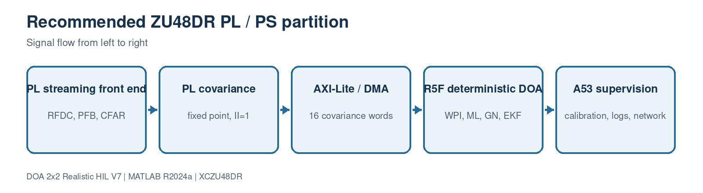

This block contains 3 implementation source file(s). Use the file links below to jump directly to the code explanation.

- [`docs/generate_block_diagrams.py`](#file-docs-generate-block-diagrams-py)
- [`docs/generate_block_pages.py`](#file-docs-generate-block-pages-py)
- [`docs/generate_complete_file_code_guide.py`](#file-docs-generate-complete-file-code-guide-py)

<a id="file-docs-generate-block-diagrams-py"></a>

## File: `docs/generate_block_diagrams.py`

### Purpose

Recreates the twelve 1600x440 JPEG block diagrams.

### Where it runs

Documentation-generation host utility; not part of runtime processing.

### Editing guidance

Edit only with the interfaces, dimensions and conventions in the surrounding block preserved.

### Size

140 source lines.

### Functions, classes and build targets

| Line | Kind | Definition | What the function/definition does |
| ---: | --- | --- | --- |
| 99 | Python definition | `def font(path, size):` | Implements the `font` helper used by this file; inputs, outputs and operations are visible in the signature and source below. |
| 103 | Python definition | `def arrow(draw, x1, y1, x2, y2, color):` | Implements the `arrow` helper used by this file; inputs, outputs and operations are visible in the signature and source below. |
| 108 | Python definition | `def render(name, title, stages):` | Draws and saves one standardized JPEG block diagram. |
| 118 | Make target | `for index, (heading, detail) in enumerate(stages):` | Defines a command-line build target for synthesis/export or cleanup. |
| 130 | Make target | `if index < len(stages) - 1:` | Defines a command-line build target for synthesis/export or cleanup. |
| 137 | Make target | `for filename, (diagram_title, diagram_stages) in DIAGRAMS.items():` | Defines a command-line build target for synthesis/export or cleanup. |

### Important code lines explained

| Line | Source statement | Function of the line |
| ---: | --- | --- |
| 4 | `ROOT = Path(__file__).resolve().parent` | Assigns the left-hand variable/property from the expression on the right. |
| 5 | `OUT = ROOT / "diagrams"` | Assigns the left-hand variable/property from the expression on the right. |
| 6 | `OUT.mkdir(parents=True, exist_ok=True)` | Assigns the left-hand variable/property from the expression on the right. |
| 8 | `FONT = "/usr/share/fonts/opentype/urw-base35/NimbusSans-Regular.otf"` | Assigns the left-hand variable/property from the expression on the right. |
| 9 | `BOLD = "/usr/share/fonts/opentype/urw-base35/NimbusSans-Bold.otf"` | Assigns the left-hand variable/property from the expression on the right. |
| 11 | `DIAGRAMS = {` | Assigns the left-hand variable/property from the expression on the right. |
| 16 | `("DOA backend", "covariance, WPI, ML + GN"),` | Creates, conditions or consumes the four-channel spatial covariance matrix. |
| 22 | `("Direct steering", "actual element positions"),` | Computes an array direction/steering quantity using the calibrated geometry. |
| 47 | `"06-calibration-covariance": ("Streaming calibration and covariance", [` | Creates, conditions or consumes the four-channel spatial covariance matrix. |
| 51 | `("4 powers + 6 pairs", "Hermitian covariance"),` | Creates, conditions or consumes the four-channel spatial covariance matrix. |
| 87 | `("Exact + DOA compare", "integer match and <=0.1 deg"),` | Assigns the left-hand variable/property from the expression on the right. |
| 91 | `("PL covariance", "fixed point, II=1"),` | Creates, conditions or consumes the four-channel spatial covariance matrix. |
| 92 | `("AXI-Lite / DMA", "16 covariance words"),` | Creates, conditions or consumes the four-channel spatial covariance matrix. |
| 99 | `def font(path, size):` | Executes this control, function-call or interface statement in source order. |
| 103 | `def arrow(draw, x1, y1, x2, y2, color):` | Executes this control, function-call or interface statement in source order. |
| 108 | `def render(name, title, stages):` | Executes this control, function-call or interface statement in source order. |
| 121 | `draw.rounded_rectangle((x1, y1, x2, y2), radius=18, fill=pale, outline=blue, width=4)` | Assigns the left-hand variable/property from the expression on the right. |

### Complete source code

<details>
<summary>Open the complete docs/generate_block_diagrams.py source</summary>

```python
from pathlib import Path
from PIL import Image, ImageDraw, ImageFont

ROOT = Path(__file__).resolve().parent
OUT = ROOT / "diagrams"
OUT.mkdir(parents=True, exist_ok=True)

FONT = "/usr/share/fonts/opentype/urw-base35/NimbusSans-Regular.otf"
BOLD = "/usr/share/fonts/opentype/urw-base35/NimbusSans-Bold.otf"

DIAGRAMS = {
    "01-overall-system": ("Complete calibrated 2x2 DOA homing chain", [
        ("RF source + paths", "waveform, loss, multipath"),
        ("2x2 array + RF ADC", "coupling, MTS, AGC, 14 bit"),
        ("PFB + detector", "1024 bins, CFAR, candidate"),
        ("DOA backend", "covariance, WPI, ML + GN"),
        ("EKF + homing", "navigation frame, guidance"),
    ]),
    "02-source-propagation": ("RF source and propagation model", [
        ("QAM/LFM/CW source", "complex baseband frame"),
        ("Free-space loss", "range and wavelength"),
        ("Direct steering", "actual element positions"),
        ("Reflected paths", "delay, gain, phase, angle"),
        ("Ideal antenna IQ", "8192 x 4 complex"),
    ]),
    "03-realistic-receiver": ("Realistic four-channel receiver and ADC", [
        ("Mutual coupling", "4 x 4 voltage matrix"),
        ("RF channel skew", "gain, phase, time, drift"),
        ("Noise + phase noise", "thermal and differential"),
        ("Common AGC", "preserves relative phase"),
        ("14-bit ADC", "clip and quantize"),
    ]),
    "04-rfdc-mts-interface": ("ZU48DR RFDC and deterministic stream interface", [
        ("Four RF inputs", "matched cables and LNAs"),
        ("RFDC + fine DDC", "2.048 GSPS, decimate 4"),
        ("MTS / SYSREF", "deterministic tile latency"),
        ("AXI gearbox", "4 samples per clock"),
        ("512-bit AXI stream", "128 MHz PL clock"),
    ]),
    "05-search-detection": ("Wideband search and source selection", [
        ("Polyphase FIR", "12 taps per band"),
        ("1024-point FFT", "2 MHz bin spacing"),
        ("Power + noise floor", "four-channel sum"),
        ("CA-CFAR", "training and guard cells"),
        ("Cluster + candidate", "center, BW, SNR gate"),
    ]),
    "06-calibration-covariance": ("Streaming calibration and covariance", [
        ("Q2.14 coefficients", "four complex corrections"),
        ("Calibrate 4 channels", "constant complex multiply"),
        ("4096 snapshots", "no sample-frame RAM"),
        ("4 powers + 6 pairs", "Hermitian covariance"),
        ("16 x int64 output", "AXI packet to PS"),
    ]),
    "07-weighted-phase": ("Six-baseline weighted phase interferometry", [
        ("Six cross phases", "angle of Rji"),
        ("Coherence weights", "gamma2 / (1-gamma2)"),
        ("2 x 2 normal matrix", "Y/Z baseline geometry"),
        ("Direction cosines", "solve uy and uz"),
        ("Azimuth/elevation seed", "known forward hemisphere"),
    ]),
    "08-ml-gn-refinement": ("Bounded local ML and Gauss-Newton polish", [
        ("WPI seed", "continuous initial angle"),
        ("36 ML candidates", "4 stages x 3 x 3"),
        ("Power iteration", "rank-one signal projector"),
        ("Two GN updates", "bounded 0.05 degree step"),
        ("Raw refined DOA", "off-grid measurement"),
    ]),
    "09-attitude-ekf": ("Full-attitude navigation-frame unit-vector EKF", [
        ("Body-frame DOA", "array measurement"),
        ("ZYX DCM", "yaw, pitch, roll"),
        ("6-state EKF", "LOS vector + rate"),
        ("Unit-sphere projection", "normalize and tangent rate"),
        ("Body-frame output", "inverse DCM for guidance"),
    ]),
    "10-platform-guidance": ("Detection-gated 3D homing guidance", [
        ("Valid candidate", "CFAR/SNR gate"),
        ("Filtered bearing", "wrapped azimuth innovation"),
        ("Rate-limited command", "yaw and pitch limits"),
        ("3D kinematics", "position and attitude"),
        ("Arrival decision", "true 1 x 3 range"),
    ]),
    "11-hil-flow": ("ZCU48DR hardware-in-the-loop verification", [
        ("MATLAB stimulus", "realistic IQ + int16 ADC pack"),
        ("AXI512 replay", "4 channels x 4 samples"),
        ("Covariance HLS IP", "calibrate and accumulate"),
        ("Board capture", "16 signed int64 values"),
        ("Exact + DOA compare", "integer match and <=0.1 deg"),
    ]),
    "12-pl-ps-partition": ("Recommended ZU48DR PL / PS partition", [
        ("PL streaming front end", "RFDC, PFB, CFAR"),
        ("PL covariance", "fixed point, II=1"),
        ("AXI-Lite / DMA", "16 covariance words"),
        ("R5F deterministic DOA", "WPI, ML, GN, EKF"),
        ("A53 supervision", "calibration, logs, network"),
    ]),
}


def font(path, size):
    return ImageFont.truetype(path, size)


def arrow(draw, x1, y1, x2, y2, color):
    draw.line((x1, y1, x2, y2), fill=color, width=5)
    draw.polygon([(x2, y2), (x2 - 15, y2 - 10), (x2 - 15, y2 + 10)], fill=color)


def render(name, title, stages):
    width, height = 1600, 440
    image = Image.new("RGB", (width, height), "white")
    draw = ImageDraw.Draw(image)
    navy, blue, pale, gray = "#17324D", "#246B9E", "#EAF3F8", "#52606D"
    draw.text((60, 35), title, font=font(BOLD, 38), fill=navy)
    draw.text((60, 88), "Signal flow from left to right", font=font(FONT, 23), fill=gray)
    margin, gap = 60, 28
    box_width = (width - 2 * margin - gap * (len(stages) - 1)) // len(stages)
    y1, y2 = 150, 350
    for index, (heading, detail) in enumerate(stages):
        x1 = margin + index * (box_width + gap)
        x2 = x1 + box_width
        draw.rounded_rectangle((x1, y1, x2, y2), radius=18, fill=pale, outline=blue, width=4)
        heading_box = draw.textbbox((0, 0), heading, font=font(BOLD, 25))
        heading_width = heading_box[2] - heading_box[0]
        draw.text((x1 + (box_width - heading_width) / 2, y1 + 42), heading,
                  font=font(BOLD, 25), fill=navy)
        detail_box = draw.multiline_textbbox((0, 0), detail, font=font(FONT, 21), align="center")
        detail_width = detail_box[2] - detail_box[0]
        draw.multiline_text((x1 + (box_width - detail_width) / 2, y1 + 105), detail,
                            font=font(FONT, 21), fill=gray, align="center", spacing=4)
        if index < len(stages) - 1:
            arrow(draw, x2 + 4, (y1 + y2) // 2, x2 + gap - 4, (y1 + y2) // 2, blue)
    draw.text((60, 395), "DOA 2x2 Realistic HIL V7 | MATLAB R2024a | XCZU48DR",
              font=font(FONT, 19), fill=gray)
    image.save(OUT / f"{name}.jpg", quality=94, subsampling=0)


for filename, (diagram_title, diagram_stages) in DIAGRAMS.items():
    render(filename, diagram_title, diagram_stages)

print(f"Generated {len(DIAGRAMS)} diagrams in {OUT}")
```

</details>

[Back to the document index](#document-header-index)

<a id="file-docs-generate-block-pages-py"></a>

## File: `docs/generate_block_pages.py`

### Purpose

Recreates the master guide and twelve individual block pages.

### Where it runs

Documentation-generation host utility; not part of runtime processing.

### Editing guidance

Edit only with the interfaces, dimensions and conventions in the surrounding block preserved.

### Size

222 source lines.

### Functions, classes and build targets

| Line | Kind | Definition | What the function/definition does |
| ---: | --- | --- | --- |
| 108 | Python definition | `def page(block, index):` | Builds one block-level Markdown page from its structured metadata. |
| 112 | Make target | `if previous_link:` | Defines a command-line build target for synthesis/export or cleanup. |
| 114 | Make target | `if next_link:` | Defines a command-line build target for synthesis/export or cleanup. |
| 139 | Make target | `for index, block in enumerate(blocks):` | Defines a command-line build target for synthesis/export or cleanup. |
| 143 | Make target | `for index, block in enumerate(blocks, 1):` | Defines a command-line build target for synthesis/export or cleanup. |
| 180 | Make target | `Select the profile in \`sim3d_params.m\`:` | Defines a command-line build target for synthesis/export or cleanup. |

### Important code lines explained

| Line | Source statement | Function of the line |
| ---: | --- | --- |
| 3 | `ROOT = Path(__file__).resolve().parent.parent` | Assigns the left-hand variable/property from the expression on the right. |
| 4 | `DOCS = ROOT / "docs"` | Assigns the left-hand variable/property from the expression on the right. |
| 5 | `BLOCKS = DOCS / "blocks"` | Assigns the left-hand variable/property from the expression on the right. |
| 6 | `BLOCKS.mkdir(parents=True, exist_ok=True)` | Assigns the left-hand variable/property from the expression on the right. |
| 8 | `blocks = [` | Assigns the left-hand variable/property from the expression on the right. |
| 9 | `dict(slug="01-overall-architecture", title="Overall system architecture",` | Assigns the left-hand variable/property from the expression on the right. |
| 10 | `image="01-overall-system.jpg", sources=["sim3d_params.m", "run_3d_doa_sim.m", "build_3d_doa_simulink.m"],` | Assigns the left-hand variable/property from the expression on the right. |
| 11 | `intro="This page connects the signal-generation, receiver, search, estimation, tracking, navigation, and verification paths. The behavioral simulat...` | Creates, conditions or consumes the four-channel spatial covariance matrix. |
| 14 | `algorithm=["Generate a direct and reflected RF field at the actual antenna locations.", "Apply coupling, receiver skew, noise, AGC and ADC quantiza...` | Creates, conditions or consumes the four-channel spatial covariance matrix. |
| 15 | `code=[("run('sim3d_params.m');", "Loads one authoritative parameter structure."), ("idealIQ=source(position,yaw,pitch,roll);", "Creates the physica...` | Loads the single authoritative project parameter structure P. |
| 22 | `algorithm=["Normalize position vectors to prevent implicit expansion.", "Compute the world unit line-of-sight vector.", "Use the full ZYX DCM to ob...` | Computes an array direction/steering quantity using the calibrated geometry. |
| 23 | `code=[("delta=sourcePosition-platformPosition;", "Forms the physical displacement as a 1x3 vector."), ("worldDirection=delta(:)/range;", "Separates...` | Computes an array direction/steering quantity using the calibrated geometry. |
| 24 | `example="At 4 GHz the wavelength is 74.948 mm. A 25 mm baseline produces about 120.1 degrees of phase for direction cosine 1, while the 35.355 mm d...` | Computes an array direction/steering quantity using the calibrated geometry. |
| 27 | `intro="This block models effects that an ideal steering-vector simulation omits: mutual coupling, gain/phase mismatch, RF time skew, temperature-li...` | Computes an array direction/steering quantity using the calibrated geometry. |
| 31 | `code=[("output=input*obj.CouplingMatrix.';", "Applies voltage-domain coupling before receiver channels."), ("timeSkewPhase_deg=-360*fc*timeSkew;", ...` | Assigns the left-hand variable/property from the expression on the right. |
| 32 | `example="A residual 0.02 degree channel-phase error on a 25 mm baseline maps to roughly 0.01 degree of direction error near boresight. FIELD_STRESS...` | Computes an array direction/steering quantity using the calibrated geometry. |
| 34 | `sources=["rfsoc_buildkit_overlay/README.md", "rfsoc_buildkit_overlay/ip/custom/doa_covariance_4ch_v4/README.md"],` | Creates, conditions or consumes the four-channel spatial covariance matrix. |
| 39 | `code=[("word = lane*4 + channel", "Defines the stable AXI packing order."), ("real -> bits 15:0", "Stores signed ADC I data."), ("imag -> bits 31:1...` | Creates, conditions or consumes the four-channel spatial covariance matrix. |
| 47 | `code=[("NumBands=1024", "Produces 2 MHz bins at 2.048 GSPS."), ("powerSum=sum(abs(subbands).^2,channel);", "Combines evidence without destroying th...` | Computes an array direction/steering quantity using the calibrated geometry. |
| 108 | `def page(block, index):` | Executes this control, function-call or interface statement in source order. |

### Complete source code

<details>
<summary>Open the complete docs/generate_block_pages.py source</summary>

```python
from pathlib import Path

ROOT = Path(__file__).resolve().parent.parent
DOCS = ROOT / "docs"
BLOCKS = DOCS / "blocks"
BLOCKS.mkdir(parents=True, exist_ok=True)

blocks = [
    dict(slug="01-overall-architecture", title="Overall system architecture",
         image="01-overall-system.jpg", sources=["sim3d_params.m", "run_3d_doa_sim.m", "build_3d_doa_simulink.m"],
         intro="This page connects the signal-generation, receiver, search, estimation, tracking, navigation, and verification paths. The behavioral simulation and the RFSoC implementation use the same geometry, calibration convention, covariance orientation, and frame rate.",
         inputs=[("Mission configuration", "Source, platform, array and accuracy limits"), ("Four RF channels", "Coherent signals from the physical square array")],
         outputs=[("Body-frame DOA", "Azimuth/elevation for guidance"), ("Verification records", "RMSE, HIL and implementation evidence")],
         algorithm=["Generate a direct and reflected RF field at the actual antenna locations.", "Apply coupling, receiver skew, noise, AGC and ADC quantization.", "Search the wideband spectrum and gate one candidate.", "Accumulate calibrated covariance and estimate a refined direction.", "Track the line of sight in the navigation frame and steer only on a valid candidate."],
         code=[("run('sim3d_params.m');", "Loads one authoritative parameter structure."), ("idealIQ=source(position,yaw,pitch,roll);", "Creates the physical antenna voltages before receiver electronics."), ("iq4=receiver(idealIQ);", "Applies the realistic RF and ADC model."), ("snapshots=snapshotSelector(iq4);", "Selects 4096 spatial observations."), ("doaEstimator(snapshots,yaw,pitch,roll)", "Runs calibration, WPI, ML, GN and navigation-frame EKF."), ("platform(azimuth,elevation,valid,sourcePosition)", "Updates vehicle state only when detection is valid.")],
         example="At the default start, the source displacement is [500, 300, 150] m and the true range is 602.0797 m. A valid estimate commands yaw and pitch toward that line of sight; arrival is asserted at 10 m."),
    dict(slug="02-source-propagation", title="RF source and propagation", image="02-source-propagation.jpg",
         sources=["SourceModel3D.m", "source_modulation_profile.m", "body_to_navigation_dcm.m"],
         intro="The source block creates complex baseband RF frames, applies range loss, rotates the world line of sight into the array body frame, and adds configurable reflected paths. Receiver noise and ADC effects are intentionally delegated to the next block.",
         inputs=[("Platform pose", "1x3 position plus yaw, pitch and roll"), ("Waveform profile", "QAM, PSK, LFM, NLFM, CW and other modes")],
         outputs=[("IdealAntennaIQ", "8192x4 complex antenna voltages")],
         algorithm=["Normalize position vectors to prevent implicit expansion.", "Compute the world unit line-of-sight vector.", "Use the full ZYX DCM to obtain body-frame azimuth/elevation.", "Generate and normalize the selected waveform.", "Apply direct-path steering and delayed reflected-path steering."],
         code=[("delta=sourcePosition-platformPosition;", "Forms the physical displacement as a 1x3 vector."), ("worldDirection=delta(:)/range;", "Separates range from direction."), ("bodyDirection=body_to_navigation_dcm(...).'*worldDirection;", "Includes combined yaw, pitch and roll."), ("signal=obj.generateSignal(N)*sqrt(receivedPower_W);", "Scales the normalized waveform by propagation power."), ("tau=obj.AntennaPositions(channel,:)*pathDirection/obj.c;", "Computes geometric delay for each actual antenna location."), ("X4(:,channel)=X4(:,channel)+pathScale*delayed*exp(...);", "Adds a coherent reflected path with its own delay and direction.")],
         example="At 4 GHz the wavelength is 74.948 mm. A 25 mm baseline produces about 120.1 degrees of phase for direction cosine 1, while the 35.355 mm diagonal remains below half a wavelength."),
    dict(slug="03-realistic-receiver", title="Realistic four-channel receiver", image="03-realistic-receiver.jpg",
         sources=["RealisticReceiver4.m", "realism_profile.m", "simulate_realistic_snapshots.m", "estimate_multifrequency_calibration.m", "verify_multifrequency_calibration.m"],
         intro="This block models effects that an ideal steering-vector simulation omits: mutual coupling, gain/phase mismatch, RF time skew, temperature-like drift, common and differential phase noise, thermal noise, AGC, DC offset, clipping and finite ADC resolution.",
         inputs=[("IdealAntennaIQ", "Four coherent complex antenna voltages"), ("Realism profile", "IDEAL, CALIBRATED_LOS or FIELD_STRESS")],
         outputs=[("ADC_IQ", "Clipped and quantized four-channel samples")],
         algorithm=["Mix channels through an actual 4x4 coupling matrix.", "Apply per-channel complex transfer including time-skew phase.", "Add input-referred thermal noise and stochastic phase noise.", "Use one common AGC factor so inter-channel ratios are preserved.", "Clip and round real and imaginary components to the ADC word length."],
         code=[("output=input*obj.CouplingMatrix.';", "Applies voltage-domain coupling before receiver channels."), ("timeSkewPhase_deg=-360*fc*timeSkew;", "Converts picosecond skew into RF phase."), ("output=output.*transfer;", "Applies channel gain, phase and drift."), ("noisePower=k*T*Fs*10^(NF/10);", "Uses the complex sampling bandwidth for thermal noise."), ("output=output*min(requestedGain,maximumGain);", "Applies common, bounded AGC."), ("round(realPart*scale)/scale", "Models deterministic ADC quantization after clipping."), ("polyfit(frequencyOffset,unwrappedPhase,1)", "Estimates picosecond relative time skew from calibration-tone phase slope.")],
         example="A residual 0.02 degree channel-phase error on a 25 mm baseline maps to roughly 0.01 degree of direction error near boresight. FIELD_STRESS intentionally uses larger drift and multipath and is not forced to pass 0.1 degree. On hardware, a five-frequency boresight capture drives estimate_multifrequency_calibration; its packed Q2.14 values program the PL registers and its fit residual tests calibration quality."),
    dict(slug="04-rfdc-mts-interface", title="RFDC, MTS and AXI interface", image="04-rfdc-mts-interface.jpg",
         sources=["rfsoc_buildkit_overlay/README.md", "rfsoc_buildkit_overlay/ip/custom/doa_covariance_4ch_v4/README.md"],
         intro="The hardware interface starts from a verified ZCU208 RFDC shell. Multi-tile synchronization establishes deterministic latency, a fine DDC converts the selected RF band to complex IQ, and the RFDC gearbox supplies four samples per PL clock.",
         inputs=[("Four RF ADC channels", "Matched analog paths"), ("SYSREF and sample clocks", "Common deterministic timing reference")],
         outputs=[("AXI512 stream", "4 lanes x 4 channels x complex int16")],
         algorithm=["Run RFDC tile startup and MTS at every boot.", "Configure identical mixer, NCO, decimation and Nyquist settings.", "Verify tile latency and channel phase with a calibration tone.", "Pack four complex samples for every channel into each 512-bit beat.", "Cross clock domains only through explicit AXI FIFOs.", "Trigger a bounded 4096-sample DOA capture without stalling the continuous RFDC/PFB search stream."],
         code=[("word = lane*4 + channel", "Defines the stable AXI packing order."), ("real -> bits 15:0", "Stores signed ADC I data."), ("imag -> bits 31:16", "Stores signed ADC Q data."), ("4 samples/clock", "Converts a 512 MSPS post-DDC stream to 128 MHz."), ("frameSamples=4096", "Defines one covariance observation interval."), ("MTS before calibration", "Prevents boot-dependent phase offsets from invalidating coefficients."), ("candidate -> capture gate", "Sends only a requested snapshot burst to the frame covariance core.")],
         example="With 2.048 GSPS and RFDC decimation by four, each complex channel is 512 MSPS. Four samples per clock require a 128 MHz PL clock, rather than an impossible 2.048 GHz scalar clock."),
    dict(slug="05-search-detection", title="PFB search, CFAR and candidate selection", image="05-search-detection.jpg",
         sources=["PFBFFTChannelizer4.m", "SpectrumEstimator4.m", "NoiseFloorEstimator1D.m", "CACFAR1D.m", "BinClusterEstimator.m", "CandidateSelector.m"],
         intro="The search branch discovers occupied spectrum, estimates a robust noise floor, applies CA-CFAR, joins adjacent bins, and selects a source matching bandwidth and SNR rules. Detection validity gates navigation but does not manufacture a DOA.",
         inputs=[("ADC_IQ", "Four coherent wideband sample streams")],
         outputs=[("CandidateValid", "Logical navigation gate"), ("Center/Bandwidth", "Selected source spectral properties")],
         algorithm=["Channelize every coherent input with identical coefficients.", "Sum four-channel bin powers and smooth in time.", "Estimate local/global noise using a sliding median.", "Apply training/guard-cell CA-CFAR thresholds.", "Cluster detections and select a bandwidth/SNR-qualified candidate."],
         code=[("NumBands=1024", "Produces 2 MHz bins at 2.048 GSPS."), ("powerSum=sum(abs(subbands).^2,channel);", "Combines evidence without destroying the DOA snapshots."), ("noise=median(localWindow);", "Rejects occupied-bin outliers."), ("alpha=Ntrain*(Pfa^(-1/Ntrain)-1);", "Forms the CA-CFAR scale factor."), ("MergeGapBins=1", "Joins nearly contiguous detections."), ("valid = bandwidth && snr", "Prevents unrelated emitters from steering the platform.")],
         example="A 30 MHz source occupies about 15 bins at 2 MHz spacing. The cluster center is power weighted, while the candidate rule checks the configured 0.5–40 MHz interval and minimum SNR."),
    dict(slug="06-calibration-covariance", title="Calibration and streaming covariance", image="06-calibration-covariance.jpg",
         sources=["rfsoc_buildkit_overlay/ip/custom/doa_covariance_4ch_v4/src/doa_covariance_4ch_v4.cpp", "hil_fixed_covariance_reference.m"],
         intro="This is the main PL DOA backend. It calibrates four complex int16 samples per channel per beat and accumulates the unique entries of a 4x4 Hermitian covariance without storing all 4096 samples.",
         inputs=[("AXI512 IQ", "Four time lanes for four channels"), ("cal0..cal3", "Complex Q2.14 corrections")],
         outputs=[("AXI64 packet", "4 powers, 6 real crosses, 6 imaginary crosses")],
         algorithm=["Unpack sixteen complex words from each AXI beat.", "Apply constant complex calibration with a 14-bit fractional shift.", "Accumulate four powers and six cross products with 64-bit headroom.", "Repeat for 1024 beats, equal to 4096 time samples.", "Emit exactly 16 signed 64-bit values with TLAST on the last word."],
         code=[("packed=input.data.range(32*word+31,32*word);", "Extracts one complex int16 sample."), ("yr=(realProduct>>14);", "Returns the calibrated result to the intended fixed-point scale."), ("power += real*real + imag*imag;", "Accumulates diagonal covariance."), ("crossImag += ys*xf - xs*yf;", "Matches R(second,first)=x_second*conj(x_first)."), ("#pragma HLS PIPELINE II=1", "Requests one four-lane beat every clock."), ("output.last=(index==15);", "Closes one covariance packet deterministically.")],
         example="4096 samples add 12 accumulator bits. A calibrated 20-bit component produces a 40-bit product, so signed 64-bit accumulators provide comfortable headroom."),
    dict(slug="07-weighted-phase", title="Weighted phase-interferometry seed", image="07-weighted-phase.jpg",
         sources=["DOAEstimator4Ch.m", "estimate_doa_from_covariance_v7.m"],
         intro="All six pair phases are used in a weighted two-parameter least-squares solve. The planar nose array observes Y and Z direction cosines; the known forward hemisphere supplies the positive X component.",
         inputs=[("Hermitian covariance", "Calibrated 4x4 complex matrix"), ("Calibrated positions", "Measured element coordinates")],
         outputs=[("Continuous seed", "Off-grid azimuth and elevation")],
         algorithm=["Read phase and coherence for every unique antenna pair.", "Build a six-row Y/Z baseline matrix.", "Convert coherence into bounded inverse-variance-like weights.", "Solve the weighted 2x2 normal equation.", "Enforce the unit sphere and positive boresight component."],
         code=[("crossValue=covariance(second,first);", "Uses the same sign convention as the source and HLS core."), ("phase(pair)=angle(crossValue);", "Extracts geometric phase."), ("weight=coherence/(1-coherence);", "Downweights unreliable cross products."), ("normal=baseline'*(weight.*baseline);", "Forms the weighted geometry matrix."), ("directionYZ=-(normal\\rightSide)/waveNumber;", "Solves for uy and uz."), ("ux=sqrt(1-uy^2-uz^2);", "Applies the known forward-hemisphere constraint.")],
         example="For azimuth 30 degrees and elevation 15 degrees, [ux,uy,uz] is approximately [0.837, 0.483, 0.259]. The square array directly measures uy and uz and reconstructs positive ux."),
    dict(slug="08-ml-gn-refinement", title="Local ML and Gauss-Newton refinement", image="08-ml-gn-refinement.jpg",
         sources=["DOAEstimator4Ch.m", "estimate_doa_from_covariance_v7.m"],
         intro="The refinement is bounded and hardware predictable. A fixed 36-point rank-one likelihood search secures the local basin, then a fixed power iteration and two limited Gauss-Newton steps remove the remaining grid residue without a general eigendecomposition.",
         inputs=[("WPI seed", "Initial azimuth/elevation"), ("Covariance", "Calibrated spatial statistics")],
         outputs=[("Raw refined DOA", "Continuous measurement before tracking")],
         algorithm=["Evaluate a 3x3 neighborhood at four decreasing step sizes.", "Keep the highest Bartlett/rank-one ML score after each stage.", "Approximate the dominant signal vector with four power iterations.", "Build I-vvH as a rank-one noise projector.", "Run exactly two Gauss-Newton updates, each limited to 0.05 degree."],
         code=[("MLStepSchedule=[.5 .1 .02 .005]", "Provides coarse capture and fine resolution."), ("score=real(a'*R*a)/4;", "Scores a single-source steering candidate."), ("signalVector=R*signalVector;", "One deterministic power-iteration step."), ("noiseProjector=eye(4)-v*v';", "Avoids a full 4x4 eigensolver."), ("gradient=2*real(D'*(Pn*a));", "Computes the local MUSIC derivative."), ("step=min(step,0.05 deg)", "Prevents noisy covariance from causing a large jump.")],
         example="The fixed ML stages evaluate 36 candidates per frame. Two GN iterations add fixed work and can refine between the final 0.005 degree candidate positions."),
    dict(slug="09-attitude-ekf", title="Full-attitude navigation-frame EKF", image="09-attitude-ekf.jpg",
         sources=["body_to_navigation_dcm.m", "DOAEstimator4Ch.m", "verify_full_attitude_geometry.m", "verify_rotating_frame_ekf.m"],
         intro="The array measures direction in the rotating body frame. V7 converts that unit vector with a full yaw-pitch-roll DCM, tracks the world line of sight, projects the state back onto the unit sphere, and converts it back for guidance.",
         inputs=[("Raw body DOA", "Refined measurement"), ("Platform attitude", "Yaw, pitch and roll")],
         outputs=[("Tracked body DOA", "Smoothed bearing for control")],
         algorithm=["Convert azimuth/elevation to a body unit vector.", "Rotate it into navigation coordinates with the ZYX DCM.", "Predict a six-state unit-vector/rate model.", "Update with a 3-D vector measurement using a Joseph covariance form.", "Normalize LOS and remove radial rate, then rotate back to body coordinates."],
         code=[("rotation=body_to_navigation_dcm(yaw,pitch,roll);", "Constructs one orthonormal attitude transform."), ("measurement=rotation*bodyMeasurement;", "Prevents platform motion from appearing as target motion."), ("transition=[I dt*I;0 I];", "Uses a constant LOS-rate process model."), ("gain=P*H'/S;", "Computes the small fixed-size Kalman gain."), ("updated(1:3)=normalize(updated(1:3));", "Enforces the physical unit sphere."), ("bodyEstimate=rotation.'*navigationEstimate;", "Returns the tracked direction to the array frame.")],
         example="A fixed world source observed while yaw changes 38 degrees, pitch changes 16 degrees and roll oscillates 12 degrees should remain stationary inside the navigation-frame EKF."),
    dict(slug="10-platform-guidance", title="Platform guidance and arrival", image="10-platform-guidance.jpg",
         sources=["PlatformDynamics3D.m", "TruthErrorMonitor3D.m", "plot_homing_results.m"],
         intro="The controller uses detection-gated pure pursuit with wrapped azimuth filtering, bounded turn/climb rates and explicit 3-D kinematics. Truth monitoring uses the same full attitude convention but never feeds the estimator.",
         inputs=[("Tracked body DOA", "Azimuth/elevation"), ("DetectionValid", "Candidate gate"), ("Source position", "Used only for simulation arrival/truth")],
         outputs=[("Platform state", "Position, yaw, pitch, roll"), ("Range/Arrived", "Termination signals")],
         algorithm=["Normalize source and platform positions to 1x3.", "Stop immediately when true range is inside the arrival radius.", "Update bearing filters only for valid detections.", "Limit yaw and pitch rates before integrating attitude.", "Integrate the forward velocity vector and repeat the arrival test."],
         code=[("sourcePosition=reshape(sourcePosition,1,3);", "Prevents the previous 3x1/1x3 Simulink expansion bug."), ("arrived=range<=ArrivalRadius;", "Defines an unambiguous stop condition."), ("azInnovation=wrap180(measuredAz-filteredAz);", "Avoids discontinuity at +/-180 degrees."), ("yawRate=max(-limit,min(limit,command/Dt));", "Enforces platform dynamics."), ("velocity=[V*cos(p)*cos(y), ...];", "Constructs the 3-D forward velocity."), ("Position=Position+velocity*Dt;", "Advances one discrete simulation step.")],
         example="At 25 m/s and 0.1 s update time the vehicle advances 2.5 m per step. From the default 602 m range, a nearly direct intercept takes about 24 seconds."),
    dict(slug="11-hil-verification", title="Hardware-in-the-loop verification", image="11-hil-flow.jpg",
         sources=["generate_zcu48dr_hil_vectors.m", "hil_fixed_covariance_reference.m", "run_zcu48dr_hil.m", "HIL_ZU48DR_GUIDE.md"],
         intro="The HIL flow is deliberately separate from the behavioral simulation. MATLAB produces packed AXI input and a bit-accurate golden covariance; the board processes the same frame; MATLAB then requires an exact 16-word match before evaluating the captured DOA.",
         inputs=[("AXI512 stimulus", "1024 beats for 4096 samples"), ("Board capture CSV", "16 signed int64 outputs")],
         outputs=[("HIL report", "Exact integer match, relative error and angular error")],
         algorithm=["Generate a deterministic calibrated-LOS snapshot frame.", "Quantize ADC samples and Q2.14 calibration coefficients.", "Pack four samples per channel into each 512-bit AXI beat.", "Replay through the ZU48DR covariance IP and capture 16 output words.", "Compare exact integers, reconstruct covariance and calculate final DOA."],
         code=[("run_zcu48dr_hil('prepare')", "Creates stimulus, manifest and golden files."), ("word=lane*4+channel", "Matches the HLS unpacking convention."), ("golden=hil_fixed_covariance_reference(...)", "Models every calibration shift and accumulation."), ("run_zcu48dr_hil('compare','capture.csv')", "Loads actual board output."), ("exact=all(captured==golden);", "Makes arithmetic mismatches impossible to hide."), ("Pass=exact && angularError<=0.1", "Checks both digital equivalence and system meaning.")],
         example="Loopback mode verifies only the host parser. A real HIL pass requires a capture produced after programming the ZCU208 and replaying the supplied 1024 AXI beats."),
    dict(slug="12-pl-ps-partition", title="ZU48DR PL/PS implementation partition", image="12-pl-ps-partition.jpg",
         sources=["ACCURACY_AND_HDL_GUIDE.md", "rfsoc_buildkit_overlay/README.md", "rfsoc_buildkit_overlay/ip/custom/doa_covariance_4ch_v4"],
         intro="Continuous high-rate operations remain in programmable logic, while one small covariance packet per estimate moves to the real-time processor. This avoids a large general eigensolver in PL and makes timing and resource use auditable.",
         inputs=[("PL RF stream", "Four coherent channels"), ("Calibration registers", "Coefficients and measured manifold")],
         outputs=[("R5F DOA update", "10 Hz bearing and confidence"), ("A53 telemetry", "Logs, calibration and control")],
         algorithm=["Use RFDC hard blocks and PL for rate conversion and spectral search.", "Gate a selected 4096-sample burst into the II=1 fixed-point covariance core while the continuous search path remains independent.", "Transfer only 16 int64 values per DOA frame.", "Run WPI, fixed ML, bounded GN and EKF on R5F initially.", "Use A53 for supervision, storage and network functions, not hard real-time loops."],
         code=[("PL: 512-bit AXI at 128 MHz", "Carries the complete decimated four-channel stream."), ("PL: covariance packet", "Reduces 4096 samples to 128 bytes."), ("R5F: fixed loop counts", "Provides deterministic compute time."), ("A53: calibration manager", "Updates coefficients after MTS and temperature events."), ("Vivado timing report", "Is required before accepting the PL design."), ("HIL exact comparison", "Is required before accepting numerical equivalence.")],
         example="At ten DOA updates per second, covariance traffic to the processor is only about 1.28 kB/s. The high-rate burden remains in PL where parallel fixed-point arithmetic is appropriate."),
]


def page(block, index):
    previous_link = blocks[index - 1]["slug"] + ".md" if index > 0 else None
    next_link = blocks[index + 1]["slug"] + ".md" if index + 1 < len(blocks) else None
    nav = ["[Master guide](../../REALISTIC_DOA_ENGINEERING_GUIDE.md)"]
    if previous_link:
        nav.append(f"[Previous block]({previous_link})")
    if next_link:
        nav.append(f"[Next block]({next_link})")
    lines = [f"# {index + 1}. {block['title']}", "", " | ".join(nav), "",
             f"![{block['title']}](../diagrams/{block['image']})", "", block["intro"], "",
             "## On this page", "", "- [Inputs and outputs](#inputs-and-outputs)",
             "- [Algorithm](#algorithm)", "- [Code walkthrough](#code-walkthrough)",
             "- [Worked example](#worked-example)", "- [Implementation checks](#implementation-checks)", "",
             "## Source files", ""]
    lines += [f"- `{source}`" for source in block["sources"]]
    lines += ["", "## Inputs and outputs", "", "| Direction | Name | Meaning |", "| --- | --- | --- |"]
    lines += [f"| Input | {name} | {meaning} |" for name, meaning in block["inputs"]]
    lines += [f"| Output | {name} | {meaning} |" for name, meaning in block["outputs"]]
    lines += ["", "## Algorithm", ""]
    lines += [f"{i}. {step}" for i, step in enumerate(block["algorithm"], 1)]
    lines += ["", "## Code walkthrough", "", "The following follows the implementation statement by statement. Short fragments are used so every operation can be mapped back to the source file.", "",
              "| Code statement | What that line does |", "| --- | --- |"]
    lines += [f"| `{code}` | {meaning} |" for code, meaning in block["code"]]
    lines += ["", "## Worked example", "", block["example"], "", "## Implementation checks", "",
              "- Confirm dimensions and sign conventions against the preceding block.",
              "- Run the associated MATLAB regression before generating HDL or deploying software.",
              "- Treat resource, timing and accuracy as unverified until the generated reports or campaign outputs are saved.",
              "- Preserve the calibrated array coordinates and covariance orientation across MATLAB, HLS and processor code.", ""]
    return "\n".join(lines)


for index, block in enumerate(blocks):
    (BLOCKS / f"{block['slug']}.md").write_text(page(block, index), encoding="utf-8")

toc = []
for index, block in enumerate(blocks, 1):
    toc.append(f"| {index} | [{block['title']}](docs/blocks/{block['slug']}.md) | `{', '.join(block['sources'][:2])}` |")

master = f"""# Realistic 0.1-degree 2x2 DOA and ZU48DR engineering guide

This is the entry point for the V7 simulation, implementation partition and HIL verification. Every block below links to a dedicated page containing its JPEG block diagram, inputs/outputs, algorithm, statement-by-statement code explanation, numerical example and implementation checks.


## Clickable block index

| # | Block page | Principal source |
| ---: | --- | --- |
{chr(10).join(toc)}

## Header index

- [Accuracy definition](#accuracy-definition)
- [Realism profiles](#realism-profiles)
- [Recommended commands](#recommended-commands)
- [Hardware acceptance gates](#hardware-acceptance-gates)
- [Documentation map](#documentation-map)

## Accuracy definition

The qualified claim remains a 3-D great-circle RMSE no larger than 0.1 degree over 1000 independent estimates at per-channel SNR of at least 15 dB, 4096 coherent snapshots, azimuth -45 to +45 degrees, elevation -35 to +35 degrees, one dominant selected source and a calibrated forward-facing 25 mm planar square array.

V7 adds a separate realistic campaign. It does not redefine FIELD_STRESS failures as passes. Multipath, unstable differential phase, poor MTS, or incorrect manifold calibration can make 0.1 degree physically impossible even when the estimator code is correct.

## Realism profiles

| Profile | Purpose | Expected use |
| --- | --- | --- |
| `IDEAL` | Mathematical sign and geometry checks | Unit tests only |
| `CALIBRATED_LOS` | Small position error, calibrated coupling, residual drift, phase noise, ADC and weak multipath | Qualified accuracy and homing |
| `FIELD_STRESS` | Stronger multipath, coupling residual and thermal drift | Robustness characterization; pass is not forced |

Select the profile in `sim3d_params.m`:

```matlab
P.Realism.Profile = 'CALIBRATED_LOS';
```

## Recommended commands

```matlab
verify_r2024a_setup
run_accuracy_campaign('acceptance')
run_realistic_accuracy_campaign('acceptance')
run_3d_doa_sim
START_HERE

% Separate hardware-in-the-loop flow
run_zcu48dr_hil('prepare')
run_zcu48dr_hil('compare','capture.csv')
```

## Hardware acceptance gates

1. RFDC MTS reports deterministic tile alignment at every boot.
2. Calibration tone residual differential phase and gain meet the stated budget.
3. Vitis HLS C simulation matches `hil_fixed_covariance_reference.m` exactly.
4. HLS synthesis meets the requested II=1 and 128 MHz target.
5. Vivado implementation meets timing in the complete ZCU208 RFDC shell.
6. Board capture matches all 16 covariance integers exactly.
7. Captured covariance produces no more than 0.1 degree error for the supplied HIL frame.
8. A real far-field campaign replaces ideal coordinates with a measured array manifold.

## Documentation map

- [Complete file, function and source-code guide](COMPLETE_FILE_AND_CODE_GUIDE.md)
- [Separate ZU48DR HIL guide](HIL_ZU48DR_GUIDE.md)
- [Accuracy and HDL assumptions](ACCURACY_AND_HDL_GUIDE.md)
- [Generated Simulink model](SIMULINK_MODEL_GUIDE.md)
- [Source waveform parameters](SOURCE_WAVEFORM_PARAMETER_GUIDE.md)
- [V7 change log](CHANGELOG_V7.md)
- [Validation report and evidence boundary](PROJECT_VALIDATION_REPORT.md)
"""
(ROOT / "REALISTIC_DOA_ENGINEERING_GUIDE.md").write_text(master, encoding="utf-8")
print(f"Generated {len(blocks)} block pages and master guide")
```

</details>

[Back to the document index](#document-header-index)

<a id="file-docs-generate-complete-file-code-guide-py"></a>

## File: `docs/generate_complete_file_code_guide.py`

### Purpose

Recreates this complete file/function/source-code guide.

### Where it runs

Documentation-generation host utility; not part of runtime processing.

### Editing guidance

Edit only with the interfaces, dimensions and conventions in the surrounding block preserved.

### Size

444 source lines.

### Functions, classes and build targets

| Line | Kind | Definition | What the function/definition does |
| ---: | --- | --- | --- |
| 136 | Python definition | `def anchor(path):` | Converts a source path/title into a stable Markdown anchor identifier. |
| 140 | Python definition | `def first_comment(lines, suffix):` | Implements the `first_comment` helper used by this file; inputs, outputs and operations are visible in the signature and source below. |
| 142 | Make target | `for line in lines[:40]:` | Defines a command-line build target for synthesis/export or cleanup. |
| 144 | Make target | `if any(stripped.startswith(mark) for mark in marks):` | Defines a command-line build target for synthesis/export or cleanup. |
| 146 | Make target | `if value:` | Defines a command-line build target for synthesis/export or cleanup. |
| 151 | Python definition | `def definitions(lines, suffix):` | Extracts classes, functions, methods and build targets with their source line numbers. |
| 153 | Make target | `if suffix in (".cpp", ".hpp"):` | Defines a command-line build target for synthesis/export or cleanup. |
| 155 | Make target | `while index < len(lines):` | Defines a command-line build target for synthesis/export or cleanup. |
| 158 | Make target | `if "(" not in combined or combined.startswith(("#", "if ", "for ", "while ", "switch ", "return ")):` | Defines a command-line build target for synthesis/export or cleanup. |
| 162 | Make target | `while balance > 0 and index + 1 < len(lines) and index - start < 10:` | Defines a command-line build target for synthesis/export or cleanup. |
| 168 | Make target | `if match and match.group(1) not in {"if", "for", "while", "switch", "catch"}:` | Defines a command-line build target for synthesis/export or cleanup. |
| 172 | Make target | `for number, line in enumerate(lines, 1):` | Defines a command-line build target for synthesis/export or cleanup. |
| 175 | Make target | `if stripped.startswith("classdef "):` | Defines a command-line build target for synthesis/export or cleanup. |
| 177 | Make target | `elif stripped.startswith("function "):` | Defines a command-line build target for synthesis/export or cleanup. |
| 188 | Python definition | `def definition_role(kind, definition, relative):` | Implements the `definition_role` helper used by this file; inputs, outputs and operations are visible in the signature and source below. |
| 200 | Make target | `else:` | Defines a command-line build target for synthesis/export or cleanup. |
| 239 | Make target | `if name in roles:` | Defines a command-line build target for synthesis/export or cleanup. |
| 243 | Make target | `if name.startswith("verify_"):` | Defines a command-line build target for synthesis/export or cleanup. |
| 245 | Make target | `if name.startswith("build_"):` | Defines a command-line build target for synthesis/export or cleanup. |
| 247 | Make target | `if name.startswith("run_"):` | Defines a command-line build target for synthesis/export or cleanup. |
| 249 | Make target | `if name.startswith("get") or name.startswith("is"):` | Defines a command-line build target for synthesis/export or cleanup. |
| 254 | Python definition | `def explain_line(line):` | Implements the `explain_line` helper used by this file; inputs, outputs and operations are visible in the signature and source below. |
| 256 | Make target | `if s.startswith("classdef "):` | Defines a command-line build target for synthesis/export or cleanup. |
| 258 | Make target | `if s.startswith("function "):` | Defines a command-line build target for synthesis/export or cleanup. |
| 260 | Make target | `if s.startswith("properties"):` | Defines a command-line build target for synthesis/export or cleanup. |
| 262 | Make target | `if s.startswith("methods"):` | Defines a command-line build target for synthesis/export or cleanup. |
| 264 | Make target | `if "run('sim3d_params.m')" in s:` | Defines a command-line build target for synthesis/export or cleanup. |
| 266 | Make target | `if s.startswith("assert(") or s.startswith("validateattributes("):` | Defines a command-line build target for synthesis/export or cleanup. |
| 268 | Make target | `if s.startswith("for ") or s.startswith("for("):` | Defines a command-line build target for synthesis/export or cleanup. |
| 270 | Make target | `if s.startswith("if "):` | Defines a command-line build target for synthesis/export or cleanup. |
| 272 | Make target | `if s.startswith("switch ") or s.startswith("case "):` | Defines a command-line build target for synthesis/export or cleanup. |
| 274 | Make target | `if "covariance" in s.lower():` | Defines a command-line build target for synthesis/export or cleanup. |
| 276 | Make target | `if "steering" in s.lower() or "direction" in s.lower():` | Defines a command-line build target for synthesis/export or cleanup. |
| 278 | Make target | `if "#pragma HLS PIPELINE" in s:` | Defines a command-line build target for synthesis/export or cleanup. |
| 280 | Make target | `if "#pragma HLS UNROLL" in s:` | Defines a command-line build target for synthesis/export or cleanup. |
| 282 | Make target | `if s.startswith("#pragma HLS INTERFACE"):` | Defines a command-line build target for synthesis/export or cleanup. |
| 284 | Make target | `if s.startswith("add_line("):` | Defines a command-line build target for synthesis/export or cleanup. |
| 286 | Make target | `if "add_block(" in s or "addSystem(" in s:` | Defines a command-line build target for synthesis/export or cleanup. |
| 288 | Make target | `if s.startswith("set_part"):` | Defines a command-line build target for synthesis/export or cleanup. |
| 290 | Make target | `if s.startswith("create_clock"):` | Defines a command-line build target for synthesis/export or cleanup. |
| 292 | Make target | `if s.startswith("csim_design"):` | Defines a command-line build target for synthesis/export or cleanup. |
| 294 | Make target | `if s.startswith("csynth_design"):` | Defines a command-line build target for synthesis/export or cleanup. |
| 296 | Make target | `if s.startswith("export_design"):` | Defines a command-line build target for synthesis/export or cleanup. |
| 298 | Make target | `if "vitis_hls" in s:` | Defines a command-line build target for synthesis/export or cleanup. |
| 300 | Make target | `if s.startswith("error(") or s.startswith("warning("):` | Defines a command-line build target for synthesis/export or cleanup. |
| 302 | Make target | `if s.startswith("fprintf("):` | Defines a command-line build target for synthesis/export or cleanup. |
| 309 | Python definition | `def key_lines(lines):` | Selects representative interface, algorithm and configuration lines for explanation. |
| 317 | Make target | `for number, line in enumerate(lines, 1):` | Defines a command-line build target for synthesis/export or cleanup. |
| 319 | Make target | `if not stripped or stripped.startswith(("%", "//", "/*", "*")):` | Defines a command-line build target for synthesis/export or cleanup. |
| 321 | Make target | `if stripped.startswith(("classdef ", "function ", "extern \"C\"", "def ", "class ")):` | Defines a command-line build target for synthesis/export or cleanup. |
| 323 | Make target | `if any(token in stripped for token in tokens):` | Defines a command-line build target for synthesis/export or cleanup. |
| 330 | Make target | `for item in chosen:` | Defines a command-line build target for synthesis/export or cleanup. |
| 331 | Make target | `if item[0] not in seen:` | Defines a command-line build target for synthesis/export or cleanup. |
| 337 | Python definition | `def escape_table(value):` | Implements the `escape_table` helper used by this file; inputs, outputs and operations are visible in the signature and source below. |
| 343 | Make target | `for relative in all_files:` | Defines a command-line build target for synthesis/export or cleanup. |
| 358 | Make target | `for index, (title, _, _) in enumerate(BLOCKS, 1):` | Defines a command-line build target for synthesis/export or cleanup. |
| 376 | Make target | `for block_index, (title, _, paths) in enumerate(BLOCKS, 1):` | Defines a command-line build target for synthesis/export or cleanup. |
| 378 | Make target | `for path in paths:` | Defines a command-line build target for synthesis/export or cleanup. |
| 382 | Make target | `for block_index, (title, image, paths) in enumerate(BLOCKS, 1):` | Defines a command-line build target for synthesis/export or cleanup. |
| 389 | Make target | `for relative in paths:` | Defines a command-line build target for synthesis/export or cleanup. |
| 401 | Make target | `if "rfsoc_buildkit_overlay" in relative:` | Defines a command-line build target for synthesis/export or cleanup. |
| 403 | Make target | `elif relative.endswith(("ZU48DRChannelizer4.m", "build_rfsoc_hdl_frontend_model.m", "generate_rfsoc_hdl_frontend.m", "design_pfb_coefficients.m")):` | Defines a command-line build target for synthesis/export or cleanup. |
| 405 | Make target | `elif relative.startswith("docs/"):` | Defines a command-line build target for synthesis/export or cleanup. |
| 407 | Make target | `else:` | Defines a command-line build target for synthesis/export or cleanup. |
| 413 | Make target | `if defs:` | Defines a command-line build target for synthesis/export or cleanup. |
| 415 | Make target | `for number, kind, definition in defs:` | Defines a command-line build target for synthesis/export or cleanup. |
| 418 | Make target | `else:` | Defines a command-line build target for synthesis/export or cleanup. |
| 422 | Make target | `for number, statement in keys:` | Defines a command-line build target for synthesis/export or cleanup. |

### Important code lines explained

| Line | Source statement | Function of the line |
| ---: | --- | --- |
| 4 | `ROOT = Path(__file__).resolve().parent.parent` | Assigns the left-hand variable/property from the expression on the right. |
| 5 | `OUTPUT = ROOT / "COMPLETE_FILE_AND_CODE_GUIDE.md"` | Assigns the left-hand variable/property from the expression on the right. |
| 7 | `BLOCKS = [` | Assigns the left-hand variable/property from the expression on the right. |
| 26 | `"DOAEstimator4Ch.m", "estimate_doa_from_covariance_v7.m",` | Creates, conditions or consumes the four-channel spatial covariance matrix. |
| 31 | `"verify_r2024a_setup.m", "verify_doa_direction.m",` | Computes an array direction/steering quantity using the calibrated geometry. |
| 38 | `"generate_zcu48dr_hil_vectors.m", "hil_fixed_covariance_reference.m",` | Creates, conditions or consumes the four-channel spatial covariance matrix. |
| 43 | `("Four-sample-per-clock production HLS core", "06-calibration-covariance.jpg", [` | Creates, conditions or consumes the four-channel spatial covariance matrix. |
| 44 | `"rfsoc_buildkit_overlay/ip/custom/doa_covariance_4ch_v4/src/doa_covariance_4ch_v4.hpp",` | Creates, conditions or consumes the four-channel spatial covariance matrix. |
| 45 | `"rfsoc_buildkit_overlay/ip/custom/doa_covariance_4ch_v4/src/doa_covariance_4ch_v4.cpp",` | Creates, conditions or consumes the four-channel spatial covariance matrix. |
| 46 | `"rfsoc_buildkit_overlay/ip/custom/doa_covariance_4ch_v4/tb/doa_covariance_4ch_v4_tb.cpp",` | Creates, conditions or consumes the four-channel spatial covariance matrix. |
| 47 | `"rfsoc_buildkit_overlay/ip/custom/doa_covariance_4ch_v4/build_hls.tcl",` | Creates, conditions or consumes the four-channel spatial covariance matrix. |
| 48 | `"rfsoc_buildkit_overlay/ip/custom/doa_covariance_4ch_v4/Makefile"]),` | Creates, conditions or consumes the four-channel spatial covariance matrix. |
| 49 | `("Legacy scalar HLS compatibility reference", "06-calibration-covariance.jpg", [` | Creates, conditions or consumes the four-channel spatial covariance matrix. |
| 50 | `"rfsoc_buildkit_overlay/ip/custom/doa_covariance_4ch/src/doa_covariance_4ch.cpp",` | Creates, conditions or consumes the four-channel spatial covariance matrix. |
| 51 | `"rfsoc_buildkit_overlay/ip/custom/doa_covariance_4ch/build_hls.tcl",` | Creates, conditions or consumes the four-channel spatial covariance matrix. |
| 58 | `PURPOSES = {` | Assigns the left-hand variable/property from the expression on the right. |
| 124 | `EDIT_NOTES = {` | Assigns the left-hand variable/property from the expression on the right. |
| 125 | `"sim3d_params.m": "Edit this file first for mission and receiver settings. Keep the baseline <= lambda/2 assertion valid.",` | Assigns the left-hand variable/property from the expression on the right. |
| 133 | `LANGUAGE = {".m": "matlab", ".cpp": "cpp", ".hpp": "cpp", ".tcl": "tcl", ".py": "python"}` | Assigns the left-hand variable/property from the expression on the right. |
| 136 | `def anchor(path):` | Executes this control, function-call or interface statement in source order. |
| 140 | `def first_comment(lines, suffix):` | Executes this control, function-call or interface statement in source order. |
| 141 | `marks = ("%",) if suffix == ".m" else (("//", "/*") if suffix in (".cpp", ".hpp") else ("#",))` | Assigns the left-hand variable/property from the expression on the right. |
| 151 | `def definitions(lines, suffix):` | Executes this control, function-call or interface statement in source order. |
| 188 | `def definition_role(kind, definition, relative):` | Executes this control, function-call or interface statement in source order. |

### Complete source code

<details>
<summary>Open the complete docs/generate_complete_file_code_guide.py source</summary>

```python
from pathlib import Path
import re

ROOT = Path(__file__).resolve().parent.parent
OUTPUT = ROOT / "COMPLETE_FILE_AND_CODE_GUIDE.md"

BLOCKS = [
    ("Project entry, configuration and dashboards", "01-overall-system.jpg", [
        "sim3d_params.m", "START_HERE.m", "run_3d_doa_sim.m",
        "run_3d_doa_sim_compat.m", "run_simulink_homing.m",
        "build_3d_doa_simulink.m", "plot_simulink_results.m",
        "plot_homing_results.m", "doa_3d_gui.m", "doa_3d_gui_update.m"]),
    ("RF source, waveform and propagation", "02-source-propagation.jpg", [
        "SourceModel3D.m", "source_modulation_profile.m",
        "source_modulation_summary.m"]),
    ("Realistic receiver and calibration", "03-realistic-receiver.jpg", [
        "RealisticReceiver4.m", "realism_profile.m",
        "simulate_realistic_snapshots.m", "estimate_multifrequency_calibration.m"]),
    ("PFB search, CFAR and candidate selection", "05-search-detection.jpg", [
        "PFBFFTChannelizer4.m", "SpectrumEstimator4.m",
        "NoiseFloorEstimator1D.m", "CACFAR1D.m", "BinClusterEstimator.m",
        "CandidateSelector.m", "SignalMetricsMonitor.m", "SnapshotDecimator4.m",
        "SyntheticFourChannelSource.m", "doa_search_params.m",
        "run_search_chain_matlab.m", "build_doa_search_model.m"]),
    ("DOA seed and off-grid refinement", "08-ml-gn-refinement.jpg", [
        "DOAEstimator4Ch.m", "estimate_doa_from_covariance_v7.m",
        "body_to_navigation_dcm.m"]),
    ("Tracking, guidance and truth", "10-platform-guidance.jpg", [
        "PlatformDynamics3D.m", "TruthErrorMonitor3D.m"]),
    ("MATLAB verification and accuracy campaigns", "09-attitude-ekf.jpg", [
        "verify_r2024a_setup.m", "verify_doa_direction.m",
        "verify_hybrid_doa_2x2.m", "verify_rotating_frame_ekf.m",
        "verify_full_attitude_geometry.m", "verify_simulink_vector_shapes.m",
        "verify_source_waveforms.m", "verify_multifrequency_calibration.m",
        "run_accuracy_campaign.m", "run_realistic_accuracy_campaign.m",
        "run_fixed_point_input_parity.m"]),
    ("Separate ZCU48DR HIL flow", "11-hil-flow.jpg", [
        "generate_zcu48dr_hil_vectors.m", "hil_fixed_covariance_reference.m",
        "run_zcu48dr_hil.m"]),
    ("MATLAB HDL front-end reference", "04-rfdc-mts-interface.jpg", [
        "ZU48DRChannelizer4.m", "design_pfb_coefficients.m",
        "build_rfsoc_hdl_frontend_model.m", "generate_rfsoc_hdl_frontend.m"]),
    ("Four-sample-per-clock production HLS core", "06-calibration-covariance.jpg", [
        "rfsoc_buildkit_overlay/ip/custom/doa_covariance_4ch_v4/src/doa_covariance_4ch_v4.hpp",
        "rfsoc_buildkit_overlay/ip/custom/doa_covariance_4ch_v4/src/doa_covariance_4ch_v4.cpp",
        "rfsoc_buildkit_overlay/ip/custom/doa_covariance_4ch_v4/tb/doa_covariance_4ch_v4_tb.cpp",
        "rfsoc_buildkit_overlay/ip/custom/doa_covariance_4ch_v4/build_hls.tcl",
        "rfsoc_buildkit_overlay/ip/custom/doa_covariance_4ch_v4/Makefile"]),
    ("Legacy scalar HLS compatibility reference", "06-calibration-covariance.jpg", [
        "rfsoc_buildkit_overlay/ip/custom/doa_covariance_4ch/src/doa_covariance_4ch.cpp",
        "rfsoc_buildkit_overlay/ip/custom/doa_covariance_4ch/build_hls.tcl",
        "rfsoc_buildkit_overlay/ip/custom/doa_covariance_4ch/Makefile"]),
    ("Documentation generators", "12-pl-ps-partition.jpg", [
        "docs/generate_block_diagrams.py", "docs/generate_block_pages.py",
        "docs/generate_complete_file_code_guide.py"]),
]

PURPOSES = {
    "sim3d_params.m": "Creates the authoritative P structure for source, array, receiver, estimator, navigation, accuracy and simulation settings.",
    "START_HERE.m": "Runs verification, builds the executable Simulink model and launches the closed-loop simulation.",
    "run_3d_doa_sim.m": "Executes the complete MATLAB-only RF search, DOA, EKF and homing loop.",
    "run_3d_doa_sim_compat.m": "Small launcher used after restarting MATLAB when an older System object was cached.",
    "run_simulink_homing.m": "Builds, simulates and plots the generated Simulink model in one command.",
    "build_3d_doa_simulink.m": "Programmatically creates every Simulink block, property, connection, display and log.",
    "plot_simulink_results.m": "Reads SimulationOutput logs safely and creates the final accuracy and RF dashboards.",
    "plot_homing_results.m": "Creates the common nine-panel trajectory, range, DOA, signal and attitude dashboard.",
    "doa_3d_gui.m": "Creates the optional live MATLAB GUI used by the scripted homing simulation.",
    "doa_3d_gui_update.m": "Updates live GUI plots without rebuilding the window.",
    "SourceModel3D.m": "Generates waveform, path loss, full-attitude array steering and reflected propagation paths.",
    "source_modulation_profile.m": "Returns the complete parameter set for the selected waveform family.",
    "source_modulation_summary.m": "Formats the active waveform parameters for console and dashboard text.",
    "RealisticReceiver4.m": "Models coupling, receiver mismatch, skew, drift, noise, AGC, DC, clipping and ADC quantization.",
    "realism_profile.m": "Defines IDEAL, CALIBRATED_LOS and FIELD_STRESS physical/calibration assumptions.",
    "simulate_realistic_snapshots.m": "Creates controlled-SNR Monte-Carlo snapshots using the same physical impairment model.",
    "estimate_multifrequency_calibration.m": "Estimates relative gain, center phase and time skew and packs PL Q2.14 corrections.",
    "PFBFFTChannelizer4.m": "Behavioral four-channel polyphase FFT channelizer.",
    "SpectrumEstimator4.m": "Calculates smoothed per-bin and summed power plus the RF frequency axis.",
    "NoiseFloorEstimator1D.m": "Estimates robust local/global spectral noise using a sliding median.",
    "CACFAR1D.m": "Applies one-dimensional cell-averaging CFAR thresholds.",
    "BinClusterEstimator.m": "Merges detected bins and estimates cluster center, width and peak power.",
    "CandidateSelector.m": "Selects a source cluster using bandwidth and SNR rules.",
    "SignalMetricsMonitor.m": "Formats peak power, SNR, RF center and bandwidth for displays/logging.",
    "SnapshotDecimator4.m": "Selects the fixed 4096 coherent spatial snapshots used by DOA.",
    "SyntheticFourChannelSource.m": "Deterministic four-channel source for isolated search-chain testing.",
    "doa_search_params.m": "Compact parameter script for the standalone search-chain example.",
    "run_search_chain_matlab.m": "Runs the search/detection blocks without navigation.",
    "build_doa_search_model.m": "Builds a focused Simulink search-chain model.",
    "DOAEstimator4Ch.m": "Implements calibration, covariance, six-baseline WPI, bounded ML/GN and navigation-frame EKF.",
    "estimate_doa_from_covariance_v7.m": "Processor-side reference that estimates DOA directly from a captured PL covariance packet.",
    "body_to_navigation_dcm.m": "Returns the project ZYX yaw/pitch/roll body-to-navigation direction-cosine matrix.",
    "PlatformDynamics3D.m": "Implements detection-gated guidance, rate limits, 3-D kinematics, roll and arrival.",
    "TruthErrorMonitor3D.m": "Computes true body-frame direction and azimuth/elevation/great-circle errors.",
    "verify_r2024a_setup.m": "Runs the complete constructor, geometry, calibration, waveform and toolbox smoke suite.",
    "verify_doa_direction.m": "Checks estimator sign at positive and negative directions.",
    "verify_hybrid_doa_2x2.m": "Checks exact deterministic 2x2 geometry and calibration at representative angles.",
    "verify_rotating_frame_ekf.m": "Checks that platform rotation is not interpreted as source motion.",
    "verify_full_attitude_geometry.m": "Checks DCM orthogonality and yaw/pitch/roll truth consistency.",
    "verify_simulink_vector_shapes.m": "Prevents the earlier 3x1/1x3 implicit-expansion and circling bug.",
    "verify_source_waveforms.m": "Exercises all documented waveform modes and verifies finite four-channel IQ.",
    "verify_multifrequency_calibration.m": "Regression for gain, phase and picosecond time-skew estimation.",
    "run_accuracy_campaign.m": "Runs the controlled 1000-trial 0.1-degree baseline campaign.",
    "run_realistic_accuracy_campaign.m": "Runs the calibrated-LOS array/RF/ADC Monte-Carlo campaign.",
    "run_fixed_point_input_parity.m": "Measures DOA degradation caused by ADC input quantization.",
    "generate_zcu48dr_hil_vectors.m": "Writes packed AXI512 stimulus, calibration registers, manifest and golden covariance.",
    "hil_fixed_covariance_reference.m": "Bit-accurate MATLAB model of HLS calibration shifts and covariance accumulators.",
    "run_zcu48dr_hil.m": "Provides separate prepare, host-loopback and real board-capture comparison modes.",
    "ZU48DRChannelizer4.m": "Synthesizable four-channel DSP HDL channelizer wrapper.",
    "design_pfb_coefficients.m": "Creates one shared fixed-point prototype filter for coherent HDL paths.",
    "build_rfsoc_hdl_frontend_model.m": "Builds the MATLAB HDL reference front-end model for ZCU208.",
    "generate_rfsoc_hdl_frontend.m": "Launches HDL Coder for the reference channelizer subsystem.",
    "rfsoc_buildkit_overlay/ip/custom/doa_covariance_4ch_v4/src/doa_covariance_4ch_v4.hpp": "Declares AXI types and the production HLS top-level interface.",
    "rfsoc_buildkit_overlay/ip/custom/doa_covariance_4ch_v4/src/doa_covariance_4ch_v4.cpp": "Four-sample-per-clock calibration and covariance HLS implementation.",
    "rfsoc_buildkit_overlay/ip/custom/doa_covariance_4ch_v4/tb/doa_covariance_4ch_v4_tb.cpp": "Self-checking 4096-sample C testbench for all 16 outputs and TLAST.",
    "rfsoc_buildkit_overlay/ip/custom/doa_covariance_4ch_v4/build_hls.tcl": "Runs C simulation, synthesis and IP export for XCZU48DR at 128 MHz.",
    "rfsoc_buildkit_overlay/ip/custom/doa_covariance_4ch_v4/Makefile": "One-command Vitis HLS build entry point.",
    "rfsoc_buildkit_overlay/ip/custom/doa_covariance_4ch/src/doa_covariance_4ch.cpp": "Legacy one-sample/128-bit covariance reference; not the production-rate core.",
    "rfsoc_buildkit_overlay/ip/custom/doa_covariance_4ch/build_hls.tcl": "Legacy scalar-core HLS build script.",
    "rfsoc_buildkit_overlay/ip/custom/doa_covariance_4ch/Makefile": "Legacy scalar-core make wrapper.",
    "docs/generate_block_diagrams.py": "Recreates the twelve 1600x440 JPEG block diagrams.",
    "docs/generate_block_pages.py": "Recreates the master guide and twelve individual block pages.",
    "docs/generate_complete_file_code_guide.py": "Recreates this complete file/function/source-code guide.",
}

EDIT_NOTES = {
    "sim3d_params.m": "Edit this file first for mission and receiver settings. Keep the baseline <= lambda/2 assertion valid.",
    "realism_profile.m": "Change impairment budgets here; do not hide FIELD_STRESS failures by loosening the acceptance threshold.",
    "DOAEstimator4Ch.m": "Keep loop counts bounded for the processor/HDL implementation and preserve covariance sign convention.",
    "build_3d_doa_simulink.m": "Regenerate the SLX after changing System object ports or nontunable properties.",
    "rfsoc_buildkit_overlay/ip/custom/doa_covariance_4ch_v4/src/doa_covariance_4ch_v4.cpp": "Do not change packing or conjugation without updating MATLAB HIL reference and capture software together.",
    "run_zcu48dr_hil.m": "Loopback is host-only; only compare mode with a board-produced CSV is HIL evidence.",
}

LANGUAGE = {".m": "matlab", ".cpp": "cpp", ".hpp": "cpp", ".tcl": "tcl", ".py": "python"}


def anchor(path):
    return "file-" + re.sub(r"[^a-z0-9]+", "-", path.lower()).strip("-")


def first_comment(lines, suffix):
    marks = ("%",) if suffix == ".m" else (("//", "/*") if suffix in (".cpp", ".hpp") else ("#",))
    for line in lines[:40]:
        stripped = line.strip()
        if any(stripped.startswith(mark) for mark in marks):
            value = stripped.lstrip("%/#* ").strip()
            if value:
                return value
    return "See the purpose and function map below."


def definitions(lines, suffix):
    found = []
    if suffix in (".cpp", ".hpp"):
        index = 0
        while index < len(lines):
            start = index
            combined = lines[index].strip()
            if "(" not in combined or combined.startswith(("#", "if ", "for ", "while ", "switch ", "return ")):
                index += 1
                continue
            balance = combined.count("(") - combined.count(")")
            while balance > 0 and index + 1 < len(lines) and index - start < 10:
                index += 1
                part = lines[index].strip()
                combined += " " + part
                balance += part.count("(") - part.count(")")
            match = re.match(r'^(?:extern\s+"C"\s+)?(?:static\s+)?[\w:<>,&* ]+\s+([A-Za-z_]\w*)\s*\(', combined)
            if match and match.group(1) not in {"if", "for", "while", "switch", "catch"}:
                found.append((start + 1, "C/C++ function", combined.rstrip(" {;")))
            index += 1
        return found
    for number, line in enumerate(lines, 1):
        stripped = line.strip()
        if suffix == ".m":
            if stripped.startswith("classdef "):
                found.append((number, "class", stripped))
            elif stripped.startswith("function "):
                found.append((number, "function/method", stripped))
        elif suffix == ".py" and stripped.startswith(("def ", "class ")):
            found.append((number, "Python definition", stripped))
        elif suffix == ".tcl" and stripped.startswith("proc "):
            found.append((number, "Tcl procedure", stripped))
        elif Path("x/" + stripped).name.endswith(":") and "=" not in stripped:
            found.append((number, "Make target", stripped))
    return found


def definition_role(kind, definition, relative):
    if kind == "class":
        return "Declares the System object/class that owns this block's configuration, state and execution methods."
    if kind == "Make target":
        return "Defines a command-line build target for synthesis/export or cleanup."
    match = re.search(r"function\s+(?:\[[^]]+\]\s*=\s*|[\w,]+\s*=\s*)?([A-Za-z]\w*)", definition)
    if not match and kind == "C/C++ function":
        candidates = re.findall(r"([A-Za-z_]\w*)\s*\(", definition)
        name = candidates[-1] if candidates else "function"
    elif not match and kind == "Python definition":
        py_match = re.search(r"(?:def|class)\s+([A-Za-z_]\w*)", definition)
        name = py_match.group(1) if py_match else "definition"
    else:
        name = match.group(1) if match else "function"
    roles = {
        "setupImpl": "Runs once when the System object locks; validates configuration and creates persistent processing resources.",
        "stepImpl": "Runs once per input frame and implements the block's main signal-processing algorithm.",
        "resetImpl": "Restores persistent algorithm/tracker/filter state to its initial condition.",
        "releaseImpl": "Releases locked child System objects and hardware/software resources.",
        "getOutputSizeImpl": "Declares fixed Simulink output dimensions for model compilation.",
        "getOutputDataTypeImpl": "Declares output numeric types for Simulink propagation.",
        "isOutputComplexImpl": "Declares whether each output is real or complex.",
        "isOutputFixedSizeImpl": "Declares that output dimensions remain fixed while running.",
        "getInputNamesImpl": "Assigns readable names to generated MATLAB System block input ports.",
        "getOutputNamesImpl": "Assigns readable names to generated MATLAB System block output ports.",
        "getIconImpl": "Builds the label shown on the generated Simulink block.",
        "weightedPhaseSeed": "Solves the six-baseline coherence-weighted phase equations for a continuous initial direction.",
        "localMLRefinement": "Evaluates the fixed 36-candidate local likelihood schedule around the WPI seed.",
        "gaussNewtonPolish": "Applies the fixed power iteration and bounded Gauss-Newton off-grid correction.",
        "unitVectorEKF": "Transforms the measurement to navigation coordinates, updates the six-state EKF and returns body DOA.",
        "steeringVector": "Calculates the calibrated four-element complex steering vector for a candidate direction.",
        "musicDOA": "Runs the optional legacy full-grid MUSIC estimator.",
        "mvdrDOA": "Runs the optional legacy full-grid MVDR estimator.",
        "applyCalibration": "Applies inverse gain/phase correction and the calibrated coupling-decoupling matrix.",
        "initializeState": "Initializes platform position, attitude and navigation-filter state.",
        "wrap180": "Wraps an angle into the half-open -180 to +180 degree interval.",
        "body_to_navigation_dcm": "Creates the full ZYX body-to-navigation rotation matrix.",
        "readLoggedSeries": "Finds a named Simulink log and normalizes its time/data dimensions.",
        "covarianceFromValues": "Reconstructs the Hermitian 4x4 covariance from the 16-word HIL packet.",
        "steeringVector": "Calculates a four-channel steering vector from azimuth/elevation and calibrated positions.",
        "low16": "Extracts and sign-interprets the low 16-bit half-word.",
        "high16": "Extracts and sign-interprets the high 16-bit half-word.",
        "calibrate": "Applies one packed complex Q2.14 channel correction using fixed-point arithmetic.",
        "doa_covariance_4ch_v4": "Production HLS top: accepts AXI512 frames, calibrates four lanes/channels and emits covariance.",
        "main": "Runs the self-checking C testbench and returns nonzero if any covariance/TLAST comparison fails.",
        "render": "Draws and saves one standardized JPEG block diagram.",
        "page": "Builds one block-level Markdown page from its structured metadata.",
        "anchor": "Converts a source path/title into a stable Markdown anchor identifier.",
        "definitions": "Extracts classes, functions, methods and build targets with their source line numbers.",
        "key_lines": "Selects representative interface, algorithm and configuration lines for explanation.",
    }
    if name in roles:
        return roles[name]
    if relative.endswith(".m") and definition.lstrip().startswith("function ") and Path(relative).stem == name:
        return PURPOSES.get(relative, "Implements the file's public MATLAB entry point.")
    if name.startswith("verify_"):
        return "Runs the named regression and asserts its pass/fail tolerance."
    if name.startswith("build_"):
        return "Creates and wires the named generated model or build artifact."
    if name.startswith("run_"):
        return "Executes the named simulation, campaign or verification flow."
    if name.startswith("get") or name.startswith("is"):
        return "Provides metadata or a derived value used by the surrounding block."
    return f"Implements the `{name}` helper used by this file; inputs, outputs and operations are visible in the signature and source below."


def explain_line(line):
    s = line.strip()
    if s.startswith("classdef "):
        return "Declares the MATLAB class and its base type."
    if s.startswith("function "):
        return "Declares a callable function or System object method, including its inputs and outputs."
    if s.startswith("properties"):
        return "Begins a property group; nontunable values become fixed after System object setup."
    if s.startswith("methods"):
        return "Begins a method group; protected methods define System object execution behavior."
    if "run('sim3d_params.m')" in s:
        return "Loads the single authoritative project parameter structure P."
    if s.startswith("assert(") or s.startswith("validateattributes("):
        return "Rejects an invalid dimension, type, geometry or configuration before processing."
    if s.startswith("for ") or s.startswith("for("):
        return "Begins a bounded loop over samples, channels, candidates or trials."
    if s.startswith("if "):
        return "Applies the stated runtime condition without changing the defined interface."
    if s.startswith("switch ") or s.startswith("case "):
        return "Selects the requested algorithm, waveform, mode or profile."
    if "covariance" in s.lower():
        return "Creates, conditions or consumes the four-channel spatial covariance matrix."
    if "steering" in s.lower() or "direction" in s.lower():
        return "Computes an array direction/steering quantity using the calibrated geometry."
    if "#pragma HLS PIPELINE" in s:
        return "Requests a pipelined hardware loop; the target is one 512-bit beat per clock."
    if "#pragma HLS UNROLL" in s:
        return "Replicates this bounded loop in parallel hardware."
    if s.startswith("#pragma HLS INTERFACE"):
        return "Defines an AXI-Stream or AXI-Lite hardware port."
    if s.startswith("add_line("):
        return "Connects two generated Simulink block ports."
    if "add_block(" in s or "addSystem(" in s:
        return "Creates or configures a generated Simulink block."
    if s.startswith("set_part"):
        return "Targets the XCZU48DR device used by the ZCU208."
    if s.startswith("create_clock"):
        return "Sets the requested HLS clock period."
    if s.startswith("csim_design"):
        return "Runs the self-checking C simulation before synthesis."
    if s.startswith("csynth_design"):
        return "Synthesizes the C++ into an RTL architecture and reports timing/resources."
    if s.startswith("export_design"):
        return "Exports the synthesized RTL as an IP-catalog component."
    if "vitis_hls" in s:
        return "Invokes Vitis HLS with the supplied build script."
    if s.startswith("error(") or s.startswith("warning("):
        return "Reports a configuration, accuracy or runtime failure explicitly."
    if s.startswith("fprintf("):
        return "Prints a traceable status, metric or next command."
    if "=" in s:
        return "Assigns the left-hand variable/property from the expression on the right."
    return "Executes this control, function-call or interface statement in source order."


def key_lines(lines):
    declarations = []
    algorithm = []
    assignments = []
    tokens = ("run('sim3d_params.m')", "assert(", "covariance", "steering",
              "direction", "#pragma HLS", "add_line(", "add_block(", "set_part",
              "create_clock", "csim_design", "csynth_design", "export_design",
              "vitis_hls", "switch ", "case ", "polyfit(", "acosd(", "angle(")
    for number, line in enumerate(lines, 1):
        stripped = line.strip()
        if not stripped or stripped.startswith(("%", "//", "/*", "*")):
            continue
        if stripped.startswith(("classdef ", "function ", "extern \"C\"", "def ", "class ")):
            declarations.append((number, stripped))
        if any(token in stripped for token in tokens):
            algorithm.append((number, stripped))
        if "=" in stripped and not stripped.startswith(("if ", "while ", "#")):
            assignments.append((number, stripped))
    chosen = declarations[:8] + algorithm[:12] + assignments[:8]
    unique = []
    seen = set()
    for item in chosen:
        if item[0] not in seen:
            unique.append(item)
            seen.add(item[0])
    return sorted(unique, key=lambda item: item[0])[:24]


def escape_table(value):
    return value.replace("|", "\\|").replace("`", "\\`")


all_files = [path for _, _, paths in BLOCKS for path in paths]
assert len(all_files) == len(set(all_files)), "A source file appears in more than one block."
for relative in all_files:
    assert (ROOT / relative).is_file(), f"Missing source file: {relative}"

lines_out = [
    "# Complete V7 file, function and source-code guide",
    "",
    "This is the single-document code reference requested for the realistic 2x2 DOA and ZU48DR HIL project. It starts with the overall project diagram, then provides a clickable block/file index. Every distributed implementation source appears once with its purpose, edit guidance, definitions, important-line explanation, and complete source code.",
    "",
    "",
    "",
    "## Document header index",
    "",
    "- [How to use this guide](#how-to-use-this-guide)",
    "- [Clickable block and file index](#clickable-block-and-file-index)",
]
for index, (title, _, _) in enumerate(BLOCKS, 1):
    lines_out.append(f"- [Block {index}: {title}](#block-{index}-{anchor(title)[5:]})")

lines_out += [
    "",
    "## How to use this guide",
    "",
    "- Start with `sim3d_params.m`, then follow the blocks in numeric order.",
    "- The definition table identifies every class, MATLAB function/method, C++ function, Tcl procedure or Make target and its source line.",
    "- The important-line table explains the lines that determine interfaces, geometry, covariance sign, bounded loops, verification and hardware synthesis.",
    "- Expand **Complete source code** to inspect or copy the exact distributed file.",
    "- Line numbers refer to this V7 delivery. Regenerate this document after code edits with `python3 docs/generate_complete_file_code_guide.py`.",
    "- Behavioral source, GUI and vehicle dynamics are simulation code. Only explicitly identified HDL/HLS blocks are intended for PL synthesis.",
    "",
    "## Clickable block and file index",
    "",
]

for block_index, (title, _, paths) in enumerate(BLOCKS, 1):
    lines_out += [f"### Block {block_index}: {title}", ""]
    for path in paths:
        lines_out.append(f"- [`{path}`](#{anchor(path)})")
    lines_out.append("")

for block_index, (title, image, paths) in enumerate(BLOCKS, 1):
    block_anchor = f"block-{block_index}-{anchor(title)[5:]}"
    lines_out += [f'<a id="{block_anchor}"></a>', "", f"# Block {block_index}: {title}", "",
                  f"", "",
                  f"This block contains {len(paths)} implementation source file(s). Use the file links below to jump directly to the code explanation.", ""]
    lines_out += [f"- [`{path}`](#{anchor(path)})" for path in paths]
    lines_out.append("")
    for relative in paths:
        path = ROOT / relative
        text = path.read_text(encoding="utf-8", errors="replace")
        source_lines = text.splitlines()
        suffix = path.suffix.lower()
        language = LANGUAGE.get(suffix, "makefile" if path.name == "Makefile" else "text")
        purpose = PURPOSES.get(relative, first_comment(source_lines, suffix))
        defs = definitions(source_lines, suffix)
        keys = key_lines(source_lines)
        lines_out += [f'<a id="{anchor(relative)}"></a>', "", f"## File: `{relative}`", "",
                      "### Purpose", "", purpose, "",
                      "### Where it runs", ""]
        if "rfsoc_buildkit_overlay" in relative:
            location = "Vitis HLS / programmable-logic build flow."
        elif relative.endswith(("ZU48DRChannelizer4.m", "build_rfsoc_hdl_frontend_model.m", "generate_rfsoc_hdl_frontend.m", "design_pfb_coefficients.m")):
            location = "MATLAB/DSP HDL reference and HDL Coder flow."
        elif relative.startswith("docs/"):
            location = "Documentation-generation host utility; not part of runtime processing."
        else:
            location = "MATLAB R2024a behavioral, processor-reference or verification environment."
        lines_out += [location, "", "### Editing guidance", "",
                      EDIT_NOTES.get(relative, "Edit only with the interfaces, dimensions and conventions in the surrounding block preserved."), "",
                      f"### Size", "", f"{len(source_lines)} source lines.", "",
                      "### Functions, classes and build targets", ""]
        if defs:
            lines_out += ["| Line | Kind | Definition | What the function/definition does |", "| ---: | --- | --- | --- |"]
            for number, kind, definition in defs:
                role = definition_role(kind, definition, relative)
                lines_out.append(f"| {number} | {kind} | `{escape_table(definition)}` | {role} |")
        else:
            lines_out.append("This is an execution/configuration script and does not declare a separate function or class.")
        lines_out += ["", "### Important code lines explained", "",
                      "| Line | Source statement | Function of the line |", "| ---: | --- | --- |"]
        for number, statement in keys:
            shortened = statement if len(statement) <= 150 else statement[:147] + "..."
            lines_out.append(f"| {number} | `{escape_table(shortened)}` | {explain_line(statement)} |")
        lines_out += ["", "### Complete source code", "", "<details>",
                      f"<summary>Open the complete {relative} source</summary>", "", f"```{language}",
                      text.rstrip(), "```", "", "</details>", "", "[Back to the document index](#document-header-index)", ""]

lines_out += [
    "# Documentation-only files",
    "",
    "The following Markdown/JPEG artifacts do not execute, so their contents are not duplicated as source code here:",
    "",
    "- `REALISTIC_DOA_ENGINEERING_GUIDE.md`: illustrated block-level operating guide.",
    "- `HIL_ZU48DR_GUIDE.md`: board integration and capture procedure.",
    "- `PROJECT_VALIDATION_REPORT.md`: completed checks and evidence boundary.",
    "- `docs/blocks/*.md`: twelve focused block pages.",
    "- `docs/diagrams/*.jpg`: twelve block diagrams.",
    "- README, changelog and historical reference documents.",
    "",
]

OUTPUT.write_text("\n".join(lines_out), encoding="utf-8")
print(f"Generated {OUTPUT.name}: {len(all_files)} source files, {len(lines_out)} document records")
```

</details>

[Back to the document index](#document-header-index)

# Documentation-only files

The following Markdown/JPEG artifacts do not execute, so their contents are not duplicated as source code here:

- `REALISTIC_DOA_ENGINEERING_GUIDE.md`: illustrated block-level operating guide.
- `HIL_ZU48DR_GUIDE.md`: board integration and capture procedure.
- `PROJECT_VALIDATION_REPORT.md`: completed checks and evidence boundary.
- `docs/blocks/*.md`: twelve focused block pages.
- `docs/diagrams/*.jpg`: twelve block diagrams.
- README, changelog and historical reference documents.
