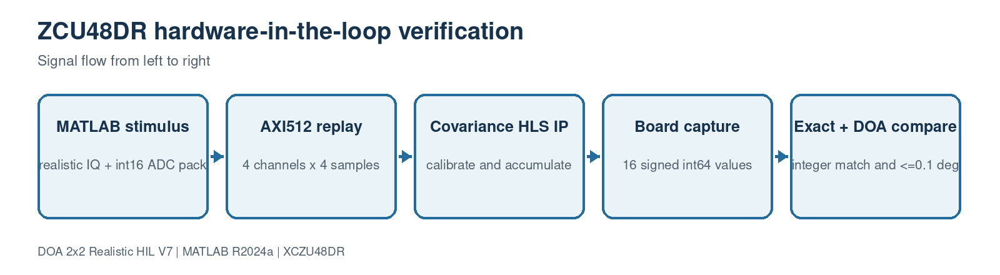

# ZCU48DR hardware-in-the-loop guide

[Back to the master engineering guide](REALISTIC_DOA_ENGINEERING_GUIDE.md)



## Header index

- [Purpose](#purpose)
- [Files](#files)
- [AXI input format](#axi-input-format)
- [Covariance output format](#covariance-output-format)
- [Calibration acquisition](#calibration-acquisition)
- [Step 1: generate vectors](#step-1-generate-vectors)
- [Step 2: build the HLS IP](#step-2-build-the-hls-ip)
- [Step 3: integrate with the ZCU208 shell](#step-3-integrate-with-the-zcu208-shell)
- [Step 4: replay and capture](#step-4-replay-and-capture)
- [Step 5: compare](#step-5-compare)
- [Pass criteria](#pass-criteria)
- [Troubleshooting](#troubleshooting)

## Purpose

The HIL flow verifies the arithmetic boundary between MATLAB and the real
XCZU48DR programmable logic. It does not call the behavioral source while the
board runs. MATLAB creates a deterministic quantized frame and a bit-accurate
golden covariance. The board receives the same packed AXI beats, processes them
with the HLS IP, and returns the 16 covariance words for exact comparison.

`loopback` mode tests only the host parser. It is not a hardware result.

## Files

| File | Purpose |
| --- | --- |
| `generate_zcu48dr_hil_vectors.m` | Generates deterministic ADC data, calibration registers and golden output |
| `hil_fixed_covariance_reference.m` | Bit-accurate calibration/covariance reference |
| `run_zcu48dr_hil.m` | Separate prepare, loopback and board-capture comparison entry point |
| `estimate_doa_from_covariance_v7.m` | Runs the PS-side WPI/ML/GN algorithm from captured covariance |
| `rfsoc_buildkit_overlay/ip/custom/doa_covariance_4ch_v4` | Four-sample-per-clock Vitis HLS IP |
| `hil_vectors/hil_manifest.json` | Machine-readable frame and coefficient description generated at run time |

## AXI input format

The input is a 512-bit AXI4-Stream beat containing four time lanes and four
complex channels per lane. Each complex word is 32 bits.

```text
word index = lane*4 + channel
word[15:0]  = signed real int16
word[31:16] = signed imaginary int16
```

The lowest word occupies AXI bits 31:0. The hexadecimal stimulus writes the
most significant word first, as normal for a 128-character hexadecimal line.

| Lane | Channels | AXI bit range |
| ---: | --- | --- |
| 0 | 0, 1, 2, 3 | 127:0 |
| 1 | 0, 1, 2, 3 | 255:128 |
| 2 | 0, 1, 2, 3 | 383:256 |
| 3 | 0, 1, 2, 3 | 511:384 |

At 4096 samples, the frame contains exactly 1024 beats.

## Covariance output format

The HLS IP emits 16 signed 64-bit values and asserts `TLAST` on word 15.

| Output index | Quantity |
| ---: | --- |
| 0–3 | Channel powers `R00`, `R11`, `R22`, `R33` |
| 4–9 | Real parts of `R10`, `R20`, `R30`, `R21`, `R31`, `R32` |
| 10–15 | Imaginary parts in the same pair order |

The convention is:

```matlab
R(second,first) = sum(x_second .* conj(x_first))
```

Do not conjugate or swap the pair order in the DMA/capture software.

## Calibration acquisition

`estimate_multifrequency_calibration.m` consumes an `N x 4 x F` calibration
capture from a known boresight tone. It divides every channel by a reference,
unwraps phase across frequency, fits phase slope for relative time skew, and
reports relative gain and phase at the operating center. It also returns the
four packed complex Q2.14 inverse coefficients expected by `cal0..cal3`.

```matlab
cal = estimate_multifrequency_calibration( ...
    toneSnapshots,frequenciesHz,4e9,1);
cal.RelativeGain_dB
cal.RelativePhaseAtCenter_deg
cal.RelativeTimeSkew_ps
cal.PackedQ2_14
```

Run `verify_multifrequency_calibration` before using the procedure. Use at
least five tone frequencies spanning the occupied RF bandwidth, rerun after
MTS and when temperature changes materially, and reject a fit whose
`PhaseFitResidual_deg` exceeds the receiver budget. This tone calibration
cannot identify direction-dependent coupling, element-coordinate errors or
radome effects; obtain those from an offline measured manifold/far-field
campaign.

## Step 1: generate vectors

Start MATLAB R2024a in the V7 directory:

```matlab
run_zcu48dr_hil('prepare')
```

Generated files appear in `hil_vectors/`:

- `adc_4ch_4spc_axis512.hex`
- `adc_iq_int16.csv`
- `golden_covariance_i64.csv`
- `hil_manifest.json`
- `hil_reference.mat`

Before using hardware, verify the host-side parser:

```matlab
run_zcu48dr_hil('loopback')
```

This must pass, but it is explicitly labeled loopback and is not HIL evidence.

## Step 2: build the HLS IP

Copy the V7 IP directory into the BuildKit:

```bash
cp -a rfsoc_buildkit_overlay/ip/custom/doa_covariance_4ch_v4 \
  /path/to/RFSoC_ZU48DR_BuildKit/ip/custom/
cd /path/to/RFSoC_ZU48DR_BuildKit/ip/custom/doa_covariance_4ch_v4
make all
```

The build Tcl performs:

1. Vitis HLS C simulation;
2. synthesis for `xczu48dr-fsvg1517-2-e`;
3. Verilog IP-catalog export.

Record these generated results:

- initiation interval;
- estimated clock period;
- DSP, LUT, FF and BRAM utilization;
- C simulation status;
- synthesis warnings.

The requested target is II=1 at 7.8125 ns, equal to 128 MHz. An estimate in
this guide is never a substitute for the generated report.

## Step 3: integrate with the ZCU208 shell

Begin from the BuildKit's verified ZCU208 RFDC/MTS project. Do not create an
RFDC configuration by changing only an FPGA part number.

Required connections:

1. Enable four coherent RF ADC channels.
2. Use identical fine-DDC and decimation settings.
3. Enable MTS when channels cross RFDC tiles.
4. Convert the RFDC outputs into the documented 512-bit packing.
5. Place an AXI FIFO at every clock-domain boundary.
6. Put a candidate-triggered 4096-sample capture gate/FIFO before this
   frame-oriented core; do not connect it as an always-on sink that can stall
   an unthrottleable RFDC stream.
7. Connect `cal0..cal3` and `frameSamples` to AXI-Lite registers.
8. Route the 64-bit output to DMA or a capture FIFO.

The core accepts one 512-bit beat per clock throughout the 1024-beat capture,
then emits 16 result beats. At the default 10 Hz DOA update rate this result
interval is negligible. The continuous PFB/search path remains separate and
the capture gate starts the covariance core only for a selected candidate.

Program calibration coefficients from the decimal values in
`hil_manifest.json`. Each coefficient is packed complex Q2.14:

```text
bits 15:0  = correction real
bits 31:16 = correction imaginary
```

## Step 4: replay and capture

Use the shell's DMA/replay mechanism to present every hexadecimal line in
order. `TVALID` may pause, but beat order must not change. Assert an input frame
boundary before the first beat and capture the complete 16-word output packet.

Save signed decimal values as a one-column CSV:

```text
power0
power1
power2
power3
real10
...
imag32
```

The file must contain exactly 16 numeric rows and no header.

## Step 5: compare

Copy the board capture to the V7 directory and run:

```matlab
report = run_zcu48dr_hil('compare','capture.csv');
```

The comparison performs two independent checks:

1. all 16 signed accumulator values must match the bit-accurate MATLAB model;
2. the reconstructed covariance must produce a DOA within the configured
   0.1-degree limit for the manifest truth direction.

## Pass criteria

| Check | Requirement |
| --- | --- |
| Output count | Exactly 16 signed int64 values |
| Integer comparison | Exact match; tolerance zero |
| Relative covariance error | Zero after exact match |
| Angular error | No more than 0.1 degree for the supplied frame |
| HLS initiation interval | II=1 |
| HLS target period | 7.8125 ns or faster |
| Vivado implementation | Timing met in the complete shell |
| Boot repeatability | Same calibrated phase after repeated MTS/startup tests |

## Troubleshooting

### Every value differs by a scale factor

Check the Q2.14 calibration shift and ADC integer scaling. The covariance is a
sum, not an average; do not divide by 4096 in PL.

### Real parts match but imaginary signs are reversed

The required convention is `x_second*conj(x_first)`. Check pair order and the
imaginary-product subtraction.

### Groups of four samples are permuted

Check `word=lane*4+channel`. Do not pack all time samples for channel 0 before
channel 1.

### Results change after every reboot

This is an RFDC/MTS/calibration problem rather than estimator noise. Verify
SYSREF, tile latency, identical NCO update events, clocks and the calibration
tone measurement.

### Integer HIL passes but antenna measurements miss 0.1 degree

HIL proves digital arithmetic, not the physical manifold. Measure residual
phase stability, element coordinates, cable/LNA paths, coupling, radome effects
and far-field multipath before changing estimator thresholds.
