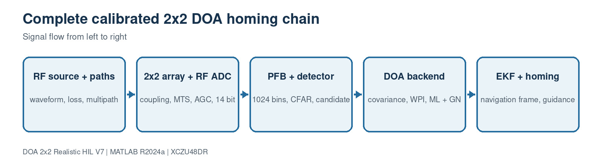

# Realistic 0.1-degree 2x2 DOA and ZU48DR engineering guide

This is the entry point for the V7 simulation, implementation partition and HIL verification. Every block below links to a dedicated page containing its JPEG block diagram, inputs/outputs, algorithm, statement-by-statement code explanation, numerical example and implementation checks.



## Clickable block index

| # | Block page | Principal source |
| ---: | --- | --- |
| 1 | [Overall system architecture](docs/blocks/01-overall-architecture.md) | `sim3d_params.m, run_3d_doa_sim.m` |
| 2 | [RF source and propagation](docs/blocks/02-source-propagation.md) | `SourceModel3D.m, source_modulation_profile.m` |
| 3 | [Realistic four-channel receiver](docs/blocks/03-realistic-receiver.md) | `RealisticReceiver4.m, realism_profile.m` |
| 4 | [RFDC, MTS and AXI interface](docs/blocks/04-rfdc-mts-interface.md) | `rfsoc_buildkit_overlay/README.md, rfsoc_buildkit_overlay/ip/custom/doa_covariance_4ch_v4/README.md` |
| 5 | [PFB search, CFAR and candidate selection](docs/blocks/05-search-detection.md) | `PFBFFTChannelizer4.m, SpectrumEstimator4.m` |
| 6 | [Calibration and streaming covariance](docs/blocks/06-calibration-covariance.md) | `rfsoc_buildkit_overlay/ip/custom/doa_covariance_4ch_v4/src/doa_covariance_4ch_v4.cpp, hil_fixed_covariance_reference.m` |
| 7 | [Weighted phase-interferometry seed](docs/blocks/07-weighted-phase.md) | `DOAEstimator4Ch.m, estimate_doa_from_covariance_v7.m` |
| 8 | [Local ML and Gauss-Newton refinement](docs/blocks/08-ml-gn-refinement.md) | `DOAEstimator4Ch.m, estimate_doa_from_covariance_v7.m` |
| 9 | [Full-attitude navigation-frame EKF](docs/blocks/09-attitude-ekf.md) | `body_to_navigation_dcm.m, DOAEstimator4Ch.m` |
| 10 | [Platform guidance and arrival](docs/blocks/10-platform-guidance.md) | `PlatformDynamics3D.m, TruthErrorMonitor3D.m` |
| 11 | [Hardware-in-the-loop verification](docs/blocks/11-hil-verification.md) | `generate_zcu48dr_hil_vectors.m, hil_fixed_covariance_reference.m` |
| 12 | [ZU48DR PL/PS implementation partition](docs/blocks/12-pl-ps-partition.md) | `ACCURACY_AND_HDL_GUIDE.md, rfsoc_buildkit_overlay/README.md` |

## Header index

- [Accuracy definition](#accuracy-definition)
- [Realism profiles](#realism-profiles)
- [Recommended commands](#recommended-commands)
- [Hardware acceptance gates](#hardware-acceptance-gates)
- [Documentation map](#documentation-map)

## Accuracy definition

The qualified claim remains a 3-D great-circle RMSE no larger than 0.1 degree over 1000 independent estimates at per-channel SNR of at least 15 dB, 4096 coherent snapshots, azimuth -45 to +45 degrees, elevation -35 to +35 degrees, one dominant selected source and a calibrated forward-facing 25 mm planar square array.

V7 adds a separate realistic campaign. It does not redefine FIELD_STRESS failures as passes. Multipath, unstable differential phase, poor MTS, or incorrect manifold calibration can make 0.1 degree physically impossible even when the estimator code is correct.

## Realism profiles

| Profile | Purpose | Expected use |
| --- | --- | --- |
| `IDEAL` | Mathematical sign and geometry checks | Unit tests only |
| `CALIBRATED_LOS` | Small position error, calibrated coupling, residual drift, phase noise, ADC and weak multipath | Qualified accuracy and homing |
| `FIELD_STRESS` | Stronger multipath, coupling residual and thermal drift | Robustness characterization; pass is not forced |

Select the profile in `sim3d_params.m`:

```matlab
P.Realism.Profile = 'CALIBRATED_LOS';
```

## Recommended commands

```matlab
verify_r2024a_setup
run_accuracy_campaign('acceptance')
run_realistic_accuracy_campaign('acceptance')
run_3d_doa_sim
START_HERE

% Separate hardware-in-the-loop flow
run_zcu48dr_hil('prepare')
run_zcu48dr_hil('compare','capture.csv')
```

## Hardware acceptance gates

1. RFDC MTS reports deterministic tile alignment at every boot.
2. Calibration tone residual differential phase and gain meet the stated budget.
3. Vitis HLS C simulation matches `hil_fixed_covariance_reference.m` exactly.
4. HLS synthesis meets the requested II=1 and 128 MHz target.
5. Vivado implementation meets timing in the complete ZCU208 RFDC shell.
6. Board capture matches all 16 covariance integers exactly.
7. Captured covariance produces no more than 0.1 degree error for the supplied HIL frame.
8. A real far-field campaign replaces ideal coordinates with a measured array manifold.

## Documentation map

- [Complete file, function and source-code guide](COMPLETE_FILE_AND_CODE_GUIDE.md)
- [Separate ZU48DR HIL guide](HIL_ZU48DR_GUIDE.md)
- [Accuracy and HDL assumptions](ACCURACY_AND_HDL_GUIDE.md)
- [Generated Simulink model](SIMULINK_MODEL_GUIDE.md)
- [Source waveform parameters](SOURCE_WAVEFORM_PARAMETER_GUIDE.md)
- [V7 change log](CHANGELOG_V7.md)
- [Validation report and evidence boundary](PROJECT_VALIDATION_REPORT.md)
