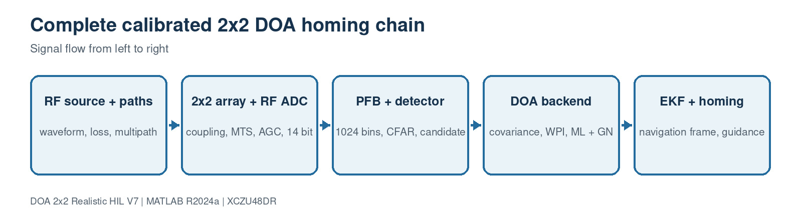

# 1. Overall system architecture

[Master guide](../../REALISTIC_DOA_ENGINEERING_GUIDE.md) | [Next block](02-source-propagation.md)

This page connects the signal-generation, receiver, search, estimation, tracking, navigation, and verification paths. The behavioral simulation and the RFSoC implementation use the same geometry, calibration convention, covariance orientation, and frame rate.

## On this page

- [Inputs and outputs](#inputs-and-outputs)
- [Algorithm](#algorithm)
- [Code walkthrough](#code-walkthrough)
- [Worked example](#worked-example)
- [Implementation checks](#implementation-checks)

## Source files

- `sim3d_params.m`
- `run_3d_doa_sim.m`
- `build_3d_doa_simulink.m`

## Inputs and outputs

| Direction | Name | Meaning |
| --- | --- | --- |
| Input | Mission configuration | Source, platform, array and accuracy limits |
| Input | Four RF channels | Coherent signals from the physical square array |
| Output | Body-frame DOA | Azimuth/elevation for guidance |
| Output | Verification records | RMSE, HIL and implementation evidence |

## Algorithm

1. Generate a direct and reflected RF field at the actual antenna locations.
2. Apply coupling, receiver skew, noise, AGC and ADC quantization.
3. Search the wideband spectrum and gate one candidate.
4. Accumulate calibrated covariance and estimate a refined direction.
5. Track the line of sight in the navigation frame and steer only on a valid candidate.

## Code walkthrough

The following follows the implementation statement by statement. Short fragments are used so every operation can be mapped back to the source file.

| Code statement | What that line does |
| --- | --- |
| `run('sim3d_params.m');` | Loads one authoritative parameter structure. |
| `idealIQ=source(position,yaw,pitch,roll);` | Creates the physical antenna voltages before receiver electronics. |
| `iq4=receiver(idealIQ);` | Applies the realistic RF and ADC model. |
| `snapshots=snapshotSelector(iq4);` | Selects 4096 spatial observations. |
| `doaEstimator(snapshots,yaw,pitch,roll)` | Runs calibration, WPI, ML, GN and navigation-frame EKF. |
| `platform(azimuth,elevation,valid,sourcePosition)` | Updates vehicle state only when detection is valid. |

## Worked example

At the default start, the source displacement is [500, 300, 150] m and the true range is 602.0797 m. A valid estimate commands yaw and pitch toward that line of sight; arrival is asserted at 10 m.

## Implementation checks

- Confirm dimensions and sign conventions against the preceding block.
- Run the associated MATLAB regression before generating HDL or deploying software.
- Treat resource, timing and accuracy as unverified until the generated reports or campaign outputs are saved.
- Preserve the calibrated array coordinates and covariance orientation across MATLAB, HLS and processor code.
