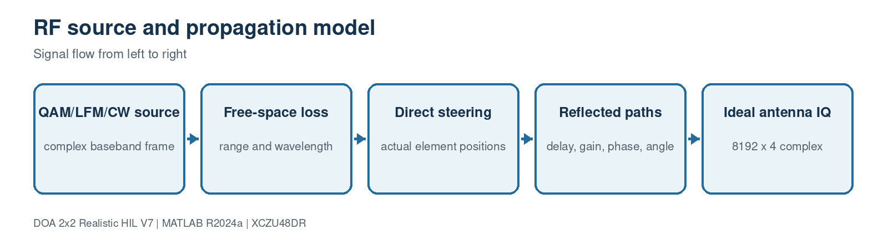

# 2. RF source and propagation

[Master guide](../../REALISTIC_DOA_ENGINEERING_GUIDE.md) | [Previous block](01-overall-architecture.md) | [Next block](03-realistic-receiver.md)

The source block creates complex baseband RF frames, applies range loss, rotates the world line of sight into the array body frame, and adds configurable reflected paths. Receiver noise and ADC effects are intentionally delegated to the next block.

## On this page

- [Inputs and outputs](#inputs-and-outputs)
- [Algorithm](#algorithm)
- [Code walkthrough](#code-walkthrough)
- [Worked example](#worked-example)
- [Implementation checks](#implementation-checks)

## Source files

- `SourceModel3D.m`
- `source_modulation_profile.m`
- `body_to_navigation_dcm.m`

## Inputs and outputs

| Direction | Name | Meaning |
| --- | --- | --- |
| Input | Platform pose | 1x3 position plus yaw, pitch and roll |
| Input | Waveform profile | QAM, PSK, LFM, NLFM, CW and other modes |
| Output | IdealAntennaIQ | 8192x4 complex antenna voltages |

## Algorithm

1. Normalize position vectors to prevent implicit expansion.
2. Compute the world unit line-of-sight vector.
3. Use the full ZYX DCM to obtain body-frame azimuth/elevation.
4. Generate and normalize the selected waveform.
5. Apply direct-path steering and delayed reflected-path steering.

## Code walkthrough

The following follows the implementation statement by statement. Short fragments are used so every operation can be mapped back to the source file.

| Code statement | What that line does |
| --- | --- |
| `delta=sourcePosition-platformPosition;` | Forms the physical displacement as a 1x3 vector. |
| `worldDirection=delta(:)/range;` | Separates range from direction. |
| `bodyDirection=body_to_navigation_dcm(...).'*worldDirection;` | Includes combined yaw, pitch and roll. |
| `signal=obj.generateSignal(N)*sqrt(receivedPower_W);` | Scales the normalized waveform by propagation power. |
| `tau=obj.AntennaPositions(channel,:)*pathDirection/obj.c;` | Computes geometric delay for each actual antenna location. |
| `X4(:,channel)=X4(:,channel)+pathScale*delayed*exp(...);` | Adds a coherent reflected path with its own delay and direction. |

## Worked example

At 4 GHz the wavelength is 74.948 mm. A 25 mm baseline produces about 120.1 degrees of phase for direction cosine 1, while the 35.355 mm diagonal remains below half a wavelength.

## Implementation checks

- Confirm dimensions and sign conventions against the preceding block.
- Run the associated MATLAB regression before generating HDL or deploying software.
- Treat resource, timing and accuracy as unverified until the generated reports or campaign outputs are saved.
- Preserve the calibrated array coordinates and covariance orientation across MATLAB, HLS and processor code.
