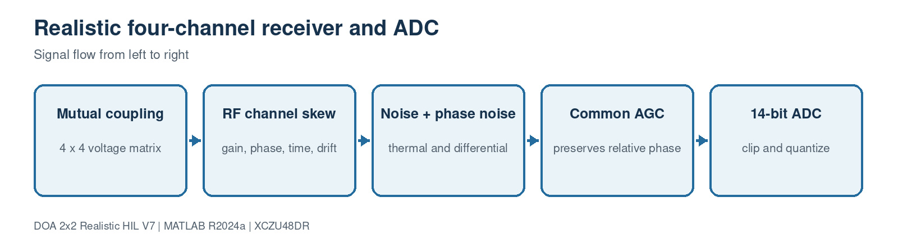

# 3. Realistic four-channel receiver

[Master guide](../../REALISTIC_DOA_ENGINEERING_GUIDE.md) | [Previous block](02-source-propagation.md) | [Next block](04-rfdc-mts-interface.md)

This block models effects that an ideal steering-vector simulation omits: mutual coupling, gain/phase mismatch, RF time skew, temperature-like drift, common and differential phase noise, thermal noise, AGC, DC offset, clipping and finite ADC resolution.

## On this page

- [Inputs and outputs](#inputs-and-outputs)
- [Algorithm](#algorithm)
- [Code walkthrough](#code-walkthrough)
- [Worked example](#worked-example)
- [Implementation checks](#implementation-checks)

## Source files

- `RealisticReceiver4.m`
- `realism_profile.m`
- `simulate_realistic_snapshots.m`
- `estimate_multifrequency_calibration.m`
- `verify_multifrequency_calibration.m`

## Inputs and outputs

| Direction | Name | Meaning |
| --- | --- | --- |
| Input | IdealAntennaIQ | Four coherent complex antenna voltages |
| Input | Realism profile | IDEAL, CALIBRATED_LOS or FIELD_STRESS |
| Output | ADC_IQ | Clipped and quantized four-channel samples |

## Algorithm

1. Mix channels through an actual 4x4 coupling matrix.
2. Apply per-channel complex transfer including time-skew phase.
3. Add input-referred thermal noise and stochastic phase noise.
4. Use one common AGC factor so inter-channel ratios are preserved.
5. Clip and round real and imaginary components to the ADC word length.

## Code walkthrough

The following follows the implementation statement by statement. Short fragments are used so every operation can be mapped back to the source file.

| Code statement | What that line does |
| --- | --- |
| `output=input*obj.CouplingMatrix.';` | Applies voltage-domain coupling before receiver channels. |
| `timeSkewPhase_deg=-360*fc*timeSkew;` | Converts picosecond skew into RF phase. |
| `output=output.*transfer;` | Applies channel gain, phase and drift. |
| `noisePower=k*T*Fs*10^(NF/10);` | Uses the complex sampling bandwidth for thermal noise. |
| `output=output*min(requestedGain,maximumGain);` | Applies common, bounded AGC. |
| `round(realPart*scale)/scale` | Models deterministic ADC quantization after clipping. |
| `polyfit(frequencyOffset,unwrappedPhase,1)` | Estimates picosecond relative time skew from calibration-tone phase slope. |

## Worked example

A residual 0.02 degree channel-phase error on a 25 mm baseline maps to roughly 0.01 degree of direction error near boresight. FIELD_STRESS intentionally uses larger drift and multipath and is not forced to pass 0.1 degree.

For hardware, capture a known boresight tone at five or more frequencies and
call `estimate_multifrequency_calibration`. The returned `PackedQ2_14` values
program the PL calibration registers; the fitted residual is a direct quality
check rather than an assumed perfect coefficient.

## Implementation checks

- Confirm dimensions and sign conventions against the preceding block.
- Run the associated MATLAB regression before generating HDL or deploying software.
- Treat resource, timing and accuracy as unverified until the generated reports or campaign outputs are saved.
- Preserve the calibrated array coordinates and covariance orientation across MATLAB, HLS and processor code.
