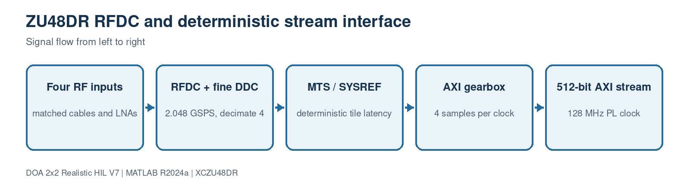

# 4. RFDC, MTS and AXI interface

[Master guide](../../REALISTIC_DOA_ENGINEERING_GUIDE.md) | [Previous block](03-realistic-receiver.md) | [Next block](05-search-detection.md)

The hardware interface starts from a verified ZCU208 RFDC shell. Multi-tile synchronization establishes deterministic latency, a fine DDC converts the selected RF band to complex IQ, and the RFDC gearbox supplies four samples per PL clock.

## On this page

- [Inputs and outputs](#inputs-and-outputs)
- [Algorithm](#algorithm)
- [Code walkthrough](#code-walkthrough)
- [Worked example](#worked-example)
- [Implementation checks](#implementation-checks)

## Source files

- `rfsoc_buildkit_overlay/README.md`
- `rfsoc_buildkit_overlay/ip/custom/doa_covariance_4ch_v4/README.md`

## Inputs and outputs

| Direction | Name | Meaning |
| --- | --- | --- |
| Input | Four RF ADC channels | Matched analog paths |
| Input | SYSREF and sample clocks | Common deterministic timing reference |
| Output | AXI512 stream | 4 lanes x 4 channels x complex int16 |

## Algorithm

1. Run RFDC tile startup and MTS at every boot.
2. Configure identical mixer, NCO, decimation and Nyquist settings.
3. Verify tile latency and channel phase with a calibration tone.
4. Pack four complex samples for every channel into each 512-bit beat.
5. Cross clock domains only through explicit AXI FIFOs.
6. Trigger a bounded 4096-sample DOA capture without stalling the continuous
   RFDC/PFB search stream.

## Code walkthrough

The following follows the implementation statement by statement. Short fragments are used so every operation can be mapped back to the source file.

| Code statement | What that line does |
| --- | --- |
| `word = lane*4 + channel` | Defines the stable AXI packing order. |
| `real -> bits 15:0` | Stores signed ADC I data. |
| `imag -> bits 31:16` | Stores signed ADC Q data. |
| `4 samples/clock` | Converts a 512 MSPS post-DDC stream to 128 MHz. |
| `frameSamples=4096` | Defines one covariance observation interval. |
| `MTS before calibration` | Prevents boot-dependent phase offsets from invalidating coefficients. |
| `candidate -> capture gate` | Sends only a requested snapshot burst to the frame covariance core. |

## Worked example

With 2.048 GSPS and RFDC decimation by four, each complex channel is 512 MSPS. Four samples per clock require a 128 MHz PL clock, rather than an impossible 2.048 GHz scalar clock.

## Implementation checks

- Confirm dimensions and sign conventions against the preceding block.
- Run the associated MATLAB regression before generating HDL or deploying software.
- Treat resource, timing and accuracy as unverified until the generated reports or campaign outputs are saved.
- Preserve the calibrated array coordinates and covariance orientation across MATLAB, HLS and processor code.
