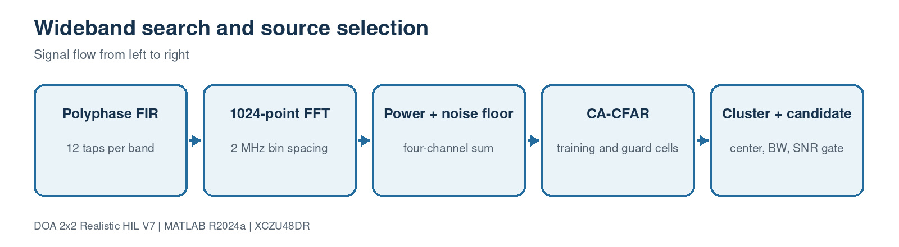

# 5. PFB search, CFAR and candidate selection

[Master guide](../../REALISTIC_DOA_ENGINEERING_GUIDE.md) | [Previous block](04-rfdc-mts-interface.md) | [Next block](06-calibration-covariance.md)

The search branch discovers occupied spectrum, estimates a robust noise floor, applies CA-CFAR, joins adjacent bins, and selects a source matching bandwidth and SNR rules. Detection validity gates navigation but does not manufacture a DOA.

## On this page

- [Inputs and outputs](#inputs-and-outputs)
- [Algorithm](#algorithm)
- [Code walkthrough](#code-walkthrough)
- [Worked example](#worked-example)
- [Implementation checks](#implementation-checks)

## Source files

- `PFBFFTChannelizer4.m`
- `SpectrumEstimator4.m`
- `NoiseFloorEstimator1D.m`
- `CACFAR1D.m`
- `BinClusterEstimator.m`
- `CandidateSelector.m`

## Inputs and outputs

| Direction | Name | Meaning |
| --- | --- | --- |
| Input | ADC_IQ | Four coherent wideband sample streams |
| Output | CandidateValid | Logical navigation gate |
| Output | Center/Bandwidth | Selected source spectral properties |

## Algorithm

1. Channelize every coherent input with identical coefficients.
2. Sum four-channel bin powers and smooth in time.
3. Estimate local/global noise using a sliding median.
4. Apply training/guard-cell CA-CFAR thresholds.
5. Cluster detections and select a bandwidth/SNR-qualified candidate.

## Code walkthrough

The following follows the implementation statement by statement. Short fragments are used so every operation can be mapped back to the source file.

| Code statement | What that line does |
| --- | --- |
| `NumBands=1024` | Produces 2 MHz bins at 2.048 GSPS. |
| `powerSum=sum(abs(subbands).^2,channel);` | Combines evidence without destroying the DOA snapshots. |
| `noise=median(localWindow);` | Rejects occupied-bin outliers. |
| `alpha=Ntrain*(Pfa^(-1/Ntrain)-1);` | Forms the CA-CFAR scale factor. |
| `MergeGapBins=1` | Joins nearly contiguous detections. |
| `valid = bandwidth && snr` | Prevents unrelated emitters from steering the platform. |

## Worked example

A 30 MHz source occupies about 15 bins at 2 MHz spacing. The cluster center is power weighted, while the candidate rule checks the configured 0.5–40 MHz interval and minimum SNR.

## Implementation checks

- Confirm dimensions and sign conventions against the preceding block.
- Run the associated MATLAB regression before generating HDL or deploying software.
- Treat resource, timing and accuracy as unverified until the generated reports or campaign outputs are saved.
- Preserve the calibrated array coordinates and covariance orientation across MATLAB, HLS and processor code.
