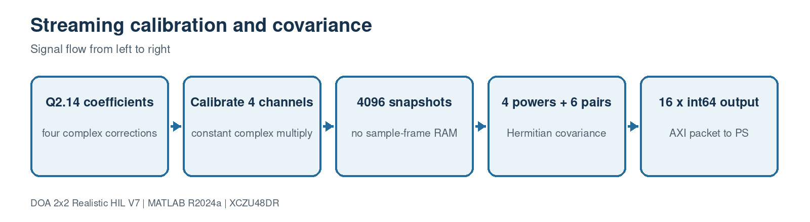

# 6. Calibration and streaming covariance

[Master guide](../../REALISTIC_DOA_ENGINEERING_GUIDE.md) | [Previous block](05-search-detection.md) | [Next block](07-weighted-phase.md)

This is the main PL DOA backend. It calibrates four complex int16 samples per channel per beat and accumulates the unique entries of a 4x4 Hermitian covariance without storing all 4096 samples.

## On this page

- [Inputs and outputs](#inputs-and-outputs)
- [Algorithm](#algorithm)
- [Code walkthrough](#code-walkthrough)
- [Worked example](#worked-example)
- [Implementation checks](#implementation-checks)

## Source files

- `rfsoc_buildkit_overlay/ip/custom/doa_covariance_4ch_v4/src/doa_covariance_4ch_v4.cpp`
- `hil_fixed_covariance_reference.m`

## Inputs and outputs

| Direction | Name | Meaning |
| --- | --- | --- |
| Input | AXI512 IQ | Four time lanes for four channels |
| Input | cal0..cal3 | Complex Q2.14 corrections |
| Output | AXI64 packet | 4 powers, 6 real crosses, 6 imaginary crosses |

## Algorithm

1. Unpack sixteen complex words from each AXI beat.
2. Apply constant complex calibration with a 14-bit fractional shift.
3. Accumulate four powers and six cross products with 64-bit headroom.
4. Repeat for 1024 beats, equal to 4096 time samples.
5. Emit exactly 16 signed 64-bit values with TLAST on the last word.

## Code walkthrough

The following follows the implementation statement by statement. Short fragments are used so every operation can be mapped back to the source file.

| Code statement | What that line does |
| --- | --- |
| `packed=input.data.range(32*word+31,32*word);` | Extracts one complex int16 sample. |
| `yr=(realProduct>>14);` | Returns the calibrated result to the intended fixed-point scale. |
| `power += real*real + imag*imag;` | Accumulates diagonal covariance. |
| `crossImag += ys*xf - xs*yf;` | Matches R(second,first)=x_second*conj(x_first). |
| `#pragma HLS PIPELINE II=1` | Requests one four-lane beat every clock. |
| `output.last=(index==15);` | Closes one covariance packet deterministically. |

## Worked example

4096 samples add 12 accumulator bits. A calibrated 20-bit component produces a 40-bit product, so signed 64-bit accumulators provide comfortable headroom.

## Implementation checks

- Confirm dimensions and sign conventions against the preceding block.
- Run the associated MATLAB regression before generating HDL or deploying software.
- Treat resource, timing and accuracy as unverified until the generated reports or campaign outputs are saved.
- Preserve the calibrated array coordinates and covariance orientation across MATLAB, HLS and processor code.
