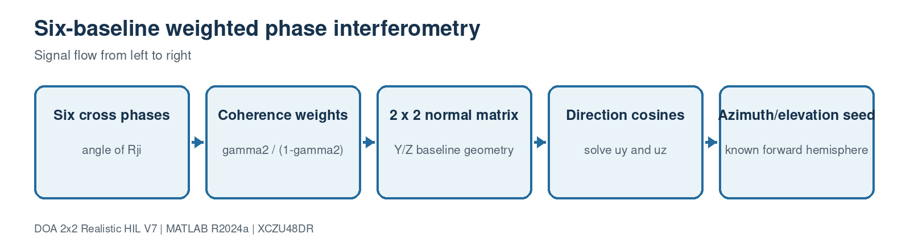

# 7. Weighted phase-interferometry seed

[Master guide](../../REALISTIC_DOA_ENGINEERING_GUIDE.md) | [Previous block](06-calibration-covariance.md) | [Next block](08-ml-gn-refinement.md)

All six pair phases are used in a weighted two-parameter least-squares solve. The planar nose array observes Y and Z direction cosines; the known forward hemisphere supplies the positive X component.

## On this page

- [Inputs and outputs](#inputs-and-outputs)
- [Algorithm](#algorithm)
- [Code walkthrough](#code-walkthrough)
- [Worked example](#worked-example)
- [Implementation checks](#implementation-checks)

## Source files

- `DOAEstimator4Ch.m`
- `estimate_doa_from_covariance_v7.m`

## Inputs and outputs

| Direction | Name | Meaning |
| --- | --- | --- |
| Input | Hermitian covariance | Calibrated 4x4 complex matrix |
| Input | Calibrated positions | Measured element coordinates |
| Output | Continuous seed | Off-grid azimuth and elevation |

## Algorithm

1. Read phase and coherence for every unique antenna pair.
2. Build a six-row Y/Z baseline matrix.
3. Convert coherence into bounded inverse-variance-like weights.
4. Solve the weighted 2x2 normal equation.
5. Enforce the unit sphere and positive boresight component.

## Code walkthrough

The following follows the implementation statement by statement. Short fragments are used so every operation can be mapped back to the source file.

| Code statement | What that line does |
| --- | --- |
| `crossValue=covariance(second,first);` | Uses the same sign convention as the source and HLS core. |
| `phase(pair)=angle(crossValue);` | Extracts geometric phase. |
| `weight=coherence/(1-coherence);` | Downweights unreliable cross products. |
| `normal=baseline'*(weight.*baseline);` | Forms the weighted geometry matrix. |
| `directionYZ=-(normal\rightSide)/waveNumber;` | Solves for uy and uz. |
| `ux=sqrt(1-uy^2-uz^2);` | Applies the known forward-hemisphere constraint. |

## Worked example

For azimuth 30 degrees and elevation 15 degrees, [ux,uy,uz] is approximately [0.837, 0.483, 0.259]. The square array directly measures uy and uz and reconstructs positive ux.

## Implementation checks

- Confirm dimensions and sign conventions against the preceding block.
- Run the associated MATLAB regression before generating HDL or deploying software.
- Treat resource, timing and accuracy as unverified until the generated reports or campaign outputs are saved.
- Preserve the calibrated array coordinates and covariance orientation across MATLAB, HLS and processor code.
