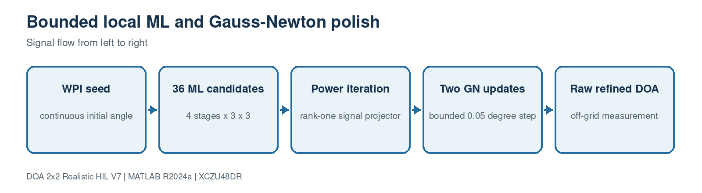

# 8. Local ML and Gauss-Newton refinement

[Master guide](../../REALISTIC_DOA_ENGINEERING_GUIDE.md) | [Previous block](07-weighted-phase.md) | [Next block](09-attitude-ekf.md)

The refinement is bounded and hardware predictable. A fixed 36-point rank-one likelihood search secures the local basin, then a fixed power iteration and two limited Gauss-Newton steps remove the remaining grid residue without a general eigendecomposition.

## On this page

- [Inputs and outputs](#inputs-and-outputs)
- [Algorithm](#algorithm)
- [Code walkthrough](#code-walkthrough)
- [Worked example](#worked-example)
- [Implementation checks](#implementation-checks)

## Source files

- `DOAEstimator4Ch.m`
- `estimate_doa_from_covariance_v7.m`

## Inputs and outputs

| Direction | Name | Meaning |
| --- | --- | --- |
| Input | WPI seed | Initial azimuth/elevation |
| Input | Covariance | Calibrated spatial statistics |
| Output | Raw refined DOA | Continuous measurement before tracking |

## Algorithm

1. Evaluate a 3x3 neighborhood at four decreasing step sizes.
2. Keep the highest Bartlett/rank-one ML score after each stage.
3. Approximate the dominant signal vector with four power iterations.
4. Build I-vvH as a rank-one noise projector.
5. Run exactly two Gauss-Newton updates, each limited to 0.05 degree.

## Code walkthrough

The following follows the implementation statement by statement. Short fragments are used so every operation can be mapped back to the source file.

| Code statement | What that line does |
| --- | --- |
| `MLStepSchedule=[.5 .1 .02 .005]` | Provides coarse capture and fine resolution. |
| `score=real(a'*R*a)/4;` | Scores a single-source steering candidate. |
| `signalVector=R*signalVector;` | One deterministic power-iteration step. |
| `noiseProjector=eye(4)-v*v';` | Avoids a full 4x4 eigensolver. |
| `gradient=2*real(D'*(Pn*a));` | Computes the local MUSIC derivative. |
| `step=min(step,0.05 deg)` | Prevents noisy covariance from causing a large jump. |

## Worked example

The fixed ML stages evaluate 36 candidates per frame. Two GN iterations add fixed work and can refine between the final 0.005 degree candidate positions.

## Implementation checks

- Confirm dimensions and sign conventions against the preceding block.
- Run the associated MATLAB regression before generating HDL or deploying software.
- Treat resource, timing and accuracy as unverified until the generated reports or campaign outputs are saved.
- Preserve the calibrated array coordinates and covariance orientation across MATLAB, HLS and processor code.
