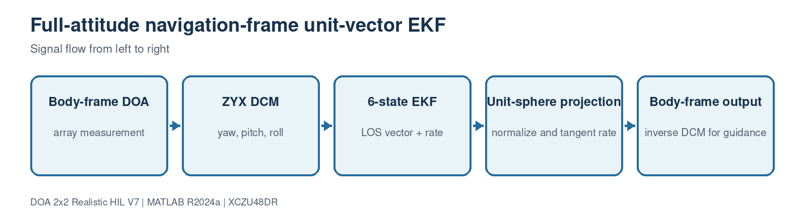

# 9. Full-attitude navigation-frame EKF

[Master guide](../../REALISTIC_DOA_ENGINEERING_GUIDE.md) | [Previous block](08-ml-gn-refinement.md) | [Next block](10-platform-guidance.md)

The array measures direction in the rotating body frame. V7 converts that unit vector with a full yaw-pitch-roll DCM, tracks the world line of sight, projects the state back onto the unit sphere, and converts it back for guidance.

## On this page

- [Inputs and outputs](#inputs-and-outputs)
- [Algorithm](#algorithm)
- [Code walkthrough](#code-walkthrough)
- [Worked example](#worked-example)
- [Implementation checks](#implementation-checks)

## Source files

- `body_to_navigation_dcm.m`
- `DOAEstimator4Ch.m`
- `verify_full_attitude_geometry.m`
- `verify_rotating_frame_ekf.m`

## Inputs and outputs

| Direction | Name | Meaning |
| --- | --- | --- |
| Input | Raw body DOA | Refined measurement |
| Input | Platform attitude | Yaw, pitch and roll |
| Output | Tracked body DOA | Smoothed bearing for control |

## Algorithm

1. Convert azimuth/elevation to a body unit vector.
2. Rotate it into navigation coordinates with the ZYX DCM.
3. Predict a six-state unit-vector/rate model.
4. Update with a 3-D vector measurement using a Joseph covariance form.
5. Normalize LOS and remove radial rate, then rotate back to body coordinates.

## Code walkthrough

The following follows the implementation statement by statement. Short fragments are used so every operation can be mapped back to the source file.

| Code statement | What that line does |
| --- | --- |
| `rotation=body_to_navigation_dcm(yaw,pitch,roll);` | Constructs one orthonormal attitude transform. |
| `measurement=rotation*bodyMeasurement;` | Prevents platform motion from appearing as target motion. |
| `transition=[I dt*I;0 I];` | Uses a constant LOS-rate process model. |
| `gain=P*H'/S;` | Computes the small fixed-size Kalman gain. |
| `updated(1:3)=normalize(updated(1:3));` | Enforces the physical unit sphere. |
| `bodyEstimate=rotation.'*navigationEstimate;` | Returns the tracked direction to the array frame. |

## Worked example

A fixed world source observed while yaw changes 38 degrees, pitch changes 16 degrees and roll oscillates 12 degrees should remain stationary inside the navigation-frame EKF.

## Implementation checks

- Confirm dimensions and sign conventions against the preceding block.
- Run the associated MATLAB regression before generating HDL or deploying software.
- Treat resource, timing and accuracy as unverified until the generated reports or campaign outputs are saved.
- Preserve the calibrated array coordinates and covariance orientation across MATLAB, HLS and processor code.
