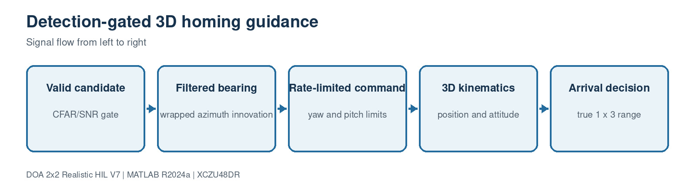

# 10. Platform guidance and arrival

[Master guide](../../REALISTIC_DOA_ENGINEERING_GUIDE.md) | [Previous block](09-attitude-ekf.md) | [Next block](11-hil-verification.md)

The controller uses detection-gated pure pursuit with wrapped azimuth filtering, bounded turn/climb rates and explicit 3-D kinematics. Truth monitoring uses the same full attitude convention but never feeds the estimator.

## On this page

- [Inputs and outputs](#inputs-and-outputs)
- [Algorithm](#algorithm)
- [Code walkthrough](#code-walkthrough)
- [Worked example](#worked-example)
- [Implementation checks](#implementation-checks)

## Source files

- `PlatformDynamics3D.m`
- `TruthErrorMonitor3D.m`
- `plot_homing_results.m`

## Inputs and outputs

| Direction | Name | Meaning |
| --- | --- | --- |
| Input | Tracked body DOA | Azimuth/elevation |
| Input | DetectionValid | Candidate gate |
| Input | Source position | Used only for simulation arrival/truth |
| Output | Platform state | Position, yaw, pitch, roll |
| Output | Range/Arrived | Termination signals |

## Algorithm

1. Normalize source and platform positions to 1x3.
2. Stop immediately when true range is inside the arrival radius.
3. Update bearing filters only for valid detections.
4. Limit yaw and pitch rates before integrating attitude.
5. Integrate the forward velocity vector and repeat the arrival test.

## Code walkthrough

The following follows the implementation statement by statement. Short fragments are used so every operation can be mapped back to the source file.

| Code statement | What that line does |
| --- | --- |
| `sourcePosition=reshape(sourcePosition,1,3);` | Prevents the previous 3x1/1x3 Simulink expansion bug. |
| `arrived=range<=ArrivalRadius;` | Defines an unambiguous stop condition. |
| `azInnovation=wrap180(measuredAz-filteredAz);` | Avoids discontinuity at +/-180 degrees. |
| `yawRate=max(-limit,min(limit,command/Dt));` | Enforces platform dynamics. |
| `velocity=[V*cos(p)*cos(y), ...];` | Constructs the 3-D forward velocity. |
| `Position=Position+velocity*Dt;` | Advances one discrete simulation step. |

## Worked example

At 25 m/s and 0.1 s update time the vehicle advances 2.5 m per step. From the default 602 m range, a nearly direct intercept takes about 24 seconds.

## Implementation checks

- Confirm dimensions and sign conventions against the preceding block.
- Run the associated MATLAB regression before generating HDL or deploying software.
- Treat resource, timing and accuracy as unverified until the generated reports or campaign outputs are saved.
- Preserve the calibrated array coordinates and covariance orientation across MATLAB, HLS and processor code.
