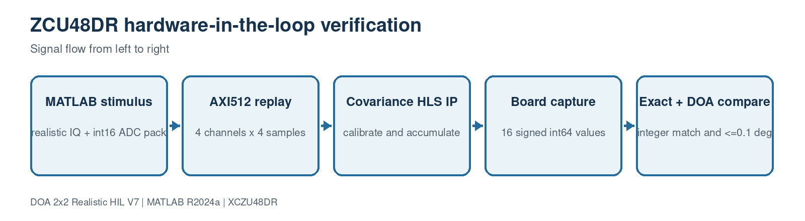

# 11. Hardware-in-the-loop verification

[Master guide](../../REALISTIC_DOA_ENGINEERING_GUIDE.md) | [Previous block](10-platform-guidance.md) | [Next block](12-pl-ps-partition.md)

The HIL flow is deliberately separate from the behavioral simulation. MATLAB produces packed AXI input and a bit-accurate golden covariance; the board processes the same frame; MATLAB then requires an exact 16-word match before evaluating the captured DOA.

## On this page

- [Inputs and outputs](#inputs-and-outputs)
- [Algorithm](#algorithm)
- [Code walkthrough](#code-walkthrough)
- [Worked example](#worked-example)
- [Implementation checks](#implementation-checks)

## Source files

- `generate_zcu48dr_hil_vectors.m`
- `hil_fixed_covariance_reference.m`
- `run_zcu48dr_hil.m`
- `HIL_ZU48DR_GUIDE.md`

## Inputs and outputs

| Direction | Name | Meaning |
| --- | --- | --- |
| Input | AXI512 stimulus | 1024 beats for 4096 samples |
| Input | Board capture CSV | 16 signed int64 outputs |
| Output | HIL report | Exact integer match, relative error and angular error |

## Algorithm

1. Generate a deterministic calibrated-LOS snapshot frame.
2. Quantize ADC samples and Q2.14 calibration coefficients.
3. Pack four samples per channel into each 512-bit AXI beat.
4. Replay through the ZU48DR covariance IP and capture 16 output words.
5. Compare exact integers, reconstruct covariance and calculate final DOA.

## Code walkthrough

The following follows the implementation statement by statement. Short fragments are used so every operation can be mapped back to the source file.

| Code statement | What that line does |
| --- | --- |
| `run_zcu48dr_hil('prepare')` | Creates stimulus, manifest and golden files. |
| `word=lane*4+channel` | Matches the HLS unpacking convention. |
| `golden=hil_fixed_covariance_reference(...)` | Models every calibration shift and accumulation. |
| `run_zcu48dr_hil('compare','capture.csv')` | Loads actual board output. |
| `exact=all(captured==golden);` | Makes arithmetic mismatches impossible to hide. |
| `Pass=exact && angularError<=0.1` | Checks both digital equivalence and system meaning. |

## Worked example

Loopback mode verifies only the host parser. A real HIL pass requires a capture produced after programming the ZCU208 and replaying the supplied 1024 AXI beats.

## Implementation checks

- Confirm dimensions and sign conventions against the preceding block.
- Run the associated MATLAB regression before generating HDL or deploying software.
- Treat resource, timing and accuracy as unverified until the generated reports or campaign outputs are saved.
- Preserve the calibrated array coordinates and covariance orientation across MATLAB, HLS and processor code.
