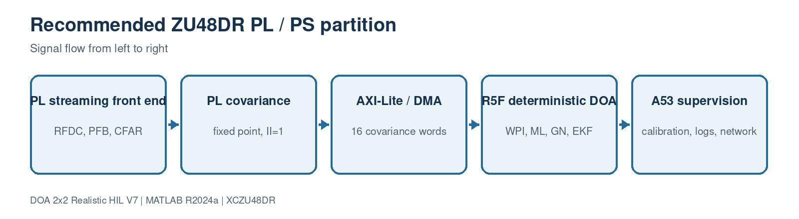

# 12. ZU48DR PL/PS implementation partition

[Master guide](../../REALISTIC_DOA_ENGINEERING_GUIDE.md) | [Previous block](11-hil-verification.md)

Continuous high-rate operations remain in programmable logic, while one small covariance packet per estimate moves to the real-time processor. This avoids a large general eigensolver in PL and makes timing and resource use auditable.

## On this page

- [Inputs and outputs](#inputs-and-outputs)
- [Algorithm](#algorithm)
- [Code walkthrough](#code-walkthrough)
- [Worked example](#worked-example)
- [Implementation checks](#implementation-checks)

## Source files

- `ACCURACY_AND_HDL_GUIDE.md`
- `rfsoc_buildkit_overlay/README.md`
- `rfsoc_buildkit_overlay/ip/custom/doa_covariance_4ch_v4`

## Inputs and outputs

| Direction | Name | Meaning |
| --- | --- | --- |
| Input | PL RF stream | Four coherent channels |
| Input | Calibration registers | Coefficients and measured manifold |
| Output | R5F DOA update | 10 Hz bearing and confidence |
| Output | A53 telemetry | Logs, calibration and control |

## Algorithm

1. Use RFDC hard blocks and PL for rate conversion and spectral search.
2. Gate a selected 4096-sample burst into the II=1 fixed-point covariance core
   while the continuous search path remains independent.
3. Transfer only 16 int64 values per DOA frame.
4. Run WPI, fixed ML, bounded GN and EKF on R5F initially.
5. Use A53 for supervision, storage and network functions, not hard real-time loops.

## Code walkthrough

The following follows the implementation statement by statement. Short fragments are used so every operation can be mapped back to the source file.

| Code statement | What that line does |
| --- | --- |
| `PL: 512-bit AXI at 128 MHz` | Carries the complete decimated four-channel stream. |
| `PL: covariance packet` | Reduces 4096 samples to 128 bytes. |
| `R5F: fixed loop counts` | Provides deterministic compute time. |
| `A53: calibration manager` | Updates coefficients after MTS and temperature events. |
| `Vivado timing report` | Is required before accepting the PL design. |
| `HIL exact comparison` | Is required before accepting numerical equivalence. |

## Worked example

At ten DOA updates per second, covariance traffic to the processor is only about 1.28 kB/s. The high-rate burden remains in PL where parallel fixed-point arithmetic is appropriate.

## Implementation checks

- Confirm dimensions and sign conventions against the preceding block.
- Run the associated MATLAB regression before generating HDL or deploying software.
- Treat resource, timing and accuracy as unverified until the generated reports or campaign outputs are saved.
- Preserve the calibrated array coordinates and covariance orientation across MATLAB, HLS and processor code.
